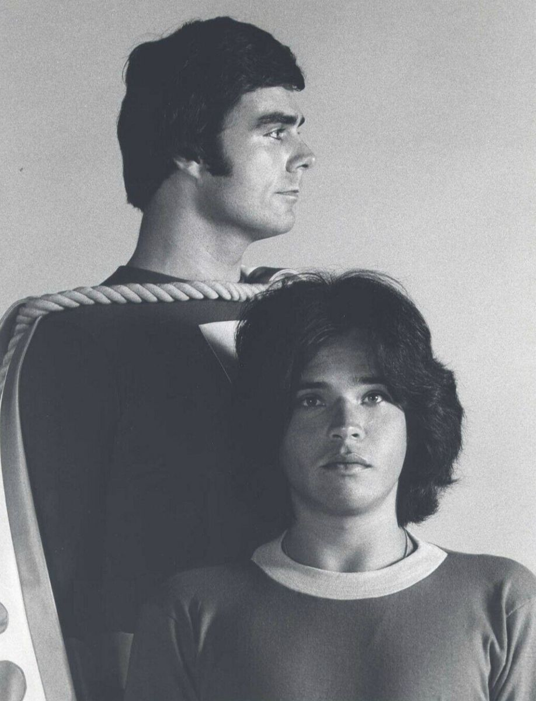
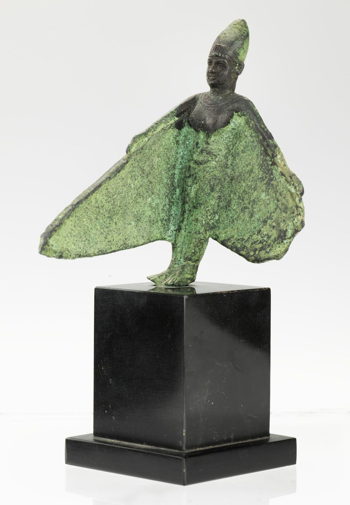

{UPDATE: This is a repost from another blog. As those who know me can attest, I’m a bit of a sci-fi geek and love to reminisce about days of old. So enjoy this somewhat quirky post on this Saturday morning.}

“…lift me now so I can fly.” Do you remember which 70s super-powered hero uttered this phrase to take flight? No? Then see if this one refreshes your memory, “Oh mighty Isis!” That’s right, a couple of months before Lynda Carter’s Wonder Woman hit the airwaves, there was another female superhero protecting teens and southern California from evil and personal injury.

Her name was <a href="http://en.wikipedia.org/wiki/The_Secrets_of_Isis" target="_blank">Isis</a>, and I take some time here to reminisce about those early Saturday morning shows.

In 2007, [The Secrets of Isis: The Complete Series](http://www.amazon.com/gp/product/B000QQDEZG?ie=UTF8&amp;tag=stevenccom-20&amp;linkCode=as2&amp;camp=1789&amp;creative=390957&amp;creativeASIN=B000QQDEZG) was released on DVD. Somehow I missed the release, although I am not sure I would have shelled out cash for the collection. About a year ago, I became aware that the series was available on DVD and placed them into my Netflix queue. As a matter of fact, I put them at the bottom of my queue thinking I would relive some childhood memories at some point down the road. It wasn’t a priority above other items in my queue. Then something happened. A couple of days ago I was reviewing my queue and noticed that the series was now available as an instant streaming option. I couldn’t wait. I turned on the Sony Bravia (Netflix streaming built in – way cool) and loaded up the first episode. “Oh my.”

That “Oh my” is both good and bad. The good is that the series is just as I remember it as a child. JoAnna Cameron, in a dual role as Isis and Andrea Thomas (science teacher at a southern California high school), does a great job channeling the mythical superhero. The bad is that she has to deal with 70s special effects technology, simple scripts, and horrible acting by her co-stars.

*Before the amulet: JoAnna Cameron, circa 1972, a few years before she said “Oh mighty Isis!” Publicity photo; creator unidentified. Public domain in the United States, via [Wikimedia Commons](https://commons.wikimedia.org/wiki/File:JoAnna_Cameron_1972.jpg).*

The horrible acting does have a plus side – lots of humor for today’s viewers. Take, for example, a situation where a teen walks past a sign that says, “Danger, hidden mine shaft.” Bet you can’t guess what happens next! And when it does, the facial reaction of the actress falling down the shaft is priceless. Check out the episode entitled *Year of the Dragon* for this laugh. Before you ask, there’s no Kung-Fu in this episode. That would be far too violent for Saturday morning television in the 70s.

Although Isis is a mixed bag, there is some real nostalgia here and I found myself enjoying my trip back to the 70s. There are episodes including crossovers from Captain Marvel (you know, the boy who turns into a superhero by uttering the word “Shazam!”), and the show really does get better with each episode, if only slightly. The last two episodes of season 2 and the series, *Now You See It...* and *...Now You Don’t*, really are the pinnacle of the show and demonstrate what this show could have become with a couple more seasons and a bigger budget. It was not to be. For some unknown reason, Isis only received two seasons and three guest shots on its sister show *Shazam!*.

*Billy Batson (Michael Gray) and Captain Marvel (Jackson Bostwick), Isis’s Saturday morning neighbors on CBS. CBS Television publicity photo, dated 1975 by [Wikimedia Commons](https://commons.wikimedia.org/wiki/File:Jackson_Bostwick_Michael_Gray_%22Shazam!%22_1975_CBS_press_photo.JPG); public domain in the United States.*

Isis does have a legacy, though. Fans all over the web reminisce about the show, the actress and its weekly moral story (as was evident during my research for this post). In 1978, Isis appeared in animated form in *The Freedom Force*, a segment of *Tarzan and the Super 7*. She eventually made her way to the DC Comics universe alongside her television co-hero Captain Marvel, now called Shazam. She later appeared in a somewhat modified version of herself in a season 10 episode of Smallville. Too bad JoAnna Cameron was not asked back for a cameo.

*A different Isis: the bronze sculpture “Winged Isis--Egyptian.” Smithsonian American Art Museum, gift of John Gellatly (1929.8.154). Image: Smithsonian American Art Museum, CC0, via [Wikimedia Commons](https://commons.wikimedia.org/wiki/File:Winged_Isis--Egyptian-saam-1929.8.154_1.jpg).*

So what are you waiting for? Grab that remote to your Netflix-enabled device and get to adding The Secrets of Isis to your instant queue. After watching a few episodes, stop back by and let me know what you thought. Did it bring back memories, a smile or a laugh?

Here’s one more Isis incantation that saved the day:

> Keeper of the winds swirling o'er, smoke those robbers out the door.

Oh my...

---

**Update (Nov 2026):** I added a few photos, corrected the debut timing, the teacher description and the cartoon credit, and dug up some extra Isis trivia I left out back in 2012:

- Isis debuted on September 6, 1975, before Lynda Carter’s Wonder Woman and The Bionic Woman. She was the first live-action superheroine to lead a Saturday morning TV series.
- That flying couplet wasn’t a one-off. Isis often called on her powers with a rhyming incantation.
- According to [Comic Watch](https://comic-watch.com/television-shows/forgotten-television-the-secrets-of-isis), Andrea found the magic “Tutmose amulet” on an archaeological dig in Egypt. On the show, it had belonged to Queen Hatshepsut. Andrea also kept a pet bird named Tut.
- Those end-of-episode lessons, with Isis talking straight to the camera, were removed from later versions of the show. The DVD set includes the surviving ones as extras.
- Only 22 episodes were made.
- That two-part finale, *Now You See It...* and *...Now You Don’t*, swapped the usual rescue-a-student story for espionage and a stolen government weather machine. It also introduced a trio of crime-fighting teens called the Super-Sleuths. According to [Saturday Mornings Forever](https://www.saturdaymorningsforever.com/2016/06/the-secrets-of-isis.html) and [Comic Watch](https://comic-watch.com/television-shows/forgotten-television-the-secrets-of-isis), Filmation meant it as a backdoor pilot for a Super-Sleuths series, but the series was never picked up.
- According to [her New York Times obituary](https://www.nytimes.com/2021/11/05/arts/television/joanna-cameron-dead.html), the 1979 Guinness Book of World Records credited JoAnna Cameron with more than 100 national network TV commercials, more than anyone else in advertising history.
- Sadly, JoAnna Cameron passed away on October 15, 2021.

Got more Isis memories or trivia? Share them in the comments below.
