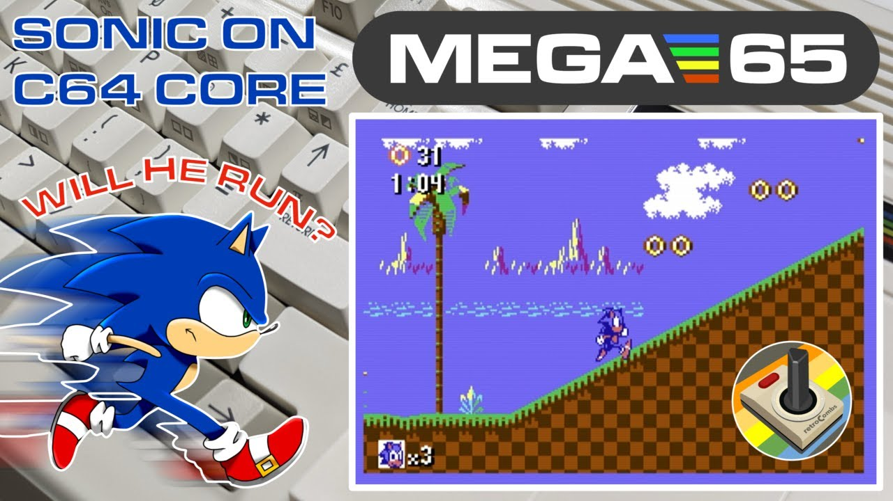

I took a short break from my [MEGA65 User's Guide series](/mega65-users-guide) to answer a viewer question: can you run the Commodore 64 homebrew version of Sonic the Hedgehog on the MEGA65? The answer is yes, but not in GO64 mode. You need the C64 core and a simulated RAM Expansion Unit (REU). This post is the text companion to my video, with the steps I used and what I learned about loading times.

## TABLE OF CONTENTS {#table-of-contents}

- [TABLE OF CONTENTS](#table-of-contents)
- [LINKS](#links)
- [SUPPORT THE BLOG AND CHANNEL](#support-the-blog-and-channel)
- [COMPANION YOUTUBE VIDEO](#companion-youtube-video)
- [VIDEO ERRATA](#video-errata)
- [WHO MADE SONIC FOR THE C64?](#credits)
- [WHY NOT GO64 MODE?](#why-not-go64)
- [STEP 1: COPY THE GAME TO YOUR SD CARD](#step-1)
- [STEP 2: BOOT THE C64 CORE](#step-2)
- [STEP 3: MOUNT THE DISK AND SIMULATE THE REU](#step-3)
- [STEP 4: LOAD AND RUN](#step-4)
- [FULL REU PRELOAD OR THE GAME'S FAST LOADER?](#fast-load)
- [WHAT ABOUT THE EPYX FASTLOAD CARTRIDGE?](#epyx)
- [A FEATURE WISH: SAVE STATES](#save-states)
- [CONCLUSION](#conclusion)

---

## LINKS {#links}

**Software**

- 💾 Sonic the Hedgehog (C64) on CSDb: <https://csdb.dk/release/?id=212190>
- 💾 C64 for MEGA65 core (GitHub): <https://github.com/MJoergen/C64MEGA65>
- 📖 C64 core user's guide: <https://c64.mega65.org>
- 💾 MEGA65 Filehost: <https://files.mega65.org>

**Hardware**

- 🕹️ Atari CX40+ Joystick: <https://amzn.to/479CFmD>
- 💾 microSD cards: <https://amzn.to/3IYL3Kn>

**Related Posts**

- [MEGA65 User's Guide series](/mega65-users-guide)
- [MEGA65 User's Guide Chapter 5 - Upgrading the MEGA65](/mega65-ug-5) (installing alternate cores like the C64 core)
- [MEGA65 User's Guide Chapter 6 - Using Disks and Disk Images](/mega65-ug-6)

*Disclosure Statement: When you click on links to various merchants on this site and make a purchase, this can result in this site earning a commission. Affiliate programs and affiliations include, but are not limited to Amazon and the eBay Partner Network.*

## SUPPORT THE BLOG AND CHANNEL {#support-the-blog-and-channel}

Check out the [supporters page](/supporters) to learn about my supporters and how you can join our community. If this post saved you some time, you can also [leave a tip](https://paypal.me/stevencombs).

## COMPANION YOUTUBE VIDEO {#companion-youtube-video}

Title: _Sonic the Hedgehog on MEGA65 with Commodore 64 Core. It works! #commodore64_





## VIDEO ERRATA {#video-errata}

As of 2026-11-18:

- **Core version.** In the video I use C64 core version 5.1, the latest at the time. The project's GitHub page now lists version 5.2. The steps in this post still hold on 5.2.

## WHO MADE SONIC FOR THE C64? {#credits}

Sonic the Hedgehog for the Commodore 64 is a homebrew release credited on CSDb to Mr. SID, released December 19, 2021. CSDb credits Mr. SID for code, Encore for music, Veto for graphics, and Krill for the loader. I use version 1.2 in the video. It comes as two `.d64` disk images. It was long thought that something like this couldn't run on a Commodore 64, so it's quite a feat. Download it from the CSDb page in the links above.

## WHY NOT GO64 MODE? {#why-not-go64}

Type `GO64` on the MEGA65 and you get a C64 mode, but it's a limited one. It handles some software, but not something as demanding as Sonic. Sonic also needs a RAM Expansion Unit, and GO64 mode doesn't provide one.

The C64 core, ported to the MEGA65 by MJoergen and sy2002 and based on the MiSTer C64 core, is a different story. It turns the MEGA65 into a Commodore 64 with a 1541 drive, and it can simulate a 1750 REU.

> **Tip:** If you haven't installed the C64 core yet, my [Chapter 5 post](/mega65-ug-5) covers installing alternate cores into a core slot.
{: .tip}

## STEP 1: COPY THE GAME TO YOUR SD CARD {#step-1}

1. Power off the MEGA65 and remove the microSD card.
2. Put the card in your computer.
3. Download Sonic the Hedgehog from CSDb and unzip it. You'll find two `.d64` files.
4. Copy both `.d64` files to the card. I keep my C64 titles in a `C64` folder on the card.
5. Eject the card and put it back in the MEGA65.

## STEP 2: BOOT THE C64 CORE {#step-2}

1. Hold down `NO SCROLL` and switch on the MEGA65. The core selection menu appears (covered in Chapter 5 of the user's guide).
2. Select the slot that holds the C64 core. Mine is in slot 2.

For this demo I used the Atari CX40+ joystick.

## STEP 3: MOUNT THE DISK AND SIMULATE THE REU {#step-3}

1. Press `HELP` to open the core's on-screen menu.
2. Choose the drive mount option and select the first Sonic `.d64` file.
3. Highlight the REU option and press the spacebar to turn on the simulated REU. You don't need to simulate a cartridge.
4. Press `HELP` to close the menu.

> **Tip:** If you reset or power off, check these settings again before you load. On my first try I forgot the REU and got the message "No REU found, Sonic needs at least 256 kilobytes." Mount the disk, turn the REU back on, and try again.
{: .tip}

## STEP 4: LOAD AND RUN {#step-4}

1. Load the first program from the disk the standard C64 way, for example `LOAD"*",8,1`, then type `RUN`. The C64 core loads at real C64 speed, so be patient. (In the video I skip the MEGA + RUN/STOP shortcut and load it the old way.)
2. After a black screen, the game asks whether to use **fast load** or **compatible load**.
3. Choose to play the game rather than read the manual.
4. After the "Sonic Team 64 presents" screen and a progress indicator, the game asks whether to **load the full game into the REU**.

## FULL REU PRELOAD OR THE GAME'S FAST LOADER? {#fast-load}

On my first run, I chose compatible load and said yes to loading the full game into the REU. That takes a long time, long enough that in the video I speed it up and show the total time on screen. Partway through, the game asks for the second disk:

1. Press `HELP`, switch the mounted disk to the second `.d64` file, and press `HELP` again to close the menu.
2. Press fire to continue.
3. If the joystick doesn't respond, open the menu with `HELP` and flip the joystick ports there. No need to swap cables.

Back in the day on a real C64, this would have been "let me get it loading, then we'll go have dinner."

On my second run, I chose **fast load** and said **no** to loading the full game into the REU. That got me playing much sooner. The game streams from the disk as you play, and at some point it asks for the second disk image.

> **Tip:** For a quick session, use the game's fast load option and skip the full REU preload.
{: .tip}

## WHAT ABOUT THE EPYX FASTLOAD CARTRIDGE? {#epyx}

I also tried a real Epyx FastLoad cartridge in the MEGA65's cartridge slot. The catch: turning on the core's simulated REU overrides the hardware cartridge slot. It's one or the other. Sonic needs the REU, so the Epyx cartridge is out. The game's own fast loader is the way to go.

## A FEATURE WISH: SAVE STATES {#save-states}

Sonic on the C64 core is not a quick "I'll play for five minutes" game, because of the load time. A save state that writes to the SD card, much like the freezer in MEGA65 mode, would solve that. I don't see one in the core's menu. Consider that a friendly suggestion for the C64 core maintainers.

## CONCLUSION {#conclusion}

Can you play Sonic the Hedgehog for the Commodore 64 on the MEGA65? Yes, with the C64 core and a simulated REU. Set up the menu before you load, use the game's fast loader, and keep the second disk image handy. The gameplay feels good, and it's one more reason the C64 core makes the MEGA65 worth it if you're on the fence. I haven't found a C64 title it can't play yet.

If you're new to the MEGA65, start with my [MEGA65 User's Guide series](/mega65-users-guide). If you like gadgets, also check out my other channel, @retroCombs-tech.

How far into Sonic did you get, and which load option did you use? Let me know in the comments below. If this post helped, [leave a tip](https://paypal.me/stevencombs).

That's it for me, folks. 🕹️ retroCombs, OUT!
