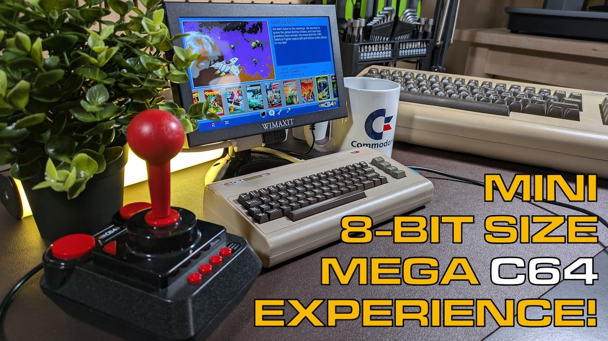

[THEC64 Mini](https://amzn.to/44opkqo) from Retro Games Ltd is a small Commodore 64 you can set on your desk, and I just love this device. It works for longtime Commodore fans like me (I've been around Commodore computers for almost 45 years) and for anyone new to the C64. This post is the text companion to my video. It walks through the Carousel, save states, the options menus, Classic Mode, firmware, and the USB drive features that open the door to far more software than the built-in games.

## TABLE OF CONTENTS {#table-of-contents}

- [TABLE OF CONTENTS](#table-of-contents)
- [LINKS](#links)
- [SUPPORT THE BLOG AND CHANNEL](#support-the-blog-and-channel)
- [COMPANION YOUTUBE VIDEO](#companion-youtube-video)
- [VIDEO ERRATA](#video-errata)
- [MINI VS. MAXI](#mini-vs-maxi)
- [THE KEYBOARD AND THE JOYSTICK](#keyboard-and-joystick)
- [THE CAROUSEL](#the-carousel)
- [SAVE STATES](#save-states)
- [THE OPTIONS MENUS](#options)
- [UPDATE THE FIRMWARE FIRST](#firmware)
- [CLASSIC MODE](#classic-mode)
- [LOADING SOFTWARE FROM A USB DRIVE](#usb-drive)
- [CARTRIDGE IMAGES IN CLASSIC MODE](#cartridges)
- [CONCLUSION](#conclusion)

---

## LINKS {#links}

**THEC64 Family and Accessories**

- 💻 Retro Games Ltd TheC64 Mini: <https://amzn.to/44opkqo>
- 💻 Retro Games Ltd TheC64 Maxi: <https://amzn.to/3oN64kW>
- 🕹️ Retro Games Ltd TheJoystick: <https://amzn.to/43lVHUh>
- 🎮 Retro Games Ltd TheGamePad: <https://amzn.to/43H7iNu>
- 💾 Retro Games Ltd USB Drive: <https://amzn.to/466QDVw>
- 🚠 HDMI Cables: <https://amzn.to/4c2vhM9>

**Related Posts**

- [Ten No Hack TheC64 Tips To Upgrade your Retro Computing Experience](/ten-thec64-tips)
- [FAST LOAD: Upgrade THEC64 mini firmware (v.1.4.2)]()

*Disclosure Statement: When you click on links to various merchants on this site and make a purchase, this can result in this site earning a commission. Affiliate programs and affiliations include, but are not limited to Amazon and the eBay Partner Network.*

## SUPPORT THE BLOG AND CHANNEL {#support-the-blog-and-channel}

Check out the [supporters page](/supporters) to learn about my supporters and how you can join our community. If this post saved you some time, you can also [leave a tip](https://paypal.me/stevencombs).

## COMPANION YOUTUBE VIDEO {#companion-youtube-video}

Title: _🕹️ THEC64 Mini in 2025: Exploring Carousel & Classic Mode in 9 Mins!_





## VIDEO ERRATA {#video-errata}

As of 2026-11-20, no errata. If you spot something, let me know in the comments below.

## MINI VS. MAXI {#mini-vs-maxi}

The Mini earns its name. Next to a full-size Commodore 64 it barely fills the frame. Retro Games Ltd also makes a full-size [Maxi](https://amzn.to/3oN64kW) version. The C64 emulation is the same on both. The differences:

- The Maxi has a working keyboard.
- The Maxi adds a VIC-20 emulator.

## THE KEYBOARD AND THE JOYSTICK {#keyboard-and-joystick}

Let's get this out of the way first: the keyboard on the Mini does not work. It's for looks. When you need to type, you have two choices:

1. Use the on-screen virtual keyboard.
2. Plug a real USB keyboard into one of the USB ports.

One keyboard that does not work: the [8BitDo Retro Mechanical Keyboard C64 Edition](/8bitdo-retro-mechanical-keyboard-c64). I tested it with THEC64 Mini and it doesn't work. Very disappointing. Use a different USB keyboard.

The Mini includes a retro-inspired joystick. It's okay. It's not the best, but it's not bad, and its extra buttons are how you move around the on-screen menus.

> **Tip:** If you plug in a USB keyboard, set its layout in the device settings (covered below) so the keys map correctly.
{: .tip}

## THE CAROUSEL {#the-carousel}

Hold the power button for about three seconds to start the Mini. It boots into the Carousel, a scrolling menu of the built-in games that you browse with the joystick. Retro Games Ltd included a good selection. If you know the C64 library, you'll wonder why some titles made the list and others didn't. No collection could include every game everyone wants, and the USB drive features below take care of that.

A couple of my picks:

- **Galencia Mini**, a Galaga-style shooter and one of my personal favorites
- **Impossible Mission** and **Impossible Mission II**

When a game asks you to press F1 for options, use the joystick's menu buttons to bring up the on-screen keyboard and make your selection.

## SAVE STATES {#save-states}

From the in-game menu, choose save/load to save a state. You get up to four save states per game, so you can come back and retry that level. Save states work for the games on your [USB drive](https://amzn.to/466QDVw) too, not only the built-in ones.

## THE OPTIONS MENUS {#options}

The options along the bottom of the Carousel cover:

- **Display:** how the pixels are drawn, and optional scan lines for a CRT look
- **Language:** the interface language
- **Device settings:**
  - Computer model: NTSC or PAL, to match the game or the machine you grew up with in North America or Europe
  - Boot mode: boot to the Carousel or to Classic Mode
  - USB keyboard layout
  - Legal notices and system information
  - Firmware update
  - Switch to Classic Mode
  - Shut down
  - Factory reset, for a fresh-out-of-the-box experience

## UPDATE THE FIRMWARE FIRST {#firmware}

When you get your Mini, update the firmware. The unit may not ship with the latest version, depending on how long the box sat on a shelf. The firmware I show in the video is the latest as I know it, and it has not been updated for quite some time. I'm not sure there will be any new updates.

For the step-by-step process, see my post [FAST LOAD: Upgrade THEC64 mini firmware (v.1.4.2)]().

## CLASSIC MODE {#classic-mode}

Classic Mode boots straight to the familiar screen: Commodore 64 BASIC V2 with 64K of RAM. From there, plug in a USB keyboard to write your own BASIC programs, or assembly language programs if you have an assembly language monitor. A virtual disk drive (next section) lets you save your work.

## LOADING SOFTWARE FROM A USB DRIVE {#usb-drive}

This is where the magic happens. With no USB drive inserted, the media access menu says it cannot read a USB stick. Plug one in and you can:

- Create virtual disks to save programs you type or create in BASIC
- Load disk images
- Load cassette (tape) images
- Load cartridge (CRT) images, such as utility cartridges like the Epyx Fast Load

To load from the Carousel:

1. Plug the USB drive into the USB port on the side. A small USB drive icon appears at the bottom of the screen.
2. Navigate to the drive to see its contents.
3. Select a disk image and press fire.

In the video I load a homebrew game built entirely from PETSCII characters. To exit a game, use the joystick's menu button. Don't forget, save states work here too.

## CARTRIDGE IMAGES IN CLASSIC MODE {#cartridges}

Classic Mode adds more media access options, including a virtual cartridge slot. To load a cartridge image:

1. Switch to Classic Mode and open the menu.
2. Choose media access.
3. Browse to the cartridge image on your USB drive. I keep mine in a folder named utilities. In the video I use the NTSC version 5.22 of the Super Snapshot cartridge.
4. Load it.
5. To confirm it's loaded, open media access again. The cartridge slot shows the cartridge name.
6. To remove it, go back to media access, select the cartridge item, and choose eject.

## CONCLUSION {#conclusion}

[THEC64 Mini](https://amzn.to/44opkqo) is a small, fun way into the Commodore 64 for beginners, and the USB drive features give experienced users disk, tape, and cartridge images, plus Classic Mode for BASIC programming. Update the firmware, grab a [USB drive](https://amzn.to/466QDVw), and add a USB keyboard if you plan to type. For more, check out my [ten TheC64 tips](/ten-thec64-tips).

Are you a Carousel person or a Classic Mode person? Let me know in the comments below. If this post helped, [leave a tip](https://paypal.me/stevencombs).

That's it for me, folks. 🕹️ retroCombs, OUT!
