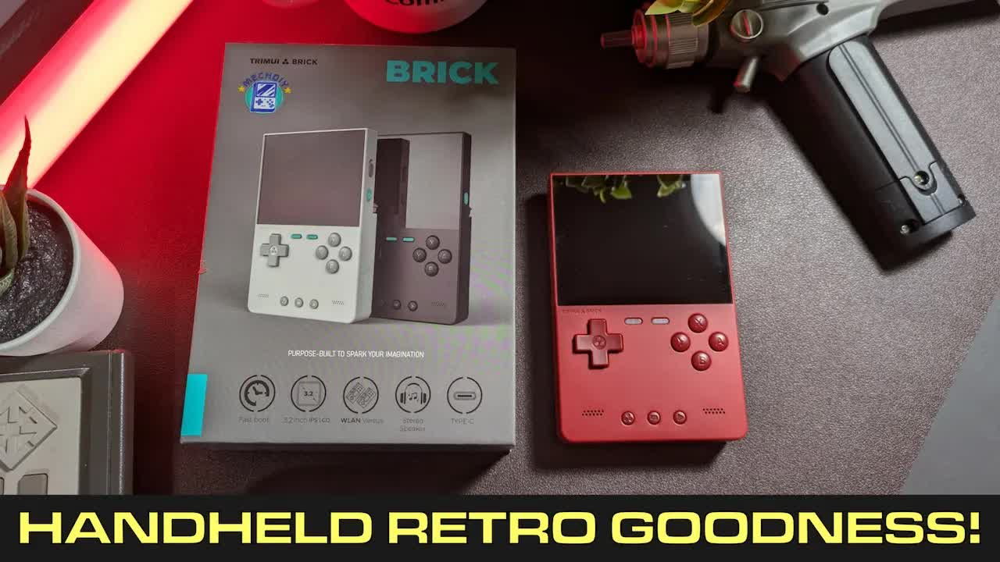
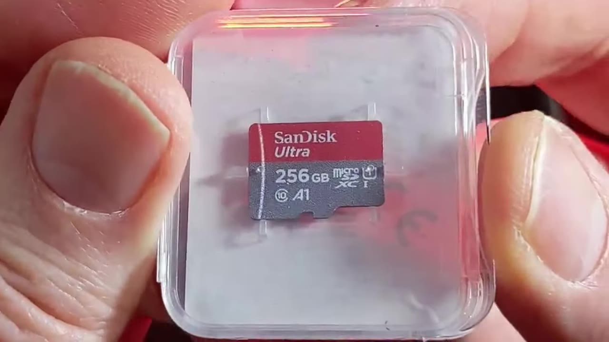
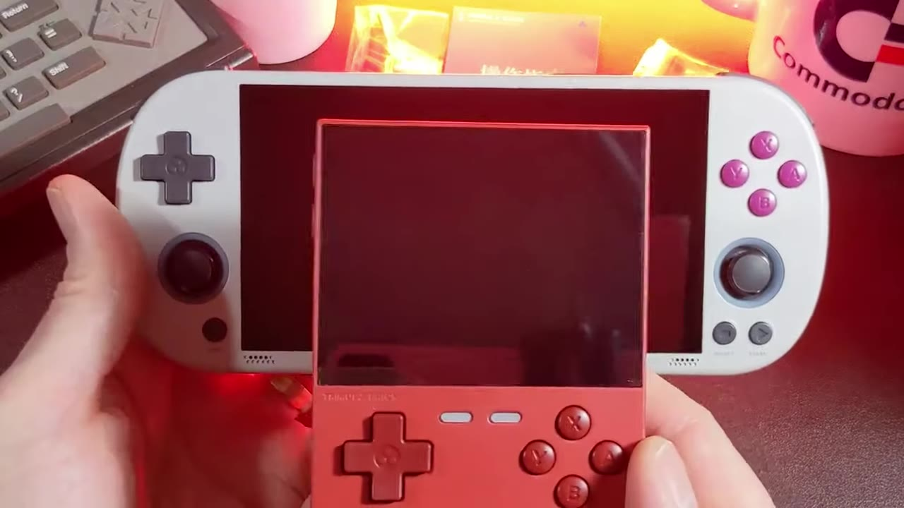
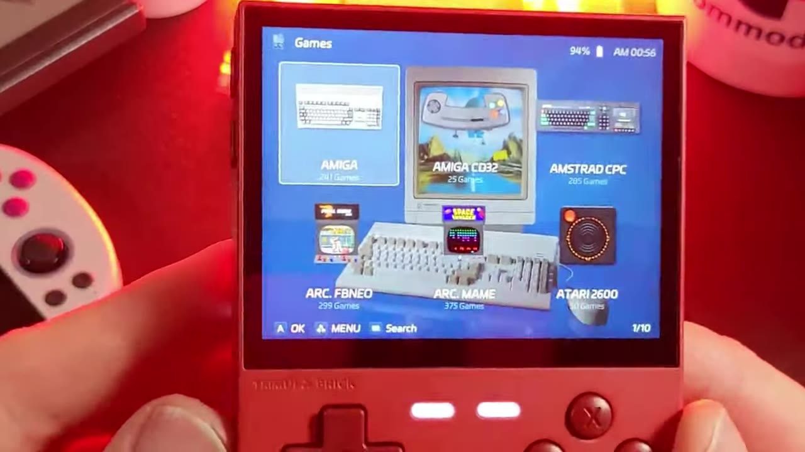
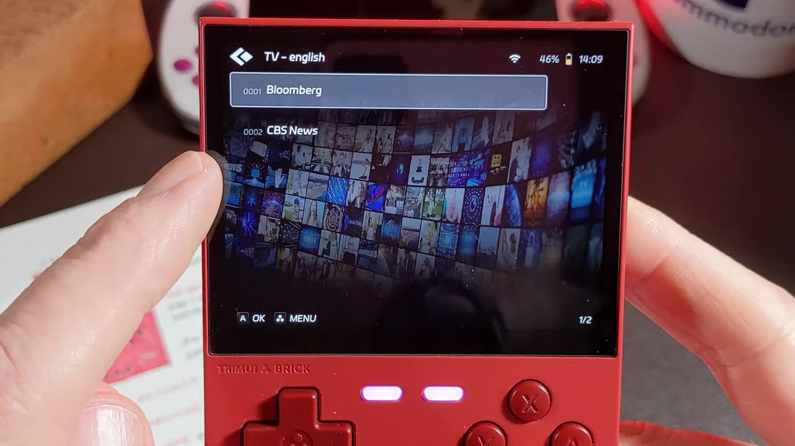

The folks over at MechDIY sent me a new toy to play with. They sent me a brick. Yep, that's right, the [TrimUI Brick](https://mechdiy.com/collections/trimui/products/trimui-brick-retro-handheld-game-console?ref=vpbwmzpy). I'm not usually a fan of the Game Boy style, vertical form factor because it cramps my hands, so I didn't expect much. This little red handheld surprised me more than any handheld I've tried in a while.



MechDIY provided this unit to the channel for free. Thank you! I'm under no obligation, they didn't ask me to say anything in particular, and these thoughts are my own.

This post is the text companion to my video on retroCombs Tech (@retroCombs-tech). It covers what's in the box, the buttons and ports, CrossMix OS, the specs, the 8-bit emulators I gravitate to, and one feature I didn't see coming. This is a first look, not a full review. Let's dig in!

## TABLE OF CONTENTS {#table-of-contents}

- [TABLE OF CONTENTS](#table-of-contents)
- [LINKS](#links)
- [SUPPORT THE BLOG AND CHANNEL](#support-the-blog-and-channel)
- [COMPANION YOUTUBE VIDEO](#companion-youtube-video)
- [VIDEO ERRATA](#video-errata)
- [WHAT'S IN THE BOX](#whats-in-the-box)
- [BRICK VS. SMART PRO](#brick-vs-smart-pro)
- [BUTTONS AND PORTS](#buttons-and-ports)
- [CROSSMIX OS](#crossmix-os)
- [TRIMUI BRICK SPECIFICATIONS](#specifications)
- [ADDING YOUR OWN GAMES](#adding-games)
- [THE 8-BIT SYSTEMS](#8-bit-systems)
- [SURPRISE: STREAMING TV](#streaming-tv)
- [MY FIRST IMPRESSIONS](#first-impressions)
- [CONCLUSION](#conclusion)

---

## LINKS {#links}

**Video Mention Links**

- 🎮 My TrimUI Smart Pro review: [The RETRO Truth About the TrimUI Smart Pro](/trimui-smart-pro-review)
- 💿 CrossMix OS (open source, by cizia64): <https://github.com/cizia64/CrossMix-OS>
- 🧱 TrimUI Brick at MechDIY: <https://mechdiy.com/collections/trimui/products/trimui-brick-retro-handheld-game-console?ref=vpbwmzpy> (the code RETROCOMBS16 takes 15% off)

**Handheld Accessories**

- 🧠 microSD Cards: <https://amzn.to/3IYL3Kn>
- 🕹️ Atari CX40+ Joystick: <https://amzn.to/479CFmD>

*Disclosure Statement: When you click on links to various merchants on this site and make a purchase, this can result in this site earning a commission. Affiliate programs and affiliations include, but are not limited to Amazon and the eBay Partner Network.*

## SUPPORT THE BLOG AND CHANNEL {#support-the-blog-and-channel}

Check out the [supporters page](/supporters) to learn about my supporters and how you can join our community. If this post saved you some time, you can also [leave a tip](https://paypal.me/stevencombs). And if you like gadgets, subscribe to @retroCombs-tech. Hooked on tech since '73.

## COMPANION YOUTUBE VIDEO {#companion-youtube-video}

Title: _🧱 TrimUI Brick | The Handheld That Surprised Me Most_





## VIDEO ERRATA {#video-errata}

- **Battery (~8:55):** I say "300 milliamp." It's a 3000mAh battery.
- **Bluetooth (~9:25):** I say Bluetooth 2.1. TrimUI lists it as Bluetooth 2.1 + EDR/4.2.
- **SD card sizes (~9:56):** "6428 to 256" should be 64GB, 128GB, or 256GB. The card options depend on the seller.

## WHAT'S IN THE BOX {#whats-in-the-box}

The first thing you notice is the weight. This thing is heavy for its size. It kind of feels like a brick! The box says it comes in multiple colors. If you're getting a brick, shouldn't you get it in red? It's not quite brick red, but it's close enough for me. The box also calls out fast boot, the 3.2-inch IPS screen, WLAN versus mode, stereo speakers, USB-C, RGB lighting, a metal back shell, and easy disassembly.

Inside the box:

- The TrimUI Brick, with a protective sponge and a screen protector
- A quick-start manual (switching views, searching for games, adding games and thumbnails, playing with other people, and the function key)
- A SanDisk Ultra 256GB [microSD card](https://amzn.to/3IYL3Kn), preloaded with the OS, emulators, and games
- A spare set of L and R keycaps in a different shape
- A USB-C cable

I love that MechDIY didn't skimp on the card. A name-brand card matters when the whole OS and your games live on it. The back shell is metal and the front is plastic, and you can see the screws for easy disassembly. They're not trying to hide anything.

> **Tip:** Make a copy of the preloaded card on your computer before you start adding games. If the card ever fails, you can restore your setup to a new card. If you want more room, pick up a bigger name-brand card. Here are some [microSD cards](https://amzn.to/3IYL3Kn) to start with.
{: .tip}

## BRICK VS. SMART PRO {#brick-vs-smart-pro}

Here's the Brick next to the [TrimUI Smart Pro](/trimui-smart-pro-review). The Smart Pro has a 16:9 screen. The Brick has a 4:3 screen, which is a better match for most retro games. On the Smart Pro, most 8-bit and 16-bit games get a background to fill the sides anyway.

The other big difference is the controls. The Brick has no analog sticks, just the D-pad and buttons. That's fine for the 8-bit games I play most, but it limits what else you can play. I'll come back to that.

The Smart Pro might fit in a cargo pocket. You could slip the Brick in the back pocket of your jeans or the inside of a jacket pretty easily.

## BUTTONS AND PORTS {#buttons-and-ports}

- **Front:** the D-pad, A, B, X, and Y, plus Menu, Select, and Start
- **Back:** four shoulder buttons (L1, L2, R1, and R2), plus RGB "atmosphere" lighting
- **Edges:** volume up and down, power, what looks like a reset, the microSD card slot, a microphone, a 3.5mm headphone jack, and two USB-C ports

The microSD slot is a push-to-click slot. Of course the card goes in upside down. Why are SD card slots always upside down? Push again to release the card, but be careful or it'll fly out of there.

> **Tip:** Experiment with the four shoulder buttons in each emulator. Some emulators map extra functions to them. In the menus, R1 and L1 move across the tabs at the top of the screen.
{: .tip}

## CROSSMIX OS {#crossmix-os}

My card came with CrossMix OS version 1.3.9 (the Surwish build that ships on retailer cards). The first boot takes a little while, and the startup music is pretty cool and a little haunting. You can turn it down. The screen is beautiful, with very good viewing angles.

CrossMix is the same OS that runs on the Smart Pro. Across the top you get Favorites, Recents, Best, Games, Apps, Netplay, and Settings. Settings is where you connect to Wi-Fi and Bluetooth. Each system gets an icon and a little background screen. There's my favorite Atari 2600!

A few things I found while I was taking notes over two days:

- **Sleep mode works.** The Brick slept overnight and lost about 2% of the battery.
- **Rumble.** There's a rumble setting under the volume settings. It doesn't work for every game.
- **Autosave and resume.** Start a game, and next time it picks up where you left off. That's great for a Commodore 64 title that takes a while to load, just like it would from a floppy. If you like the loading experience, you can start from scratch.
- **BIOS files are already configured** for the included emulators, and you can change themes to give it your own look.

> **Note:** CrossMix OS is an open-source project by cizia64. Its official GitHub releases target the Smart Pro, and the newest one (v1.3.0) says it isn't compatible with the Brick. The v1.3.9 on my card is Surwish's retailer build, so check the [CrossMix OS GitHub page](https://github.com/cizia64/CrossMix-OS) before you update.
{: .note}

## TRIMUI BRICK SPECIFICATIONS {#specifications}

From the video, checked against TrimUI's spec sheet:

- **CPU:** Allwinner A133P at 1.8GHz
- **GPU:** Imagination PowerVR GE8300 at 660MHz
- **Memory and storage:** 1GB of RAM and 8GB of eMMC, plus the microSD card
- **Screen:** 3.2-inch IPS, 1024x768 (4:3), not a touchscreen
- **Wireless:** Wi-Fi b/g/n and Bluetooth
- **Audio:** two speakers, a 3.5mm headphone jack, and a mono microphone
- **Battery:** 3000mAh, with about five hours of play claimed. After a long session, five hours seems about right.
- **USB-C:** the bottom port handles charging and OTG. The top port is a USB host.

## ADDING YOUR OWN GAMES {#adding-games}

You have two ways to move files:

1. **USB:** Plug a USB-C cable into the bottom port, open the USB Storage app under Apps, and the card shows up on your computer.
2. **Wireless:** Use SFTP over Wi-Fi.

The MechDIY list of games and emulators is a good start, and it shows off what this little device can do. The video mentions 16,700 games on my card. Your count will depend on the card you get. You'll still want to add some of your own favorites.

## THE 8-BIT SYSTEMS {#8-bit-systems}

This is where the Brick shines for me:

- **Atari 2600:** Gameplay is perfect. The games are a little tiny on the screen, but they look really good. What you miss is a real joystick. Steering Pac-Man with your thumb isn't the same as an [Atari CX40+ Joystick](https://amzn.to/479CFmD). In the video, I said I'd feature the CX40+ wireless joystick in a later video.
- **Atari 5200, Atari 7800, and Atari 800:** The 2600 follow-ups, with better visuals and sound, plus Atari 8-bit computer games.
- **Commodore 64:** My favorite. There are quite a few great titles, and it's ripe for you to add your own.
- **ZX Spectrum:** A great addition.
- **PICO-8, DOS, Game & Watch, Mega Duck, Intellivision, and MSX:** I didn't have an Intellivision growing up, so I've enjoyed trying those games.
- **Game Boy, Game Boy Color, and Game Boy Advance:** The Brick's design is inspired by these handhelds.
- **NES and N64:** The N64 is more advanced than what I'm looking at today.

There are modern systems too. I'll leave those to other YouTubers. Just know the limits. Without analog sticks, I couldn't make selections in some PlayStation Portable games. PlayStation 1 games were difficult, and PSP games were impossible. Stick to 8-bit and 16-bit games that don't need analog controls. If you want the more advanced systems, look at the [TrimUI Smart Pro](/trimui-smart-pro-review).

One notable miss: the Commodore VIC-20. It may be possible to set up. In the video, I said I'd try dropping some VIC-20 games on the card to see if that would activate the emulator. It may also need a BIOS file.

## SURPRISE: STREAMING TV {#streaming-tv}

Not 8-bit, but very interesting. There's an area called Videos, and inside it is TV, with English and French channels. I picked Bloomberg, and with Wi-Fi connected, it streamed. On the go, you can watch Bloomberg on a retro handheld. I did not expect that.

I'm sure each channel is a standard file with a stream URL. In the video, I said I'd connect it to my computer next and see what other stations I could add.

## MY FIRST IMPRESSIONS {#first-impressions}

I'm enjoying the form factor more than I thought I would. My hands usually cramp when they're brought together like this, but it hasn't been a problem. I still prefer a wider handheld, but as a pocket device, the Brick is a lot of fun. It's solid, the screen is great, sleep mode works, and CrossMix OS makes it plug and play. If you mostly play 8-bit and 16-bit games, this is a great fit. If you want PS1 and PSP, get something with analog sticks.

In the video, I said I was thinking about a Brick vs. Smart Pro comparison video. Why might you choose one over the other? Let me know if you want to see it.

## CONCLUSION {#conclusion}

A heavy little brick with a metal back, a 4:3 screen, a big preloaded card, and Bloomberg on demand. For 8-bit fans, it's a pocket full of fun.

Brick or Smart Pro: which would you pick, and why? Let me know in the comments below. If this post helped, [leave a tip](https://paypal.me/stevencombs).

That's it for me, retroCombs, out.
