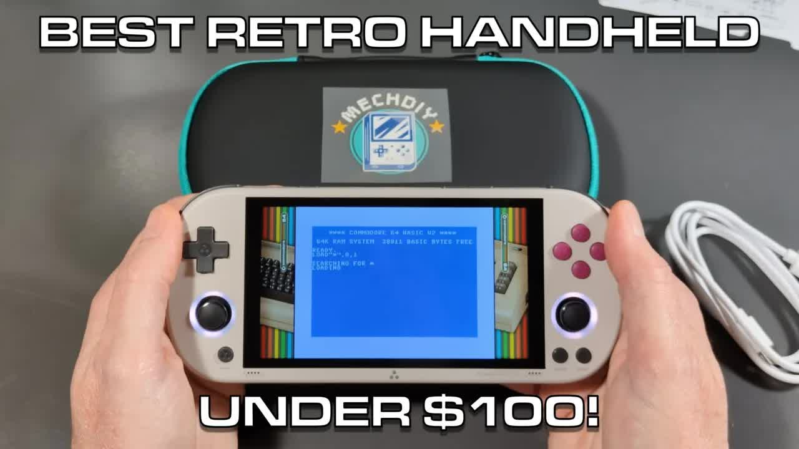
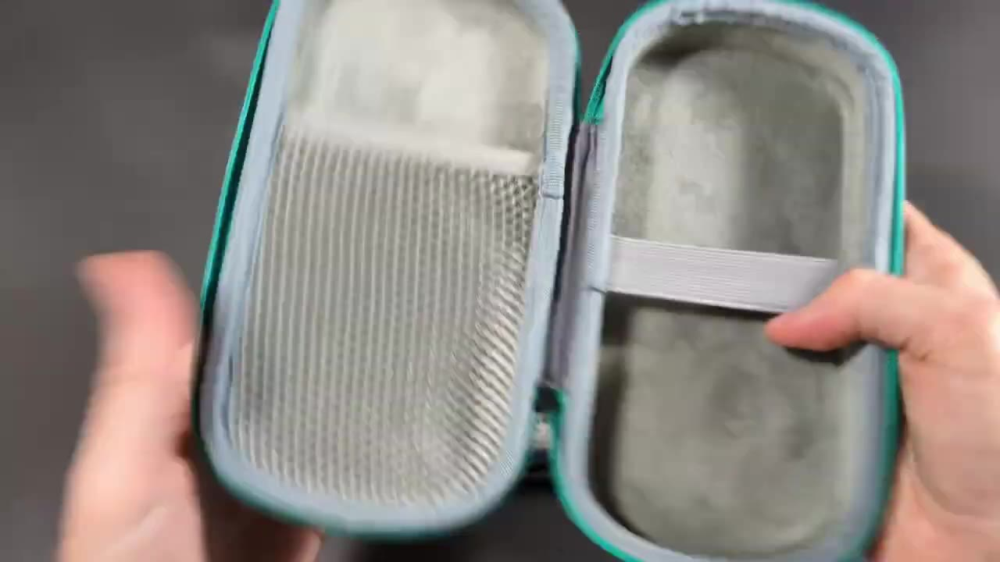
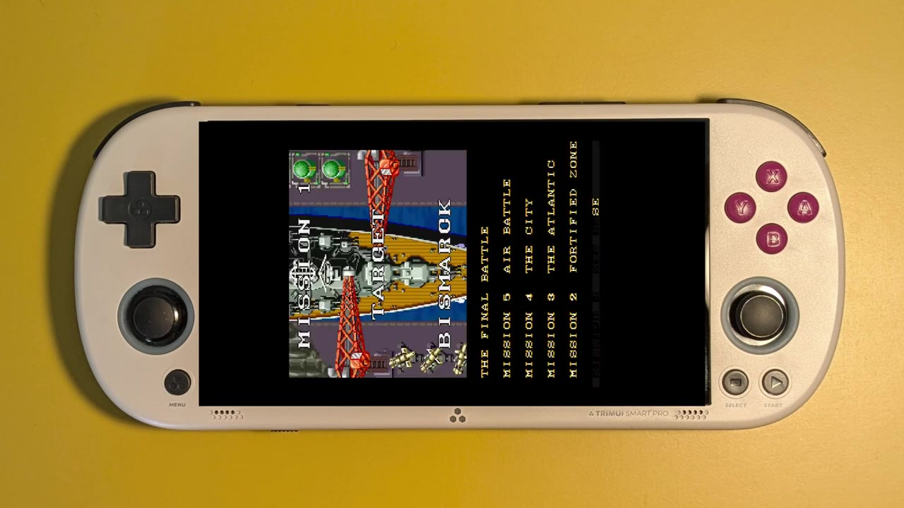
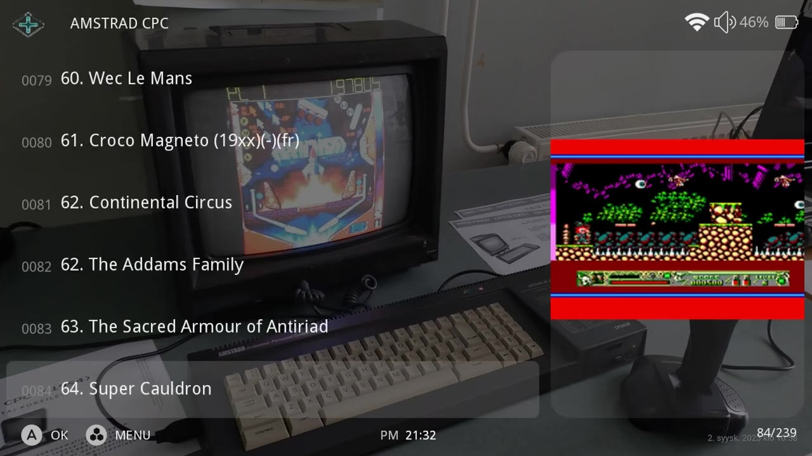
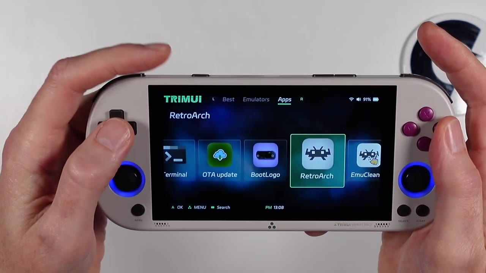

Here's the retro truth: the TrimUI Smart Pro is a fantastic handheld for anyone who loves 8-bit home computers and retro gaming in general, but also likes to dabble in some modern games. When I made the video in October 2024, it sold for about $100. And with 8-bit home computers like the Commodore 64, ZX Spectrum, Amstrad CPC, and Atari 8-bit, you get gameplay you can't get on other handhelds.

MechDIY provided this unit to the channel for free. Thank you! I'm under no obligation, they didn't ask me to say anything in particular, and these thoughts are my own.

This post is the text companion to my video. It covers what's in the box, the design and controls, the screen, CrossMix OS, the 8-bit computer emulators, how to add your own games, and the built-in apps. Let's dig in!

## TABLE OF CONTENTS {#table-of-contents}

- [TABLE OF CONTENTS](#table-of-contents)
- [LINKS](#links)
- [SUPPORT THE BLOG AND CHANNEL](#support-the-blog-and-channel)
- [COMPANION YOUTUBE VIDEO](#companion-youtube-video)
- [VIDEO ERRATA](#video-errata)
- [WHAT'S IN THE BOX](#whats-in-the-box)
- [DESIGN AND CONTROLS](#design-and-controls)
- [THE SCREEN](#the-screen)
- [TRIMUI SMART PRO SPECIFICATIONS](#specifications)
- [CROSSMIX OS](#crossmix-os)
- [SEARCH AND EXIT](#search-and-exit)
- [IT'S GOT 8-BIT COMPUTERS](#8-bit-computers)
- [ADD YOUR OWN GAMES](#add-your-own-games)
- [THE APPS](#the-apps)
- [MY VERDICT](#verdict)
- [CONCLUSION](#conclusion)

---

## LINKS {#links}

**Video Mention Links**

- 🧱 My TrimUI Brick first look: [TrimUI Brick: The Handheld That Surprised Me Most](/trimui-brick-first-look)
- 💿 CrossMix OS (open source, by cizia64): <https://github.com/cizia64/CrossMix-OS>
- 📦 PortMaster: <https://portmaster.games>

**Handheld Accessories**

- 🧠 microSD Cards: <https://amzn.to/3IYL3Kn>

*Disclosure Statement: When you click on links to various merchants on this site and make a purchase, this can result in this site earning a commission. Affiliate programs and affiliations include, but are not limited to Amazon and the eBay Partner Network.*

## SUPPORT THE BLOG AND CHANNEL {#support-the-blog-and-channel}

Check out the [supporters page](/supporters) to learn about my supporters and how you can join our community. If this post saved you some time, you can also [leave a tip](https://paypal.me/stevencombs).

## COMPANION YOUTUBE VIDEO {#companion-youtube-video}

Title: _🎮️ The RETRO Truth About TrimUI Smart Pro Handheld Console!_





## VIDEO ERRATA {#video-errata}

- **Weight (~1:30):** I say it weighs about 220 grams. TrimUI's spec sheet lists about 231 grams.
- **Speakers (~2:40):** I say about 1.5 watts each. TrimUI lists the speakers at 1 watt each.
- **Where CrossMix OS came from (~3:25):** I say CrossMix OS was originally developed for Surwish devices. CrossMix OS is an open-source project by cizia64, built for the TrimUI Smart Pro. Surwish is a seller that ships its own CrossMix build on preloaded cards.
- **Discount code (~0:20 and ~14:30):** The code in the video and the codes in the video description don't match, and I couldn't confirm any of them still works, so I've left them out of this post.

## WHAT'S IN THE BOX {#whats-in-the-box}

MechDIY also sent a carrying case. That's generally an extra purchase, but it was a nice touch for this review.

Inside the box, you'll find:

- A SanDisk 128GB [microSD card](https://amzn.to/3IYL3Kn), preloaded with games. It's unusual to find a SanDisk-branded card with these units.
- A USB-C charging and data cable
- A user's manual
- The console itself

To get started, insert the microSD card and turn it on. The console configures and installs CrossMix OS on first boot. When the install is complete, you're ready to play. My card came with about 1,400 games.

## DESIGN AND CONTROLS {#design-and-controls}

The Smart Pro has a form factor like a PlayStation Portable or Vita, and it feels solid in your hand. It's made from ABS plastic and glass, which gives it a premium feel. It comes in three colors. I chose Vintage Gray because the colors seemed a little more retro, with a tan case and maroon buttons.

- **Dual analog sticks** with customizable RGB lighting. Set them to cycle through colors or stay on your favorite shade in the Settings menu.
- **A, B, X, and Y buttons**, with actions that depend on the game or menu
- **Start, Select, and Menu buttons** at the bottom. Menu is how you quit a game.
- **Shoulder buttons** for quick page up and down in the menus and for extra in-game controls
- **A lanyard slot**, two forward-facing stereo speakers, a microphone, and a function switch you can configure

All the buttons are responsive and comfortable.

## THE SCREEN {#the-screen}

The screen is a beauty. It's a 4.96-inch IPS display at 1280x720. Whether you're playing Commodore 64, ZX Spectrum, or 16-bit console games, they look good at any angle. It's a 16:9 screen, so most retro games get a themed background on the sides. This is not a touchscreen. All navigation is done with the physical controls.

## TRIMUI SMART PRO SPECIFICATIONS {#specifications}

From TrimUI's spec sheet:

- **CPU:** Allwinner A133P at 1.8GHz
- **GPU:** PowerVR GE8300
- **Memory and storage:** 1GB of RAM and 8GB of eMMC, plus the microSD card
- **Screen:** 4.96-inch IPS, 1280x720
- **Battery:** 5000mAh
- **Wireless:** Wi-Fi and Bluetooth
- **Weight:** about 231 grams

## CROSSMIX OS {#crossmix-os}

The Smart Pro runs CrossMix OS, a Linux distribution built on a modified version of Linux kernel 4.9. It's lightweight and gets the most out of the hardware, with over 100 emulators. For the computers I care about, that includes VICE for the Commodore 64, Fuse for the ZX Spectrum, Caprice32 for the Amstrad CPC, and Atari800 for the Atari 8-bit computers.

The menus run across the top:

- **Favorites:** quick access to your favorite games
- **Recents:** recently played games, great when you want to continue where you left off
- **Best:** curated galleries
- **Emulators:** access to all of the emulators
- **Apps:** tools like a screen recorder, a CPU max setting, and a cleaner
- **Netplay:** online multiplayer with friends or other retro gamers
- **Settings:** RGB lighting, the function switch, Wi-Fi, and Bluetooth. You can connect Bluetooth keyboards and audio devices.

One standout in Best is the vertical shoot 'em ups gallery. Pick a game from it, and the game rotates automatically and the controls are set up for portrait orientation. Turn the handheld on its side and play. That's the kind of attention to detail that makes this a fun unit.

## SEARCH AND EXIT {#search-and-exit}

With the built-in search, you can search one emulator or across all of them. I searched for a Star Wars game, got a few results, cursored over, and selected the one I wanted.

To exit a game:

1. Press the **Menu** button.
2. Scroll down to **Exit Game**.
3. Press **A**. You're back at the main menu.
4. Use **B** to go back.

Once you get the hang of it, it's an easy interface.

## IT'S GOT 8-BIT COMPUTERS {#8-bit-computers}

Here's what surprised me. Commodore, Atari, ZX Spectrum, and Amstrad emulators aren't unusual. What is unusual is that these come with games, and they've been tuned to work well. For a home computer fan, it's a dream come true in a handheld.

- **Commodore 64:** Games run smoothly, the graphics look great, and the controls are responsive. They've also set up the on-screen keyboard, so you can type those C64 commands.
- **ZX Spectrum:** Colorful, quirky classics, with the keyboard you need.
- **Amstrad CPC:** I never had one. This handheld let me play Amstrad CPC games for the very first time.
- **Commodore Amiga:** Yes, for my fellow Commodore fans, there's an Amiga emulator, with some great games included.

It handles 16-bit console games too, and some more modern games like Wolfenstein 3D run smoothly, many times up to 60 frames per second. The dual sticks open up systems that a D-pad-only handheld can't handle. That's the big difference from the [TrimUI Brick](/trimui-brick-first-look).

> **Tip:** Turn the Smart Pro on its side for the vertical shoot 'em ups in Best, and use the on-screen keyboard for C64 and ZX Spectrum games that ask you to type a command or press a key to start.
{: .tip}

## ADD YOUR OWN GAMES {#add-your-own-games}

Adding your own games is simple:

- **Drag and drop:** Put the microSD card in your computer and copy the files into the right emulator folder.
- **USB storage:** Plug in a USB cable, turn on USB Storage in Apps, and the card shows up on your computer.
- **Network:** Transfer files over your network using a couple of different protocols.

> **Tip:** Back up the preloaded card before you add or remove anything. If you want a second card for your own collection, here are some [microSD cards](https://amzn.to/3IYL3Kn) to start with.
{: .tip}

## THE APPS {#the-apps}

They've included some handy tools in Apps:

- **PortMaster:** download ports of classic and modern games
- **System Tools:** change CrossMix OS settings
- **Scraper:** grab box art and game info
- **USB Storage:** access the card from your computer
- **Terminal:** this is Linux, so there's a full terminal
- **Over-the-air updates:** I love this one for future OS updates
- **Boot logo:** change it if you want a custom one
- **RetroArch:** direct access
- **Emulator cleaner:** clean up your system
- **File manager:** manage files right on the device
- **Screen recorder:** one of my favorites. I used it to capture the gameplay in the video.
- **User guide:** not sure what something does? Check the built-in guide.

> **Note:** CrossMix OS is an open-source project. Check the [CrossMix OS GitHub page](https://github.com/cizia64/CrossMix-OS) for the latest release notes before you update, especially if your card came with a retailer build.
{: .note}

## MY VERDICT {#verdict}

At around $100 when I made the video, the TrimUI Smart Pro is a great handheld for 8-bit home computer fans. The screen is sharp, the build feels premium, CrossMix OS is easy to use, and the 8-bit computer emulators are set up with care. The dual analog sticks let you dabble in more modern games too. I know you'd enjoy it.

## CONCLUSION {#conclusion}

A PSP-style handheld with a sharp 720p screen, dual sticks, and 8-bit computers that are tuned and ready to play. Check out the gameplay montage in the video to see what it can do.

What's the first 8-bit computer game you'd load on the Smart Pro? Let me know in the comments below. If this post helped, [leave a tip](https://paypal.me/stevencombs).

That's it for me, folks. 🕹️ retroCombs, OUT!
