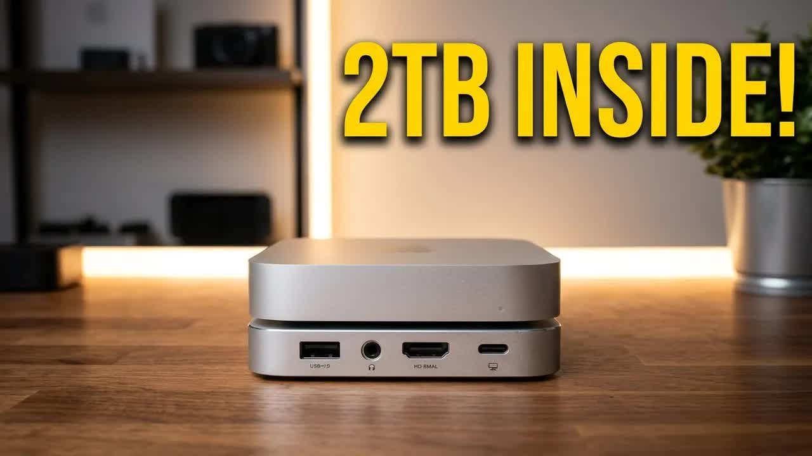
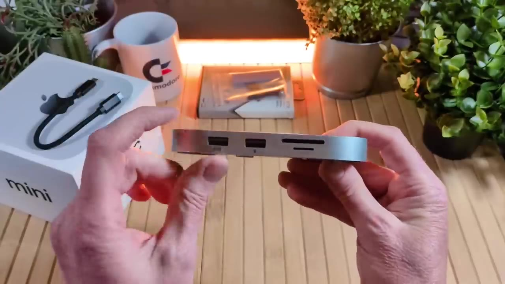
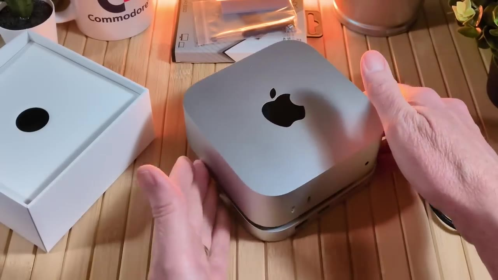
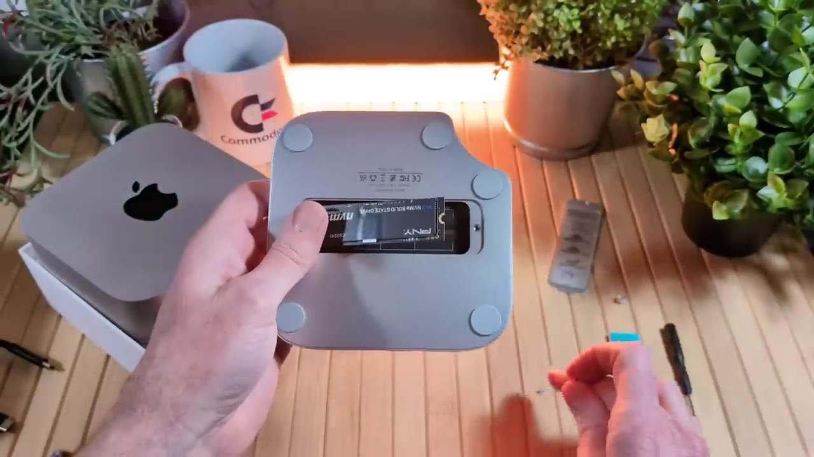
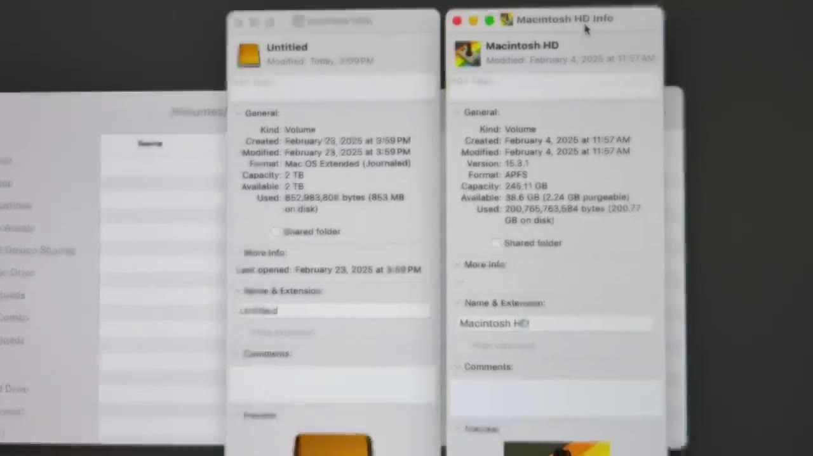

Sometimes things happen for a reason. I recently bought a [Mac mini M4](https://amzn.to/4bnPdZO), and as I used it, I noticed some limits. It doesn't have as many ports as the M2 Mac mini I owned before. Right about then, Minisopuru reached out and asked if I'd take a look at its new stand hub for the 2024 Mac mini M4 and M4 Pro. I said absolutely, and on top of more ports, it has a slot for an NVMe SSD inside. So I added 2TB to my Mac mini for less than Apple charges for a storage upgrade.



Minisopuru provided this unit to the channel for free. Thank you! I'm under no obligation, they didn't ask me to say anything in particular, and these thoughts are my own.

This post is the text companion to my video on retroCombs Tech (@retroCombs-tech). It covers the unboxing, the ports, how to install an NVMe SSD inside the dock, my desk setup, and formatting the new drive in Disk Utility. Let's dig in!

## TABLE OF CONTENTS {#table-of-contents}

- [TABLE OF CONTENTS](#table-of-contents)
- [LINKS](#links)
- [SUPPORT THE BLOG AND CHANNEL](#support-the-blog-and-channel)
- [COMPANION YOUTUBE VIDEO](#companion-youtube-video)
- [VIDEO ERRATA](#video-errata)
- [WHAT'S IN THE BOX](#whats-in-the-box)
- [THE PORTS](#the-ports)
- [THE NOTCH](#the-notch)
- [INSTALL AN SSD IN THE DOCK](#install-an-ssd)
- [MY DESK SETUP](#desk-setup)
- [FORMAT THE NEW DRIVE](#format-the-drive)
- [MY VERDICT](#verdict)
- [CONCLUSION](#conclusion)

---

## LINKS {#links}

**Mac mini Accessories**

- 🖥️ Apple Mac mini M4: <https://amzn.to/4bnPdZO>
- 🚠 HDMI Cables: <https://amzn.to/4c2vhM9>
- 🧠 microSD Cards: <https://amzn.to/3IYL3Kn>

*Disclosure Statement: When you click on links to various merchants on this site and make a purchase, this can result in this site earning a commission. Affiliate programs and affiliations include, but are not limited to Amazon and the eBay Partner Network.*

## SUPPORT THE BLOG AND CHANNEL {#support-the-blog-and-channel}

Check out the [supporters page](/supporters) to learn about my supporters and how you can join our community. If this post saved you some time, you can also [leave a tip](https://paypal.me/stevencombs). And if you like gadgets, subscribe to @retroCombs-tech. Hooked on tech since '73.

## COMPANION YOUTUBE VIDEO {#companion-youtube-video}

Title: _🍎 Why a Dock Belongs Under Every Mac mini M4!_





## VIDEO ERRATA {#video-errata}

- **"2 gigs" (~1:00):** The SSD I installed is 2 terabytes, not 2 gigabytes.
- **My internal drive (~1:05 and ~11:05):** Early on, I say I'm upgrading my "paltry 512 gigs." Disk Utility shows a 245GB Macintosh HD, which is my 256GB internal drive. The 2TB SSD is the upgrade either way.
- **Drive speed:** The PNY SSD is a PCIe Gen 4x4 drive, but the dock connects to the Mac over USB-C at up to 10Gbps. Expect USB 10Gbps speeds, not Gen 4 speeds. It's still plenty fast for video editing storage.

## WHAT'S IN THE BOX {#whats-in-the-box}

The dock has a little notch in one corner. A lot of you with a Mac mini already know what that's for. More on that in a minute. Inside the box:

- The iExpandMate MINI4PRO stand hub
- A USB-C to USB-C cable to connect the hub to the Mac mini
- A user guide with the SSD installation steps
- A small screwdriver, screws, and a silicone thermal pad for installing an SSD

The dock is light, with non-slip feet on the bottom. Even on my slick desk surface, it doesn't slide around.

## THE PORTS {#the-ports}

**Front:**

- Two USB-A 2.0 ports, labeled as the spots for your keyboard and joystick
- An SD card slot and a [microSD card](https://amzn.to/3IYL3Kn) slot

**Back:**

- One USB-A 2.0 port
- A 3.5mm headphone jack
- An HDMI port, up to 4K at 60Hz
- The USB-C host port that connects to the Mac mini

I really like having a headphone jack on the back. On the Mac mini M4, the headphone jack is on the front. Mine runs to a pair of reference speakers, so that cable used to come out of the front of my setup.

> **Tip:** The front USB-A ports are USB 2.0. They're perfect for a keyboard, mouse, or joystick. Plug fast USB drives into the Mac mini's own USB-C ports instead. The card slots are rated up to 104MB/s.
{: .tip}

The HDMI port is a nice extra. With the dock's HDMI and the Mac mini's own HDMI port, you're ready for a dual-monitor setup. Grab a good [HDMI cable](https://amzn.to/4c2vhM9) if you plan to run a 4K display at 60Hz.

## THE NOTCH {#the-notch}

The mini you see on the dock in the video is The Lovely Accountant's new Mac mini M4. She's upgrading from an M1, and I hadn't set it up yet. Mine was already set up and in use at my desk, so I borrowed hers for the test fit.

The Mac mini fits right in the top of the dock and doesn't slide back and forth. The power button on the M4 is on the bottom, and the notch lines up with it, so you can reach the power button without lifting the mini off the dock. Some hubs don't include that. Nice addition.

## INSTALL AN SSD IN THE DOCK {#install-an-ssd}

The dock accepts an M.2 NVMe SSD in 2230, 2242, 2260, or 2280 sizes. It does not support SATA M.2 drives. I used a PNY 2TB NVMe SSD in the full-length 2280 size. It was less than $100 on Amazon when I bought it.

1. **Remove the bottom cover** with the included screwdriver.
2. **Find the right standoff position** for your SSD size. The adapters let you mount shorter drives.
3. **Insert the SSD** into the slot at an angle, then press it down.
4. **Secure the SSD** with the included screw.
5. **Add the silicone thermal pad.** Put the silicone side down on the SSD and the sticky side up, so it sticks to the aluminum cover. If you stick it to the SSD, it's in the wrong direction when you replace the drive later.
6. **Replace the cover** and tighten the screws.

The pad helps transfer heat from the SSD to the aluminum cover. I had to clean off a little adhesive afterward. It doesn't show, but I could have done a better job with that.

> **Tip:** Double-check that your SSD is NVMe, not SATA, before you buy. Both use the M.2 connector, and they look almost the same. The drive's label or listing will say NVMe or PCIe.
{: .tip}

## MY DESK SETUP {#desk-setup}

At my desk, the Mac mini with the dock didn't fit in the same spot under my monitor, and the monitor was at the perfect height. I moved things over, didn't have to go as far as I thought, and raised the monitor a little.

I also added a small USB-C to USB-A hub off the back for devices I always leave plugged in, like a document camera and a microphone. That cleans up the front for USB drives and SD cards. With the Mac mini's two front USB-C ports, that's a lot of ports. From the front, you don't see any of it, and the back is pretty clean.

## FORMAT THE NEW DRIVE {#format-the-drive}

I used the notch to turn on the Mac mini, and macOS said, "The disk you attached was not readable by this computer." That's a good sign. It means the drive is there and ready to initialize.

1. Click **Initialize**. Disk Utility opens.
2. Select the new drive, and click **Erase**.
3. Pick a name and a format. I chose **Mac OS Extended (Journaled)**.
4. Click **Erase**, then **Done** when it finishes.

Get Info shows a 2TB capacity. Next to it, my Macintosh HD shows 245GB. Now I can use the 2TB drive for my video editing storage and keep that off my main drive.

> **Tip:** If you'll only use the drive with Macs running macOS High Sierra or later, consider APFS instead of Mac OS Extended. Apple's Disk Utility uses APFS by default for SSDs. Choose Mac OS Extended if you need the drive to work with older Macs.
{: .tip}

## MY VERDICT {#verdict}

The Mac mini M4 is small and fast, but it's short on ports, and Apple storage upgrades are expensive. The MINI4PRO matches the mini's aluminum look, adds front USB and card slots, moves the headphone cable to the back, adds HDMI, leaves the power button reachable, and hides a 2TB SSD inside. Together, the dock and an SSD cost far less than ordering a 2TB Mac mini from Apple. If this works the way it has so far, I highly recommend it.

## CONCLUSION {#conclusion}

A stand that matches the Mac mini M4, a handful of extra ports, a notch for the power button, and 2TB more storage hidden inside. That's why I think a dock belongs under every Mac mini M4.

What's under your Mac mini, and what do you use the extra storage for? Let me know in the comments below. If this post helped, [leave a tip](https://paypal.me/stevencombs).

That's it for me, retroCombs, out.
