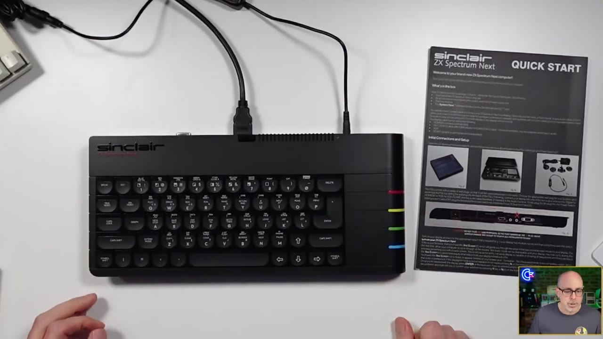
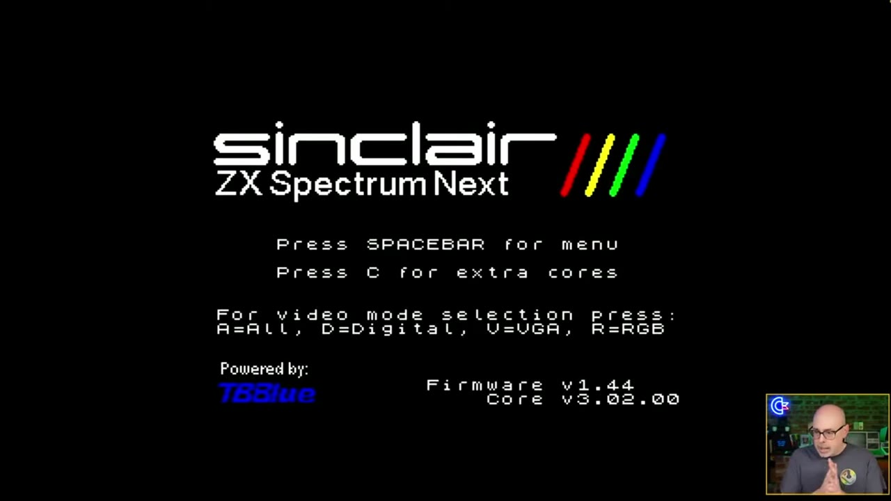
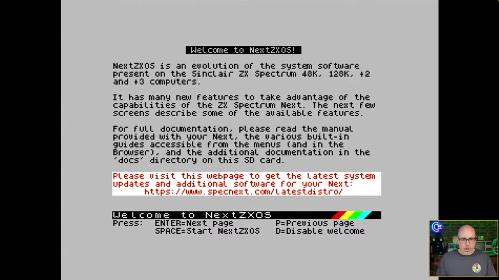
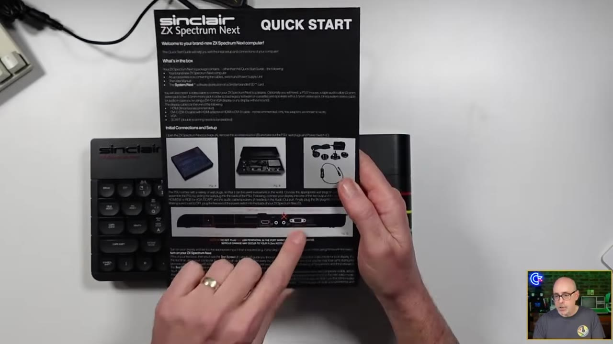
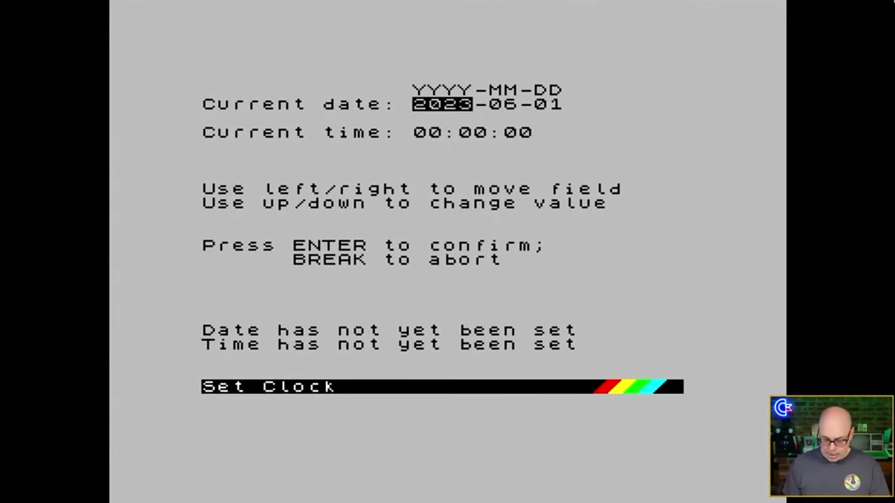
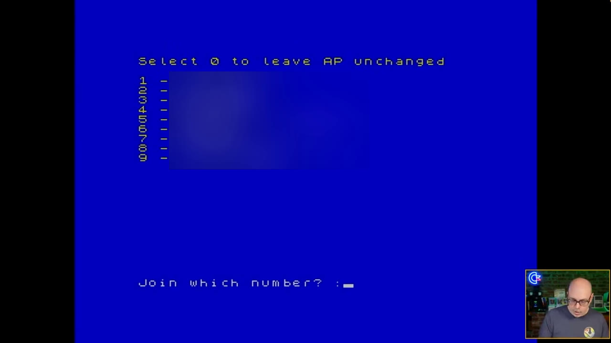
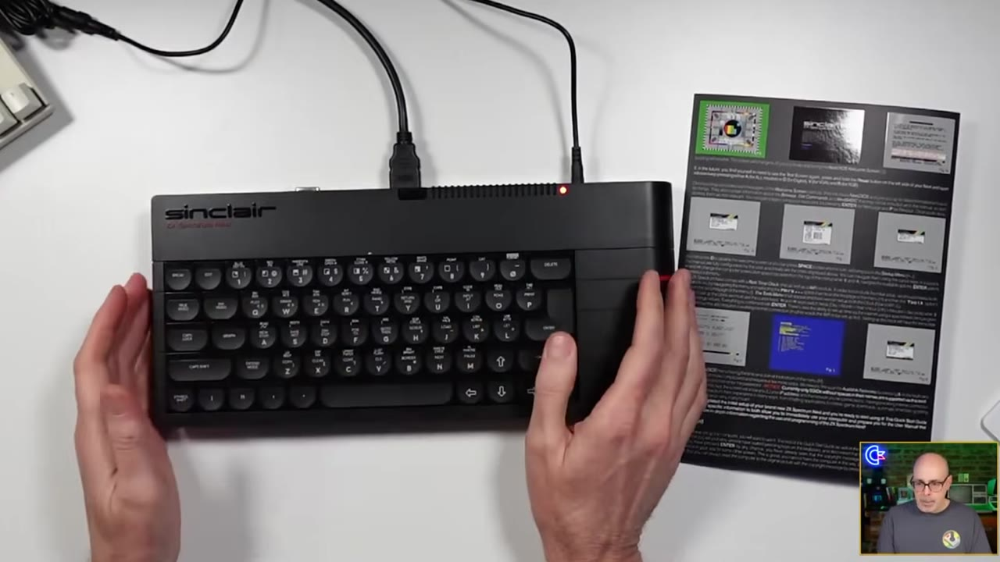
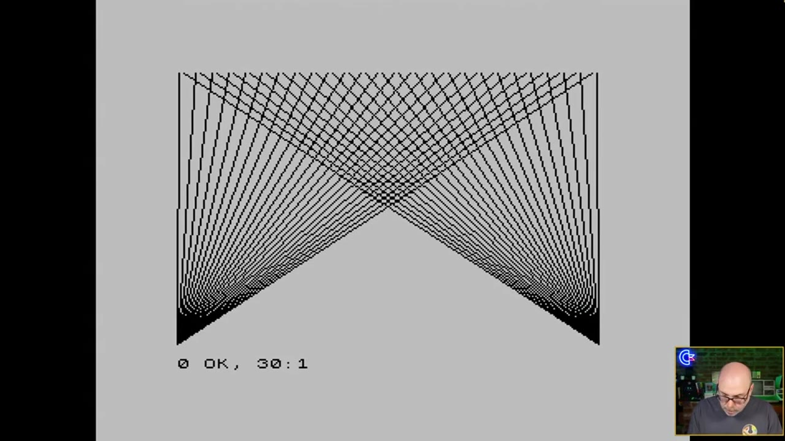
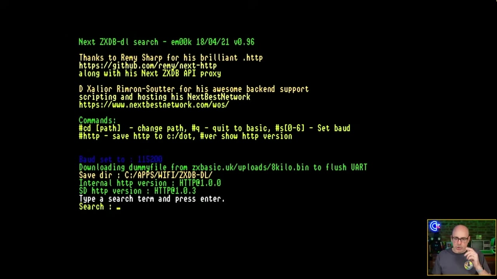

My ZX Spectrum Next arrived in February 2024 after a three-year wait. I [unboxed it live](https://www.youtube.com/watch?v=yuD-Q8eZbBQ), and then I didn't touch it. When folks asked how I liked it, I had to admit I had no earthly idea. So I went live again with the little Quick Start Guide card that comes in the box and worked through it on camera, tiny print and all.

KS3 machines use the Issue 5 board. If yours is on the desk, this is the "now what?" I had with mine. This post is the text companion to that video. It follows the Quick Start card step by step and adds what I've learned since: the confusing "Issue" naming, SD card prep for an Issue 5 board, video modes, Wi-Fi, the keyboard shortcuts, the NextBASIC type-in program, downloading games, and writing the Pi accelerator card with Raspberry Pi Imager. Soldering the header and opening the case are in my [NextPi install guide](/zx-spectrum-next-nextpi-install). I've also corrected the things I got wrong on camera. Let's dig in!

> **Updated Nov 2026:** The official distribution is System/Next 26.11a. The SD card steps below follow the KS3 Issue 5 instructions on specnext.com, and the Pi accelerator image is written with Raspberry Pi Imager.



## TABLE OF CONTENTS {#table-of-contents}

- [TABLE OF CONTENTS](#table-of-contents)
- [LINKS](#links)
  - [Video Mention Links](#video-mention-links)
  - [ZX Spectrum Next Accessories](#zx-spectrum-next-accessories)
  - [ZX Spectrum Next Resources](#zx-spectrum-next-resources)
- [SUPPORT THE BLOG AND CHANNEL](#support-the-blog-and-channel)
- [COMPANION YOUTUBE VIDEO](#companion-youtube-video)
- [VIDEO ERRATA](#video-errata)
- [UPDATES SINCE THE VIDEO](#updates-since-the-video)
- [WHICH "ISSUE" DO I HAVE?](#which-issue-do-i-have)
- [BEFORE YOU POWER ON: SD CARD PREP](#sd-card-prep)
- [FIRST BOOT AND VIDEO MODES](#first-boot-and-video-modes)
- [THE REAR PORTS](#the-rear-ports)
- [CPU SPEED, CLOCK, AND WI-FI](#cpu-speed-clock-and-wi-fi)
  - [Set the Clock](#set-the-clock)
  - [Connect to Wi-Fi](#connect-to-wi-fi)
- [KEYBOARD, BUTTONS, AND SHORTCUTS](#keyboard-buttons-and-shortcuts)
- [NEXTBASIC: EDITOR MODES AND A FIRST PROGRAM](#nextbasic-first-program)
  - [The Quick Start Type-In Program](#the-quick-start-type-in-program)
- [DOWNLOADING GAMES WITH ZXDB-DL](#downloading-games-with-zxdb-dl)
  - [Joysticks](#joysticks)
- [ADD A RASPBERRY PI ZERO](#add-a-raspberry-pi-zero)
- [ISSUE 3 / KS3: THE ISSUE 5 BOARD](#issue-3-what-new-owners-should-know)
- [EXTRA TIPS AND TRICKS](#extra-tips-and-tricks)
- [SOURCES](#sources)
- [CONCLUSION](#conclusion)

---

## LINKS {#links}

Below are the links you need to get the most out of your ZX Spectrum Next.

### Video Mention Links {#video-mention-links}

- 📘 ZX Spectrum Next User Manual, first edition (official page): <https://www.specnext.com/zx-spectrum-next-user-manual-first-edition/>
- 💾 Latest System/Next distribution (official): <https://www.specnext.com/latestdistro/>
- 💾 Raspberry Pi Imager (official install guide): <https://www.raspberrypi.com/documentation/computers/getting-started.html#install-using-imager>
- 🎮 ZXDB downloader by em00k: <https://github.com/em00k/next-zxdb-downloader>
- 📺 My live unboxing of the ZX Spectrum Next: <https://www.youtube.com/watch?v=yuD-Q8eZbBQ>
- 📺 My NextPi Zero accelerator install video: <https://www.youtube.com/watch?v=06S6ZSgc-w0>
- 📘 My NextPi install write-up (header, case, and the 2025 NextPi2 video): [/zx-spectrum-next-nextpi-install](/zx-spectrum-next-nextpi-install)

### ZX Spectrum Next Accessories {#zx-spectrum-next-accessories}

- 🧠 microSD Cards: <https://amzn.to/3IYL3Kn>
- 🚠 HDMI Cables: <https://amzn.to/4c2vhM9>
- 🕹️ Hyperkin Trooper (the joystick I use in the video): <https://amzn.to/3l1CHXj>
- 🔊 3.5mm Shielded Cables: <https://amzn.to/3VBsBPL>
- 🔈 Edifier Speakers: <https://amzn.to/3vymO2G>
- 🔈 Budget Speakers: <https://amzn.to/3J2PyDX>
- 🔌 USB-C to Micro USB Adapter (handy if you add a Pi Zero): <https://amzn.to/3Wkxxrr>
- 📺 Prison TVs on eBay (small CRTs for VGA or RGB setups): <https://ebay.us/jTv90O>
- 👚 Sew Ready Covers (tell Maggie retroCombs sent you!): <https://ebay.us/EFNZGp>

*When you click on links to various merchants on this site and make a purchase, this can result in this site earning a commission. Affiliate programs and affiliations include, but are not limited to Amazon and the eBay Partner Network.*

### ZX Spectrum Next Resources {#zx-spectrum-next-resources}

- SpecNext official site: <https://www.specnext.com/>
- ZX Spectrum Next User Manual, 3rd edition (online, on Explorer): <https://explorer.specnext.dev/documentation/manual/rev3/chapter/zx-spectrum-next-home-computer>
- SpecNext wiki FAQ: <https://wiki.specnext.dev/FAQ>
- Issue 3 Kickstarter (FAQ tab): <https://www.kickstarter.com/projects/spectrumnext/zx-spectrum-next-issue-3-0/faqs>
- System/Next distribution on GitLab: <https://gitlab.com/thesmog358/tbblue>
- NextZXOS change log: <https://gitlab.com/thesmog358/tbblue/-/raw/master/docs/nextzxos-changelog.txt>
- Spectrum Computing (game database): <https://spectrumcomputing.co.uk/>

## SUPPORT THE BLOG AND CHANNEL {#support-the-blog-and-channel}

Check out the [supporters page](/supporters) to learn about my supporters and how you can join our community. If this post saved you some time, you can also [leave a tip](https://paypal.me/stevencombs).

## COMPANION YOUTUBE VIDEO {#companion-youtube-video}

Title: _🤪 This ZX Spectrum Next is WILD! QUICK START GUIDE Overview._





This video is an edit of two livestreams. If you want to catch the next one live, [become a channel member](https://www.youtube.com/@retrocombs/join) and join the conversation.

## VIDEO ERRATA {#video-errata}

As of 2026-10-22:

- **"Issue 2" (title and throughout):** I call my machine an "Issue 2." That's the name of the second Kickstarter campaign (KS2). The mainboard inside KS2 machines is a different revision called Issue 4. See [Which "Issue" do I have?](#which-issue-do-i-have) below. ([Explorer registers](https://explorer.specnext.dev/registers); [Retro Isle](http://www.retroisle.com/general/specnext.php))
- **"The SP32 that's in this thing" (~13:55):** The Next's Wi-Fi module is an ESP8266, not an ESP32. ([User Manual, 3rd ed.](https://explorer.specnext.dev/documentation/manual/rev3/chapter/zx-spectrum-next-home-computer))
- **The Wi-Fi firmware update (~13:18):** I picked option 7 without knowing what it did. It updates the ESP Wi-Fi module's firmware, and my version stayed at 1.2. Don't copy me. The FAQ warns that ESP updates can brick the module, and on KS2 boards the ESP is soldered on. ([SpecNext wiki FAQ](https://wiki.specnext.dev/FAQ))
- **"The VIC-20 had a 23 column" screen (~20:15):** The VIC-20 shows 22 columns by 23 rows. I mixed up the two numbers. ([Wikipedia: VIC-20](https://en.wikipedia.org/wiki/VIC-20))
- **"Jet Set Willie" (~36:12):** It's *Jet Set Willy*. ([Spectrum Computing](https://spectrumcomputing.co.uk/))
- **"TZX or ZX or Z80" (~36:54):** The formats listed were TZX, TAP, and Z80. ([SpecNext wiki: File Formats](https://wiki.specnext.dev/File_Formats))
- **The Jet Set Willy load failure (~37:25):** I most likely picked a TZX file. The loader asked me to choose a TZX load mode, and the FAQ says TZX files need a Raspberry Pi Zero accelerator or an external TZX player. NextZXOS loads TAP and Z80 directly. I can't confirm that from the footage alone, so treat it as my best guess. ([SpecNext wiki FAQ](https://wiki.specnext.dev/FAQ); [File Formats](https://wiki.specnext.dev/File_Formats))
- **"I don't know that I'll ever do that" (~7:32, about the Pi Zero):** I did! See [Add a Raspberry Pi Zero](#add-a-raspberry-pi-zero).
- **F11 and F12 (~17:58):** I read the card as saying F11 and F12 on a PS/2 keyboard turn the expansion bus off and on. I can't confirm that. The [official PS/2 keyboard page](https://www.specnext.com/ps2-keyboard/) lists only F1 to F10, and the core's [register notes](https://gitlab.com/SpectrumNext/ZX_Spectrum_Next_FPGA/-/blob/master/cores/zxnext/nextreg.txt) describe "F5/F6 expansion bus hotkeys." If you need the expansion bus hotkeys, check the current official docs rather than my reading of the card.

## UPDATES SINCE THE VIDEO {#updates-since-the-video}

- **Firmware and software:** The video shows firmware 1.44 and core 3.02.00. When I first published this post, the distro I was using was System/Next 24.11 (NextZXOS 2.09). As of November 2026 the [latest distro page](https://www.specnext.com/latestdistro/) is System/Next 26.11a: NextZXOS v2.10a, core 3.03.03 for Issues 2, 4, and 5, and firmware 1.46. Distributions are named by year and month (24.11 was November 2024). The differential updater is back, so the Update menu works again. KS3 Issue 5 machines use a different file set than a full card rebuild. See [SD card prep](#sd-card-prep).
- **Issue 3 is the KS3 campaign, and the board is Issue 5:** The third Kickstarter ran from July 19 to August 18, 2025, and 7,524 backers pledged £2,612,335. ([Kickstarter](https://www.kickstarter.com/projects/spectrumnext/zx-spectrum-next-issue-3-0)) The current distro page addresses those machines as "KS3 (Issue 5)." A 31 August 2026 distributor note said finished machines were in sea transit and had not yet shipped to individual backers. ([SpriteFountain](https://www.spritefountain.com/zx-spectrum-next-issue-3-shipping-moves-to-sea-transit/)) specnext.com does not publish a date when every backer received one.
- **I wondered about a C64 core (~24:17), and here it is:** Issue 3 adds fully licensed Sinclair QL and Commodore 64 cores. In SpecNext's words, "the Next Issue 3 can run all the software for the Sinclair QL and the C64 straight out of the box." ([SpecNext announcement](https://www.specnext.com/the-sinclair-zx-spectrum-next-issue-3-is-coming-to-kickstarter-this-saturday/)) 26.11a also updates the official extra cores for Issues 2, 4, and 5, including Fat32 drivers in the QL core. ([Latest distro](https://www.specnext.com/latestdistro/))
- **I installed a Pi Zero after all:** In August 2025 I added the Raspberry Pi Zero accelerator with NextPi2. The current accelerator download on the distro page is AlpineNext, written with Raspberry Pi Imager. ([my NextPi video](https://www.youtube.com/watch?v=06S6ZSgc-w0); [latest distro](https://www.specnext.com/latestdistro/))

## WHICH "ISSUE" DO I HAVE? {#which-issue-do-i-have}

This confused me, and it confuses a lot of people. "Issue" gets used for two different things: the Kickstarter campaign and the mainboard revision.

- **KS1 (2017)** machines use the **Issue 2** board.
- **KS2 (2020)**, the campaign called "Issue 2," shipped the **Issue 4** board. That's my machine.
- **KS3 (2025)**, the campaign called "Issue 3," ships a board that reports itself as **Issue 5**.

So when I say "my Issue 2" in the video, I mean my KS2 machine, which has an Issue 4 board.

| | KS1 (board Issue 2) | KS2 "Issue 2" (board Issue 4) | KS3 "Issue 3" (board Issue 5) |
|---|---|---|---|
| Kickstarter | 2017 | 2020 | Jul–Aug 2025 |
| FPGA | Xilinx Spartan-6 XC6SLX16 | Xilinx Artix-7 XC7A15T | Xilinx Artix-7 XC7A35T, "almost 3X the size of the Issue 2 Next" |
| RAM | 1MB (512KB plus a stretch goal) | 2MB | 2MB as standard |
| SD card slots | One | One | Two, both available to the OS |
| VGA out | Standard | Standard | Upgraded to support more colours |
| Expansion port | Standard | Standard | Adds +3 disk signals |
| Official extra cores | | | Licensed QL and C64 cores |

Sources: [Explorer registers](https://explorer.specnext.dev/registers) (board IDs and FPGAs), [Retro Isle](http://www.retroisle.com/general/specnext.php) (board history, campaigns, and RAM), [Issue 3 Kickstarter FAQ](https://www.kickstarter.com/projects/spectrumnext/zx-spectrum-next-issue-3-0/faqs) (Issue 3 changes), and the [SpecNext announcement](https://www.specnext.com/the-sinclair-zx-spectrum-next-issue-3-is-coming-to-kickstarter-this-saturday/) (cores).

> **Note:** The User Manual explains that on Issue 2 boards, the real-time clock, Wi-Fi module, extra RAM, and Raspberry Pi Zero accelerator were optional, and most of those are standard on Issue 4. "If on the other hand, you have an Issue 4, the only feature you may be interested in is the Raspberry Pi Zero accelerator." ([User Manual, 3rd ed., p. 220](https://explorer.specnext.dev/documentation/manual/rev3/page/220))
{: .note}

## BEFORE YOU POWER ON: SD CARD PREP {#sd-card-prep}

This isn't in the video, but it's the first thing I'd tell a new owner. The Next's own card is a FAT32 card you copy files onto. Raspberry Pi Imager is only for the separate Pi accelerator card, in [Add a Raspberry Pi Zero](#add-a-raspberry-pi-zero).

- **FAT32 only (or FAT16/FAT12).** The Next does not read exFAT or NTFS. Windows' GUI formatter and the SD Association formatter force exFAT on cards of 32GB or larger. On Windows, format from the command line instead: `format X: /FS:FAT32`, where `X:` is your card. ([SpecNext wiki FAQ](https://wiki.specnext.dev/FAQ)) The current distro page also says to use a fresh FAT32 card, and it recommends a new SDHC card at a minimum. ([Latest distro](https://www.specnext.com/latestdistro/))
- **KS3 (Issue 5), the short path.** Download three files from the [latest distro page](https://www.specnext.com/latestdistro/) onto a new card: `sn-update-26.11a.dsu`, `install.bas`, and `updater.bas`. Copy them into the root of the card. SpecNext says this card should not already be a System/Next card, and the longer instructions say it should not have `TBBLUE.FW` in the root. Eject the card on the computer before you remove it.
- **On the Next.** Turn it on, open the Browser, press D to change drive, select `install.bas`, press ENTER, press Y, then press C and wait. Reboot while pressing U, answer Y, and wait until the core flash finishes. The machine resets to the testcard screen. ([Latest distro](https://www.specnext.com/latestdistro/))
- **KS3 with the internal card removed.** The same page treats that machine like a KS2: copy `sn-update-26.11a.dsu` onto the boot card, or copy an unzipped full distribution onto a newly formatted card. Then use **Tools > Updater**, or launch the DSU from the Browser.
- **Full distribution zips are file archives.** `sn-complete-26.11a.zip`, `sn-nosrc-26.11a.zip`, and `sn-lite-26.11a.zip` unzip onto a newly formatted SD card. Raspberry Pi Imager is for the AlpineNext accelerator download, which is the disk image on that page.
- **What 26.11a reports.** NextZXOS v2.10a, core 3.03.03 for Issues 2, 4, and 5, and firmware 1.46. The boot process also adds an INFO screen for the card readers, partition types, ESP, RTC, RPi0, core, and NextZXOS version. Check the filenames on the distro page when you download. The FAQ notes that the page's WordPress date doesn't change every time the page is edited. ([Latest distro](https://www.specnext.com/latestdistro/); [SpecNext wiki FAQ](https://wiki.specnext.dev/FAQ))

> **Warning:** Some TVs keep the Next powered through the HDMI cable. After a firmware or core update, remove ALL cables so the Next fully powers off. ([SpecNext wiki FAQ](https://wiki.specnext.dev/FAQ))
{: .warn}

## FIRST BOOT AND VIDEO MODES {#first-boot-and-video-modes}

There's no power button. The power supply has an inline switch, which was a Kickstarter stretch goal, so plug everything in first (yes, including the HDMI cable, unlike me) and then flip the switch.



The boot screen in the video shows firmware 1.44 and core 3.02.00. It also lists the keys you can press: SPACEBAR for the menu, C for extra cores, and A, D, V, or R to pick a video mode (All, Digital, VGA, or RGB). System/Next 26.11a lists firmware 1.46 and core 3.03.03, and it adds the INFO screen described above. ([Latest distro](https://www.specnext.com/latestdistro/))

- **Choosing a video mode:** On first boot, the Next shows a test screen so you can pick the mode your display handles. It also plays a tone. If your display locks onto more than one mode, choose the one where you can hear the tone. ([SpecNext wiki FAQ](https://wiki.specnext.dev/FAQ))
- **VGA:** Hold V at boot. VGA0 is the preferred mode because its timing is the most accurate. ([SpecNext wiki FAQ](https://wiki.specnext.dev/FAQ))
- **HDMI and timing-sensitive games:** Some games and demos that use multicolour or border effects need exact Spectrum timing. They won't display properly over HDMI and need a VGA or RGB display. That's a hardware limit, not a fault in your machine. ([SpecNext wiki FAQ](https://wiki.specnext.dev/FAQ))



Next comes the Welcome to NextZXOS pages. ENTER goes to the next page, P goes back, SPACE starts NextZXOS, and D turns off the welcome screens. ENTER and P sit right next to each other, which helps.

## THE REAR PORTS {#the-rear-ports}



The card shows the ports on the back: EAR/MIC, audio out, VGA, PS/2 keyboard and mouse, and HDMI. There's also a big X that says don't plug USB peripherals in there. Those ports belong to the optional Raspberry Pi Zero accelerator. The joystick ports are on the front, nicely placed.

- **Loading real cassettes:** The Next's EAR/MIC socket needs a 3.5mm plug of the "stereo" (TRS) type, because the signal travels on the ring. A mono plug won't work. Use **More > Tape Tester** to find the right volume before you load. ([SpecNext wiki FAQ](https://wiki.specnext.dev/FAQ))
- **PS/2 mouse:** I picked up a free PS/2 mouse at World of Commodore. If a PS/2 *keyboard* doesn't work, see [Extra Tips](#extra-tips-and-tricks).

## CPU SPEED, CLOCK, AND WI-FI {#cpu-speed-clock-and-wi-fi}

In the NextZXOS menu, the up and down arrows move through the options and the left and right arrows change the CPU speed. You can also toggle the speed with NMI+8 (3.5, 7, 14, or 28MHz). ([SpecNext wiki FAQ](https://wiki.specnext.dev/FAQ))

### Set the Clock {#set-the-clock}



Go to **More > Tools** and choose the clock. Left and right move between fields, up and down change the values, and ENTER confirms. It's a 24-hour clock. Check the year, because I set mine to 2023 by mistake. Once it's set, the date and time appear at the bottom of the NextZXOS menu.

### Connect to Wi-Fi {#connect-to-wi-fi}



Wi-Fi setup is also under **More > Tools**. Option 5 scans for networks (I had to press ENTER before the scan finished), and then you pick a network by number and type the password. The password shows on screen as you type, so don't do this on a livestream like I almost did.

> **Tip:** The Next's ESP Wi-Fi module only connects to 2.4GHz networks, and your password can't contain spaces. If setup fails, run `wifi2.bas` from `/apps/wifi/setup`. To check that you're online, go to the command line, type `.uart`, and send `AT+CIFSR`. It should return your IP address. ([SpecNext wiki FAQ](https://wiki.specnext.dev/FAQ))
{: .tip}

> **Warning:** Leave option 7, the Wi-Fi firmware update, alone unless you know you need it. KS machines shipped with ESP firmware 1.2.0.0, which works. A failed update can brick the ESP, and on KS2 boards it's soldered on. ([SpecNext wiki FAQ](https://wiki.specnext.dev/FAQ))
{: .warn}

## KEYBOARD, BUTTONS, AND SHORTCUTS {#keyboard-buttons-and-shortcuts}



The keyboard isn't a MEGA65 keyboard, but as we say in Kentucky, it ain't bad. The concave keys feel good. The layout is the hard part: there's no colon where my pinky expects one, and the symbols hide behind Symbol Shift. You'll find Break, True Video, Inv Video, Graph, Caps Shift, Extend, and Symbol Shift.

- **BREAK works like Escape.** A viewer taught me this live: when you're stuck in the browser, BREAK gets you back to the menu.
- **Typing symbols:** Hold Symbol Shift. In the video, `=` and `-` (Symbol Shift+J) were the ones I hunted for.

The three buttons on the left side:

- **Reset:** Tap for a soft reset or hold for a hard reset.
- **NMI:** Hold it and press a number key for the shortcuts below.
- **Drive:** Triggers the DivMMC, the hardware that manages the SD card.

| Shortcut | What it does |
|---|---|
| NMI + 1 | Hard reset |
| NMI + 2 | Toggle the scan doubler |
| NMI + 3 | Toggle 50/60Hz |
| NMI + 4 | Soft reset |
| NMI + 7 | Toggle scanlines (25/50/75%) |
| NMI + 8 | Toggle CPU speed (3.5/7/14/28MHz) |
| NMI + 9 | NMI menu |

Source: [SpecNext wiki FAQ](https://wiki.specnext.dev/FAQ). On a PS/2 keyboard, F1 to F10 do the same jobs as NMI+1 to NMI+0. ([SpecNext PS/2 keyboard page](https://www.specnext.com/ps2-keyboard/))

> **Tip:** In the NextZXOS browser (NextZXOS 2.07 and later), press O to sort by date, size, or none, and press + (Symbol Shift+K) to flip between ascending and descending order. ([SpecNext wiki FAQ](https://wiki.specnext.dev/FAQ))
{: .tip}

## NEXTBASIC: EDITOR MODES AND A FIRST PROGRAM {#nextbasic-first-program}

Choose **NextBASIC** from the opening menu. Commands are typed letter by letter, not with the single-key keywords of the original Spectrum. The cursor is a flashing blue-and-white block.

- **Column modes:** NextBASIC supports 32, 64, and 85 columns. The 64- and 85-column modes use the Timex hi-res screen modes, so they're monochrome. Only 32 columns gives you colour.
- **The footer bar** shows which part of the system you're in. Below it, a two-line status area shows messages and errors.
- **The EDIT key** opens a menu with screen size, a screen option that switches between the full editor and the lower screen, renumber, clear, and **the guide**, which is the built-in documentation.
- **Calculator:** It's in the main menu. The `+` sign is Symbol Shift+K.

### The Quick Start Type-In Program {#the-quick-start-type-in-program}

Here's the program from the card, as I ended up running it. You'll start with `STEP 10` like I did, and then the card has you change line 10 to `STEP 7`:

```basic
10 FOR f=1 TO 255 STEP 7
20 PLOT 0,0: DRAW f,175: PLOT 255,0: DRAW -f,175
30 NEXT f
```



What I learned typing it in:

- When you press ENTER, the line turns uppercase and is colour coded (cyan is usually numbers).
- **Listen for the beep.** A high beep means the line was accepted, and a low beep means something's wrong with it. Turn your volume up so you can hear it.
- Go back up to a line to edit it.
- Don't worry when line 20 wraps onto the next screen line. The editor handles it.
- The `0 OK, 30:1` report at the bottom means the program finished normally.
- **GO TO 10 vs RUN:** After the STEP 7 change, the card has you type `GO TO 10`, which redraws right on top of the first picture. When I typed `RUN`, the screen cleared before the drawing started.

## DOWNLOADING GAMES WITH ZXDB-DL {#downloading-games-with-zxdb-dl}

This is the part that made me say "this is going to be a fun machine." With Wi-Fi set up, you can search an online game database and download straight to your SD card, without a PC.



1. Open the **Browser** and go to `apps/wifi/zxdb-dl`. The FAQ's quick Wi-Fi test is to launch `zxdb-loader.bas` from that folder. ([SpecNext wiki FAQ](https://wiki.specnext.dev/FAQ))
2. Type a search term and press ENTER.
3. Pick a result, press ENTER to download and play, or press C to change the save folder.

> **Tip:** Choose a TAP or Z80 version when the database has one. NextZXOS loads `.tap` and `.z80` directly. TZX files need a Raspberry Pi Zero accelerator or an external TZX player, which is probably why my Jet Set Willy download failed. ([SpecNext wiki: File Formats](https://wiki.specnext.dev/File_Formats); [SpecNext wiki FAQ](https://wiki.specnext.dev/FAQ))
{: .tip}

### Joysticks {#joysticks}

In ZXDB-dl, the arrow keys did the work and my joystick didn't. In games, the Next uses Atari-standard sticks and also supports Sega Mega Drive pads.

- **Defaults:** The left port is Kempston1 and the right port is Sinclair1. Change them with **NMI > Settings > Joysticks**. To make the change permanent, hold SPACE at the boot screen and press E. ([SpecNext wiki FAQ](https://wiki.specnext.dev/FAQ))
- **Fire buttons:** Only two fire buttons work on non-Sega pads. That's a hardware limit. ([SpecNext wiki FAQ](https://wiki.specnext.dev/FAQ))

> **Warning:** Don't use Sinclair-branded SJS-1 joysticks on the Next. Their wiring shorts the 5V line to ground and can damage the machine. If your joystick has a black plug and a grey plug, don't use the grey one. ([SpecNext wiki FAQ](https://wiki.specnext.dev/FAQ))
{: .warn}

## ADD A RASPBERRY PI ZERO {#add-a-raspberry-pi-zero}

In the video I said I didn't know that I'd ever add the Pi Zero accelerator. In August 2025 I did, with NextPi2. That install is what loads TZX files, runs extra dot commands, and plays more music formats. The current file on the distro page is AlpineNext, not the NextPi2 image from the video.



- **Which Pi:** The Raspberry Pi Zero v1.2, v1.3, and Zero W work with NextPi. NextPi disables the Zero W's wireless. **The Pi Zero 2 is not supported**, and neither are other Pi models or clones. ([SpecNext wiki FAQ](https://wiki.specnext.dev/FAQ)) The current AlpineNext download says the same limit in fewer words: Pi Zero or Pi Zero W, not the Pi Zero 2 W. ([Latest distro](https://www.specnext.com/latestdistro/))
- **The header:** The Pi needs a 40-pin (2x20) female header, soldered from the component side so it faces downwards. ([User Manual, 3rd ed., p. 221](https://explorer.specnext.dev/documentation/manual/rev3/page/221))
- **The accelerator card is a disk image.** AlpineNext on the distro page (the file listed in November 2026 is `alpinenext-0.5.8-2026-11-09.xz`) needs a 16GB microSD card and the official Raspberry Pi Imager. SpecNext calls it a must-update for Issue 2 and Issue 4 machines, and for anyone who is just adding a Pi Zero or Pi Zero W or rebuilding that card. 26.11a adds AlpineNext support on the Next, including SPI mode and pause, play, and rewind for TZX files. ([Latest distro](https://www.specnext.com/latestdistro/))
- **Write it with Raspberry Pi Imager.** Download Imager from the Raspberry Pi website on Windows or Mac, or run `sudo apt install rpi-imager` on Raspberry Pi OS. In the Device tab, select the Pi Zero model, not a Pi Zero 2. In the OS tab, choose **Use Custom** and select the AlpineNext file you downloaded. Connect the 16GB card, and in the Storage tab select that card. If more than one drive is plugged in, unplug the others until the size matches the card you mean. Leave **Exclude system drives** selected. Writing erases the card you pick. Select **Write**, then **I understand, erase and write**, and let Imager finish its verify step. ([Raspberry Pi docs: Install using Imager](https://www.raspberrypi.com/documentation/computers/getting-started.html#install-using-imager))
- **If Imager opens Customisation.** Raspberry Pi OS, and some other images, ask for a hostname, user, and Wi-Fi before the write. SpecNext's AlpineNext notes don't ask for any of that. The docs' way to decline it is **Skip customisation**.
- **NextPi quick test, from the video.** At the command line, type `.term`. When Terminex appears, press SYM+CAPS+B (Symbol Shift + Caps Shift + B) to switch to 115,200 baud and press ENTER. If you see `SUP>`, the NextPi install from the video is ready. Press Symbol Shift+Q to quit. ([SpecNext wiki FAQ](https://wiki.specnext.dev/FAQ)) That is the FAQ's NextPi test. The 26.11a page describes AlpineNext's TZX pause, play, and rewind, and leaves this `.term` check in the FAQ.

Soldering the header, opening the case, and the commands I used are in the [ZX Spectrum Next NextPi install guide](/zx-spectrum-next-nextpi-install). That post's flash steps are the NextPi2 and balenaEtcher process from the video. For a card you are writing now, use Imager and AlpineNext above.

## ISSUE 3 / KS3: THE ISSUE 5 BOARD {#issue-3-what-new-owners-should-know}

The KS3 campaign was called Issue 3. The board in those machines is Issue 5, which is the name on the current distro's KS3 steps, and core 3.03.03 is listed for Issues 2, 4, and 5. ([Latest distro](https://www.specnext.com/latestdistro/)) Most of the Quick Start card applies to every Next, so the tips above work on a KS3 machine too. Here's what the official [Issue 3 Kickstarter FAQ](https://www.kickstarter.com/projects/spectrumnext/zx-spectrum-next-issue-3-0/faqs) says is new:

- A larger FPGA, "almost 3X the size of the Issue 2 Next."
- An extra SD card slot, populated, "so the Issue 3 has two drives available to the OS."
- +3 disk signals routed to the expansion port.
- A VGA port upgraded to support more colours.
- Licensed Sinclair QL and Commodore 64 cores. ([SpecNext announcement](https://www.specnext.com/the-sinclair-zx-spectrum-next-issue-3-is-coming-to-kickstarter-this-saturday/))

**Already own a KS1 or KS2 Next?** It isn't obsolete. The FAQ says, "Never, the Next Issue 3 remains fully compatible with the KS1 and KS2."

> **Note: upgrading a KS1 or KS2 Next.** The FAQ is clear about which board fits. For KS1 and KS2 owners, the answer is "The upgrade board with daughterboard tier. The 'Just the Board' is a different layout that will not fit inside the Next's case." The upgrade tier's description says it's for owners who "want to upgrade their innards to Issue 3. Screwdriver required!" The "Just the Board" option will fit inside an original Spectrum case, but the FAQ warns "you'll need to drill quite a few holes… There's hacking involved!" ([Issue 3 Kickstarter FAQ](https://www.kickstarter.com/projects/spectrumnext/zx-spectrum-next-issue-3-0/faqs); [campaign description](https://www.kickstarter.com/projects/spectrumnext/zx-spectrum-next-issue-3-0/description))
{: .note}

I backed the ZX Spectrum Next Upgrade Board (the board plus daughterboard tier the Kickstarter FAQ recommends for Issue 1 and Issue 2 owners) to put inside my KS2 Next, and I plan to install it live when it arrives. [Become a channel member](https://www.youtube.com/@retrocombs/join) and watch the channel so you don't miss it.

## EXTRA TIPS AND TRICKS {#extra-tips-and-tricks}

- **PS/2 keyboard not working?** At the firmware screen, press SPACE, press SPACE again, change "PS/2 Mouse" to "Keyb.", and press ENTER twice. ([Latest distro](https://www.specnext.com/latestdistro/))
- **Use the built-in guide.** EDIT > Guide opens the documentation on the machine. I didn't find a search, so browse it like a book. Press Q to quit.
- **Prefer 48K mode with esxDOS?** Download esxDOS from <https://esxdos.org/index.html> and copy its BIN, SYS, and TMP folders to the root of your SD card. ([SpecNext wiki FAQ](https://wiki.specnext.dev/FAQ))
- **A game won't load?** The NextZXOS loader can switch off most of the Next's extra hardware for picky titles. ([SpecNext wiki FAQ](https://wiki.specnext.dev/FAQ))
- **Where to find games:** [Spectrum Computing](https://spectrumcomputing.co.uk/) and [World of Spectrum](https://www.worldofspectrum.org/), or ZXDB-dl on the Next itself. ([SpecNext wiki FAQ](https://wiki.specnext.dev/FAQ))
- **See what changed:** The [NextZXOS change log](https://gitlab.com/thesmog358/tbblue/-/raw/master/docs/nextzxos-changelog.txt) lists the new features and fixes in each version.

## SOURCES {#sources}

The KS3 Issue 5 steps, AlpineNext, and Raspberry Pi Imager notes were checked on 2026-11-14. The rest of this post was checked on 2026-10-22. Sources:

- SpecNext, Latest distro (System/Next 26.11a): <https://www.specnext.com/latestdistro/>
- Raspberry Pi docs, Install using Imager: <https://www.raspberrypi.com/documentation/computers/getting-started.html#install-using-imager>
- SpecNext, User Manual first edition page: <https://www.specnext.com/zx-spectrum-next-user-manual-first-edition/>
- SpecNext, PS/2 keyboard: <https://www.specnext.com/ps2-keyboard/>
- SpecNext, Issue 3 Kickstarter announcement: <https://www.specnext.com/the-sinclair-zx-spectrum-next-issue-3-is-coming-to-kickstarter-this-saturday/>
- ZX Spectrum Next User Manual, 3rd ed. (Explorer): <https://explorer.specnext.dev/documentation/manual/rev3/chapter/zx-spectrum-next-home-computer> and p. 220: <https://explorer.specnext.dev/documentation/manual/rev3/page/220>
- Explorer, registers (board IDs): <https://explorer.specnext.dev/registers>
- SpecNext wiki, FAQ: <https://wiki.specnext.dev/FAQ>
- SpecNext wiki, File Formats: <https://wiki.specnext.dev/File_Formats>
- ZX Spectrum Next FPGA core, nextreg.txt: <https://gitlab.com/SpectrumNext/ZX_Spectrum_Next_FPGA/-/blob/master/cores/zxnext/nextreg.txt>
- Issue 3 Kickstarter: <https://www.kickstarter.com/projects/spectrumnext/zx-spectrum-next-issue-3-0> (FAQ: <https://www.kickstarter.com/projects/spectrumnext/zx-spectrum-next-issue-3-0/faqs>)
- Retro Isle, ZX Spectrum Next history: <http://www.retroisle.com/general/specnext.php>
- SpriteFountain, "ZX Spectrum Next Issue 3 is on the water" (Aug 31 2026): <https://www.spritefountain.com/zx-spectrum-next-issue-3-shipping-moves-to-sea-transit/>
- Wikipedia, VIC-20: <https://en.wikipedia.org/wiki/VIC-20>
- em00k, ZXDB downloader: <https://github.com/em00k/next-zxdb-downloader>
- My videos: Quick Start (<https://www.youtube.com/watch?v=v8Ts9xAVeJo>), unboxing (<https://www.youtube.com/watch?v=yuD-Q8eZbBQ>), and NextPi install (<https://www.youtube.com/watch?v=06S6ZSgc-w0>)

## CONCLUSION {#conclusion}

That's the Quick Start card, start to finish: power, video modes, ports, clock, Wi-Fi, keyboard shortcuts, a first NextBASIC program, and a game download over Wi-Fi. It took me two livestreams to get through that tiny print. I hope this post gets you there in one sitting.

KS3 owners, your board is the Issue 5, and the current card steps are the three-file update above. Let me know in the comments below which core you'll try first: the Next, the QL, or the C64. If this post helped, [leave a tip](https://paypal.me/stevencombs). Questions can go to steven@retrocombs.com.

That's it for me, folks. 🕹️ retroCombs, OUT!
