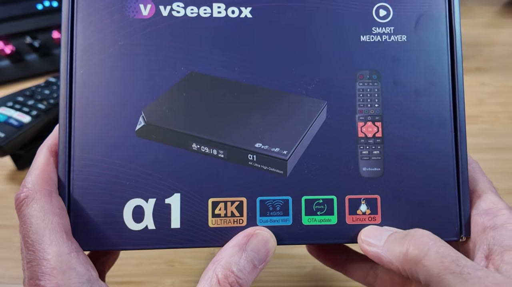
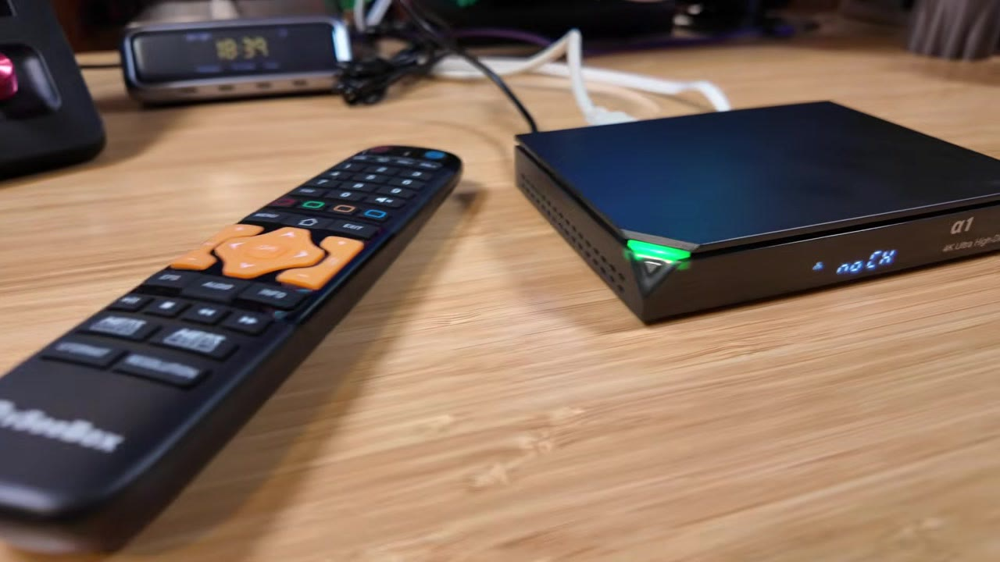
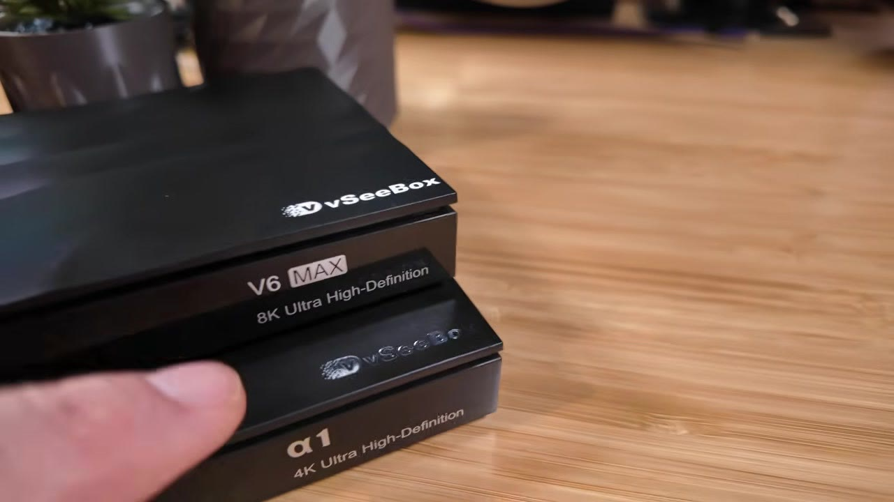
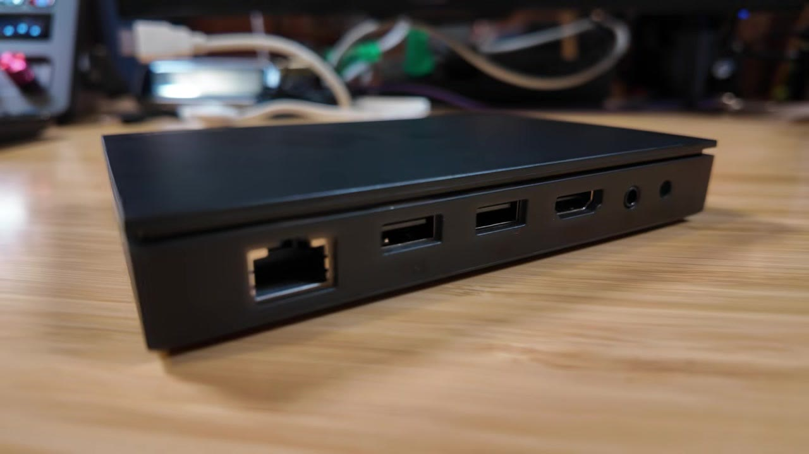
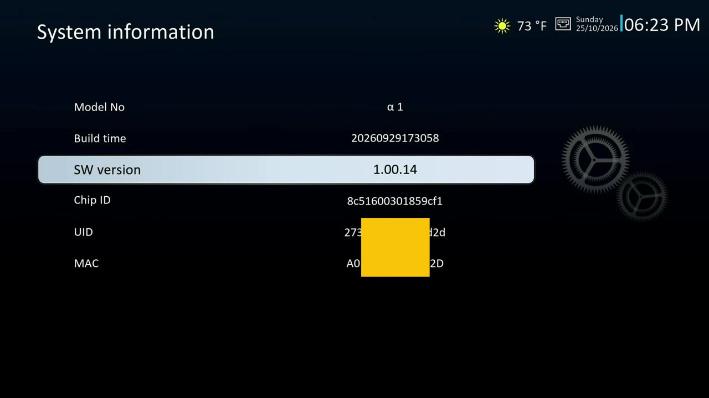
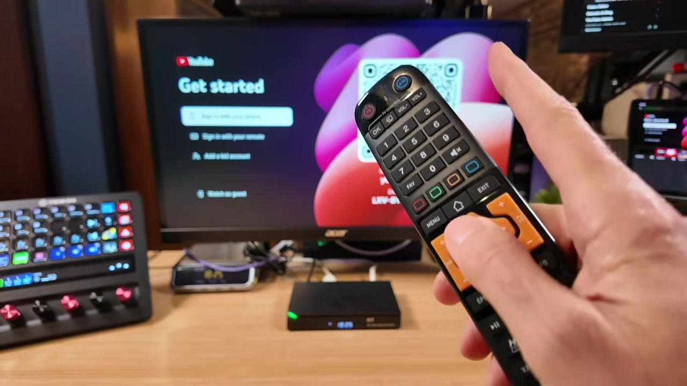
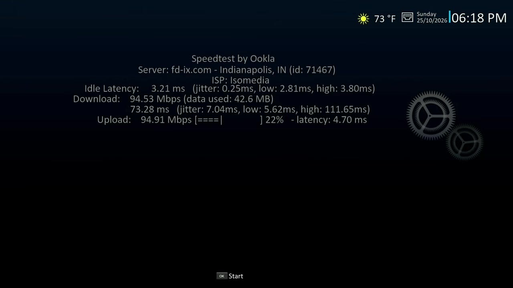
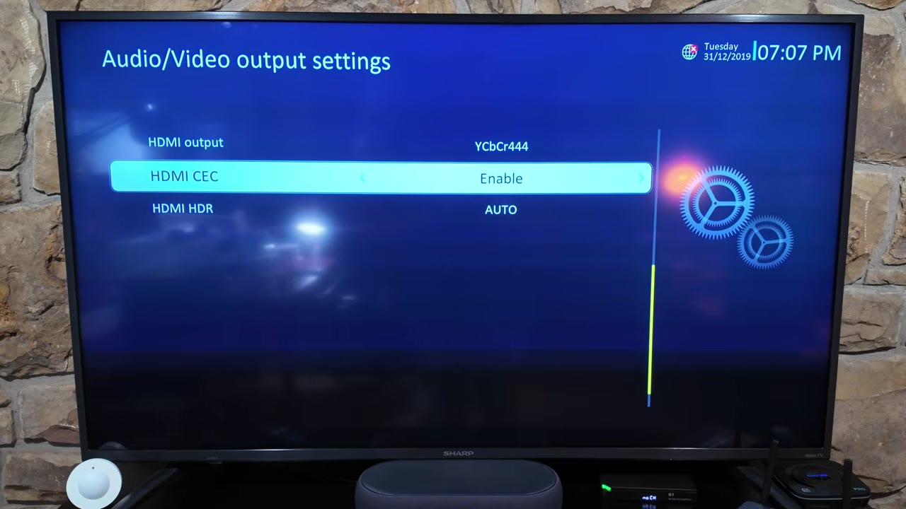

vSeeBox walked away from Android TV OS for this one. The α1 is a small Linux media player with six apps, no store, and a remote that still wants line of sight. I unboxed it, raced the cold boot against a V6 Max, checked wired and 5 GHz networking, played my own USB files, and tried casting. Here is what actually showed up on the tape.

*Full disclosure: vSeeBox provided this α1 free in exchange for an honest review. It was a product exchange with no payment, and vSeeBox did not see this post before it was published. Links in this post are affiliate links, so I may earn a commission if you buy through them. The official α1 link also includes an automatic $30 off at checkout (no code needed); verify the discount before you pay.*



## TABLE OF CONTENTS {#table-of-contents}

- [TABLE OF CONTENTS](#table-of-contents)
- [LINKS](#links)
  - [Video Mention Links](#video-mention-links)
  - [Accessories Used in Testing](#accessories-used-in-testing)
  - [My Related Videos](#my-related-videos)
  - [Resources](#resources)
- [SUPPORT THE BLOG AND CHANNEL](#support-the-blog-and-channel)
- [COMPANION YOUTUBE VIDEO](#companion-youtube-video)
- [VIDEO ERRATA](#video-errata)
- [WHAT'S IN THE BOX](#whats-in-the-box)
- [DESIGN AND PORTS](#design-and-ports)
- [FIRST BOOT AND FIRMWARE](#first-boot-and-firmware)
- [SIX APPS, NO STORE](#six-apps-no-store)
- [SETTINGS WORTH USING](#settings-worth-using)
- [THE FRONT-PANEL CHANNEL NUMBER](#the-front-panel-channel-number)
- [SYSTEM INFORMATION THAT WON'T NAME THE HARDWARE](#system-information)
- [NETWORK: ETHERNET AND 5 GHZ WI-FI](#network)
- [BOOT RACE: α1 VS V6 MAX](#boot-race)
- [4K OUTPUT AND THE HDR MENU](#4k-and-hdr)
- [USB PLAYBACK: HEVC WORKS, AV1 DIDN'T](#usb-playback)
- [CASTING: MIRACAST AND AIRPLAY](#casting)
- [LIVING WITH IT FOR SEVERAL DAYS](#living-with-it)
- [TIPS AND TRICKS](#tips-and-tricks)
- [BACKGROUND: WHAT "LINUX 4.9" MEANS HERE](#background-linux)
- [VERDICT](#verdict)
- [SOURCES](#sources)
- [CONCLUSION](#conclusion)

---

## LINKS {#links}

### Video Mention Links {#video-mention-links}

- 🐧 vSeeBox α1: <https://vseeboxstream.com/products/vseebox-alpha1?source_type=sales_plugin_af&slt=sales_plugin_af&referral_code=U2LA4FVZ0TUJ>
  - Exclusive $30 off through this link (no code needed). Confirm the discount at checkout.
- 📺 vSeeBox All Models (Elite Ultra, V6 Pro, V6 Max, V6 Plus): <https://vseeboxus.com/affiliate-program/sell-product?source_type=sales_plugin_af&slt=sales_plugin_af&productPage=1&referral_code=X973T43OZTN1>
- 📀 ClonerAlliance UHD Pro: <https://amzn.to/3UzOnES>

### Accessories Used in Testing {#accessories-used-in-testing}

- 🔋 Amazon Basics Batteries: <https://amzn.to/49LycZc>
- 🛜 Ethernet Network Cable: <https://amzn.to/4cEJyyB>
- 🔌 3.5mm to RCA AV Cable: <https://amzn.to/4i3EHM4>

*When you click on links to various merchants on this site and make a purchase, this can result in this site earning a commission. Affiliate programs and affiliations include, but are not limited to Amazon and the eBay Partner Network.*

### My Related Videos {#my-related-videos}

- ClonerAlliance UHD Pro: [Archive, Capture, and Stream with the ClonerAlliance UHD Pro](https://www.youtube.com/watch?v=fE8jXDB06Fc) and the post [/cloneralliance-uhd-pro](/cloneralliance-uhd-pro)
- vSeeBox Elite Ultra: [Is vSeeBox Elite Ultra Worth It in 2026? Full Unboxing!](https://youtu.be/7am4edtfZiA)
- Digibox D6 Max: [Digibox D6 Max Has a Feature Nobody is Talking About \| Full Unboxing](https://youtu.be/k542cIXHi48)

### Resources {#resources}

- Official α1 product page: <https://vseeboxstream.com/products/vseebox-alpha1>
- Independent hands-on (TORR3NT's Tech, Aug 2026): <https://torrentstech.com/reviews/vseebox-alpha1/>
- vSeeBox model comparison chart (TORR3NT's Tech): <https://torrentstech.com/guides/vseebox-comparison/>
- Linux vs Android for IPTV/OTT set-top boxes (Infomir BroadVision): <https://broadvision.infomir.eu/en/linux-vs-android-7-issue/>
- Why vendor Linux 4.9 kernels still show up on media boxes (CoreELEC forum FAQ): <https://discourse.coreelec.org/t/linux-kernel-faq-and-discussion/14870>
- Cortex-A35 + Linux 4.9 example in the MAG class of boxes (Infomir MAG544 datasheet PDF): <https://www.infomir.eu/img/544/20230419_Infomir_Datasheet_MAG544_544w3_EN.pdf>
- ARM Cortex-A35 overview (architecture reference): <https://developer.arm.com/Processors/Cortex-A35>
- Mali-450 MP overview (GPU family used on many low-power STBs): <https://developer.arm.com/Processors/Mali-450>

## SUPPORT THE BLOG AND CHANNEL {#support-the-blog-and-channel}

Check out the [supporters page](/supporters) to learn about my supporters and how you can join our community. If this post saved you some time, you can also [leave a tip](https://paypal.me/stevencombs).

## COMPANION YOUTUBE VIDEO {#companion-youtube-video}

Title: _I Tested The vSeeBox α1 And It Doesn't Run Android TV!_



This video is on my modern tech channel, [@retroCombs-tech](https://www.youtube.com/@retrocombs-tech?sub_confirmation=1). Tagline: Hooked on tech since '73.

## VIDEO ERRATA {#video-errata}

As of November 5, 2026 (same day as publish):

1. **Ethernet misspoke (wins/misses close).** On camera I said the Ethernet "caps out at 100MB." The Speed Test result was about **94.5 Mbps down / 95 Mbps up**, which matches a **100 megabit** (10/100) port, not 100 megabytes. The official page lists RJ45 10M/100M. ([Official specs](https://vseeboxstream.com/products/vseebox-alpha1))
2. **Boot race wording.** By my capture clock the α1 reached the home screen in roughly **15 seconds**. The V6 Max took much longer on the same power brick — on the order of the mid-40-second range in the shoot plan, so the α1 was roughly a third of that time. Treat the spoken "almost 5 seconds" for the V6 Max as a slip if you hear it that way; the useful takeaway is still "noticeably faster cold boot."
3. **"Linux" on the cardboard, not in System Information.** I say the box runs Linux. That claim is printed on the retail carton and the product page as **Linux 4.9**. The on-device System Information screen shows model, build time, and software version **1.00.14** — it does **not** print the OS name, RAM, storage, or SoC. ([Official page](https://vseeboxstream.com/products/vseebox-alpha1))
4. **Vendor RAM/storage vs one teardown-style reading.** The product page lists **2GB DDR3** and **8GB eMMC**. An independent Aug 2026 hands-on (TORR3NT's Tech) estimated roughly **1 GB** RAM and **256 MB** flash from chip part numbers, and notes there is no terminal or diagnostics path on the locked launcher. I did not open my unit. Treat the page numbers as vendor claims and the chip reading as a second opinion, not as my measurement. ([Official page](https://vseeboxstream.com/products/vseebox-alpha1), [TORR3NT α1 review](https://torrentstech.com/reviews/vseebox-alpha1/))
5. **AV1 and casting are firmware-dated.** Product marketing lists AV1 decode plus Miracast / DLNA / AirPlay. On **1.00.14** my two AV1 USB samples played **audio only**, and neither Miracast nor AirPlay found the box on my network. A later firmware may change that — check before you buy if those matter. ([Official page](https://vseeboxstream.com/products/vseebox-alpha1))
6. **Wi-Fi "ax" on the sheet.** The page lists 802.11a/b/g/n/ac/**ax**. I confirmed a working **5 GHz** join and subjectively snappier UI on 5 GHz. I did **not** capture a link-rate screenshot proving Wi-Fi 6, so I am not calling it Wi-Fi 6 in this post.
7. **A/V settings clock quirk.** When I opened Audio/Video output settings on the Sharp TV path, the on-screen clock showed a default-looking **31/12/2019** date even though other menus had the correct October 2026 date after setup. Harmless, but odd. See [4K output and the HDR menu](#4k-and-hdr).
8. **No Bluetooth on the sheet.** The retail box and the product page do not list Bluetooth. I did not find a Bluetooth settings page. IR remote only, rated to 10 m on the carton.

## WHAT'S IN THE BOX {#whats-in-the-box}

The carton calls it a smart media player and prints the big claim in red: **Linux OS**. Inside you get the α1, an IR remote with an orange D-pad accent I actually like, an HDMI cable, a barrel-jack power supply, and a thicker-than-expected user guide.

Two **AAA batteries are not included**. Buy a pack before you sit down to set it up.

## DESIGN AND PORTS {#design-and-ports}

If you watch this channel, the chassis will look familiar. Stacked with a V6 Max you get the same notched corner and ridge language. The V6 Max is white on top; the α1 uses a shinier silver gloss. The α1 also has bottom vents the V6 Max lacks.

Around back, left to right on my unit: **RJ45 Ethernet**, **two USB 2.0** ports, **HDMI**, a **3.5 mm AV** jack for older TVs, and a **DC barrel** power inlet. No USB-C. No USB 3. The V6 Max keeps a similar layout and adds a small SD card slot the α1 skips.

This reads as vSeeBox's baseline appliance: minimal ports, IR remote, front LED and a tiny front display.

## FIRST BOOT AND FIRMWARE {#first-boot-and-firmware}

First power-on offered an update before I could poke around: **version 1.00.14**, dated **2026-09-29**. I installed it so the rest of the review matches a fully updated unit. Then came language and time zone. The time-zone list is… creative. My zone was not listed, so I picked the closest match and moved on.

System Information later confirmed **SW version 1.00.14** and a build timestamp of `20260929173058`. It also shows a Chip ID. It does **not** show RAM, free storage, processor name, or "Linux."

## SIX APPS, NO STORE {#six-apps-no-store}

The home screen is the product. You get **YouTube**, a **media player**, **Weather**, **Speed Test**, plus vSeeBox's own **preloaded live app** and **preloaded on-demand app**. That is the whole launcher. There is no app store and no path I found to install anything else.

That is not a bug. That is what walking away from Android TV OS looks like on this box: no store, no sideloading story, nothing to manage.

> **Tip:** YouTube wants a sign-in. On a locked living-room box, use a secondary Google account, not your main personal one.
{: .tip}

## SETTINGS WORTH USING {#settings-worth-using}

The settings menu is plainer than Android TV OS, and that is the point. Useful bits I actually used:

- Subtitle size and color
- Screen position and aspect ratio (letterbox, pan and scan, or full)
- Audio output as **PCM** or **bitstream**
- **Launch an app at start-up** (I set Weather)
- **Auto standby** after a set number of hours
- Assign the **red remote button** to an app (I set YouTube; it worked the first time)
- Front-panel LED brightness, so it does not light the bedroom like a runway

Text entry is an on-screen keyboard driven by the remote. It works. It is not fast. Remote keyboards never are.

## THE FRONT-PANEL CHANNEL NUMBER {#the-front-panel-channel-number}

When the preloaded live app is running, the front-panel display shows the **channel number** as you flip channels — cable-box energy from the 90s. Because the number is on the box, not as a banner on the TV, you can glance over without covering the picture. Rapid presses kept up on my unit. I did not expect to want that on a streaming appliance. I kind of do.

## SYSTEM INFORMATION THAT WON'T NAME THE HARDWARE {#system-information}

Open System Information hoping for a Pi-style About page and you will be disappointed. You get model, build time, software version, Chip ID, and identifiers. No RAM. No storage. No SoC name. No OS string.

So if someone asks "what's inside?", the honest answer from the unit itself is: **the cardboard and the product page make the Linux and hardware claims; the Settings screen will not.**

## NETWORK: ETHERNET AND 5 GHZ WI-FI {#network}

Speed Test is built in. On a wired connection I saw about **94.53 Mbps down** and **94.91 Mbps up** to an Indianapolis server. That looks like a **100 Mbit** Ethernet port running at its ceiling. The official page lists **10M/100M** adaptive RJ45, not gigabit. For everyday streaming that is usually fine. For dragging large files across the LAN, that is your ceiling — and this box does not expose a general "send files to me" network share anyway.

Wi-Fi is listed as dual-band. I pointed the α1 at my **5 GHz** network and it connected. On 5 GHz the UI felt noticeably snappier. Subjective only; no Wi-Fi speed-test numbers in the video. Between Ethernet and 5 GHz you have workable options to get it online.

## BOOT RACE: α1 VS V6 MAX {#boot-race}

This is where leaving Android TV OS should pay off. I unplugged the α1, counted to five, and plugged it back in. By my capture clock it was on the home screen in roughly **15 seconds**.

Then I swapped in a V6 Max on the **same 5V supply**. The V6 Max took much longer — about three times the α1 on my count. If you hate waiting on a cold start, the α1 is faster than anything I have tried in this lineup.

## 4K OUTPUT AND THE HDR MENU {#4k-and-hdr}

Through my ClonerAlliance UHD Pro capture path the resolution list offered **2160p** and the picture came through in 4K. Plugged straight into a Sharp 4K TV, it also synced to 4K. Extra video options included HDMI CEC and an HDR menu with SDR, Dolby, HDR10, HLG, and Auto.

A menu option is not a test result. I did not verify every HDR flavor end to end, so I am not claiming all of them work — I will take vSeeBox's word for the list, and stick to what I can show: **4K handshake** on two displays.

Odd note: on that Sharp path the A/V settings screen showed a **31/12/2019** clock even after other menus had the correct date. See [Video Errata](#video-errata).

## USB PLAYBACK: HEVC WORKS, AV1 DIDN'T {#usb-playback}

Local media is the second half of this product after the built-in suite. I used my own USB stick.

- A **4K HEVC ~60 fps** sample played without a hitch.
- A **1080p HEVC 10-bit** sample also played cleanly.

The product page lists **AV1** decode. My two AV1 test files — a 4K HDR clip and a small low-res sample — played **sound only**. No video. The same files play video in VLC on a computer, so the files were not empty. If AV1 from USB matters to you, check for a firmware update before you buy.

Official page also claims USB storage up to **2 TB** (FAT32/NTFS). I did not fill a 2 TB drive for this review.

## CASTING: MIRACAST AND AIRPLAY {#casting}

The page lists Miracast, DLNA, and AirPlay. On my network:

- The phone Miracast app never found the α1.
- The Mac AirPlay menu did not list it either.

Could be network isolation on my side, but I do not think so. A firmware upgrade may activate casting later. Until then, treat casting as **unverified / not working on 1.00.14**.

## LIVING WITH IT FOR SEVERAL DAYS {#living-with-it}

After several days the pattern is: pick up the remote, land on the home screen, hit the red button I mapped to YouTube. Short menus. Six apps. Nothing to manage.

vSeeBox gave up flexibility to get there. For a lot of people, that is the right trade. This is the box I would hand to a less techy relative, because there is almost nothing to break or fiddle with. I still wish there were a clean way to add a couple of apps. For general turn-it-on-and-watch use, the α1 is pretty slick.

## TIPS AND TRICKS {#tips-and-tricks}

> **Tip:** Prefer **5 GHz Wi-Fi** when the box is near the router. On my unit the UI felt snappier there than on a weaker band.
{: .tip}

> **Tip:** Map the **red remote button** to YouTube (or Weather) on day one. One press beats hunting tiles.
{: .tip}

> **Tip:** Need batteries for the IR remote before first boot. Two AAA, not in the box.
{: .tip}

> **Tip:** If you want a VCR-style recording path for what is on the TV, put the α1 through a [ClonerAlliance UHD Pro](/cloneralliance-uhd-pro) the same way I do with other living-room boxes.
{: .tip}

> **Tip:** Keep expectations honest on Ethernet: plan for **~100 Mbps**, not gigabit.
{: .tip}

> **Note:** Stay off touring the preloaded live / on-demand grids in demos and screenshots if you are posting publicly. Frame the α1 as a media player with a small built-in suite, USB local media, YouTube, networking, and hardware honesty.
{: .note}

## BACKGROUND: WHAT "LINUX 4.9" MEANS HERE {#background-linux}

"Linux" on a TV box is not "Ubuntu on your desk."

- **Kernel vs product.** Linux 4.9 is a **kernel version**. On set-top hardware it is usually a **vendor kernel** with board support and media drivers, wrapped in a locked launcher. You do not get a desktop, a package manager, or a shell. CoreELEC's own FAQ is blunt about why Amlogic-class devices still ship on vendor 4.9 trees: that is where the working hardware decode paths live. ([CoreELEC kernel FAQ](https://discourse.coreelec.org/t/linux-kernel-faq-and-discussion/14870))
- **Why vendors still pick locked Linux.** Operator and appliance vendors like full UI control, fewer moving parts, and a fixed app set. Infomir's overview of Linux vs Android for IPTV/OTT lists the trade: performance and uniqueness on Linux, vs app ecosystems on Android TV. ([Infomir BroadVision](https://broadvision.infomir.eu/en/linux-vs-android-7-issue/))
- **Cortex-A35 / Mali-450 class.** The official page lists a **quad-core ARM Cortex-A35** and a **Mali-450** GPU. That is an efficiency-oriented AArch64 CPU family and an older Utgard-class GPU common on low-power STBs — fine for menus and hardware-decoded video, not a gaming or desktop GPU story. ([ARM Cortex-A35](https://developer.arm.com/Processors/Cortex-A35), [Mali-450](https://developer.arm.com/Processors/Mali-450), [MAG544 datasheet as a same-class Cortex-A35 + Linux 4.9 example](https://www.infomir.eu/img/544/20230419_Infomir_Datasheet_MAG544_544w3_EN.pdf))
- **SoC naming.** The official page does **not** name the SoC. TORR3NT's Aug 2026 hands-on attributes a **Goke GK6323-family** part from markings. I did not open my unit, so I am not repeating that as my finding. ([TORR3NT α1 review](https://torrentstech.com/reviews/vseebox-alpha1/))

## VERDICT {#verdict}

**Wins on my unit (1.00.14):**

- Fast cold boot versus the V6 Max
- Simple menus; six apps and done
- Snappier feel on 5 GHz Wi-Fi
- Front-panel channel number throwback
- Cheapest vSeeBox in the current line (verify live pricing)
- 4K HEVC from USB that just works

**Misses on my unit (1.00.14):**

- Ethernet behaves like a 100 Mbit port (not gigabit)
- Miracast / AirPlay did not find the box
- AV1 USB samples played audio only

**Who should buy it:** someone who wants an appliance. Turn it on. Watch. Hand it to a relative who does not want to tinker.

**Who should skip it:** power users who want an app store, gigabit Ethernet, Bluetooth, casting that works today, or AV1 from USB on current firmware. Look at the Android TV OS models in the same family instead — my Elite Ultra review is the power-user end of that spectrum.

How I put it on camera: the Elite Ultra is for the geek who wants to tinker. The α1 is for someone who wants less fiddling. You get what you get. It is an appliance, closer to a refrigerator than a hobby PC.

Check the [current α1 price](https://vseeboxstream.com/products/vseebox-alpha1?source_type=sales_plugin_af&slt=sales_plugin_af&referral_code=U2LA4FVZ0TUJ) before you buy, and confirm the automatic $30 off if you use my link.

## SOURCES {#sources}

- Official vSeeBox α1 product page and specs: <https://vseeboxstream.com/products/vseebox-alpha1>
- TORR3NT's Tech α1 hands-on (Aug 2026): <https://torrentstech.com/reviews/vseebox-alpha1/>
- TORR3NT's Tech vSeeBox comparison chart: <https://torrentstech.com/guides/vseebox-comparison/>
- Infomir BroadVision, Linux vs Android for IPTV/OTT: <https://broadvision.infomir.eu/en/linux-vs-android-7-issue/>
- CoreELEC forum, Linux kernel FAQ (vendor 4.9 context): <https://discourse.coreelec.org/t/linux-kernel-faq-and-discussion/14870>
- Infomir MAG544/544w3 datasheet (Cortex-A35 + Linux 4.9 class example): <https://www.infomir.eu/img/544/20230419_Infomir_Datasheet_MAG544_544w3_EN.pdf>
- ARM Cortex-A35: <https://developer.arm.com/Processors/Cortex-A35>
- ARM Mali-450: <https://developer.arm.com/Processors/Mali-450>
- Companion video on @retroCombs-tech: <https://www.youtube.com/watch?v=944c-XHpDtU>

## CONCLUSION {#conclusion}

The α1 is vSeeBox choosing simple over flexible. Linux 4.9 on the carton, six apps on the screen, no store, fast boot, honest limits on Ethernet, casting, and AV1 on the firmware I tested. If that sounds like the streamer you (or someone you buy for) actually wanted, the link is above. If you want to install apps next month, this is the wrong box.

Would you miss Android TV OS, or do you know someone this appliance is perfect for? Tell me in the [comments below this post](#comments) — not on the YouTube page.
