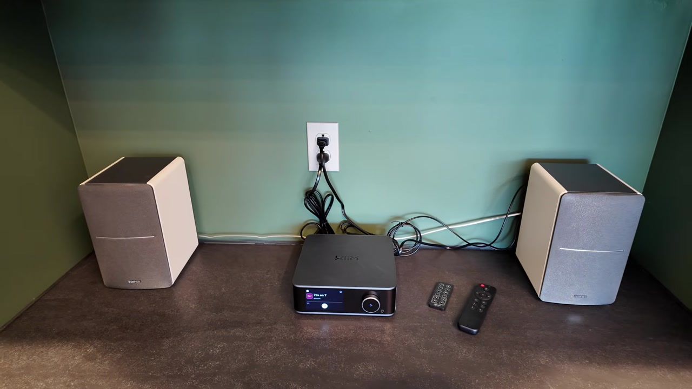
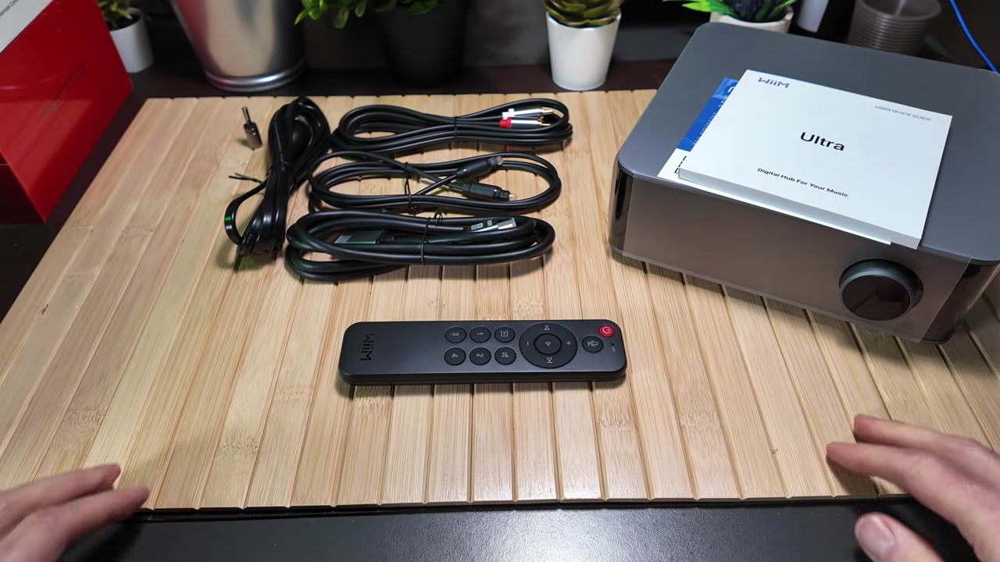
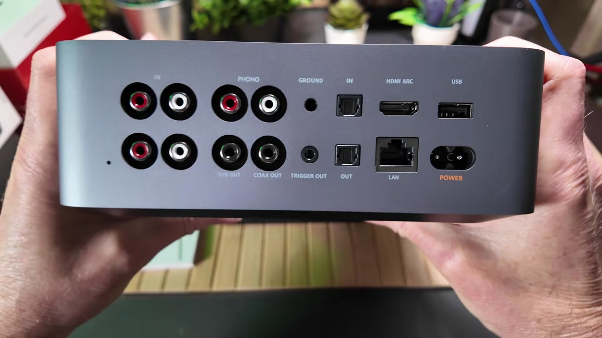
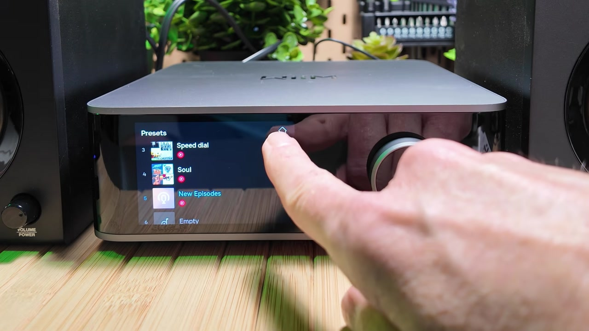

I spend long days at a desk with thin, single-speaker audio, and I finally wanted something better. After more than a week with a [WiiM Ultra](https://link.amazon/B02NR2bha) and a pair of [Edifier R1280DB](https://link.amazon/B01Cfibzl) speakers, the difference is not subtle. Stereo separation was the biggest win, RoomFit made the shelves sound brighter, and the setup flexes from local radio to YouTube Music to a SiriusXM workaround without making me pick up my phone every time.

*Full disclosure: I bought this WiiM Ultra with my own hard-earned cash. I picked it up during an Amazon sale and paid less than $450. Nobody sent it over to me for free. Links in this post are affiliate links, so I may earn a commission if you buy through them.*



## TABLE OF CONTENTS {#table-of-contents}

- [TABLE OF CONTENTS](#table-of-contents)
- [LINKS](#links)
  - [Video Mention Links](#video-mention-links)
  - [Accessories Used in Testing](#accessories-used-in-testing)
  - [Resources](#resources)
- [SUPPORT THE BLOG AND CHANNEL](#support-the-blog-and-channel)
- [COMPANION YOUTUBE VIDEO](#companion-youtube-video)
- [VIDEO ERRATA](#video-errata)
- [WHAT'S IN THE BOX](#whats-in-the-box)
- [DESIGN AND PORTS](#design-and-ports)
- [SETUP, FIRMWARE, AND THE WIIM HOME APP](#setup)
- [GOOGLE CAST, ALEXA, AND THE MISSING SIRIUSXM APP](#siriusxm)
- [THE 3.5-INCH TOUCHSCREEN](#touchscreen)
- [EDIFIER R1280DB AND THE OPTICAL HOOKUP](#edifier)
- [ROOMFIT CALIBRATION](#roomfit)
- [DAILY USE AFTER A WEEK](#daily-use)
- [TIPS AND TRICKS](#tips-and-tricks)
- [BACKGROUND: WHAT THE ULTRA ADDS BEYOND THE VIDEO](#background)
- [VERDICT](#verdict)
- [SOURCES](#sources)
- [CONCLUSION](#conclusion)

---

## LINKS {#links}

### Video Mention Links {#video-mention-links}

- 🎵 WiiM Ultra: <https://link.amazon/B02NR2bha>
- 🔊 Edifier R1280DB: <https://link.amazon/B01Cfibzl>
- 🔊 Google Nest Audio (the single speaker I replaced): <https://amzn.to/3WaeYJs>

### Accessories Used in Testing {#accessories-used-in-testing}

The Ultra box already includes RCA, optical, and HDMI cables, plus a power cable and a phono ground adapter. I used the included optical cable for the permanent desk hookup and IKEA rechargeable batteries in the voice remote. I did not add a separate accessory purchase for this review.

*When you click on links to various merchants on this site and make a purchase, this can result in this site earning a commission. Affiliate programs and affiliations include, but are not limited to Amazon and the eBay Partner Network.*

### Resources {#resources}

- Official WiiM Ultra overview and specs: <https://www.wiimhome.com/wiimultra/overview>
- WiiM Ultra user manual (PDF): <https://www.wiimhome.com/langPdf/en/WiiM%20Ultra%20UM.pdf>
- WiiM Ultra firmware release notes: <https://faq.wiimhome.com/en/support/solutions/articles/72000631650-wiim-ultra-firmware-release-notes>
- RoomFit room-correction guide: <https://faq.wiimhome.com/en/support/solutions/articles/72000626583-optimizing-your-audio-experience-a-comprehensive-guide-to-roomfit-room-correction>
- WiiM Ultra questions and answers (includes SiriusXM): <https://faq.wiimhome.com/en/support/solutions/articles/72000630074-wiim-ultra-questions-answers>
- WiiM Ultra roadmap: <https://faq.wiimhome.com/en/support/solutions/articles/72000635113-wiim-ultra-roadmap>
- Official Edifier R1280DB page: <https://us.edifier.com/products/r1280db>
- Edifier R1280DB user manual (optical/coax PCM note): <https://new-edifier-us-oss.edifier.com/files/20241120/8005e65e9af53427ab89ca6d4261e832.pdf>

## SUPPORT THE BLOG AND CHANNEL {#support-the-blog-and-channel}

Check out the [supporters page](/supporters) to learn about my supporters and how you can join our community. If this post saved you some time, you can also [leave a tip](https://paypal.me/stevencombs).

## COMPANION YOUTUBE VIDEO {#companion-youtube-video}

Title: _🎼️ I Set Up the WiiM Ultra on My Desk and I Was Shocked (So Good!)_



This video is on my modern tech channel, [@retroCombs-tech](https://www.youtube.com/@retrocombs-tech?sub_confirmation=1). Tagline: Hooked on tech since '73.

## VIDEO ERRATA {#video-errata}

As of November 6, 2026 (same day as publish):

1. **Optical output vs what the Edifiers officially accept.** On the bench I said I would set the Ultra's coaxial/optical output to **24-bit/192 kHz** once I moved it to my desk and used the optical cable. I did. After the move, my R1280DB accepted 24-bit/192 kHz over optical from the Ultra. In practice it worked at 24-bit/192 kHz, even though Edifier's manual lists optical and coaxial modes as PCM at 44.1 kHz or 48 kHz only. WiiM's sheet lists optical out up to 192 kHz/24-bit. If you hook the same speakers up and get silence or dropouts, drop the Ultra's Optical/Coax output resolution to 48 kHz. ([WiiM Ultra specs](https://www.wiimhome.com/wiimultra/overview), [R1280DB manual](https://new-edifier-us-oss.edifier.com/files/20241120/8005e65e9af53427ab89ca6d4261e832.pdf))
2. **"Tactical" at the wrap-up.** Near the end I called the pairing "intentional" and "tactical." I meant **tactile** — the knob, the glass, the remote presets — not a military briefing. Auto-captions copied what I said.

## WHAT'S IN THE BOX {#whats-in-the-box}

First impression: the chassis has some weight to it. It is a mix of plastic, glass, and aluminum, and it does not feel like a hollow streaming dongle.

WiiM packs a lot in around the streamer itself:

- A 60-day trial for [Roon](https://www.wiimhome.com/wiimultra/overview) (the Ultra is listed as Roon Ready)
- A thick multilingual manual / quick-start guide
- RCA cables with red and white labels, silver shielding, and gold connectors
- An optical cable, which is what I used later at the desk
- A 4K UHD HDMI cable (I do not need HDMI on this desk, but it is there if you want the Ultra to feed a monitor or TV)
- A power cable
- A phonograph ground connector for older turntables
- The voice remote

WiiM's official package list matches what I pulled out: the Ultra, voice remote, quick start guide, phono ground adapter, power cable, RCA cable, HDMI cable, and optical cable. ([Official package contents](https://www.wiimhome.com/wiimultra/overview))

The remote needed batteries. I used a pair of IKEA rechargeables I already had; they are not in the box.

Peeling the film off that 3.5-inch Gorilla Glass display is still satisfying. That screen is what sets the Ultra apart from the rest of the WiiM lineup.

## DESIGN AND PORTS {#design-and-ports}

Around back, left to right as I held the unit:

- **RCA in** and **RCA out**
- **Phono** input for a turntable, plus **sub out** if you want deeper bass later
- **Coax out**, a **ground** pin for the phono ground plug, and a **12-volt trigger out**
- A digital block: **optical in**, **optical out**, and **HDMI ARC**
- **Ethernet**, **USB-A** for local media, and the **power** inlet

The 12-volt trigger is the sleeper feature. It sends a signal that can automatically power on a connected amplifier or powered subwoofer when the Ultra wakes up.

On the front you get the volume knob and a 3.5 mm headphone jack. The bottom has substantial rubber feet so it stays put on a desk.

Internally I called out **Wi-Fi 6** and **Bluetooth 5.3** on camera. WiiM's sheet agrees, lists Ethernet as **10/100M** (not gigabit), and names the DAC as an **ESS ES9038Q2M** Sabre converter. I said "ESS Sabre DAC" in the review; the Q2M model number comes from the official page, not from a label on my unit. ([Official specs](https://www.wiimhome.com/wiimultra/overview))

For the initial setup I borrowed an old pair of Alesis speakers on the workbench so I could get through firmware and the app before moving the Ultra to its permanent home.

## SETUP, FIRMWARE, AND THE WIIM HOME APP {#setup}

The Android WiiM Home app is on the Play Store. It found the Ultra almost immediately over Bluetooth LE. A firmware update was waiting, and I do not recommend skipping those. WiiM publishes a regular list of extra features and fixes; the public Ultra notes were still moving in 2026, with the latest entry I checked listed as **5.2.833832** on October 28, 2026 (Presto Music, Input Scene, more parametric-EQ preset slots, and a pile of playback fixes). I did not put my installed build number on screen long enough to quote it here. ([Firmware release notes](https://faq.wiimhome.com/en/support/solutions/articles/72000631650-wiim-ultra-firmware-release-notes))

Remote pairing is simple: Device Settings > Remote, then hold **Source** and **Mute** on the remote for two seconds.

Audio settings let you set the coax/optical output. I left it alone for the RCA workbench hookup and said I would come back to **24-bit/192 kHz** for optical at the desk. After the move I did set it there, and the R1280DB played it. See [Video Errata](#video-errata) for the manual's lower number, and for what to try if you get silence.

The WiiM Home app is one of the most stable, feature-rich audio apps I have used. You can link Spotify, Tidal, Qobuz, Amazon Music, and more. I am a YouTube Music user, and the app linked to my account without a fight. WiiM added native YouTube Music support in firmware notes dated August 13, 2025, which matches what I saw. ([Firmware notes](https://faq.wiimhome.com/en/support/solutions/articles/72000631650-wiim-ultra-firmware-release-notes))

Two app details I keep using:

- While the app is active, the phone's **physical volume rocker** controls the Ultra — even if I cannot find the remote.
- There are **12 preset slots**. The first four sync to the remote buttons. All 12 are available in the app and on the front touchscreen. My four remote presets are a couple of local stations via TuneIn and iHeart, plus two YouTube Music playlists.

If you want to tweak the sound, you get 24 tone presets, a 10-band graphic EQ, and a 10-band parametric EQ. You can also change what that 3.5-inch screen shows: VU meters, album art, or a customized digital clock for standby.

## GOOGLE CAST, ALEXA, AND THE MISSING SIRIUSXM APP {#siriusxm}

I am a Google fan, so Google Cast on the Ultra matters. I can include it in Google multi-room audio around the house.

The Ultra also includes Amazon Alexa, and that is how I solved my daily listening hole. I can Google Cast SiriusXM from my phone, but I do not want to pick the phone up all day. The Ultra **does not include a native SiriusXM app yet**. I said on camera that it is on their roadmap.

That is directionally fair, with a caveat from WiiM's own pages. Their Ultra Q&A still says you can use Bluetooth or Google Cast for SiriusXM, they plan to support it natively, and there is no firm date. The public Ultra roadmap (updated December 28, 2025) lists SiriusXM under **future concepts under consideration**, not as a committed shipping feature. Do not buy the Ultra only because you expect a native SiriusXM app next month. ([Ultra Q&A](https://faq.wiimhome.com/en/support/solutions/articles/72000630074-wiim-ultra-questions-answers), [Ultra roadmap](https://faq.wiimhome.com/en/support/solutions/articles/72000635113-wiim-ultra-roadmap))

The workaround I use: activate the Alexa skill, press the button on the voice remote, and talk. No extra wake word. "Play Hair Nation on SiriusXM," or '70s on 7, and it loads.

What you do **not** get with that workaround is song metadata on the 3.5-inch display. The screen shows the channel, not the track. That is exactly why a native app would be better. Until then, this is a good fix.

Alexa also turns the Ultra into a voice front-end for multi-room sync, weather, news, and smart-home control through that same remote.

I did try to launch a **preset** by talking to the remote mic. That is currently a no-go. You have to use the physical preset buttons or the touchscreen. That one also appears to be on the roadmap.

## THE 3.5-INCH TOUCHSCREEN {#touchscreen}

The knob is great. Being able to swipe volume or skip tracks on the glass is better than I expected. You only get four presets on the remote; on the screen you can scroll through all twelve.

You can also browse and tune radio stations directly on the unit — local FM via TuneIn, or other stations — without building a playlist first. That is perfect for background sound while I work.

## EDIFIER R1280DB AND THE OPTICAL HOOKUP {#edifier}

The permanent partners are a pair of white Edifier R1280DB active bookshelf speakers. They take up a small footprint and they do not need a separate amplifier on the desk, which keeps the desk setup clean. The Ultra itself is a streamer and preamp, not an amp.

On the back of the Edifiers you get dual RCA inputs plus optical and coaxial digital inputs. On the side: physical treble and bass dials, and a master volume that doubles as an input selector. I usually crank treble and bass all the way up, then use the Ultra's EQ to tailor the sound. For input I chose optical once and left it there.

Officially the R1280DB is a 21 W + 21 W (42 W RMS) active pair with Bluetooth 5.1, optical, coaxial, and dual RCA, a 55 Hz–20 kHz frequency response, and 4-inch woofers with 0.5-inch silk-dome tweeters. Edifier's US page listed them at $189.99 when I checked on November 6, 2026; treat that as their site's number that day, not what I paid and not a promise it will stay there. ([Edifier R1280DB](https://us.edifier.com/products/r1280db))

I connected the Ultra with the included optical cable so the signal stays digital from the streamer into the speakers.

What surprised me most: even after I moved the Ultra onto a different network at my desk, it remembered my settings and the remote was still paired. I only had to join the new Wi-Fi in the app.

## ROOMFIT CALIBRATION {#roomfit}

A tight bookshelf space can muddy the sound. Once the speakers were in their permanent home, I ran RoomFit.

The process matches what WiiM documents: hold the phone at ear height and rotate it 180 degrees so the microphone points toward the speakers. The Ultra plays a series of chirps to map the room. WiiM also says to take the case off your phone, hold it away from your body, and keep the mic, your ears, and the speakers at about the same height. ([RoomFit guide](https://faq.wiimhome.com/en/support/solutions/articles/72000626583-optimizing-your-audio-experience-a-comprehensive-guide-to-roomfit-room-correction))

Afterwards, the sound was noticeably brighter and better tailored to that bookshelf. Stereo separation was the biggest win. It feels more immersive than these smallish speakers have any right to.

RoomFit measures the frequency response at your listening position and tries to flatten room problems. It is not the same thing as the graphic or parametric EQ — WiiM treats those as a manual fine-tune you can combine with the correction profile. One firmware note worth knowing: RoomFit is disabled when you use the headphone output, so a profile you love on the Edifiers will not automatically follow you into headphones. ([Firmware notes, September 3, 2025](https://faq.wiimhome.com/en/support/solutions/articles/72000631650-wiim-ultra-firmware-release-notes))

## DAILY USE AFTER A WEEK {#daily-use}

Compared with my old single [Google Nest Audio](https://amzn.to/3WaeYJs), the sound is night and day. Stereo separation is wonderful on channels such as Classic Vinyl on SiriusXM. The ESS Sabre DAC and that RoomFit pass have made the bookshelf speakers sound better than they should.

If the Ultra lived at home, where I have more space, I would likely step up to larger speakers and add a sub. At this desk, a sub would bother the people around me. When I want to disappear into the music anyway, I can plug headphones into the front jack.

The system is also ready to grow. If I later want a full amp, a turntable, or a CD player, the ports are already there: phono in, line in, optical, HDMI ARC, sub out, and that 12-volt trigger.

HDMI ARC, if you use the Ultra with a TV or monitor, officially supports stereo PCM and Dolby Digital up to 192 kHz/24-bit. It does **not** support DTS. The Ultra also does **not** support AirPlay 2 — WiiM is explicit about that, even though some other WiiM streamers do. I did not test AirPlay, because I am on Android, but iPhone listeners should know before they buy. ([Official overview](https://www.wiimhome.com/wiimultra/overview))

## TIPS AND TRICKS {#tips-and-tricks}

> **Tip:** Do not skip the first firmware update. WiiM pushes features and fixes often; the public Ultra notes are a long, living list.
{: .tip}

> **Tip:** Pair the voice remote from Device Settings > Remote, then hold Source and Mute for two seconds.
{: .tip}

> **Tip:** My Edifier R1280DB played 24-bit/192 kHz over optical from the Ultra. Edifier's manual still lists those inputs as PCM at 44.1 or 48 kHz only. If you get silence or dropouts, drop the Ultra's Optical/Coax output to 48 kHz.
{: .tip}

> **Tip:** For RoomFit, hold the phone at ear height, rotate it so the bottom microphone faces the speakers, and take the case off first.
{: .tip}

> **Tip:** The phone volume rocker can drive the Ultra while WiiM Home is open. Handy when the remote has wandered off.
{: .tip}

> **Tip:** Map your four daily sources to the remote's preset buttons (the other eight live on the screen and in the app). Voice-launching those presets did not work on my unit.
{: .tip}

> **Tip:** SiriusXM via Alexa is press-the-button-and-talk, no extra wake word. Expect the channel name on the display, not the song title.
{: .tip}

> **Tip:** Planning to use HDMI ARC from a TV? Officially that path is stereo PCM and Dolby Digital, not DTS.
{: .tip}

> **Tip:** RoomFit does not apply to the front headphone jack. Recheck EQ if you switch from speakers to headphones.
{: .tip}

## BACKGROUND: WHAT THE ULTRA ADDS BEYOND THE VIDEO {#background}

A few official details that did not get a close-up on camera, but help explain why the Ultra behaves the way it does:

- **The converter.** WiiM specifies an ESS ES9038Q2M Sabre DAC, 121 dB analog-out SNR, and -116 dB (0.00015%) THD+N, with analog input conversion up to 192 kHz/24-bit. The headphone amp is listed as a TI TPA6120A2. ([Official overview](https://www.wiimhome.com/wiimultra/overview), [user manual PDF](https://www.wiimhome.com/langPdf/en/WiiM%20Ultra%20UM.pdf))
- **Size and weight.** 8.3 × 7.87 × 2.83 inches (211 × 200 × 72 mm) and about 3.13 lb / 1.42 kg. It is a small box, but not a puck.
- **Network.** Wi-Fi 6 now, with a stated software path to Wi-Fi 6E; Bluetooth 5.3 (including A2DP in and out); 10/100 Ethernet. If you expected gigabit on the jack, that is not what the sheet says.
- **What it will not do.** No AirPlay 2 on the Ultra. No DTS on HDMI ARC or optical in. No native SiriusXM app as of this review.
- **Roon.** The card in the box is a 60-day trial; the hardware is listed as Roon Ready. I have not used that trial yet. If you have, I would like to know whether it is worth the time.
- **The speakers.** The R1280DB has optical and coaxial inputs, so I could keep the signal digital from the Ultra. Its cousin, the analog-only R1280T, would have meant RCA.

## VERDICT {#verdict}

**Wins after a week at the desk:**

- A clear step up from a single Nest Audio, especially stereo separation
- RoomFit that made the bookshelf pair sound brighter and more tailored
- A useful 3.5-inch touchscreen, not just a status panel
- Twelve presets, with four on the remote, plus phone-rocker volume
- Ports enough to add a turntable, TV via ARC, a sub, or a later amp
- Settings and remote pairing that survived a move to another network

**Misses and limits:**

- No native SiriusXM app; the Alexa path works but hides song titles
- Voice control cannot launch presets yet
- No AirPlay 2 if you live in Apple's world
- Ethernet on the sheet is 10/100, not gigabit
- Edifier's manual lists optical and coax as 44.1 or 48 kHz PCM only. Mine played 24-bit/192 kHz from the Ultra; if yours is silent, drop to 48 kHz

**Who should buy it:** someone who wants better-than-smart-speaker desk sound, a lot of music-service choices, and room to grow later.

**Who should pause:** anyone whose must-have feature is native SiriusXM with full metadata, AirPlay 2, or a built-in amplifier (that is a different box in the WiiM lineup, and I did not review it here).

For me it comes down to three words I used on camera: flexibility, music choice, and options. I can jump from a local FM broadcast to a YouTube Music playlist, or use the Alexa workaround for SiriusXM, without the Ultra getting in the way. I can be picky with parametric EQ or just a guy who wants good tunes while he works. Moving it from the workbench to my desk without losing settings is the kind of reliability I look for.

The WiiM Ultra and Edifier pairing is a thoughtful, tactile upgrade. It is the best thing I have done for my desk audio in years.

## SOURCES {#sources}

- Companion video on @retroCombs-tech: <https://youtu.be/zY6Xu8XzEdg>
- Official WiiM Ultra overview and specs: <https://www.wiimhome.com/wiimultra/overview>
- WiiM Ultra user manual (PDF): <https://www.wiimhome.com/langPdf/en/WiiM%20Ultra%20UM.pdf>
- WiiM Ultra firmware release notes: <https://faq.wiimhome.com/en/support/solutions/articles/72000631650-wiim-ultra-firmware-release-notes>
- RoomFit guide: <https://faq.wiimhome.com/en/support/solutions/articles/72000626583-optimizing-your-audio-experience-a-comprehensive-guide-to-roomfit-room-correction>
- WiiM Ultra questions and answers: <https://faq.wiimhome.com/en/support/solutions/articles/72000630074-wiim-ultra-questions-answers>
- WiiM Ultra roadmap (updated December 28, 2025): <https://faq.wiimhome.com/en/support/solutions/articles/72000635113-wiim-ultra-roadmap>
- Official Edifier R1280DB page: <https://us.edifier.com/products/r1280db>
- Edifier R1280DB user manual: <https://new-edifier-us-oss.edifier.com/files/20241120/8005e65e9af53427ab89ca6d4261e832.pdf>

## CONCLUSION {#conclusion}

The Ultra is not a magic speaker. It is a streamer with a real screen, a long list of inputs and outputs, and software that I have actually enjoyed using. Pair it with active speakers that have an optical input — I used the Edifier R1280DB — run RoomFit, and a single smart speaker starts to feel like the compromise it is.

If you already live with SiriusXM all day, go in knowing you will use Alexa or Google Cast until WiiM ships a native app. If you want Apple AirPlay 2, this is the wrong WiiM. If you want better desk sound and room to grow, this pairing did that job for me.

Would you wait for native SiriusXM, or is the Alexa workaround good enough? Tell me in the [comments below this post](#comments) — not on the YouTube page.

That's it for me, retroCombs, out.
