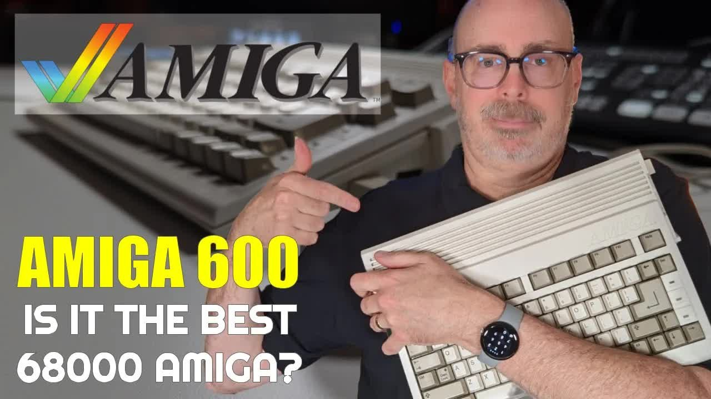

I'm a Commodore 8-bit guy at heart, but at some point I moved from my Commodore 128 to an Amiga 500 and used it for several years. I hadn't touched original Amiga hardware since 1988 or 1989. This Amiga 600 changes that. It's my first Amiga purchase since my A500 back in 1987. This post is the text companion to my unboxing video, with the A600's history and specs, what came in the box, my first boot, and the upgrades I'm looking at.

## TABLE OF CONTENTS {#table-of-contents}

- [TABLE OF CONTENTS](#table-of-contents)
- [LINKS](#links)
- [SUPPORT THE BLOG AND CHANNEL](#support-the-blog-and-channel)
- [COMPANION YOUTUBE VIDEO](#companion-youtube-video)
- [VIDEO ERRATA](#video-errata)
- [A SHORT HISTORY OF THE AMIGA 600](#history)
- [AMIGA 600 SPECS](#specs)
- [WHERE I BOUGHT IT](#where)
- [WHAT'S IN THE BOX](#in-the-box)
- [A TOUR OF THE PORTS](#ports)
- [A600 VERSUS MY OLD A500](#versus-a500)
- [FIRST BOOT: PIRATES! FROM FLOPPY](#first-boot)
- [WORKBENCH 2.1 FROM COMPACTFLASH](#workbench)
- [ADDING A WIRELESS TANK MOUSE](#tank-mouse)
- [UPGRADES TO CONSIDER](#upgrades)
- [CONCLUSION](#conclusion)

---

## LINKS {#links}

**Where I Bought It**

- 💾 Bonus Life Computers: <https://bonuslifecomputers.com>

**Hardware**

- 🐁 Tank Mouse: <https://tank-mouse.com/>
- 💾 Floppy Disks: <https://amzn.to/3DrEOj1>
- 📀 ClonerAlliance Box Pro: <https://amzn.to/4qAOn3A>

**Software**

- 💾 Cloanto Amiga Forever: <https://www.amigaforever.com>

**Resources**

- 📖 Amiga 600 on Wikipedia: <https://en.wikipedia.org/wiki/Amiga_600>

**Related Posts**

- [My Vintage Computer Festival Midwest 2022 Experience and Commodore PET Purchase](/vcfmw-2022) (my other Bonus Life Computers purchase)
- [Unboxing and First Use of the Retro Game TheA500 Mini](/unbox-thea500mini)

*Disclosure Statement: When you click on links to various merchants on this site and make a purchase, this can result in this site earning a commission. Affiliate programs and affiliations include, but are not limited to Amazon and the eBay Partner Network.*

## SUPPORT THE BLOG AND CHANNEL {#support-the-blog-and-channel}

Check out the [supporters page](/supporters) to learn about my supporters and how you can join our community. If this post saved you some time, you can also [leave a tip](https://paypal.me/stevencombs).

## COMPANION YOUTUBE VIDEO {#companion-youtube-video}

Title: _💾 It's an Amiga 600! My First Commodore Amiga Purchase since 1987._





## VIDEO ERRATA {#video-errata}

As of 2026-11-14:

- **Stock chip RAM.** In the video I guessed the A600 shipped with 512 KB. It shipped with 1 MB of chip RAM. The trapdoor card in mine adds another 1 MB, for 2 MB of chip RAM total. That matches the 1,741,968 bytes of free graphics memory Workbench reported once the system took its share.
- **Memberships.** In the video I mention YouTube memberships at one level for $4.99 a month. Check the [supporters page](/supporters) for the current options.

## A SHORT HISTORY OF THE AMIGA 600 {#history}

Commodore launched the Amiga 600 in March 1992. The US price was $499.99, or $749.99 for the A600HD with a built-in hard drive. Commodore discontinued it in late 1993. It was the last Amiga built around the Enhanced Chip Set (ECS), and it was the first of only two Amigas with a PCMCIA slot. The A1200 was the other.

The A600 gets mixed reviews today. Compared with the A500 it's small and has no numeric keypad, and it uses the same 68000 processor at roughly the same speed. Compared with the A1200 that followed, it's slower and has older graphics. What it does have is a built-in IDE hard drive interface and a much smaller footprint, and those two things sold me.

## AMIGA 600 SPECS {#specs}

| Feature | Amiga 600 |
| --- | --- |
| Released | March 1992 |
| Launch price (US) | $499.99; $749.99 for the A600HD |
| CPU | Motorola 68000 at 7.16 MHz (NTSC) |
| Chip RAM | 1 MB stock; up to 2 MB with a trapdoor card |
| Chipset | ECS (Enhanced Chip Set) |
| Operating system | Kickstart 2.05 ROM; Workbench 2.1 upgrade adds CrossDOS; AmigaOS 3.1 or 3.2 with a ROM swap |
| Storage | Internal 3.5-inch floppy; internal 44-pin IDE for a 2.5-inch drive |
| Expansion | PCMCIA Type II slot; trapdoor memory slot |
| Video out | 23-pin RGB, composite, and RF |
| Keyboard | 78 keys, no numeric keypad |
| Discontinued | Late 1993 |

*Source: [Amiga 600 on Wikipedia](https://en.wikipedia.org/wiki/Amiga_600), checked November 1, 2026.*

## WHERE I BOUGHT IT {#where}

I found this A600 while browsing one of my favorite retailers, [Bonus Life Computers](https://bonuslifecomputers.com). Scott Campbell takes in vintage computers, restores them, sometimes adds upgrades, and sends them out ready to use. I bought my Commodore PET from Bonus Life at [Vintage Computer Festival Midwest](/vcfmw-2022), and they've never steered me wrong. They are not a sponsor. I paid for this one myself.

This one was $500. That's a bit pricey, and I might have found an A600 cheaper elsewhere, but here's what I got for the money:

- An Amiga 600 HD bundle rated condition one, which means almost mint
- A 90-day warranty
- A Commodore-branded (Escom) two-button mouse with new microswitches
- Kickstart 2.05
- A trapdoor baseboard with 1 MB of chip RAM and a real-time clock
- Workbench 2.1 pre-installed on a 2 GB CompactFlash card in place of the hard drive

That last item is what got me. It's like the hard-drive Amiga 500 I couldn't afford back in the 1980s.

> **Tip:** Unlike a random auction listing, a restored machine from a shop like Bonus Life comes with a list of the work done and a warranty. On a 30-plus-year-old computer, that peace of mind is worth something.
{: .tip}

## WHAT'S IN THE BOX {#in-the-box}

Bonus Life packed it well. Inside the box I found:

- **A thank-you gift.** A copy of *Amiga for Beginners: A Complete Guide to Learning and Applying the Amiga*, with a note from the staff. I can't wait to dig into it.
- **A service checklist.** Disassemble the case, clean the motherboards, check the capacitors for bulging or leaking, clean the floppy heads, lubricate the drive, and more. They even replaced the rubber feet. For the mouse, they replaced the microswitches.
- **The mouse.** I expected a tank mouse. It's a Commodore-branded mouse in a form factor I didn't know Commodore made.
- **A composite cable.** There's no HDMI out on this machine.
- **A power supply.** It's huge, and it has a Mean Well conversion inside, which is good news for an old supply.
- **The Amiga 600.** It looks and feels brand new, with one slight blemish. Serial number 5031, with a "do not remove" warranty seal on the bottom that I left alone.

## A TOUR OF THE PORTS {#ports}

On the right side are the two DE9 ports, labeled 1 (mouse) and 2 (game port). On the left side is the PCMCIA slot, which is unique to this machine and the A1200.

Around the back you'll find:

- External floppy drive port
- Serial port
- Parallel port
- Left and right audio out, so I get stereo into my [capture card](https://amzn.to/4qAOn3A)
- 23-pin RGB video out
- Composite video out, which is what I use in the video
- RF modulator out

I'd like to get better video than composite out of this machine. If you know a good path from the 23-pin RGB port to HDMI, tell me in the comments.

## A600 VERSUS MY OLD A500 {#versus-a500}

The form factor is the first thing you notice. The A500 was much longer and had a numeric keypad on the right. The A600 drops the keypad. That could be a reason not to buy an A600, because some games, especially flight simulators, use the keypad. The keyboard itself feels good, and the A600 sits at a steeper tilt than I remember on my A500.

The other big change is the ROM. My A500, if I remember right from 30-plus years ago, came with Kickstart 1.3. This A600 has Kickstart 2.05, and that's a different experience. My A500 also had no hard drive and only one floppy drive, so I spent a lot of time doing the disk shuffle. Booting from internal storage is a treat.

## FIRST BOOT: PIRATES! FROM FLOPPY {#first-boot}

With a [floppy](https://amzn.to/3DrEOj1) in the drive, the A600 boots from the floppy first. The disk I had was MicroProse's *Pirates!*, so that's what came up. The stereo audio is perfect, and composite video through my capture card is not bad at all. I started a new career and named my family Combs. What else would it be?

To get back to Workbench, I popped the floppy out and reset the machine with the three-key salute: hold `CTRL` and both `AMIGA` keys.

## WORKBENCH 2.1 FROM COMPACTFLASH {#workbench}

Without a floppy in the drive, the A600 boots Workbench 2.1 from the CompactFlash card. Here's what I explored:

- **The System disk.** Utilities, games, and preferences, with plenty of room left.
- **Memory.** Workbench reports 1,741,968 bytes of free graphics memory. That's 2 MB of chip RAM, minus what the system uses.
- **The Shell.** The Amiga's command line, like a terminal. I've forgotten most of my Shell commands, but `DIR` still works.
- **Menus.** Hold the right mouse button to show the menu bar at the top of the screen.
- **Zork.** The disk includes *Zork I*, *II*, and *III*. Zork runs in a window, so you can shrink it and keep working. That's Amiga multitasking from 1985, and it still impresses me.

Dragging windows is a little slow on a 7 MHz 68000, and things aren't as responsive as a modern computer. That's part of the charm.

> **Tip:** If the floppy drive keeps clicking with no disk in it, that's normal behavior for an Amiga drive. Insert a disk and the clicking stops.
{: .tip}

## ADDING A WIRELESS TANK MOUSE {#tank-mouse}

The included mouse works, but it's not the best for dragging windows. I own a [Tank Mouse](https://tank-mouse.com/), a modern re-creation of the original Amiga tank mouse from a Kickstarter campaign. It's wireless, with a USB receiver, and it gets rid of the rollerball.

1. Put [batteries](https://amzn.to/49LycZc) in the Tank Mouse.
2. Plug the wireless receiver into a USB-to-DB9 adapter, then plug the adapter into the A600's mouse port.
3. Power on the computer.

It worked right away in Amiga mode. It was too sensitive at first, so I opened the Input preferences, lowered the mouse speed to 2, tested a double-click, and saved. The A600 with the Tank Mouse looks fabulous, and it's a much better experience.

## UPGRADES TO CONSIDER {#upgrades}

These are the A600 upgrades I'm reading about. I haven't installed any of them yet.

- **PCMCIA cards.** The PCMCIA slot can take memory cards and storage adapters. Getting a card working in mine is next on my list.
- **Chip RAM.** The trapdoor slot supports up to 2 MB of chip RAM. Mine is already maxed out.
- **Kickstart ROM swap.** The A600 can run AmigaOS 3.1 or 3.2 with a ROM swap. 3.2 needs more than 1 MB of memory.
- **Accelerators and expansions.** Wikipedia mentions modern add-ons such as the Vampire V2 and Apollo Manticore accelerators (the Manticore also adds HDMI) and the A608 expansion. I haven't researched these enough to recommend one.

> **Tip:** Some A600s shipped with Kickstart 37.299, which can't boot from the internal IDE or PCMCIA. If you buy an A600 that won't boot from a hard drive, check the ROM version.
{: .tip}

I also own a license for Cloanto's Amiga Forever, which I recommend if you want legal Kickstart ROMs and Workbench disks for emulation. And I have Workbench on floppy as a backup in case my CompactFlash card ever fails.

## CONCLUSION {#conclusion}

This Amiga 600 is a well-restored machine with a hard drive, 2 MB of chip RAM, and a form factor that fits my desk. It isn't the most powerful Amiga, and the missing keypad is a real trade-off, but for an 8-bit guy coming back to the Amiga for the first time since the late 1980s, it's perfect. I'll focus on Commodore 8-bits, but expect the A600 to show up in future videos and maybe a livestream.

Do you think the A600 is better than the A500, or the other way around? What pitfalls are ahead for me as I learn the Amiga 600? Let me know in the comments below. If this post helped, [leave a tip](https://paypal.me/stevencombs).

That's it for me, folks. 🕹️ retroCombs, OUT!
