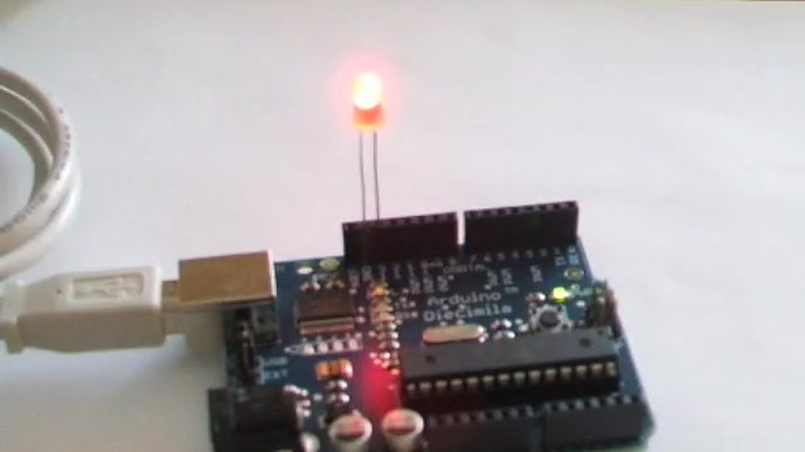
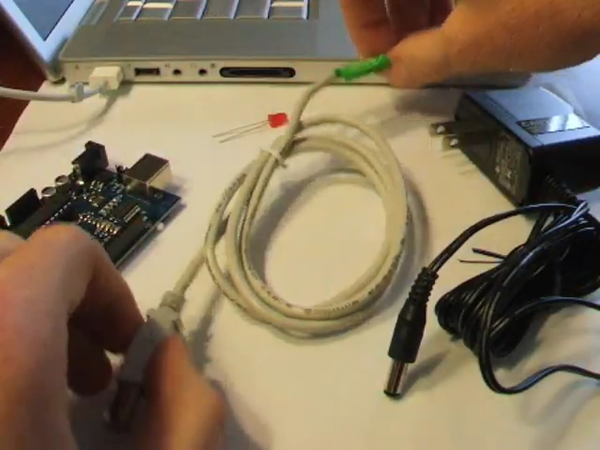
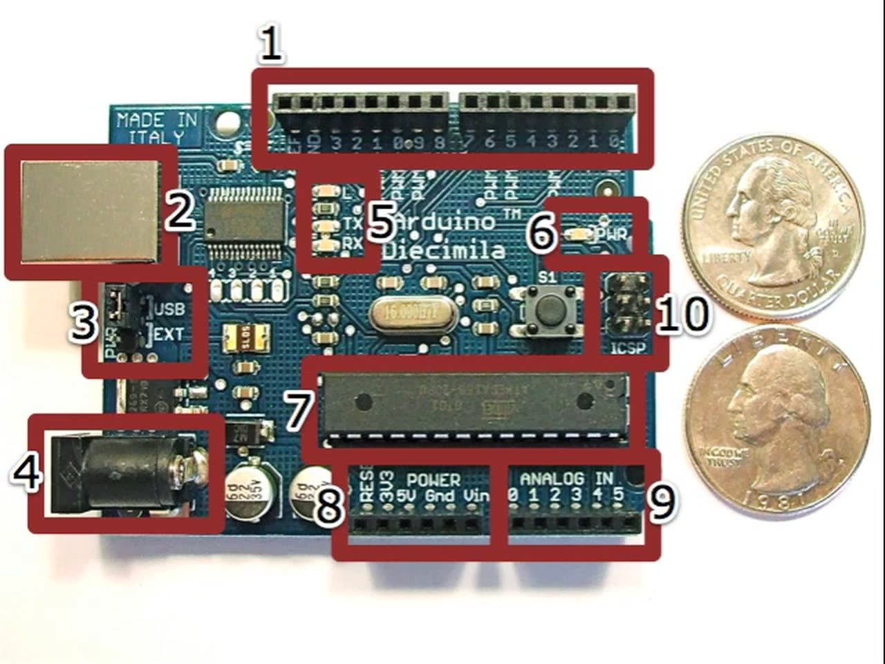
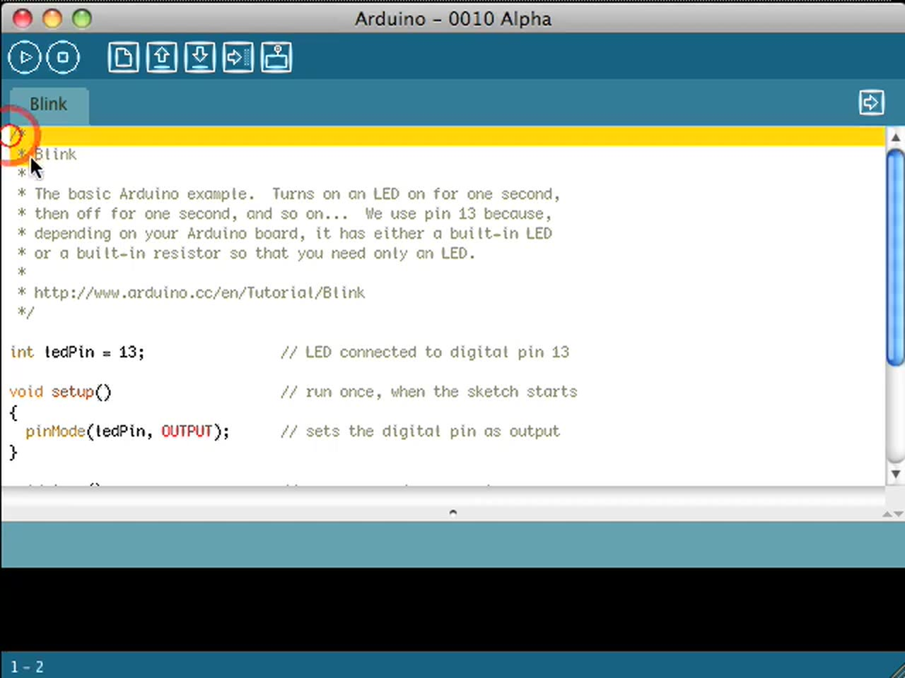
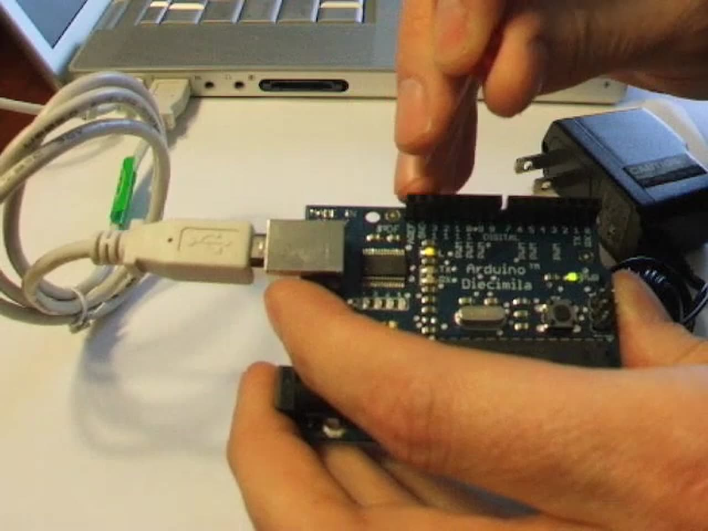

Every programming language has its "Hello, World!" moment. In C or BASIC, you print a line that says hello. On an Arduino, you make an LED blink. Back in 2008, I opened the little white box from Adafruit that held my Arduino starter pack, plugged the board in (fingers close to 911, just in case), and uploaded my first program. This post is the text companion to that 2008 video, updated with notes on what's different today.



## TABLE OF CONTENTS {#table-of-contents}

- [TABLE OF CONTENTS](#table-of-contents)
- [LINKS](#links)
- [SUPPORT THE BLOG AND CHANNEL](#support-the-blog-and-channel)
- [COMPANION YOUTUBE VIDEO](#companion-youtube-video)
- [VIDEO ERRATA](#video-errata)
- [WHAT YOU NEED](#what-you-need)
- [INSTALL THE SOFTWARE](#install)
- [A TOUR OF THE BOARD](#board-tour)
- [THE BLINK SKETCH](#blink)
- [CONNECT AND UPLOAD](#upload)
- [ADD A BRIGHTER LED](#add-an-led)
- [AN AUTONOMOUS ARDUINO](#autonomous)
- [YOUR CHALLENGE](#challenge)
- [CONCLUSION](#conclusion)

---

## LINKS {#links}

- 💾 Arduino software downloads: <https://www.arduino.cc/en/software>
- 📖 Arduino Blink example: <https://docs.arduino.cc/built-in-examples/basics/Blink/>
- 🛒 Adafruit: <https://www.adafruit.com>
- 📝 My later Arduino Hello World post (Elegoo kit): [BUILD & CODE: Arduino Hello World!](/arduino-hello-world)

*Disclosure Statement: When you click on links to various merchants on this site and make a purchase, this can result in this site earning a commission. Affiliate programs and affiliations include, but are not limited to Amazon and the eBay Partner Network.*

## SUPPORT THE BLOG AND CHANNEL {#support-the-blog-and-channel}

Check out the [supporters page](/supporters) to learn about my supporters and how you can join our community. If this post saved you some time, you can also [leave a tip](https://paypal.me/stevencombs).

## COMPANION YOUTUBE VIDEO {#companion-youtube-video}

Title: _HOW TO: "Hello Arduino!"_





## VIDEO ERRATA {#video-errata}

As of 2026-11-15:

- **The software looks different now.** The video shows the 2008 Arduino software. Today's Arduino IDE 2.x has a different layout, an automatic board and port selector, and the Serial Monitor button moved to the top-right corner. The steps below use the current IDE.
- **The power jumper.** My 2008 board had a jumper that selected USB power or the 9-volt adapter. Current boards such as the Arduino Uno switch between USB and external power automatically, so there's no jumper to move.
- **Where to answer the challenge.** At the end of the video I ask you to answer on an old website, or in the YouTube comments. Please answer in the comments below this post instead.

## WHAT YOU NEED {#what-you-need}

From my starter pack:



- An Arduino board
- A USB cable to connect the board to your computer
- A red LED
- A 9-volt power adapter, to run the board without the computer
- Rubber feet to lift the board off the table and protect its underside (Adafruit included these)

## INSTALL THE SOFTWARE {#install}

Before you plug in the board, install the Arduino software. The Arduino website has step-by-step instructions for Windows, Mac, and Linux. In 2008 that meant installing drivers separately. The current Arduino IDE 2.x installer handles the drivers for official boards.

## A TOUR OF THE BOARD {#board-tour}

In the video I number the parts of my board. Layouts vary by model, but you'll find most of these on any Uno-style board:



1. Digital pin headers, generally used for output
2. The USB connector
3. The power-select jumper (on my 2008 board only; see the errata)
4. The 9-volt adapter jack
5. Onboard LEDs, including the transmit and receive indicators
6. The power indicator LED
7. The microcontroller chip that runs your program
8. Power headers for connecting external power sources
9. Analog input pins
10. The ICSP header, used for other kinds of connections to various devices

## THE BLINK SKETCH {#blink}

Arduino programs are called sketches. The Blink example does exactly what we want: it turns an LED on, waits, turns it off, waits, and repeats. Here's the current version of the example:

```cpp
// the setup function runs once when you press reset or power the board
void setup() {
  // initialize digital pin LED_BUILTIN as an output.
  pinMode(LED_BUILTIN, OUTPUT);
}

// the loop function runs over and over again forever
void loop() {
  digitalWrite(LED_BUILTIN, HIGH);  // turn the LED on (HIGH is the voltage level)
  delay(1000);                      // wait for a second
  digitalWrite(LED_BUILTIN, LOW);   // turn the LED off by making the voltage LOW
  delay(1000);                      // wait for a second
}
```

What's going on:

- `setup()` runs once. It sets the LED pin as an output. In 2008 the example named pin 13 directly. Today it uses `LED_BUILTIN`, which points to the onboard LED on whatever board you select (pin 13 on an Uno).

    
- `loop()` runs over and over. It sets the pin HIGH (on), waits, sets it LOW (off), and waits again.
- `delay()` counts in thousandths of a second, so `1000` is one second.

## CONNECT AND UPLOAD {#upload}

1. Plug the USB cable into the board, then into your computer. If it's connected properly, the green power light comes on.

    
2. In the Arduino IDE, open **File > Examples > 01.Basics > Blink**. It's the same sketch as above.
3. Select your board and port from the board selector at the top of the window, or from **Tools > Board** and **Tools > Port**.
4. Click **Upload** (the right-arrow button).
5. Watch the message area at the bottom of the window. It reports that it's uploading and then shows when it's done and how large your program is.

On the board, the transmit and receive LEDs flicker during the upload. Then the onboard LED starts blinking, once per second. Hello, Arduino!

## ADD A BRIGHTER LED {#add-an-led}

The onboard light is a little dim, so let's add a bright red LED. On my board, I plugged it into the headers next to pin 13 so it blinks along with the onboard LED.

> **Tip:** LEDs have polarity. If yours doesn't light, it's probably in backward. Pull it out, turn it around, and plug it back in. In the video I put it in the wrong way first so you can see what that looks like.
{: .tip}

> **Note:** Plugging an LED straight into the headers is what I did in 2008, but the safer habit is to add a current-limiting resistor (220 ohms is common) in series with the LED. The Arduino Blink page linked above shows the wiring.
{: .note}

## AN AUTONOMOUS ARDUINO {#autonomous}

Once a sketch is uploaded, the board keeps it, even after you unplug the computer. To run it on its own:

1. Unplug the USB cable. The LED goes dark because the board lost power.
2. Plug in the 9-volt adapter. (On my 2008 board, I had to move the power jumper first so the board took power from the adapter instead of USB. Current boards don't need this.)
3. The board resets itself and the LED starts blinking, just like it did when connected to the computer.

Now you can place the board anywhere you have power and it does its thing. That's the beauty of the Arduino.

## YOUR CHALLENGE {#challenge}

At the end of the video there's a short clip of my Arduino blinking in a pattern. The pattern means something. Watch it, figure out what the Arduino is doing, and post your answer in the comments below.

## CONCLUSION {#conclusion}

Install the software, open the Blink example, upload it, add an LED, and unplug the computer. That's the whole Hello Arduino journey, and it's the same first step today that it was in 2008. When you're ready for more, see my [Arduino Hello World post](/arduino-hello-world) with the Elegoo kit.

What was the first thing you made blink? Let me know in the comments below. If this post helped, [leave a tip](https://paypal.me/stevencombs).

That's it for me, folks. 🕹️ retroCombs, OUT!
