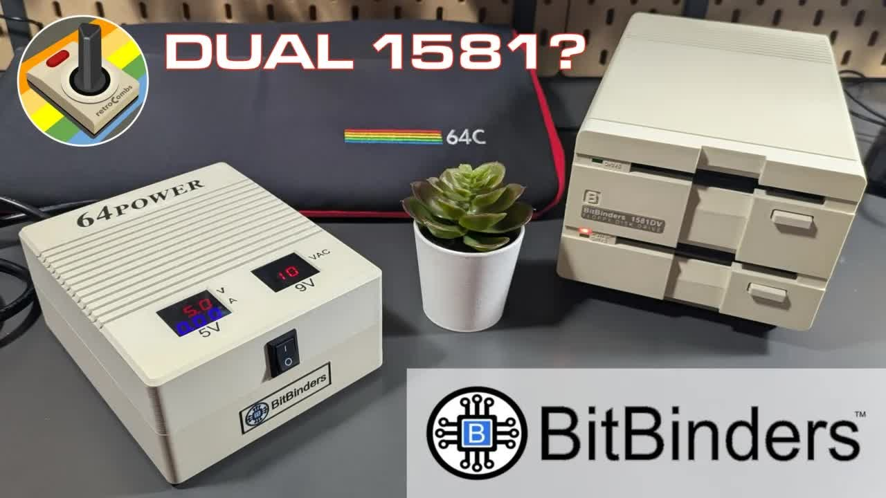
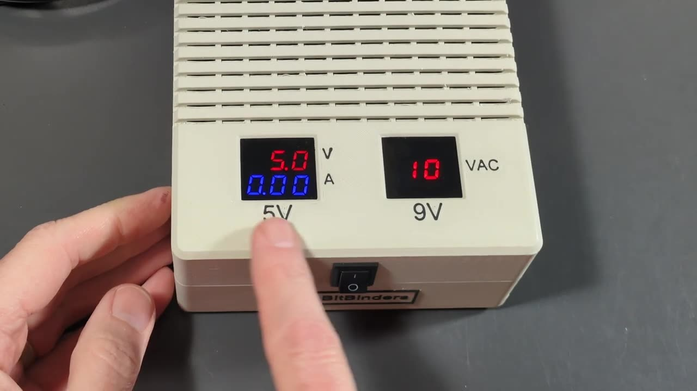
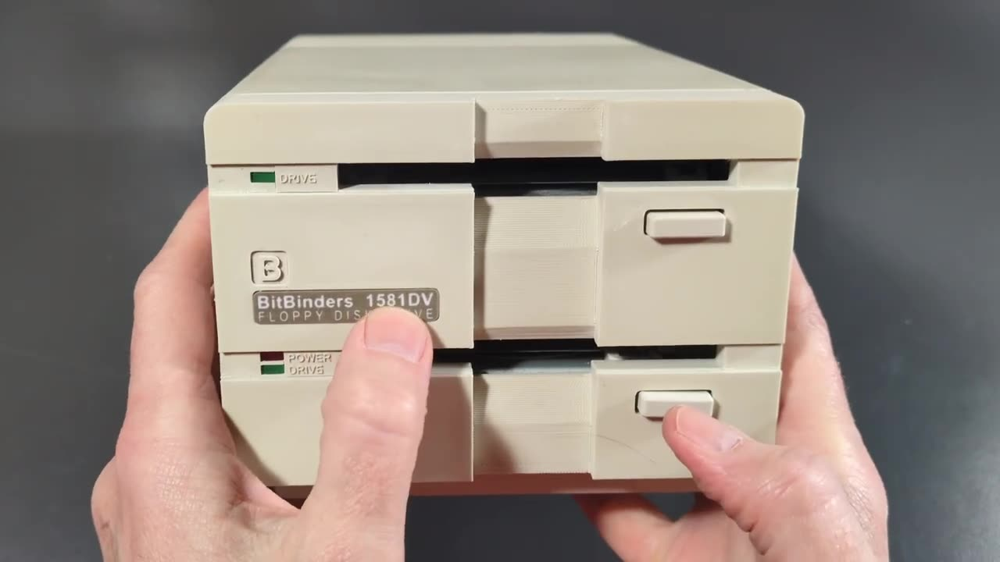
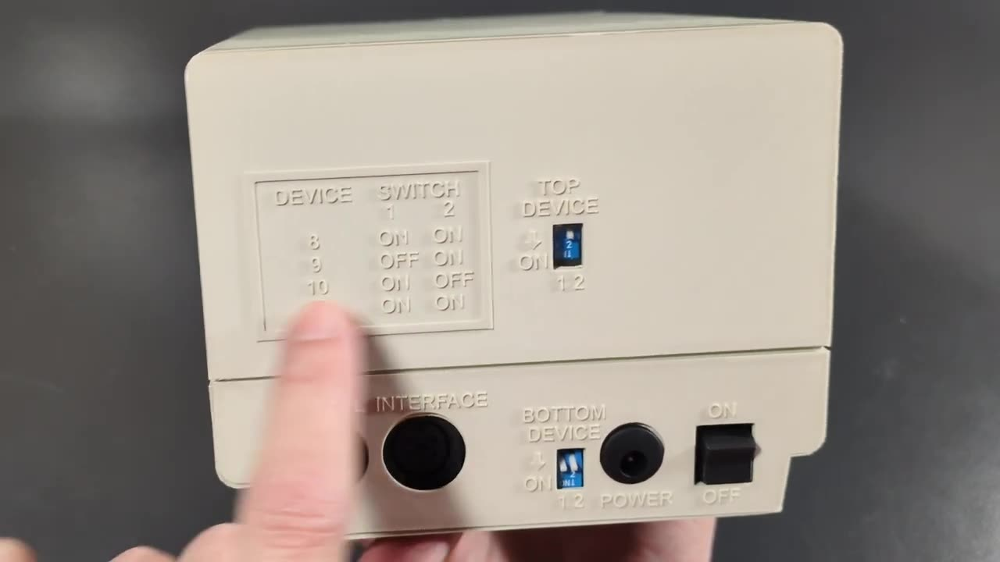
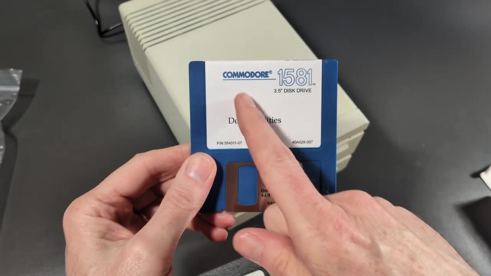

A box too big for my bench showed up from BitBinders. Inside were a dual Commodore 1581 disk drive, a drive I never owned back in the day, and a modern Commodore 64 power supply with built-in meters. This post is the text companion to my unboxing video, with specs, setup, current prices, and where these drives have shown up on the channel since.

## TABLE OF CONTENTS {#table-of-contents}

- [TABLE OF CONTENTS](#table-of-contents)
- [LINKS](#links)
- [SUPPORT THE BLOG AND CHANNEL](#support-the-blog-and-channel)
- [COMPANION YOUTUBE VIDEO](#companion-youtube-video)
- [VIDEO ERRATA](#video-errata)
- [WHAT WAS THE COMMODORE 1581?](#the-1581)
- [THE 64POWER SUPPLY](#the-64power)
- [THE 1581DV DUAL DRIVE](#the-1581dv)
- [SETTING UP THE DUAL DRIVE](#setup)
- [WHAT SOFTWARE WORKS WITH IT?](#software)
- [THE BITBINDERS DRIVE LINEUP AND PRICES](#prices)
- [WHERE YOU'LL SEE IT NEXT](#next)
- [CONCLUSION](#conclusion)

---

## LINKS {#links}

**BitBinders**

- 💾 BitBinders 1581 replica disk drives: <https://bitbinders.com/collections/bitbinders-1581-replica-disk-drives>
- 🔌 BitBinders store (64Power and more): <https://bitbinders.com>

**Resources**

- 📖 Commodore 1581 on Wikipedia: <https://en.wikipedia.org/wiki/Commodore_1581>
- 📖 Commodore 8050 and 8250 dual drives on Wikipedia: <https://en.wikipedia.org/wiki/Commodore_8050>

**Related Posts**

- [MEGA65 User's Guide Chapter 6 - Using Disks and Disk Images](/mega65-ug-6) (the dual drive connected to a MEGA65)
- [Ten No Hack TheC64 Tips To Upgrade your Retro Computing Experience](/ten-thec64-tips)

*Full disclosure: Craig Smith at BitBinders sent me the 1581DV dual drive and the 64Power supply free to review. The BitBinders links in this post are plain links, not affiliate links.*

*Disclosure Statement: When you click on links to various merchants on this site and make a purchase, this can result in this site earning a commission. Affiliate programs and affiliations include, but are not limited to Amazon and the eBay Partner Network.*

## SUPPORT THE BLOG AND CHANNEL {#support-the-blog-and-channel}

Check out the [supporters page](/supporters) to learn about my supporters and how you can join our community. If this post saved you some time, you can also [leave a tip](https://paypal.me/stevencombs).

## COMPANION YOUTUBE VIDEO {#companion-youtube-video}

Title: _💾️ BitBinders Dual Disk Drive Changes the Commodore 64 Forever!_





## VIDEO ERRATA {#video-errata}

As of 2026-11-16:

- **DH or DV?** In the video I read "1581 DH" off the box. The drive I have is the stacked model, labeled 1581DV. BitBinders sells the stacked (vertical) model as the 1581DV and the side-by-side (horizontal) model as the 1581DH.
- **Did Commodore make a dual drive?** I said I didn't think Commodore ever built a two-unit floppy drive. Commodore did make dual drives, such as the 4040, 8050, and 8250, but those were side-by-side 5.25-inch drives for the PET and CBM business line that used the parallel IEEE-488 bus. As BitBinders puts it, Commodore never made a dual 1581.
- **Power.** I said power wasn't included in the box. It was. The 9-volt power adapter was in the small accessory bag.

## WHAT WAS THE COMMODORE 1581? {#the-1581}

The Commodore 1581 was a 3.5-inch, double-sided, double-density floppy drive released in 1987 for the Commodore 64 and 128. It also works with the Plus/4, C16, and VIC-20. It launched at $399 and was discontinued in 1990.

| Feature | Commodore 1581 |
| --- | --- |
| Released | 1987 |
| Launch price | $399 |
| Media | 3.5-inch double-sided, double-density disks |
| Capacity | About 800 KB (3,160 blocks free) |
| Drive CPU | MOS 6502 at 2 MHz |
| Interface | Commodore serial bus, with burst mode on the C128 |
| Discontinued | 1990 |

*Source: [Commodore 1581 on Wikipedia](https://en.wikipedia.org/wiki/Commodore_1581), checked November 1, 2026.*

That's more than four times the capacity of a 1541 disk, and the 1581 was the highest-capacity serial-bus drive Commodore ever made. The catch is compatibility. The 1581 is compatible with older Commodore drives at the DOS level, but software that does low-level disk access, which includes most C64 games, won't run from it. Original 1581s are also hard to find today, which is where BitBinders comes in.

## THE 64POWER SUPPLY {#the-64power}

The first box held the 64Power, a modern replacement power supply for the Commodore 64. Original C64 power supplies are now more than 30 years old, and the earliest are past 40. A failing one can damage the computer, so a modern supply is a smart purchase.

What I like about it:

- **Built-in meters.** It shows the voltage on both outputs and the current draw on the 5-volt side, so you can see what your C64 is pulling.

    
- **A front power switch.** Turn the C64 off at the supply.
- **Both cables out the back.** The power cord and the 7-pin DIN plug for the C64 both exit the rear, which keeps the desk tidy.
- **The case.** It appears to be 3D printed, with a nice BitBinders logo.

| 64Power spec | Value |
| --- | --- |
| Outputs | 5 VDC at 3 A and 9 VAC at 1 A |
| Connector | 7-pin DIN (Commodore 64) |
| Input | 110 to 240 V |
| Fuse | User-replaceable |
| Warranty | 12 months |

*Source: [BitBinders](https://bitbinders.com), checked November 1, 2026.*

BitBinders lists the 64Power for the Commodore 64. I own a Commodore Plus/4 adapter, and I believe it will work with my Plus/4 through that adapter. I haven't confirmed that, so check with BitBinders before you buy it for a Plus/4.

## THE 1581DV DUAL DRIVE {#the-1581dv}

The second box held the drive, and it's gorgeous. BitBinders hand-assembles these drives. The styling mimics the original 1581, with a BitBinders logo where the Commodore logo used to be. Each mechanism has its own drive light, and there's a power light.

I chose the stacked 1581DV because it takes up less desk space. BitBinders also makes a side-by-side model, and I'm told it's designed to hold a monitor on top.

| 1581DV spec | Value |
| --- | --- |
| Drives | Two 3.5-inch 1581-compatible drives, stacked |
| ROM | JiffyDOS |
| Unit numbers | Each drive settable to 8, 9, 10, or 11 |
| Power | 9 V wall adapter (110/220 V), included |
| Construction | Socketed ICs; some used or new-old-stock parts |
| Size and weight | 4.4 × 5.4 × 8.8 in, 4.3 lb |
| Included disks | Commodore 1581 test and utilities disk, 1581 Toolkit disk |
| Warranty | 12 months |

*Source: [BitBinders](https://bitbinders.com/collections/bitbinders-1581-replica-disk-drives), checked November 1, 2026.*

## SETTING UP THE DUAL DRIVE {#setup}

Around the back are switches for the top drive and switches for the bottom drive. Here's how I set it up:

1. Set the unit number for each drive with its rear switches. Each drive can be unit 8 through 11. Give each drive a different number, and make sure neither conflicts with another device on your serial bus.

    
2. Connect the drive to your computer's serial (IEC) port with a Commodore serial cable.
3. Plug the 9-volt adapter into the power jack.
4. Flip the power switch. The power light comes on. With no computer connected, you won't hear any drive clicks.

The point of a dual drive is that you can work with two disks at once, for example copying from one to the other, without the old floppy disk shuffle.

> **Tip:** On a Commodore 64, the 1581 burst mode isn't available. That's a C128 feature. JiffyDOS in the drive speeds up loading if your computer also has a JiffyDOS ROM installed.
{: .tip}

## WHAT SOFTWARE WORKS WITH IT? {#software}

The 1581DV behaves like two Commodore 1581 drives, so the same rules apply:

- **Works well:** BASIC programs, productivity software, GEOS, BBS software, and anything that uses standard DOS commands to load and save files.
- **Won't work:** Most commercial C64 games on disk, because they use fast loaders or copy protection written for the 1541. For those, you still want a 1541 or a 1541-compatible device.

BitBinders includes two disks to get you started: the Commodore 1581 test and utilities disk and the 1581 Toolkit. I never owned a 1581, so I'm looking forward to digging into both.

## THE BITBINDERS DRIVE LINEUP AND PRICES {#prices}

Prices from [BitBinders](https://bitbinders.com) as of November 1, 2026:

| Product | Price |
| --- | --- |
| 1581DV dual drive (stacked) | $569 |
| 1581DH dual drive (side by side) | $569 |
| 1581S single drive | $329 |
| MEGA1581 | $359 |
| 64Power supply | $89 |

If you only need a replacement for a single 1581, the single-drive model is the one to look at.

## WHERE YOU'LL SEE IT NEXT {#next}

I didn't connect the drive to a computer in this video. In the video I mention trying it on the MEGA65. My [MEGA65 User's Guide Chapter 6 post](/mega65-ug-6) covers unit numbers and external drives on the MEGA65's IEC port, and it links to the BitBinders drives. I also planned to pair the drive and the 64Power with a Commodore 64 project I'm working on.

## CONCLUSION {#conclusion}

The BitBinders 1581DV is a well-built, hand-assembled dual 1581, a drive Commodore never made, and the 64Power is a practical upgrade for any C64 owner. Thank you again to Craig Smith at BitBinders for sending these over. He didn't have to, and I know it's a significant outlay for a growing business. Support the people making new hardware for our hobby.

Would you use a dual 1581, or do you stick with a 1541 and an [SD2IEC](https://link.amazon/B0i3pxXnb)? Let me know in the comments below. If this post helped, [leave a tip](https://paypal.me/stevencombs).

That's it for me, folks. 🕹️ retroCombs, OUT!
