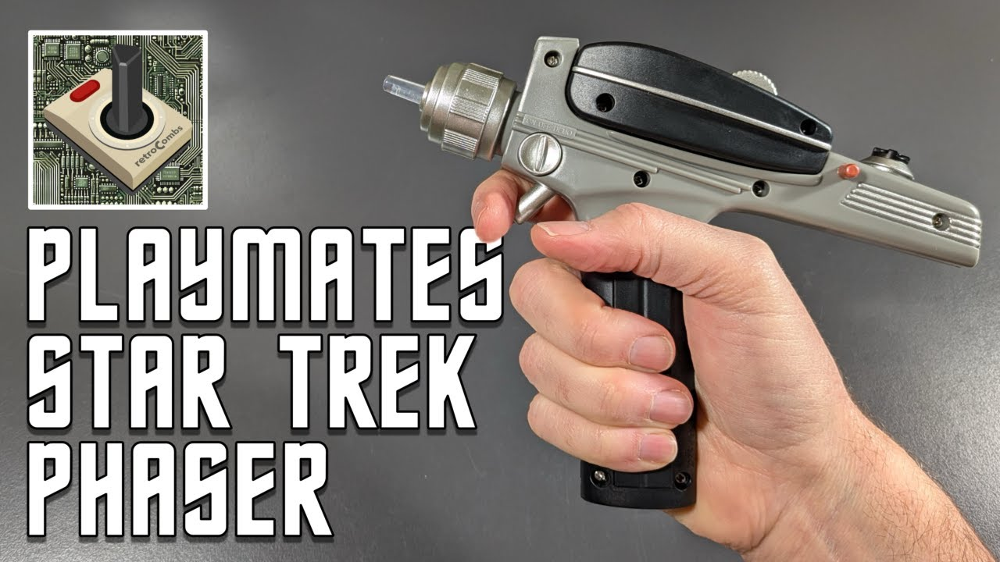
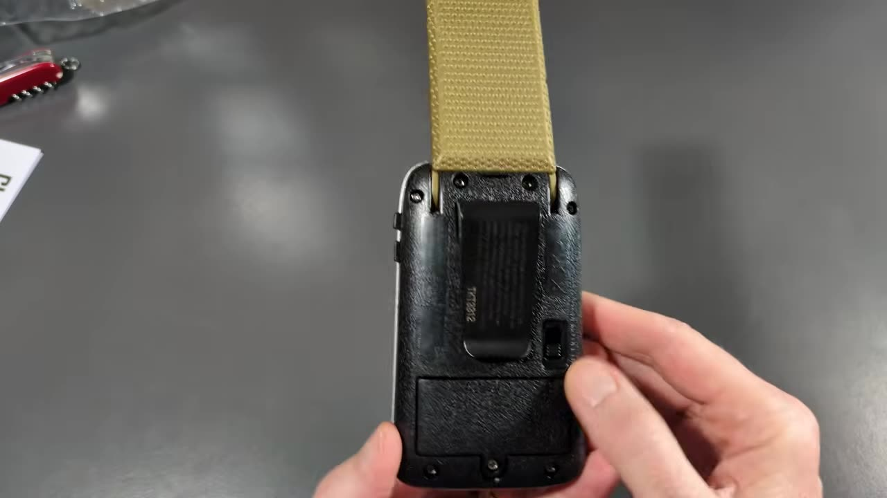
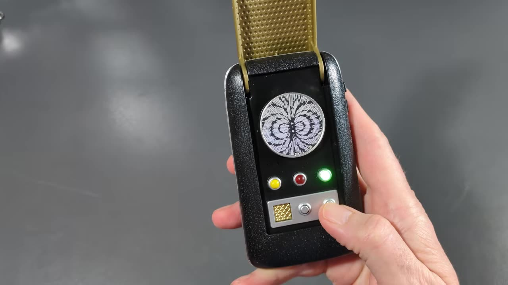
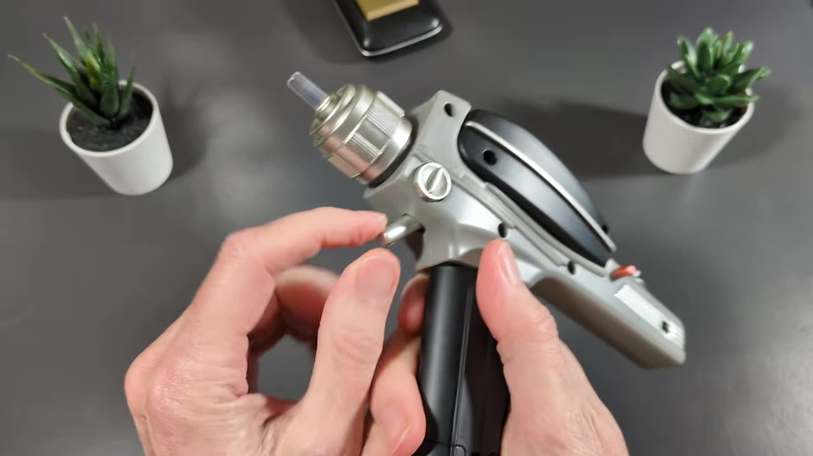
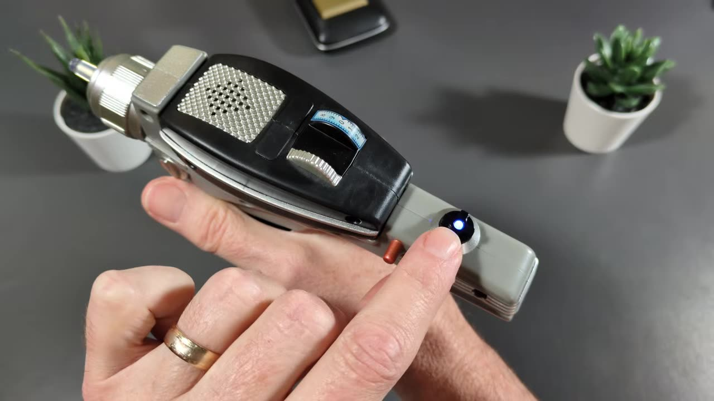

Halloween was coming up, and I needed a couple of accessories for a little costume I was working out. So I picked up two pieces of original series Star Trek gear from Playmates: the [Classic Communicator](https://link.amazon/B01dKGTPl) and its companion, the [Classic Phaser](https://link.amazon/B09HYWDxw). Let me be clear up front: these are not studio-quality replicas. They're toys. But they're pretty good toys. This post is the text companion to my two short videos on retroCombs Tech (@retroCombs-tech).

## TABLE OF CONTENTS {#table-of-contents}

- [TABLE OF CONTENTS](#table-of-contents)
- [LINKS](#links)
- [SUPPORT THE BLOG AND CHANNEL](#support-the-blog-and-channel)
- [COMPANION YOUTUBE VIDEOS](#companion-youtube-videos)
- [VIDEO ERRATA](#video-errata)
- [THE CLASSIC COMMUNICATOR](#communicator)
- [THE CLASSIC PHASER](#phaser)
- [COMMUNICATOR VS. PHASER AT A GLANCE](#at-a-glance)
- [CONCLUSION](#conclusion)

---

## LINKS {#links}

- 🖖 Playmates Toys: <https://www.playmatestoys.com>
- 📟 Playmates Classic Star Trek Communicator: <https://link.amazon/B01dKGTPl>
- 🔫 Playmates Classic Star Trek Phaser: <https://link.amazon/B09HYWDxw>

*Disclosure Statement: When you click on links to various merchants on this site and make a purchase, this can result in this site earning a commission. Affiliate programs and affiliations include, but are not limited to Amazon and the eBay Partner Network.*

## SUPPORT THE BLOG AND CHANNEL {#support-the-blog-and-channel}

Check out the [supporters page](/supporters) to learn about my supporters and how you can join our community. If this post saved you some time, you can also [leave a tip](https://paypal.me/stevencombs). And if you like gadgets, subscribe to @retroCombs-tech. Hooked on tech since '73.

## COMPANION YOUTUBE VIDEOS {#companion-youtube-videos}

Title: _🖖🏼️ Playmates Star Trek Communicator: Beam Me Up, Scottie!_



Title: _🖖🏼️ Playmates Classic Star Trek Phaser | Set Phasers to O.G. Fun!_





## VIDEO ERRATA {#video-errata}

As of 2026-11-17:

- **Scotty, not Scottie.** The communicator video title spells the chief engineer's name "Scottie." It's Scotty. And as Trek fans love to point out, nobody in the original series ever says the exact line "Beam me up, Scotty."
- **No kill setting.** In the phaser video I call the red setting "kill" and then correct myself. The box describes the settings as "full stun or overload."

## THE CLASSIC COMMUNICATOR {#communicator}

### In the Box

The box tells you how to open the communicator (grip the bottom), and it's covered with information: a little "Captain's Log" that calls it the first generation of subspace communication devices, a QR code, and a diagram labeling the speaker/microphone plate, the emergency indicator, the frequency control indicator, the antenna grill, and the opening, hailing, and ship-away communication buttons. It requires two AA batteries, and they're included. Starfleet batteries, outstanding.

Inside you'll find an instruction sheet showing how to insert the batteries. It's pretty self-explanatory.

### Hands-On

The first thing I noticed was how light the box was. The communicator is light too, but it's not bad. Here's what you get:

- **A three-position switch:** off, so you don't accidentally press buttons; on; and demo. Demo mode plays the sounds without lighting the LEDs, probably to save the batteries while it sits on a store shelf.
- **Two buttons on the side:** one to hail and one to answer.
- **A belt snap** on the back, handy for a costume.

    
- **The frequency spinner** on top. I'm pretty sure it doesn't actually spin.

Flip it open and you get the original series sounds and lights. Hail and you hear "This is Captain James Kirk of the USS Enterprise," plus "energize" and the other classic lines.

### Verdict

It's a nice-looking toy. If you want that original series communicator in hand for a costume, cosplay, or the shelf, this is a really inexpensive way to get there.

## THE CLASSIC PHASER {#phaser}

### In the Box

The box promises a light-up beam emitter, a phaser setting dial ("set phaser to full stun or overload"), and lights and sounds from the original Star Trek series. Like the communicator, it requires two AA batteries, and they're included. There's a short manual that shows the off, demo, and on switch. It doesn't explain how to replace the batteries.

### Hands-On

It's a good size, but a little lighter than I had hoped. A few things I noticed:

- **The batteries go in the handle,** behind screws.
- **The small pocket phaser section isn't removable.** In the original series, the little hand phaser could come out of the larger pistol. On this toy it's part of the body.
- **Most of the controls are for show.** The extra knobs and details don't do anything.
- **The trigger is different than I expected.** It's a cylindrical post sticking out of the unit, not a curved trigger.

    
- **The switch has off, demo, and on.** Like the communicator, demo mode cycles through the three sounds without lighting the emitter, for in-store demos.
- **The setting dial has three positions,** with a nice indicator on the dial. Blue is stun, and the dial also has an overload setting and a red setting.

    

Turn it on, choose a setting, and pull the trigger. The beam emitter lights up and you get the sound for that setting.

### Verdict

Again, it's not a studio-level replica, but it's actually a pretty good toy. Now I just need to find me some Klingons.

## COMMUNICATOR VS. PHASER AT A GLANCE {#at-a-glance}

| | Classic Communicator | Classic Phaser |
|---|---|---|
| Batteries | 2 AA (included) | 2 AA (included) |
| Switch | Off / on / demo | Off / demo / on |
| Lights | LEDs | Light-up beam emitter |
| Controls | Hail and answer buttons, flip-open lid | Post trigger, three-position setting dial |
| Costume extras | Belt snap | None noted |
| Best for | Costume, cosplay, shelf | Costume, shelf |

## CONCLUSION {#conclusion}

Neither of these will fool a prop collector, and they don't try to. For a Halloween costume or an affordable way to get the original series look, the Playmates [communicator](https://link.amazon/B01dKGTPl) and [phaser](https://link.amazon/B09HYWDxw) do the job, with sounds that put a smile on any Trek fan's face.

Which original series gadget would you want on your belt? Let me know in the comments below. If this post helped, [leave a tip](https://paypal.me/stevencombs).

That's it for me, retroCombs, out.
