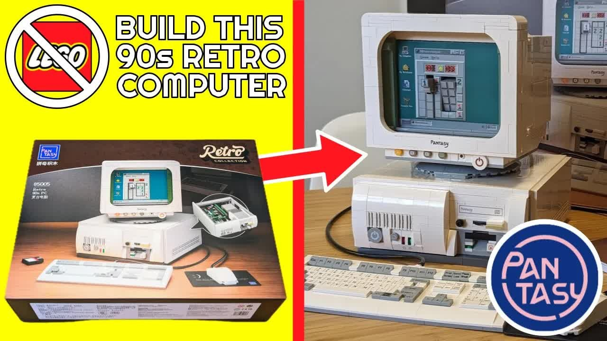

Pantasy sounds like a pants boutique in a 1980s mall, but it's a building brick company, and they reached out to see if I wanted to build their [1990s retro computer set](https://amzn.to/3siGHsX). My channel mostly covers the 1980s and earlier, but I couldn't resist. I occasionally cover building brick sets from COBI, and there's also that little-known company LEGO. This post is the text companion to my build video, with the set details, my notes bag by bag, and tips for your own build.



## TABLE OF CONTENTS {#table-of-contents}

- [TABLE OF CONTENTS](#table-of-contents)
- [LINKS](#links)
- [SUPPORT THE BLOG AND CHANNEL](#support-the-blog-and-channel)
- [COMPANION YOUTUBE VIDEO](#companion-youtube-video)
- [VIDEO ERRATA](#video-errata)
- [SET DETAILS](#set-details)
- [THE BOX AND INSTRUCTIONS](#box)
- [BRICK QUALITY](#quality)
- [THE BUILD, BAG BY BAG](#build)
- [THE DETAILS I LOVE](#details)
- [WHAT I'D CHANGE](#changes)
- [BUILD TIPS](#tips)
- [CONCLUSION](#conclusion)

---

## LINKS {#links}

**The Set**

- 🧱 Pantasy Retro 90s PC Building Set 85005: <https://amzn.to/3siGHsX>
- 🧱 Pantasy Retro 90s PC (85005) at Pantasy: <https://pantasy.com/products/pantasy-retro-90s-pc-85005>
- 🧱 Pantasy store: <https://pantasy.com>

Use code **retroCombs1** for 20% off at Pantasy.

**Related Posts**

- [COBI M60 Patton Tank and a COBI versus LEGO comparison](/cobi-m60-patton)

*Full disclosure: Pantasy sent me this set free, with no obligation other than to post my build.*

*Disclosure Statement: When you click on links to various merchants on this site and make a purchase, this can result in this site earning a commission. Affiliate programs and affiliations include, but are not limited to Amazon and the eBay Partner Network.*

## SUPPORT THE BLOG AND CHANNEL {#support-the-blog-and-channel}

Check out the [supporters page](/supporters) to learn about my supporters and how you can join our community. If this post saved you some time, you can also [leave a tip](https://paypal.me/stevencombs).

## COMPANION YOUTUBE VIDEO {#companion-youtube-video}

Title: _🖥️ Build a L̶E̶G̶O̶ Pantasy 1990s Retro Computer. The Detail is Amazing!_





## VIDEO ERRATA {#video-errata}

As of 2026-11-19:

- **Piece count.** The box doesn't list the number of pieces, and in the video I said a quick search showed about 1,800. Pantasy lists the set at 1,634 pieces.
- **Stamped or stickers?** I pointed out that some details are stamped, not stickers. Most are: Pantasy lists 43 printed parts. There are two stickers, the floppy disk label and the Minesweeper screen.

## SET DETAILS {#set-details}

| Detail | Pantasy Retro 90s PC |
| --- | --- |
| Set number | 85005 |
| Pieces | 1,634 |
| Printed parts | 43 |
| Stickers | 2 (floppy disk label and Minesweeper screen) |
| Bags | 28, numbered 1 through 9 |
| Finished size | 18.9 × 20 × 24 cm |
| Estimated build time | 5 to 6 hours |
| Price | $122.99 at pantasy.com |

*Source: [Pantasy](https://pantasy.com/products/pantasy-retro-90s-pc-85005), checked November 1, 2026. The bag count is from my build.*

## THE BOX AND INSTRUCTIONS {#box}

The box highlights the set's features. My one disappointment is that it doesn't mention the number of elements. Inside are 28 bags, numbered 1 through 9, with three or four bags per number, and the instruction manual. If you skip past the Chinese text, the manual looks very familiar in style to the brand everyone measures against, LEGO. The instructions were easy to follow.

## BRICK QUALITY {#quality}

- **Connections.** Brick connections are tight and solid. I didn't find any loose connections.
- **Studs.** The studs don't carry a logo the way LEGO and COBI studs do.
- **Sprue marks.** Some elements have sprue marks on top. Other brands often hide them.
- **Tolerances.** On a few walls, quite a bit of light came through between bricks. I would have liked tighter tolerances.
- **Brick separator.** The set includes one, and I used it several times.

For how other brands compare, see my [COBI versus LEGO comparison](/cobi-m60-patton).

## THE BUILD, BAG BY BAG {#build}

Each bag number builds a recognizable component, which I liked.

1. **Bag 1:** The base and back plate of the case.
2. **Bag 2:** Most of the bottom of the case.
3. **Bag 3:** The motherboard, CPU, and heat sink. I called the CPU a 286, then decided it's probably a Pentium, or at least a 486. Dropping the motherboard into the case and locking it down is satisfying.
4. **Bag 4:** The power supply, the floppy drive bay, and the CD-ROM drive, which mounts above the floppy bay.
5. **Bags 5 and 6:** The side panels and the top of the case. I wonder if I could fit an ITX board in this thing. Bag 6 also gave me the bottom of the monitor.
6. **Bag 7:** The front plate of the monitor, plus a small piece I couldn't identify yet.
7. **Bag 8:** For one step, I had to pull parts from four different bags. This bag also has printed bricks for the back of the monitor and the Minesweeper screen sticker. That small piece from bag 7 turned out to be part of the Minesweeper screen.
8. **Bag 9:** The keyboard, with a PCB detail you'll cover up later, and the mouse.

I had four extra pieces left over. They're the small pieces you're most likely to lose, so it makes sense they're included. Your mileage may vary.

## THE DETAILS I LOVE {#details}

- **Connectors.** The monitor has a little VGA connector that seats into a faux VGA port on the back of the computer. The keyboard and mouse have simulated PS/2 connectors that plug into simulated PS/2 ports, and they're color-coded correctly.
- **The back panel.** It includes the fan housing, an ISA slot, VGA, PS/2, and headphone, auxiliary, and microphone ports.
- **The CD-ROM drive.** It's an old-school caddy drive. You put the disc in the caddy, then the caddy in the slot.
- **The floppy.** I call it a floppy brick disk drive. When I posted a preview on X, someone said it looked more like a Zip drive. It even comes with a disk label.
- **The front panel.** A power button, volume knob, hard drive and power LEDs, floppy access light, and CD volume.
- **The monitor.** Brightness, menu, and settings controls, a headphone jack, and a power button. It swivels left and right, but not up and down, and has stamped badges on the back.
- **Screens.** A double-sided card with Windows 3.1 on one side and a DOS window on the other.
- **It comes apart.** The monitor lifts off and the top of the case pulls off easily, so you can show off the inside.

## WHAT I'D CHANGE {#changes}

- List the piece count on the box.
- Print the Minesweeper screen instead of using a sticker.
- Offer a plain DOS screen. I'd prefer it to DOS in a window. I guess I could make one.
- Tighten the tolerances between bricks.
- And, Pantasy, if you're reading: make a set that's a little more 8-bit.

## BUILD TIPS {#tips}

> **Tip:** Spread out all the bags for each number before you start. Some steps pull parts from several bags.
{: .tip}

> **Tip:** Use a spare parts bowl, and check similar pieces carefully. I nearly mixed up an 8-long and a 10-long piece.
{: .tip}

> **Tip:** Apply the Minesweeper sticker slowly. You only get one try.
{: .tip}

> **Tip:** Plan for an afternoon. Pantasy estimates 5 to 6 hours.
{: .tip}

## CONCLUSION {#conclusion}

I was pleasantly surprised. The instructions were easy to follow, [the set](https://amzn.to/3siGHsX) was fun to build, and the finished model is a whole heap of fun if a 1990s desktop is your thing. Here at retroCombs, it's our thing. Thanks to Pantasy for sending my first Pantasy set.

Which 1980s or 1990s computer would you like to see as a building brick set? Let me know in the comments below. If this post helped, [leave a tip](https://paypal.me/stevencombs).

That's it for me, folks. 🕹️ retroCombs, OUT!
