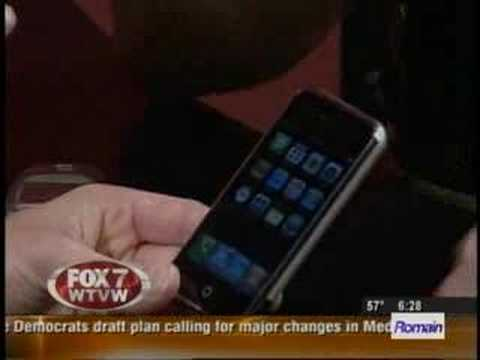
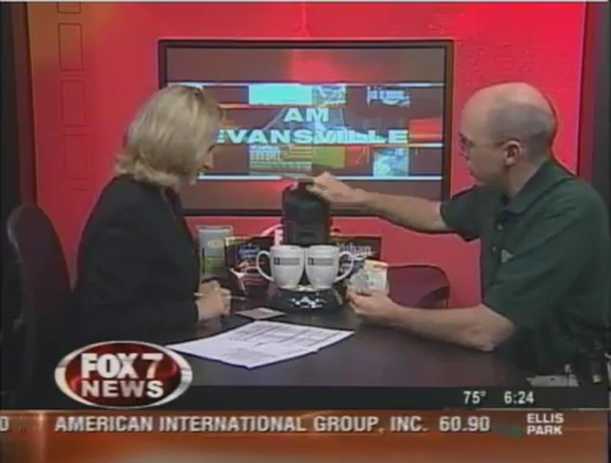
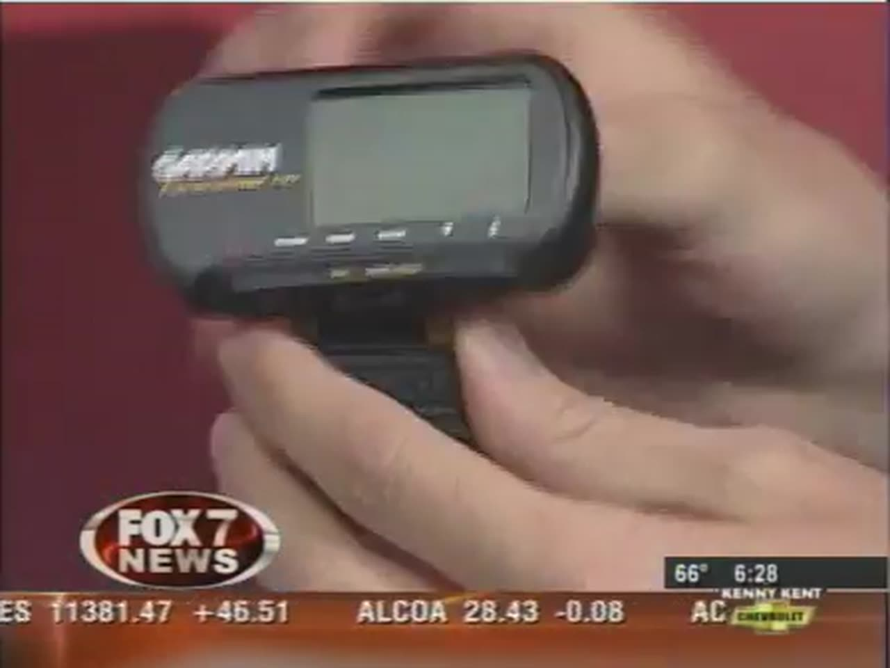
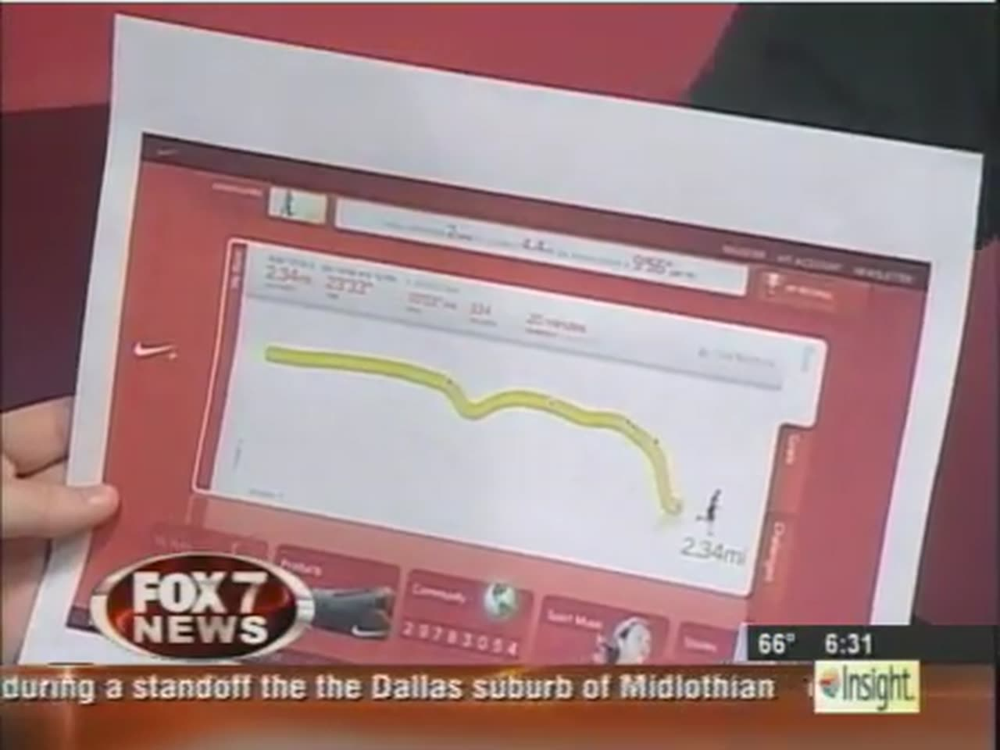
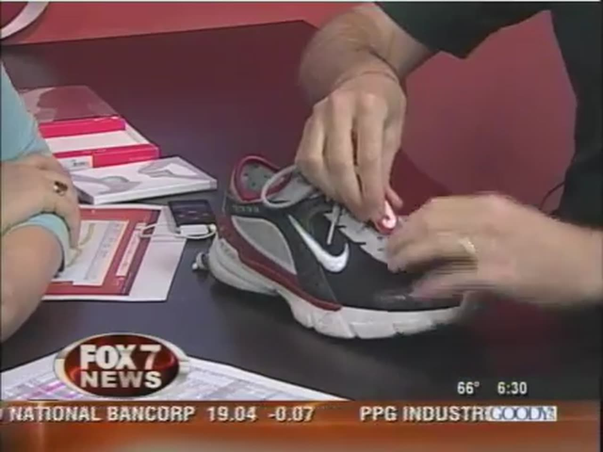

Back in 2006 and 2007, I had a recurring gadget segment on local morning TV. It was called Inspector Gadget, and it ran on the Fox 7 AM Evansville morning show. Each spot was about three or four minutes: I brought in a gadget, demonstrated it live with one of the hosts, and hoped it worked on the air. Sometimes it did. These are now retro gadgets themselves, so I've collected the gadget spots into one archive page, with a short note on each.



> **Note:** Prices, availability, and websites in these spots are from 2006 and 2007. Most of these products are long discontinued, and many of the stores and sites mentioned are gone. Treat this page as a time capsule, not a shopping guide.
{: .note}

## TABLE OF CONTENTS {#table-of-contents}

- [TABLE OF CONTENTS](#table-of-contents)
- [LINKS](#links)
- [SUPPORT THE BLOG AND CHANNEL](#support-the-blog-and-channel)
- [VIDEO ERRATA](#video-errata)
- [ABOUT THE SPOTS](#about-the-spots)
- [THE 2006 SPOTS](#spots-2006)
  - [PHILIPS SENSEO COFFEE POD BREWER](#senseo)
  - [NIKE+IPOD SPORT KIT](#nike-ipod)
  - [VOIP, SKYPE, AND SKYPE PHONES](#voip-skype)
  - [PICOO Z RC HELICOPTER](#picoo-z)
  - [LEGO MINDSTORMS NXT](#lego-mindstorms-nxt)
  - [NOKIA 770 INTERNET TABLET](#nokia-770)
  - [XANTREX POWERPACK 200 PLUS](#xantrex-powerpack)
  - [PACIFIC DIGITAL PHOTO FRAME](#digital-picture-frame)
  - [WILD PLANET VERTICON MID-AIR COMBAT](#verticon)
  - [GEEK STOCKING STUFFERS](#geek-stocking-stuffers)
- [THE 2007 SPOTS](#spots-2007)
  - [LOGITECH HARMONY 880 UNIVERSAL REMOTE](#logitech-harmony-880)
  - [DIGITAL BLUE QX5 COMPUTER MICROSCOPE](#qx5-microscope)
  - [FUJIFILM FINEPIX V10 DIGITAL CAMERA](#fujifilm-v10)
  - [APPLE TV (FIRST GENERATION)](#apple-tv)
  - [THE ORIGINAL APPLE IPHONE](#original-iphone)
  - [TOMTOM GO 510 GPS](#tomtom-go-510)
- [CONCLUSION](#conclusion)

---

## LINKS {#links}

- 📺 retroCombs on YouTube: <https://www.youtube.com/@retroCombs>
- 🕹️ More gadget reviews: [Gadgets topic page](/gadgets)

*Disclosure Statement: When you click on links to various merchants on this site and make a purchase, this can result in this site earning a commission. Affiliate programs and affiliations include, but are not limited to Amazon and the eBay Partner Network.*

## SUPPORT THE BLOG AND CHANNEL {#support-the-blog-and-channel}

Check out the [supporters page](/supporters) to learn about my supporters and how you can join our community. If this post saved you some time, you can also [leave a tip](https://paypal.me/stevencombs). And if you like gadgets, subscribe to @retroCombs-tech. Hooked on tech since '73.



## VIDEO ERRATA {#video-errata}

- These are TV segments recorded live, so prices and details are as I said them on the air at the time. I haven't corrected them in the notes below.
- Some old video descriptions point to websites that no longer exist. I've left those links out of this post.
- YouTube upload dates are not air dates. I grouped the spots by the year I uploaded them, which is close to when they aired.

## ABOUT THE SPOTS {#about-the-spots}

The format was simple. A host asked the questions most viewers would ask (What does it do? How much is it?), and I tried to answer in under four minutes while the gadget did its thing on live TV. One running joke shows up more than once: any gadget that ends a household argument earned the name "Marriage Saver 5000."

## THE 2006 SPOTS {#spots-2006}

### PHILIPS SENSEO COFFEE POD BREWER {#senseo}

The very first Inspector Gadget segment, with Sarah Brownlee. The Philips Senseo brews a single cup from a coffee pod. About $70 at the time.

- The water heats in a minute or two, so you go from cold water to hot coffee in about 3 minutes, with a little froth on top.
- You aren't stuck with the Senseo brand. Other companies made pods too, including Target's Archer Farms, and there was even a tea pod.
- The removable parts go in the dishwasher.

Title: _Fox 7 - Inspector Gadget Spot - ☕ Senseo Coffee Pod_



### NIKE+IPOD SPORT KIT {#nike-ipod}

Sarah Brownlee and I break out the running shoes. The Nike+iPod kit links a small shoe sensor to an iPod nano.

- The kit was $29.99, and you needed an iPod nano (about $150).
- It replaced my Garmin Forerunner 101 for tracking runs.

    
- Press the center button during a run and a human voice tells you your stats. You can also pick a power song for extra encouragement. Runs sync through iTunes to nike.com, which graphs them.

    
- Myth debunked: Nike says you need new Nike shoes (about $100). You don't. I wrapped the sensor in plastic and laced it into the shoes I already had.

    

Title: _Fox 7 - Inspector Gadget Spot - Nike+iPod_



### VOIP, SKYPE, AND SKYPE PHONES {#voip-skype}

With Sarah Brownlee: what VoIP (voice over Internet Protocol) is, and how Skype used it to cut long-distance bills.

- Skype looked like an instant messaging client, then added free computer-to-computer calls anywhere in the world.
- Calls from Skype to regular phones in the United States and Canada were free at the time, and calls to Europe were about 2 cents a minute. The Lovely Accountant and I used it to call family overseas.
- Skype phones made it feel like a regular phone: a USB handset, a Philips cordless model with a cradle, and a new Logitech model that worked over Wi-Fi with no computer at all.

*Looking back: Microsoft retired Skype in 2025.*

Title: _Fox 7 - Inspector Gadget Spot | What is VOIP, Skype & Skype Phones?_



### PICOO Z RC HELICOPTER {#picoo-z}

Sarah Brownlee becomes a pilot, and we crash it a time or two. The Picoo Z was the smallest RC helicopter I knew of.

- I found it for about $30 at my local RadioShack.
- A 30-minute charge gave you about 3 to 7 minutes of flight.
- I compared it to the Zip Zaps RC cars (about $20).
- It was hard to find, and units were selling on eBay for about three times the price.

Title: _Fox 7 - Inspector Gadget Spot - Picoo Z RC Helicopter_



### LEGO MINDSTORMS NXT {#lego-mindstorms-nxt}

The latest in LEGO robotics at the time, the Mindstorms NXT.

- My Alpha Rex robot, the example on the box, took about seven hours of construction and programming time.
- The sensors include an ultrasonic sensor that measures distance with sound and a touch sensor.
- The software shows the building instructions on screen.
- Alpha Rex tried to dance for us to "The Loco-Motion."

Title: _Fox 7 - Inspector Gadget Spot - LEGO Mindstorms NXT_



### NOKIA 770 INTERNET TABLET {#nokia-770}

With Sarah Brownlee: taking the web with you, in usable form, in the palm of your hand.

- An 800x480 screen, Wi-Fi, and Bluetooth.
- It ran the Gizmo VoIP app for calls over Wi-Fi, and with the 1GB expansion card in mine, it played video.
- It cost $350. I mentioned the Sony mylo as a competitor.

Title: _Fox 7 - Inspector Gadget Spot - Nokia 770 Internet Tablet_



### XANTREX POWERPACK 200 PLUS {#xantrex-powerpack}

An emergency kit for your car or home, all in one box. It's basically a big, heavy battery.

- A built-in light that stays on for about 12 hours, and a 110V inverter for something like a small TV or a radio.
- Jumper cables with polarity correction, plus an air compressor.
- A battery indicator light, and it charges from a wall outlet or your car's lighter socket.
- I paid about $60 on Amazon with free shipping. Xantrex made models all the way up to 1600 watts.
- During a power outage, I plugged a 15W fluorescent bulb into it and we had light for over two hours.

Title: _Fox 7 - Inspector Gadget Spot - Xantrex Powerpack 200 Plus_



### PACIFIC DIGITAL PHOTO FRAME {#digital-picture-frame}

With Sarah Brownlee, ahead of the holidays: a digital picture frame, so nobody has to sit through a great uncle's slideshow.

- An 8x10 frame with an 800x600 screen and transition effects such as wipes.
- It stored about 80 photos. The included software wasn't great, so I suggested iPhoto or Picasa.
- A wireless USB adapter let you push pictures to the frame over a network, so you could send new photos to a relative's frame from far away. You could also link an online account like Flickr.
- Two stereo speakers and a built-in microphone, so you could add music or record your voice on a slide.
- USB ports for a thumb drive or a camera, and an output to a bigger screen.
- About $350 for this model. Simpler frames were around $150, and small ones went on sale for about $100.

Title: _Fox 7 - Inspector Gadget Spot - Digital Picture Frame_



### WILD PLANET VERTICON MID-AIR COMBAT {#verticon}

Everybody wanted a Wii or a PS3 that Christmas, and many kids weren't getting one. My alternative for geeky kids ages 10 to 80: Verticon. According to the video description, this spot aired December 4, 2006.

- It's the old science project of a ping pong ball floating in a hair dryer's air stream, turned into a battle game that reminded me of Quidditch.
- Each battle ball has holes for up to three weapon attachments. Numbers on the ball tell you how many weapons it can carry and how much damage it does.
- Drop the balls into the arena. The first one knocked out loses, and the score on the back tells you how many weapons to remove.
- You can adjust the air. Sarah Brownlee won.

Title: _Fox 7 - Inspector Gadget Spot - WildPlanet's Verticon_



### GEEK STOCKING STUFFERS {#geek-stocking-stuffers}

With Sean McHose: gadgets for the geek's stocking.

- Powerline Ethernet adapters: plug one in near your router and another in a different room, and your network runs over the power lines. About $50 per plug.
- The Macally BT-2 Bluetooth mouse. No dongle, as long as the computer has Bluetooth. About $50.
- The Liberator cable, a short extension that frees up the outlet a bulky power brick would block. About $5.
- Sean's favorite, the Ninja Remote, for muting or changing that blaring TV at your favorite restaurant. $9.99 from ThinkGeek.

*Looking back: ThinkGeek closed in 2019.*

Title: _Fox 7 - Inspector Gadget Spot - Geek Stocking Stuffers_



## THE 2007 SPOTS {#spots-2007}

### LOGITECH HARMONY 880 UNIVERSAL REMOTE {#logitech-harmony-880}

With Sarah Brownlee: clearing the remote control clutter from the coffee table with what I called the Marriage Saver 5000.

- You program it from your computer over USB, by activity (watch TV, watch a DVD, listen to the radio) instead of by device.
- Press Watch TV and it turns on the TV and the receiver. Press Watch DVD and it adds the DVD player.
- When I bought a new TV over the holidays, the codes weren't perfect at first. When I went back online later, updated codes were there and it worked flawlessly.
- Harmony remotes ranged from $99 to $399. The 880 listed at $250, but you could find it for about $150.
- It even had built-in help and a little photo slideshow.

Title: _Fox 7 - Inspector Gadget Spot - Logitech Harmony 880_



### DIGITAL BLUE QX5 COMPUTER MICROSCOPE {#qx5-microscope}

With Sean McHose: the microscopic world on a computer screen.

- A USB microscope for Mac or Windows with 10x, 60x, and 200x zoom, plus a light underneath for slides and a top light for solid objects.
- We zoomed in on Lincoln sitting in the Lincoln Memorial on the back of a penny. The software measures distances, like the space between Lincoln's knees, and angles.
- The included slides have a pheasant feather and a honey bee's wing and leg.
- It also records movies and does time-lapse.
- About $50, online or at Toys R Us. Intel originally made it, back when the processor company got into toys.

Title: _Fox 7 - Inspector Gadget Spot - QX5 Computer Microscope_



### FUJIFILM FINEPIX V10 DIGITAL CAMERA {#fujifilm-v10}

With Sarah Brownlee: why 2007 was the sweet spot to buy a pocket digital camera.

- My old Kodak had a 10x zoom and 5 megapixels, cost about $600 three years earlier, and didn't fit in a pocket.
- The V10 was 5 megapixels for $150 from online retailers, with a large screen and video recording.
- 5 megapixels is plenty for 4x6 prints and fine up to 8x10.
- It had games built in (not why I bought it) and a night shooting mode that took a usable photo outside the building that morning without a flash.
- It came with a leather case. You have to accessorize.

Title: _Fox 7 - Inspector Gadget Spot - FujiFilm V10 Digital Camera_



### APPLE TV (FIRST GENERATION) {#apple-tv}

With Sean McHose. Apple TV did for video what AirPort Express did for audio: it moved music, TV shows, movies, and photos from iTunes to your TV.

- It needed a high-definition TV. It wouldn't work with an older standard TV.
- Connections: Ethernet or Wi-Fi, HDMI or component video, and a USB port "reserved for future use." I recommended HDMI for audio and video on one cable.
- Inside was a 40GB hard drive. iTunes found the Apple TV on your network and synced to it.
- Missed an episode of 24 on Fox 7? Buy it from iTunes for $1.99 and watch it from the recliner.

Title: _Fox 7 - Inspector Gadget Spot - The OG Apple TV Hardware_



### THE ORIGINAL APPLE IPHONE {#original-iphone}

With Sean McHose: the brand-new iPhone.

- There were complaints about glitches, and any first-generation product will have some, but I'd had nothing but good experiences. What put most people off was the keyboard, which felt nothing like physical keys.
- Only a few mechanical buttons: Home, volume, and on/off. Slide to unlock keeps it from waking in your pocket.
- A 2-megapixel camera, and pinch to zoom on photos.
- Maps, the iPod app for music and video, and a built-in speaker.
- The included earbuds had a microphone with a click button to pause music and answer calls.

Title: _Fox 7 - Inspector Gadget Spot - Original Apple iPhone_



### TOMTOM GO 510 GPS {#tomtom-go-510}

With Sarah Brownlee: the next Marriage Saver 5000, for couples who don't travel well together because someone has to navigate.

- Set where you are and where you want to go on the touchscreen, and it gives directions on screen and out loud. Miss a turn and it tells you to make a U-turn. It's kind of bossy.
- On a trip to Washington, D.C., I asked it to route around congestion and it found back roads.
- An optional antenna accessory picked up broadcast traffic information.
- Celebrity voices were available. I wanted Mr. T.
- Bluetooth turned it into a hands-free speakerphone and downloaded my phone's contacts.
- It listed at $350, with built-in points of interest such as restaurants.

Title: _Fox 7 - Inspector Gadget - TomTom Go 510 GPS_



## CONCLUSION {#conclusion}

Looking back at these spots, it's fun to see how fast things moved. In about a year we went from a coffee pod brewer to the original iPhone. If you remember any of these, or still have one, I'd like to hear about it.

Which of these gadgets did you own? Let me know in the comments below. If this post helped, [leave a tip](https://paypal.me/stevencombs).

That's it for me, retroCombs, out.
