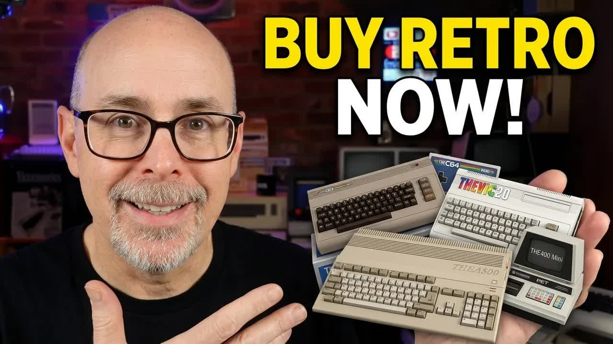
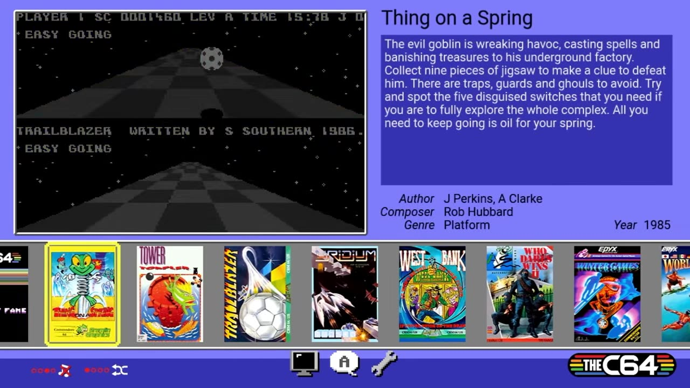
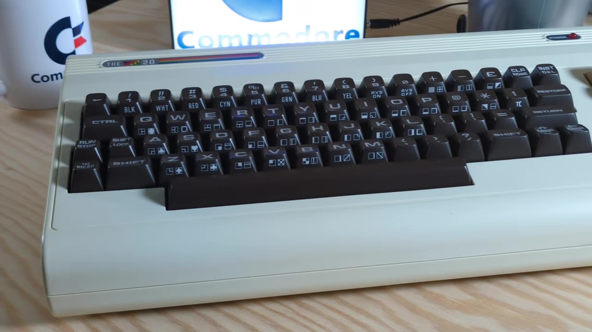
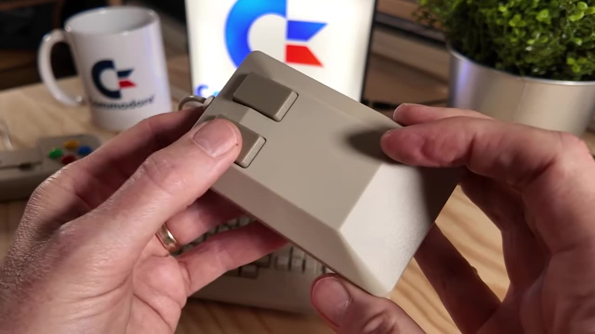
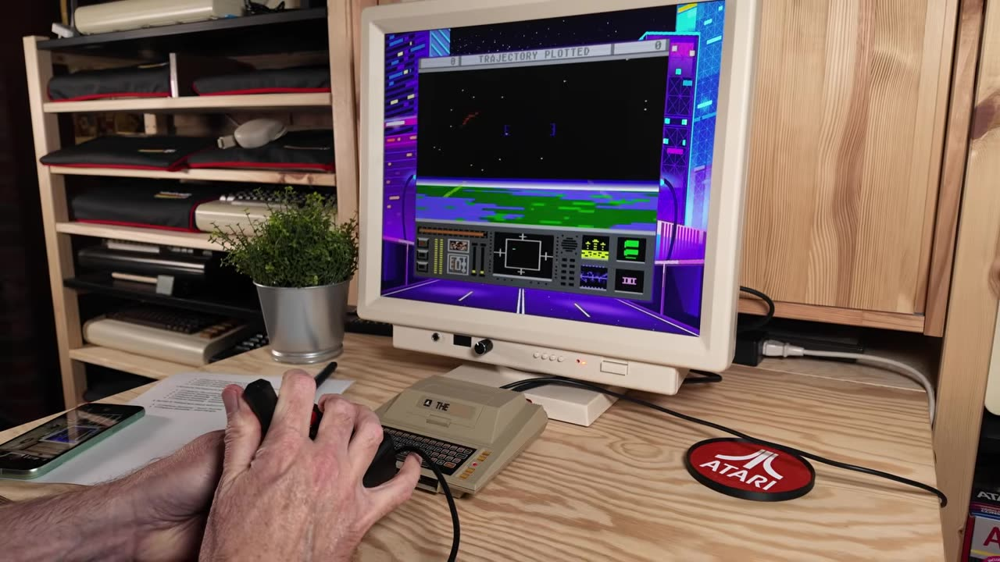

You pre-ordered [THEA1200](https://amzn.to/4oeSG1F) from Retro Games Ltd (RGL), and now you're waiting. That doesn't mean you're out of options for yourself or the retro computer fan on your gift list. I've bought almost every RGL computer, so in this post, the companion to my video, I go through the lineup in the order RGL released it. For each one, I match it to the original computer, share my five favorite experiences, and list what it costs today.

## TABLE OF CONTENTS {#table-of-contents}

- [TABLE OF CONTENTS](#table-of-contents)
- [LINKS](#links)
- [SUPPORT THE BLOG AND CHANNEL](#support-the-blog-and-channel)
- [COMPANION YOUTUBE VIDEO](#companion-youtube-video)
- [VIDEO ERRATA](#video-errata)
- [THEA1200 STATUS UPDATE](#thea1200)
- [PRICES AT A GLANCE](#prices)
- [THEC64 MINI (2018)](#thec64-mini)
- [THEC64, THE "MAXI" (2019)](#thec64)
- [THEVIC20 (2020)](#thevic20)
- [THEA500 MINI (2022)](#thea500-mini)
- [THE400 MINI (2024)](#the400-mini)
- [THE SPECTRUM (2024)](#thespectrum)
- [THEC64 MINI BLACK EDITION (2025)](#black-edition)
- [WHICH ONE SHOULD YOU BUY?](#which-one)
- [CONCLUSION](#conclusion)

---

## LINKS {#links}

**Retro Games Ltd Computers**

- 💻 Retro Games Ltd TheC64 Mini: <https://link.amazon/B019AnpPJ>
- 💻 Retro Games Ltd TheC64 Maxi: <https://link.amazon/B0i8BtTtm>
- 💻 Retro Games Ltd TheVIC20 (UK): <https://amzn.to/3CA7anp>
- 💻 THEVIC20 at Retro Games Ltd: <https://retrogames.biz/products/thevic20/>
- 💻 Retro Games Ltd TheA500 Mini: <https://amzn.to/3OVxJuD>
- 💻 Retro Games Ltd The Atari 400 Mini: <https://amzn.to/3Ju6xiH>
- 💻 The Spectrum at Retro Games Ltd: <https://retrogames.biz/products/thespectrum/>
- 💻 Retro Games Ltd TheSpectrum: <https://link.amazon/B05ukTchg>
- 🤍 Retro Games Ltd TheSpectrum White Edition: <https://link.amazon/B0e3Pz7Cr>
- 💻 Retro Games Ltd THEC64 Mini Black: <https://amzn.to/4p4zzsv>
- 🅰️ Retro Games Ltd A1200 (US preorder): <https://amzn.to/4oeSG1F>
- 🅰️ THEA1200 at Retro Games Ltd: <https://retrogames.biz/products/thea1200/>

**Controllers and Accessories**

- 🖱️ Retro Games Ltd TheMouse: <https://amzn.to/3PiJ1JM>
- 🎮 Retro Games Ltd TheGamePad: <https://amzn.to/43H7iNu>
- 🕹️ Retro Games Ltd TheJoystick: <https://amzn.to/43lVHUh>
- 🕹️ Retro Games Ltd THECXSTICK: <https://amzn.to/3UgLwgy>
- 💾 AMiNIMiga: <https://www.amiga500mini.com/AMiNIMiga>

**Books**

- 📕 A Hobbyist's Guide to The A500 Mini: <https://amzn.to/41HIUMZ>

**Related Posts**

- [Ten No Hack TheC64 Tips To Upgrade your Retro Computing Experience](/ten-thec64-tips)
- [10 reasons THEVIC20 and THEC64 are great retro-computing gifts](/thevic20-1)
- [A review of the Commodore VIC-20 Games on the THEVIC20 and THEC64 maxi](/thevic20-2)
- [Upgrade TheC64 and VIC20 to Firmware 1.6.1](/thec64-1-6-1)
- [Unboxing and First Use of the Retro Game TheA500 Mini](/unbox-thea500mini)
- [10 Best Holiday Gifts for Retro Computing Fans in 2022](/2022-gift-guide)

*Disclosure Statement: When you click on links to various merchants on this site and make a purchase, this can result in this site earning a commission. Affiliate programs and affiliations include, but are not limited to Amazon and the eBay Partner Network.*

## SUPPORT THE BLOG AND CHANNEL {#support-the-blog-and-channel}

Check out the [supporters page](/supporters) to learn about my supporters and how you can join our community. If this post saved you some time, you can also [leave a tip](https://paypal.me/stevencombs).

## COMPANION YOUTUBE VIDEO {#companion-youtube-video}

Title: _💾️ 6 Retro Consoles You Can Buy RIGHT NOW While You Wait for the A1200_





## VIDEO ERRATA {#video-errata}

As of 2026-11-22:

- **THEA1200 launch date.** In the video I said THEA1200 wouldn't arrive until June 2026. That date slipped. RGL now lists the launch as Friday, December 4, 2026. See the [status update](#thea1200) below.
- **VIC-20 dates.** I said the VIC-20 was from the 1970s. It launched in Japan in 1980 as the VIC-1001 and in the US and Europe in 1981. Commodore discontinued it in January 1985. It was the first computer of any kind to sell one million units.
- **A1200 bits.** I called THEA1200 "the full 16-bit experience." The original A1200 has a 32-bit Motorola 68EC020 processor, a step up from the 16-bit-era A500.
- **Spectrum game name.** The game I called "Fantas" is *Phantis (Game Over II)*.
- **Prices.** The prices I quoted in the video have changed. The [Black Edition](https://amzn.to/4p4zzsv), which I said was around $120, now costs less. See the [price table](#prices).

## THEA1200 STATUS UPDATE {#thea1200}

According to [RGL's THEA1200 page](https://retrogames.biz/products/thea1200/), checked November 1, 2026:

- **Launch date:** Friday, December 4, 2026. Pre-orders are open.
- **What it is:** A full-size A1200 with a working keyboard, HDMI, and USB. It emulates the A1200's AGA chipset and also the A500's OCS and the ECS of later machines.
- **Included:** 25 games, a Workbench installation, an original-style two-button mouse, and a new eight-button gamepad.
- **Load your own:** USB loading with WHDLoad support, plus save and resume.

UK listings I found were £164.95 at Hit and £169.99 at Argos. Some retailer pages still show the old June 2026 date, so go by RGL's page. In the US, Rarewaves.com lists a pre-order at $284.99.

## PRICES AT A GLANCE {#prices}

These are new-in-box prices I found on store listings as of November 1, 2026. Prices change often, and stock comes and goes.

| Computer | RGL release | Price in the video | Price as of November 1, 2026 |
| --- | --- | --- | --- |
| [THEC64 Mini](https://link.amazon/B019AnpPJ) | 2018 | Launched around $80; as low as $40 | $54.99 new (True Believers); about $40 to $50 used |
| [THEC64 (Maxi)](https://link.amazon/B0i8BtTtm) | 2019 | $120 to $140 | $355.99 new (CaveGamers) |
| [THEVIC20](https://amzn.to/3CA7anp) | 2020 | $120 to $140, hard to find | $204.99 (Rarewaves.com; power supply not included) |
| [THEA500 Mini](https://amzn.to/3OVxJuD) | 2022 | $130 to $140 | $219.99 new (CaveGamers); $110 to $120 used (PayMore) |
| [THE400 Mini](https://amzn.to/3Ju6xiH) | 2024 | Around $120 | $119.99 (atari.com, AtariAge) |
| [The Spectrum](https://link.amazon/B05ukTchg) | 2024 | $120 to $140 | $104.99 plus shipping (Play-Asia) |
| THEC64 Mini Black Edition | 2025 | Around $120 | $79.99 (Rarewaves.com) |
| THEA1200 | Pre-order | Not yet released | See the [status update](#thea1200) |

## THEC64 MINI (2018) {#thec64-mini}

**The original.** The Commodore 64 launched in 1982 and stayed in production until 1994. It's often called the best-selling single computer model of all time. It wasn't just a game machine. It was a gateway to programming and music.

**The re-creation.** THEC64 Mini is a half-scale model. The keyboard is just for show, but it looks perfect. It comes with the first version of the joystick, which uses dome switches rather than microswitches. It has 64 built-in 1980s games and outputs 720p over HDMI. You can plug in a USB keyboard for a full C64 BASIC experience.

**My top five experiences:**

1. Plugging in a USB keyboard and booting to BASIC
2. Hearing "Stay a while, stay forever!" from *Impossible Mission*
3. Playing a modern homebrew like *Galencia*
4. Loading your own games from a [USB stick](https://link.amazon/B05GEnTW6)
5. Using save states to finally beat *Paradroid*

It's readily available and the cheapest way into the RGL lineup.

## THEC64, THE "MAXI" (2019) {#thec64}

**The re-creation.** In 2019, RGL fixed the Mini's biggest complaint. THEC64 (everyone calls it the Maxi, but RGL doesn't like that) is a full-size re-creation with a working keyboard that has that classic C64 feel. This is one for people who want to type `LOAD"*",8,1` again. It has the same 64 games as the Mini, runs in C64 or VIC-20 mode, and comes with the upgraded microswitch joystick.

Full disclosure: I don't own the brown Maxi. I bought its identical twin, THEVIC20.

**My top five experiences:**

1. Booting into BASIC to use the keyboard
2. Loading a game from a USB stick
3. Playing *Boulder Dash*
4. Typing a program from an old magazine
5. Just looking at it on my desk

For more ideas, see my [ten THEC64 tips](/ten-thec64-tips).

## THEVIC20 (2020) {#thevic20}

**The original.** The VIC-20 was the C64's older brother and my very first computer. It had a short but important run, from 1980 in Japan and 1981 in the US until January 1985, and it was the first computer to sell one million units.

**The re-creation.** THEVIC20 uses the same full-size body as THEC64, in VIC-20 colors. It boots into VIC-20 mode, C64 mode, or the games carousel, and it includes 64 built-in titles that mix VIC-20 and C64 classics. The VIC-20 games are hit and miss, but you can load better ones from a USB drive.

**My top five experiences:**

1. Reliving the 22-column screen
2. Typing VIC-20 BASIC programs on that keyboard
3. Playing a Jeff Minter classic like *Gridrunner*
4. Booting into C64 mode, because it's two computers in one
5. Running the music visualizer *Psychedelia*

It's for the true connoisseur, and it's hard to find. If your gift recipient ever owned a VIC-20, it's a home run. My [THEVIC20 gift post](/thevic20-1) and [VIC-20 games review](/thevic20-2) have more.

## THEA500 MINI (2022) {#thea500-mini}

**The original.** The Amiga 500 launched in 1987 and was light-years ahead of anything else on the market. The 500 series sold until about 1992.

**The re-creation.** THEA500 Mini is a small-scale replica with a non-working keyboard, but it comes with two useful accessories: [THEMOUSE](https://amzn.to/3PiJ1JM), a replica of the Amiga tank mouse, and [THEGAMEPAD](https://amzn.to/43H7iNu). Both are also sold separately. It has 25 built-in Amiga games, and you can load your own over USB.

**My top five experiences:**

1. Loading your Amiga library from a USB stick using ADF or WHDLoad files
2. Using [AMiNIMiga](https://www.amiga500mini.com/AMiNIMiga) to get a full Workbench environment running
3. Using the clicky tank mouse replica
4. Playing *Another World*
5. Using save states to win a game of *Battle Chess*

My [A500 Mini unboxing post](/unbox-thea500mini) covers setup.

## THE400 MINI (2024) {#the400-mini}

**The original.** The Atari 400 sold from 1979 to 1983. It looked like a space-age typewriter and had an awful membrane keyboard, but it and its big brother, the 800, had a great game library.

**The re-creation.** THE400 Mini is a half-scale model that emulates the 400 and the rest of the Atari 8-bit line, including the 800, XL, and XE. The keyboard is just for show, and that's fine here. It has 25 built-in games and comes with [THECXSTICK](https://amzn.to/3UgLwgy), a re-creation of the Atari CX40 joystick with USB and extra buttons for the carousel. The joystick is the star of the show.

**My top five experiences:**

1. Using THECXSTICK
2. Playing the modern 3D homebrew *Yump*
3. Playing *Berzerk*
4. Typing a BASIC program on an external keyboard
5. Playing *Star Raiders II*, which started life as a tie-in game for *The Last Starfighter*

## THE SPECTRUM (2024) {#thespectrum}

**The original.** If you grew up in the UK, the Sinclair ZX Spectrum was your childhood. The 48K model launched in 1982, and the Spectrum line continued until about 1992.

**The re-creation.** The Spectrum is a full-size model of the 48K Spectrum that also emulates the 128K models. The rubber keyboard works. RGL lists 48 built-in games, HDMI at 720p, and four USB ports. A USB power lead is included, but not a power adapter.

I didn't grow up with the Spectrum, so my favorites might not be yours.

**My top five experiences:**

1. Typing on those rubber keys
2. Writing a BASIC program with single keystrokes for each command
3. Playing *Manic Miner* with THECXSTICK, which works with The Spectrum
4. Playing *Bobby Bearing*
5. Playing *Phantis (Game Over II)*

While I was recording, RGL announced a [white collector's edition](https://link.amazon/B0e3Pz7Cr) that pays tribute to the one millionth Spectrum. It comes with a matching white printer, a QuickShot II joystick, and a Microdrive-style USB stick. At the time, pre-orders were open only in Europe. As of November 1, 2026, I found White Edition listings from $151.99 to $178.

## THEC64 MINI BLACK EDITION (2025) {#black-edition}

**The re-creation.** The Black Edition is more than a paint job. It includes the upgraded microswitch joystick and a USB-C power port. The biggest change is the games: RGL replaced the 64 classic games with 25 modern homebrew titles. That makes it a different machine for a different audience, people who follow the current C64 scene.

**My top five experiences:**

1. Playing the platformer *Sam's Journey*
2. Exploring the Metroidvania-style *Steel Ranger*
3. Playing *Galencia* again
4. Diving into *Metal Warrior Ultra*
5. Loading CRT, PRG, or D64 files from a USB drive

If you're a modern C64 fan, this is the Mini to get. If you just want 1980s nostalgia, save a few bucks and get the original.

## WHICH ONE SHOULD YOU BUY? {#which-one}

| If you are... | Get |
| --- | --- |
| A 1980s C64 nostalgia fan | [THEC64 Mini](https://link.amazon/B019AnpPJ) |
| A modern C64 homebrew fan | [THEC64 Mini Black Edition](https://amzn.to/4p4zzsv) |
| A Commodore fan who wants a full 8-bit keyboard | [THEC64 (Maxi)](https://link.amazon/B0i8BtTtm), or [THEVIC20](https://amzn.to/3CA7anp) if you can find one |
| A 16-bit Amiga fan | [THEA500 Mini](https://amzn.to/3OVxJuD), plus a [THEA1200 pre-order](https://amzn.to/4oeSG1F) |
| An Atari fan | [THE400 Mini](https://amzn.to/3Ju6xiH) and a USB keyboard |
| A British retro fan | [The Spectrum](https://link.amazon/B05ukTchg), plus [THEGAMEPAD](https://amzn.to/43H7iNu) for easier carousel navigation |

> **Tip:** These are also a low-cost way to try a computer you didn't own back in the day.
{: .tip}

## CONCLUSION {#conclusion}

You can't go wrong with any of these. They're well made and they scratch the nostalgia itch. THEA1200 is now set for December 4, 2026, and until then, the rest of the lineup is ready to play today. Check the price table before you buy, because prices have moved since I made the video.

Did I miss a classic game or experience for one of these? Let me know in the comments below. If this post helped, [leave a tip](https://paypal.me/stevencombs).

That's it for me, folks. 🕹️ retroCombs, OUT!
