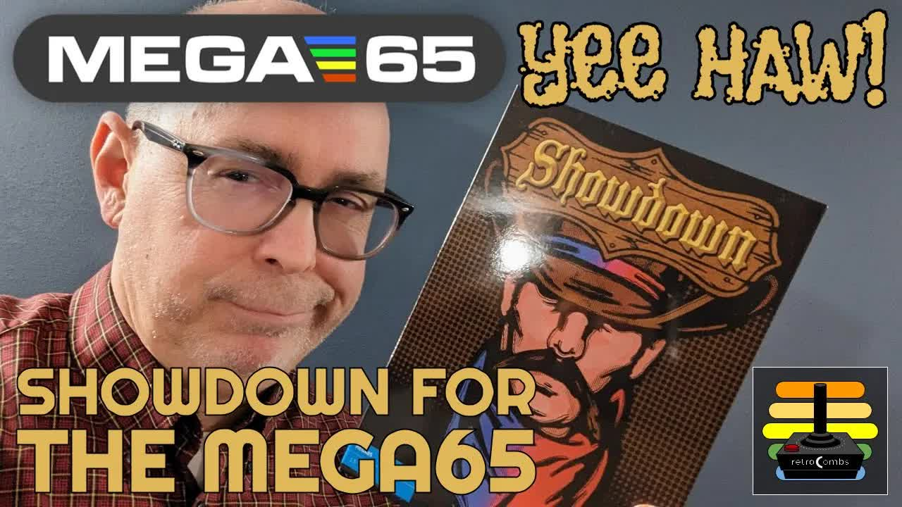
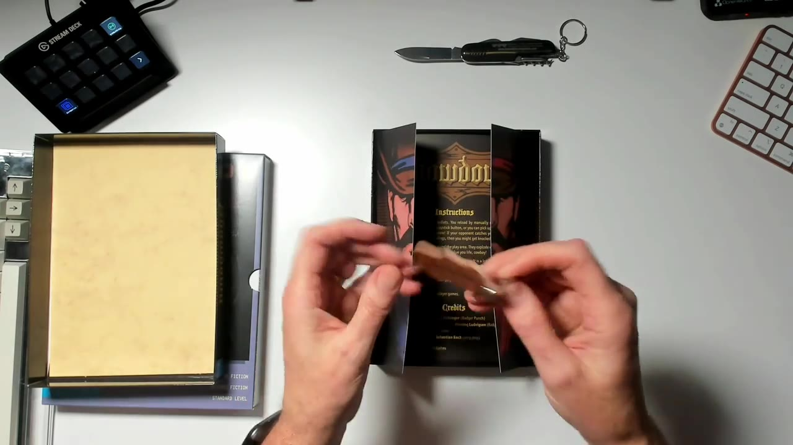
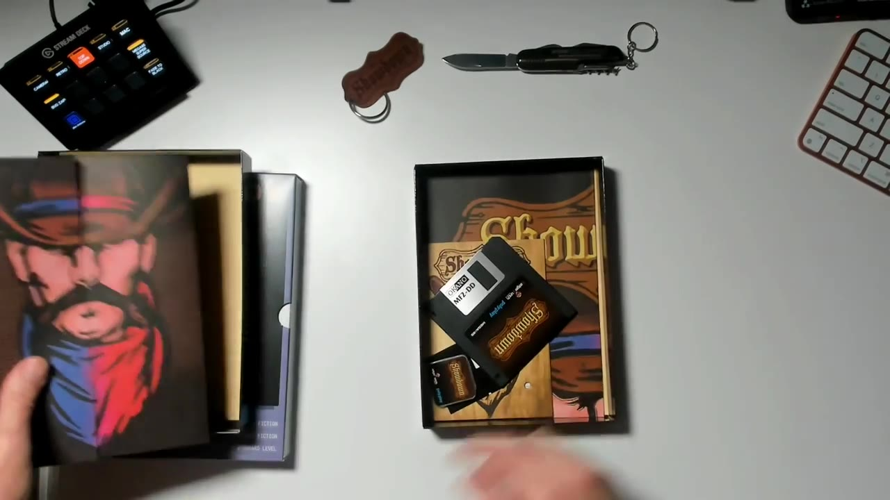
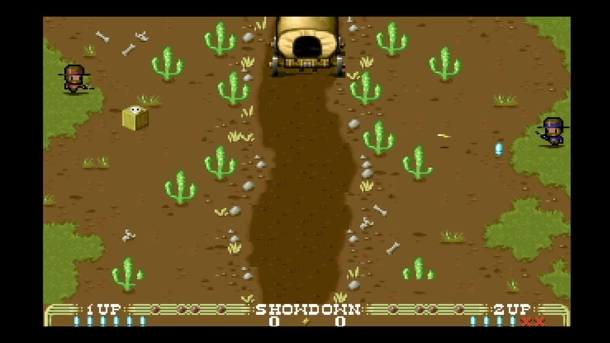
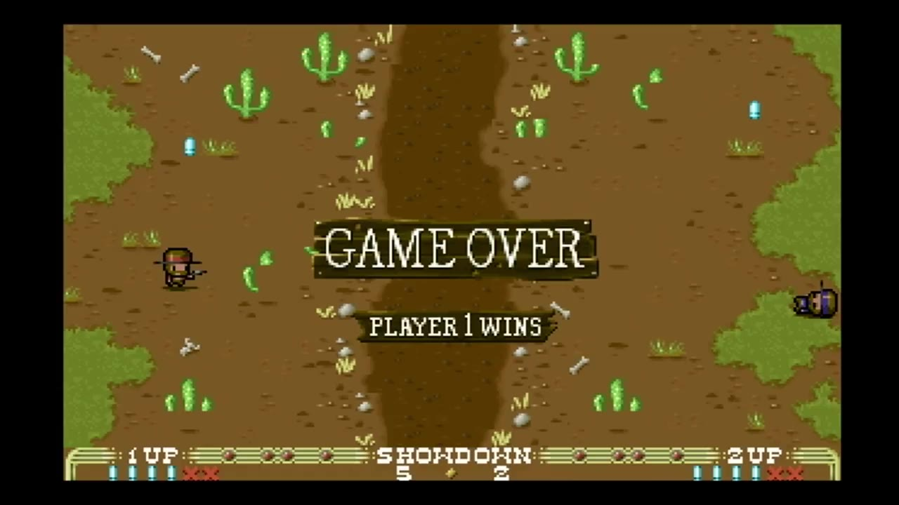

If you remember, I shared the boxed copy of Hibernated 1: The Director's Cut. Poly.Play is back with a boxed copy of the second MEGA65 packaged software release, Showdown from Badger Punch Games. It's a one or two player Wild West duel, and the box is packed with goodies. Yee haw!

Poly.Play provided this copy to the channel for free. Thank you! I'm under no obligation, they didn't ask me to say anything in particular, and these thoughts are my own.

This post is the text companion to my video. I edited it from my Halloween Eve livestream. It covers the unboxing, how the game plays, and what to do about the floppy disk in the first boxed copies. Let's dig in!



## TABLE OF CONTENTS {#table-of-contents}

- [TABLE OF CONTENTS](#table-of-contents)
- [LINKS](#links)
- [SUPPORT THE BLOG AND CHANNEL](#support-the-blog-and-channel)
- [COMPANION YOUTUBE VIDEO](#companion-youtube-video)
- [VIDEO ERRATA](#video-errata)
- [WHAT IS SHOWDOWN?](#what-is-showdown)
- [UNBOXING THE COLLECTOR'S EDITION](#unboxing)
- [THE FLOPPY DISK ISSUE](#floppy-disk-issue)
- [HOW TO PLAY](#how-to-play)
- [PLAYING SHOWDOWN](#playing-showdown)
- [CONCLUSION](#conclusion)

---

## LINKS {#links}

**Video Mention Links**

- 🤠 Showdown Collector's Edition (Poly.Play): <https://www.polyplay.xyz/Showdown-Collectors-Edition-MEGA65_1>
- 💾 Showdown disk images (Badger Punch Games on itch.io): <https://badgerpunch.itch.io/showdown-mega65>
- 🖥️ Get a MEGA65: <https://www.mega65.org>
- ❄️ My Hibernated 1 post: [Hibernated 1: The Director's Cut for MEGA65](/hibernated1)
- 📀 How to copy a MEGA65 disk image to a floppy: [Copy a MEGA65 Disk Image to a Floppy](/copy-mega65-disk-image-to-floppy)
- 📺 Original livestream: <https://youtu.be/Hf6TR2mhiEo>

**Joysticks and Supplies**

- 🕹️ Hyperkin Trooper Controller: <https://amzn.to/3l1CHXj>
- 🕹️ Atari CX40+ Joystick: <https://amzn.to/479CFmD>
- 💾 Floppy Disks: <https://amzn.to/3DrEOj1>

*Disclosure Statement: When you click on links to various merchants on this site and make a purchase, this can result in this site earning a commission. Affiliate programs and affiliations include, but are not limited to Amazon and the eBay Partner Network.*

## SUPPORT THE BLOG AND CHANNEL {#support-the-blog-and-channel}

Check out the [supporters page](/supporters) to learn about my supporters and how you can join our community. If this post saved you some time, you can also [leave a tip](https://paypal.me/stevencombs).

## COMPANION YOUTUBE VIDEO {#companion-youtube-video}

Title: _🕹️ Showdown for the MEGA65 Computer. Rootin' Tootin' Shoot 'em!_





## VIDEO ERRATA {#video-errata}

- **"Keychain" (~3:05):** I call the leather piece a keychain. Poly.Play lists it as a leather patch.
- **The floppy (~4:50):** The floppy in the first boxed copies has an older version of the game. See [THE FLOPPY DISK ISSUE](#floppy-disk-issue) below for the fix.

## WHAT IS SHOWDOWN? {#what-is-showdown}

Showdown is a one or two player action game from Badger Punch Games, the folks who also brought us [Roguecraft DX for the MEGA65](/roguecraft-dx-mega65). It's inspired by a host of older titles with the same theme, including the 1975 arcade game Gun Fight. Two cowboys face off across the screen, and the first player to knock down the other five times wins. It runs on a real MEGA65, the Xemu emulator, and the Nexys development board.

You can download the disk images from the [Badger Punch Games itch.io page](https://badgerpunch.itch.io/showdown-mega65) at a name-your-own-price rate (the page text suggests $5), or buy the boxed copy from Poly.Play. I recommend sending the developers two to five dollars so they keep making games.

## UNBOXING THE COLLECTOR'S EDITION {#unboxing}

Poly.Play does a fabulous job with its packaging. Even the receipt paper is professional. I wish I could get reams of it. Before you even get into the box, there's a sticker and some flyers for other Poly.Play titles, like Sam's Journey for the NES and its New Old Stock games.

The box comes in cellophane wrap. Compared to Hibernated, it's a little smaller. I'm not sure how they pick the size. It may depend on the goodies inside.

Here's where the box copy shines. The flaps open like saloon doors. Inside the doors is a leather Showdown patch. This is why you want box copies of this stuff!

According to Poly.Play, the Collector's Edition includes:

- The game on a 3.5-inch floppy disk
- A microSD card with the disk images, in a themed Poly.Play holder
- A cardboard box with the shrink-wrap
- A leather patch
- An A5 manual
- A postcard and stickers
- An A3 poster

There's also an old-fashioned registration card. I said I'd fill out the one from Hibernated and send it in, and I didn't. I don't want to mess this one up either. In the video, I said I kind of wanted it to be part of the package, so I'd see if there was a way to register online.

When I checked on Nov 3, 2026, Poly.Play listed the Collector's Edition at €30, including VAT, and available immediately. Check the [Poly.Play page](https://www.polyplay.xyz/Showdown-Collectors-Edition-MEGA65_1) for the current price and stock.

## THE FLOPPY DISK ISSUE {#floppy-disk-issue}

Here's the deal with the disk. The developer let me know through a direct message that the floppy in the first boxed copies has an older version of the game with an error. If you got one of those copies, the disk version won't work properly. For the video, I'd already moved a disk image to my MEGA65 and saved the game in the Freezer, so I didn't have to load it.

Here's how to fix it:

1. Download the latest disk image from the [Badger Punch Games itch.io page](https://badgerpunch.itch.io/showdown-mega65). When I checked, the download was **SHOWDOWN65-V1.4.ZIP**, from the "Version 1.4 - Floppy disk fix!" update posted Oct 9, 2022.
2. Unzip it, and copy the `.D81` disk image to your MEGA65's SD card.
3. Play from the disk image, or write it to a floppy. I walk through the floppy steps, with `MOUNT` and `BACKUP U9 TO U8`, in my post on how to [copy a MEGA65 disk image to a floppy](/copy-mega65-disk-image-to-floppy). It's the same process I used for Hibernated 1.

> **Tip:** Don't overwrite the original floppy in your box copy. Keep it as a collectible, and write the updated image to a blank disk. Need blanks? Here are some [floppy disks](https://amzn.to/3DrEOj1) to start with.
{: .tip}

> **Note:** Later boxed copies ship with the fixed v1.4 floppy. If yours doesn't load or acts strange, use the updated disk image.
{: .note}

## HOW TO PLAY {#how-to-play}

Plug a joystick into port 2 for one player, or use two joysticks for two players. I like the [Hyperkin Trooper](https://amzn.to/3l1CHXj) and the [Atari CX40+ Joystick](https://amzn.to/479CFmD).

- **Five bullets:** Each gun carries five bullets.
- **Reload:** Click the joystick button to reload by hand, or grab bullet packs from the ground.
- **Take cover:** Hide behind the cactus and buildings. If your opponent catches you out in the open, you'll get knocked down.
- **Explosive crates:** Watch out for them.
- **Win:** Knock down your opponent five times.
- **Exit:** Press **F7** to go back to the title screen.

## PLAYING SHOWDOWN {#playing-showdown}

I was the cowboy on the left. The computer opponent was blowing bullets everywhere. I had to remember to reload, and I ran out of bullets more than once. Rats!

Player one wins! I admit, I really enjoyed it. The menu screen keeps track of the wins, so you can keep playing and see who's ahead. The cover wears away too. Every time a bullet hits the outhouse, a little more of it goes away, kind of like the bricks in Breakout. Then you can try to sneak a shot through the gap.

This would be a blast with two people. I just wanted to yell at that guy. As the box says, the game is best played with a friend. Watching them hit the ground as you win the showdown is a lot of fun.

> **Tip:** Want two-player duels? Keep two joysticks plugged in. Then grab a friend and have at it.
{: .tip}

## CONCLUSION {#conclusion}

Badger Punch Games and Poly.Play, nicely done. Showdown is simple to learn, fun with a friend, and the Collector's Edition is packed with goodies. Poly.Play is knocking it out of the park with its packaging. If you have a MEGA65, a Commodore 64, an Atari, or another classic platform, check out their boxed titles. Tell your family a box copy is what you want for Christmas!

Have you played Showdown with a friend on your MEGA65? Who won? Let me know in the comments below. If this post helped, [leave a tip](https://paypal.me/stevencombs).

That's it for me, folks. 🕹️ retroCombs, OUT!
