SuperBOX sent over their flagship, the S8 Ultra, and I sat it next to the [S7 Pro](/android-tv-box-comparison#superbox-s7-pro) I looked at earlier this year. The question I started with was simple: what makes this one Ultra, and is it any more special than the other Android TV OS boxes on this bench?

On the carton I read 1000 Mbps Ethernet, Wi-Fi 6, 4 GB of RAM, 128 GB of storage, a 6K claim, over-the-air updates, and H.265. After a first look at the hardware, the Android 12 settings, and a few of the built-in tools, the upgrade I felt most was not a new chip story. It was the aluminum case, the backlit remote, and that jump from 32 GB on the S7 Pro to 128 GB here.

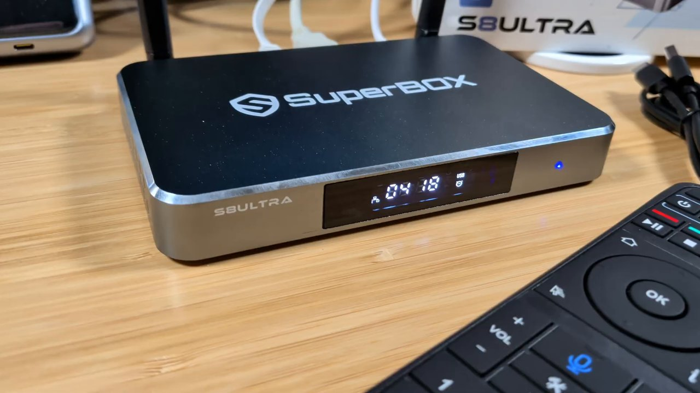

*Full disclosure: SuperBOX provided this S8 Ultra free in exchange for an honest review. SuperBOX did not see this post before publication. Links in this post are affiliate links, so I may earn a commission if you buy through them. Code retrocombs is 10% off S6, S7, and S8 models at the SuperBOX shop; confirm the discount at checkout.*

{% include review-box.html
   score="4"
   price="$449"
   where="list price at mysuperbox.shop (as of November 27, 2026; 10% off with code retrocombs)"
   summary="A solid step up from the S7 Pro: aluminum case, 128GB of storage, USB-C power, and a backlit remote. Still 4GB of RAM and Android 12 with a February 2022 security patch."
   note="First look, not a long-term living-room test. Official 6K, Multi View, and 7-day time-shift claims were not verified on my bench."
   product="SuperBOX S8 Ultra"
   channel="tech" %}

## TABLE OF CONTENTS {#table-of-contents}

- [TABLE OF CONTENTS](#table-of-contents)
- [LINKS](#links)
  - [Video Mention Links](#video-mention-links)
  - [Accessories Used in Testing](#accessories-used-in-testing)
  - [Related posts and videos](#related-posts)
  - [Resources](#resources)
- [SUPPORT THE BLOG AND CHANNEL](#support-the-blog-and-channel)
- [COMPANION YOUTUBE VIDEO](#companion-youtube-video)
- [VIDEO ERRATA](#video-errata)
- [A NOTE ON LEGAL USE](#legal-use)
- [WHAT'S IN THE BOX](#whats-in-the-box)
- [DESIGN AND PORTS](#design-and-ports)
- [FIRST BOOT](#first-boot)
- [THE HOME SCREEN](#home-screen)
- [ANDROID 12 SETTINGS WORTH OPENING](#settings)
- [ABOUT, ANDROID VERSION, AND THE SECURITY PATCH](#about)
- [FILE MANAGER, NETWORK SHARES, AND THE SPEED TEST](#files-and-speed)
- [PAIRING THE BACKLIT REMOTE](#remote)
- [INSTALLED APPS, PLAY STORE, AND THE ROM UPDATE](#apps-and-update)
- [THE SUPERBOX APP STORE, BLUE TV, AND BLUE VOD](#superbox-apps)
- [VIDEO RECORDER](#video-recorder)
- [COLOR BUTTONS](#color-buttons)
- [WHAT I DID NOT DEMONSTRATE](#not-demonstrated)
- [TIPS AND TRICKS](#tips-and-tricks)
- [VERDICT](#verdict)
- [SOURCES](#sources)
- [CONCLUSION](#conclusion)

---

## LINKS {#links}

### Video Mention Links {#video-mention-links}

- ✨ SuperBOX (S6, S7, S8): <https://mysuperbox.shop/>
  - Promo: save 10% with code **retrocombs**. Confirm the discount at checkout.

### Accessories Used in Testing {#accessories-used-in-testing}

- 🔋 AAA Batteries: <https://link.amazon/B0bbvUAlP> (two, not included)
- 🛜 Ethernet Network Cable: <https://amzn.to/4cEJyyB>

The box already includes an HDMI cable and a USB-C power supply. I powered the Ultra from a USB-C source I already had on the bench so I did not have to use the included brick. The compact keyboard I used for a Bluetooth check was a handy RC200-class USB-dongle unit, not my favorite sofa keyboard.

*Disclosure Statement: When you click on links to various merchants on this site and make a purchase, this can result in this site earning a commission. Affiliate programs and affiliations include, but are not limited to Amazon and the eBay Partner Network.*

### Related posts and videos {#related-posts}

- [Android TV boxes I've tested](/android-tv-box-comparison) includes the SuperBOX S7 Pro and the rest of the Android TV OS boxes on this channel
- SuperBOX S7 Pro deep dive: [Don't Buy a Streaming Box Until You Watch My SuperBOX S7 Pro Deep Dive](https://youtu.be/WVmw1CoG5fM)
- [vSeeBox α1 Review](/vseebox-alpha1) is the one box in this series that does not run Android TV OS

### Resources {#resources}

- Official SuperBOX S8 Ultra product page: <https://mysuperbox.shop/product/superbox-s8-ultra/>
- SuperBOX shop: <https://mysuperbox.shop/>

## SUPPORT THE BLOG AND CHANNEL {#support-the-blog-and-channel}

Check out the [supporters page](/supporters) to learn about my supporters and how you can join our community. If this post saved you some time, you can also [leave a tip](https://paypal.me/stevencombs).

## COMPANION YOUTUBE VIDEO {#companion-youtube-video}

Title: _SuperBOX S8 Ultra First Look: Aluminum Case, 128GB, and a Backlit Remote_

The embed title below is a proposed title for this first look. As of November 27, 2026, early afternoon ET, the live YouTube title was still a leftover OBSBOT Meet 2 title, and the description had not been filled in yet.



This video is on my modern tech channel, [@retroCombs-tech](https://www.youtube.com/@retrocombs-tech?sub_confirmation=1). Tagline: Hooked on tech since '73.

## VIDEO ERRATA {#video-errata}

As of November 27, 2026:

1. **YouTube title and description.** The published file is this SuperBOX S8 Ultra first look, but the live YouTube title at publish time was still the leftover OBSBOT Meet 2 title, and the description had not been filled in yet. This post uses a proposed title until that is corrected.
2. **"1000 megabit" on the carton.** I described the Ethernet as a 1000 megabit (1 Gbps) port. That matches the icon on the back of the carton and the official page's 1000 Mbps Ethernet line.
3. **Speed test wording.** While the Fast.com test was still running I said it was already up about 330 Mbps. The finished result on screen was **340 Mbps**.
4. **6K.** The carton and official page claim H.265 decoding up to 6K. I only have 4K displays and a 4K capture path, so I could not test 6K. Leave HDMI output on Auto unless you have a display that can prove otherwise.
5. **Android 14 wish.** In the accessibility section I said Android TV OS 12, then that "12.4" has a better accessibility set, then that I wish the Ultra were Android TV 14. I meant Android 14, not a 12.4 point release. The unit I set up was Android 12 (About showed BigdroidOS 2.0.1).
6. **Email garbled in auto-captions.** If you have a 6K set and want to lend it for a later check, the address is steven@retrocombs.com.
7. **Security patch after the ROM update.** After the 260910 ROM update, About showed version 1.02. The security patch I still read was February 5, 2022.

## A NOTE ON LEGAL USE {#legal-use}

I say this in every one of these videos: the box by itself is not illegal. It is an Android TV device. You can sign in to the Google Play Store and install Netflix, YouTube, Prime Video, and the rest, the legal way, with your own accounts. What you install and what you stream is what makes your use legal or not.

SuperBOX also ships its own store and its own live TV and video-on-demand apps (Blue TV and Blue VOD). That is where the questions about legality and ethical use come in. The first-boot disclaimer and the "My Store" screen put the responsibility on you. I am not a lawyer, and the rules differ by country. Let your conscience be your guide, both when you decide to buy and when you use it.

On camera I follow YouTube's community guidelines: I show the Android TV OS and the hardware, and I do not walk through questionable streams. This post includes a few stills of those app screens, with the same caveat.

> **Heads up:** Blue TV and Blue VOD are SuperBOX's own streaming apps, not licensed apps I can verify from the networks or studios whose content they may carry. I cannot verify the licensing behind them. You are responsible for what you watch. I mention them because they are part of why people buy this box, not as an endorsement.
{: .warning}

## WHAT'S IN THE BOX {#whats-in-the-box}

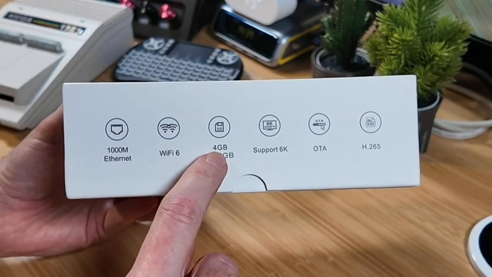

The back of the carton is a clean checklist: **1000M Ethernet**, **Wi-Fi 6**, **4 GB + 128 GB**, **Support 6K**, **OTA**, and **H.265**.

Inside I found:

- The S8 Ultra itself
- A short instruction manual (a couple of pages)
- An HDMI cable
- A USB-C wall wart and cable (not a barrel jack)
- The remote

Two **[AAA batteries](https://link.amazon/B0bbvUAlP) are not included**. The official shop's package list matches what I pulled out: the Ultra, backlit remote, HDMI cable, power supply, and user guide. ([Official package](https://mysuperbox.shop/product/superbox-s8-ultra/))

I like USB-C power on these boxes. I said the same about the Digibox D6 Max and the S7 Pro. You can use the included brick, or any USB-C power source you already have on the bench.

## DESIGN AND PORTS {#design-and-ports}

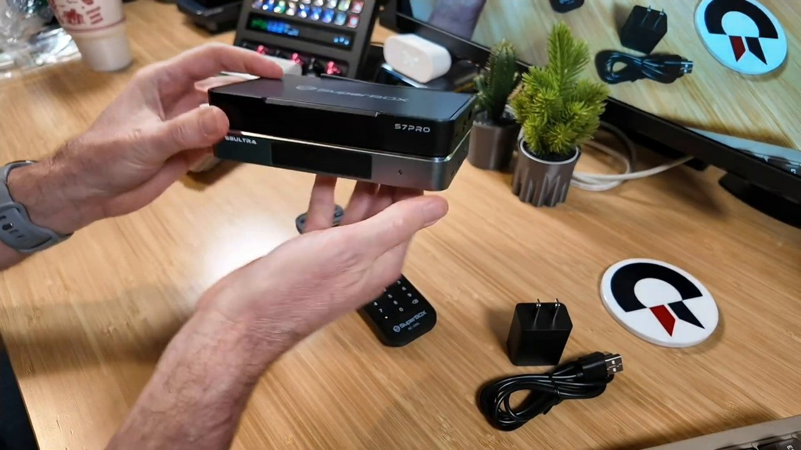

The S8 Ultra is about the same size as the S7 Pro. The S7 Pro I have is a plastic case. This one is aluminum, and it feels like it. There is a front display, feet on the bottom, and ventilation grills underneath.

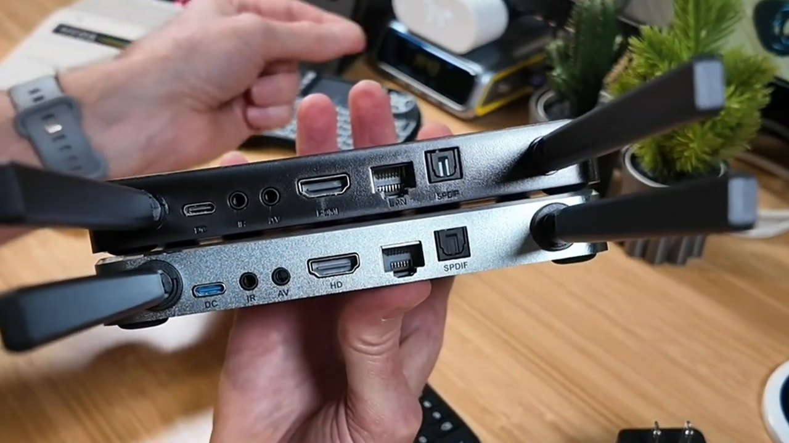

Around the back, on both units in this photo, you get **USB-C for power** (labeled DC on the Ultra; power only, not data), an **IR extender** jack so you can hide the box in a cabinet, a **3.5 mm AV** jack for older TVs with RCA inputs, **HDMI**, **LAN**, and **S/PDIF / optical** audio out.

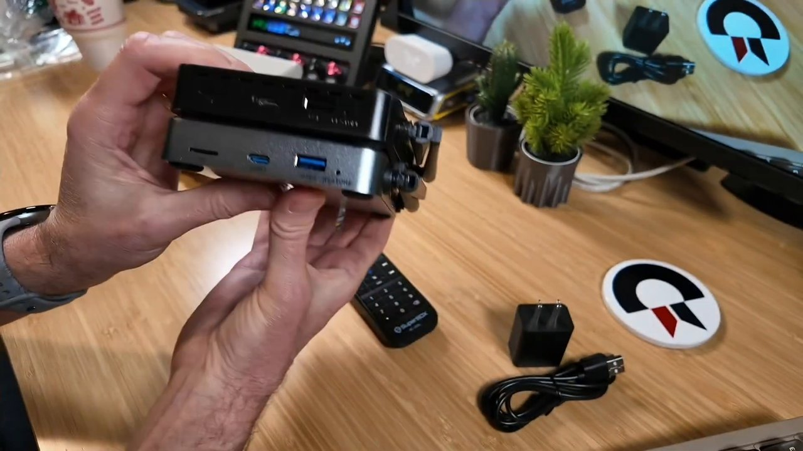

On the side of my Ultra there is a **TF / microSD** slot, a USB port I took as the storage port, a port that looked like **USB 3.0**, and a **restore** button. I believe the matching side port on my S7 Pro was only USB 2.0. The official page lists TF, USB 3.0, USB-C, restore, power, IR, AV, HDMI, LAN, and S/PDIF. ([Official ports](https://mysuperbox.shop/product/superbox-s8-ultra/))

There is no power button. When you apply power, it boots.

## FIRST BOOT {#first-boot}

I used an isolated path on my network for this box, as I usually do with review streaming boxes, then plugged in Ethernet and HDMI.

On first boot the time appeared, but the time zone was wrong (it later showed Pacific until I fixed it). A disclaimer screen comes up early. The wording I read is that SuperBOX is an "empty and open entertainment device" and that they are not responsible for how you use it. I agreed and continued. The remote worked immediately over infrared. Ethernet was already connected, so I did not need the antennas for this session and folded them down.

The first display setup was a little small, about 96%. I took overscan / screen size to 100%, and it filled the screen correctly.

## THE HOME SCREEN {#home-screen}

Across the top of the home screen I had Live TV, VOD (video on demand), an on-screen browser, playback for your own video files, Apps, and an app store. Further along: Settings, Folder (the file manager), a cleaner, a speed test, a microphone-style control that is really about pairing and shortcuts, and technical support (an online customer-service page). You can see that tile row in the [About](#about) and [Device Info](#about) stills below.

The 128 GB of internal storage is the practical win if you want to keep personal video on the box instead of hanging a drive off the side. There are also network paths in the file manager, which I came back to later.

I believed this was Android 12 from the start. About later confirmed it.

## ANDROID 12 SETTINGS WORTH OPENING {#settings}

The device name on my unit was already **SuperBOX_S8Ultra**, which is what you want if you are going to find it on your network.

Bluetooth is not just for the remote. You can add headsets, game controllers, or a small keyboard. I still think a sofa keyboard with a trackpad is easier than pecking at a remote when a password appears. Use a [secondary Google account](#tips-and-tricks) if you sign in, not your personal one. I give the same advice for any Android TV OS box.

Under apps, the first look at the system list was lean: the launcher and the browser. You can also open app permissions and special app access from here.

Display and sound, the useful bits I actually changed or left as recommendations:

- **Text scaling** at 100% was fine
- **Match content frame rate** set to on / Seamless
- **HDMI output** left on Auto. The 6K mode did not appear on my 4K capture path, which is expected
- **HDR mode** left on Auto. The box offers SDR and HDR
- **Game mode** is there if your TV supports it
- On this path, **HDR10** and **HLG** were enabled. **Dolby Vision** and **HDR10+** were disabled. I do not know whether that is the box or the display / capture path. I would expect those to enable on a TV that supports them, but I did not prove that
- Audio: passthrough is available if your sound system wants the raw bitstream. Supported formats listed on screen were Dolby Digital, Digital Plus, True HD, Atmos, DTS, and DTS-HD. If you only have a stereo pair, turn surround off and let those two speakers do the work
- **HDMI-CEC** is worth turning on. This remote can control a CEC television, and a TV remote can control the box. I also turned on TV auto power on, auto language, and auto input

Google Assistant can be activated. In practice, that usually helps with apps you install from the Play Store. I would not count on full Google voice search inside SuperBOX's own apps. Voice search on the remote may still do something narrower.

Casting is built in because this is Android TV OS. There is also a screen saver (backdrop or colors), an energy saver to turn the display off after a period, and location. Location via Wi-Fi is how the box already knew I was in the United States and defaulted to English, even though it did not pick the correct time zone by itself.

Accessibility is present: captions, high-contrast text, text-to-speech, and accessibility shortcuts. Some earlier boxes I have shown, including the S7 Pro, stripped a lot of that out. I was glad to see it here. I still wish this flagship were on Android 14, which has the better accessibility set.

Storage settings reported **120 GB** usable on the 128 GB device. That is a normal amount of overhead on a 128 GB eMMC, not a short pack. Device Info lists the raw figure as **128.0 GB**.

## ABOUT, ANDROID VERSION, AND THE SECURITY PATCH {#about}

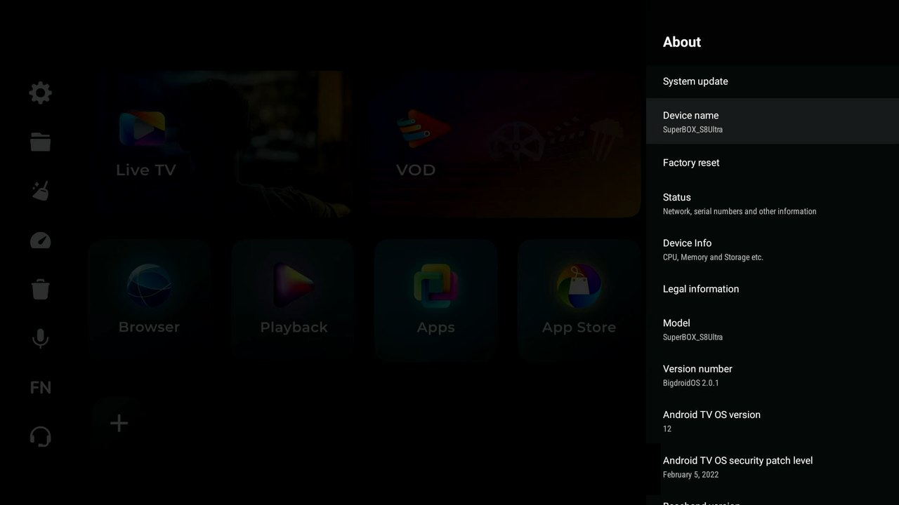

About is where I confirmed the software identity of this unit:

- Device name / model: **SuperBOX_S8Ultra**
- Version number: **BigdroidOS 2.0.1**
- **Android TV OS 12**
- **Security patch: February 5, 2022.** That is old, and it is the part of these Android 12 boxes that always concerns me

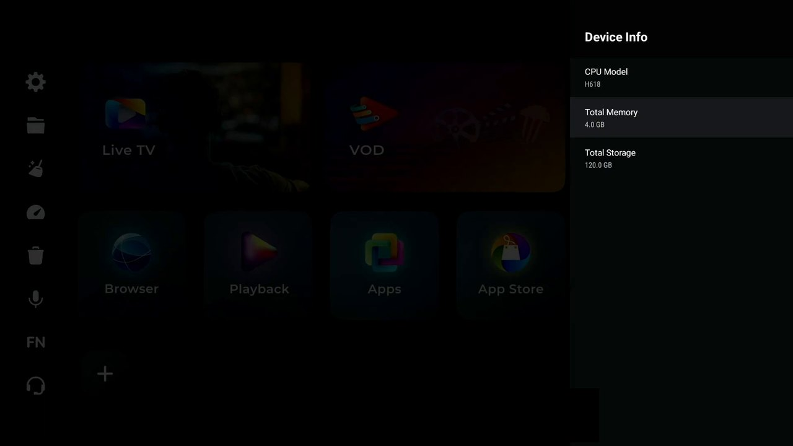

Device Info, one row above About, is where I pointed at the CPU line on camera. The screen lists:

- **CPU Model: H618**
- **Total Memory: 4.0 GB**
- **Total Storage: 128.0 GB**

I still wish these boxes would ship with 8 GB of RAM. Some Android apps are starting to want more than 4 GB, and every recent box I have tested in this class has stayed on 4 GB.

The official shop page lists a quad-core ARM Cortex-A53, which is consistent with an H618-class part. I am quoting the on-screen **H618** string, not a chip teardown. ([Official specs](https://mysuperbox.shop/product/superbox-s8-ultra/))

Date and time were under Device preferences, not in a fancy first-run wizard. A lot of these boxes walk you through language and time zone up front. This one did not. I had to set the zone in Android settings; the clock then jumped from 8:00 to 2:59, which matched my local time. The on-screen keyboard is the Leanback keyboard. Mouse mode is on the remote if you need a cursor, but it is not a great way to live. A trackpad keyboard is better for those moments.

## FILE MANAGER, NETWORK SHARES, AND THE SPEED TEST {#files-and-speed}

The Folder app is the familiar file manager I have seen on a lot of these boxes. Local memory opens a normal Android TV filesystem (movies, downloads, videos, pictures, music, files). That is also a path for sideloading an APK if you choose to do that.

Network neighborhood saw file shares on my network, so you can move files from a computer to the box. NFS is listed too. One NFS entry I saw looked like the box finding itself, so I did not treat that as a second server.

The sweeper / cleaner app is there if the box starts to feel sluggish. I did not need it on a fresh unit.

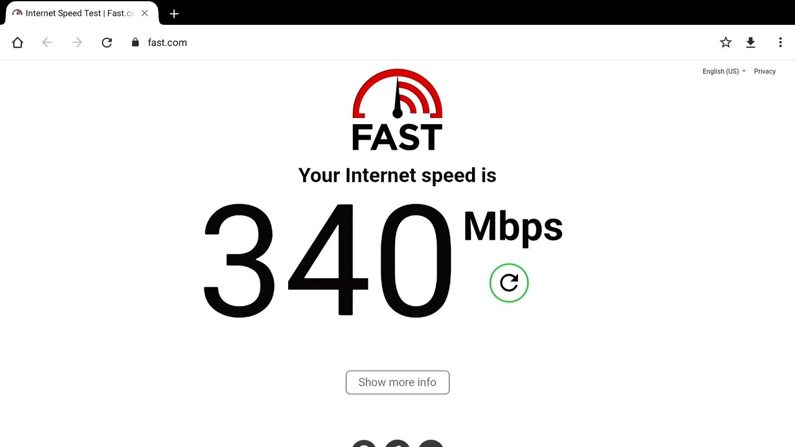

The built-in speed test runs in **Chrome**. I declined Chrome sync. On Ethernet, on a 1 gigabit line, the finished Fast.com result was **340 Mbps**. While it was still climbing I called it about 330 Mbps. That is not line rate, but it is plenty for HD and 4K, and it would not be the limiting factor if you actually had 6K material. I would still rather see a number closer to a gigabit on a gigabit port, but I am not going to oversell a 340 Mbps result.

## PAIRING THE BACKLIT REMOTE {#remote}

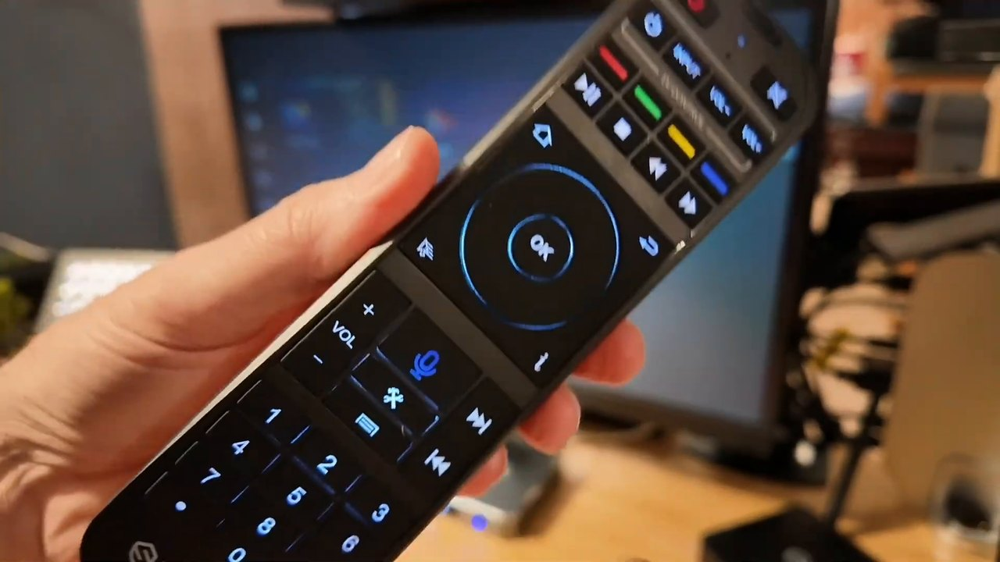

The remote is one of the better parts of this package. It starts in infrared, which is why it worked before I paired Bluetooth. Pairing instructions are printed on the back of the remote, including BLE pairing and the TV programming functions. Hold **OK** and **Return** to enter Bluetooth pairing; a light blinks, and then you add it in Android's Bluetooth settings.

After pairing I no longer had to point at the box. One oddity: a microphone-style icon in the UI seems to be there to help you pair, not as a live microphone control. I would not have chosen that icon.

The S8 Ultra remote is **backlit**. The number pad, OK ring, and microphone key light up, which is a real late-night quality-of-life feature. I do not believe the S7 Pro remote was backlit, and the official shop page says the Ultra is the only S8 model with a backlit remote. ([Official page](https://mysuperbox.shop/product/superbox-s8-ultra/))

What it does not have are app-specific keys (no Netflix key, no Amazon key). There are color buttons instead, which I will come back to. That makes the remote a little more service-agnostic, for better or worse.

## INSTALLED APPS, PLAY STORE, AND THE ROM UPDATE {#apps-and-update}

Out of the box, the Apps list I opened included the host, the browser, a gallery, a **Miracast receiver**, a music app, the **Google Play Store**, System Update, and TV ROM Updater. There was no preinstalled playback app in the Playback row until I added SuperBOX's own tools later.

I like that starting point. You can treat this as a fairly clean Android TV OS box, sign in to the Play Store with a secondary account, and install Tubi, YouTube, Netflix, or Google TV the ordinary way. I said on camera that it feels like a supercharged Google TV box with a lot of onboard storage, a responsive interface, and a full-size remote instead of the small Google dongle remote.

Two update apps:

- **TV ROM Updater** is the over-the-air path. An update to **260910** was waiting. I installed the zip. After reboot, About showed **version 1.02**. The February 5, 2022 security patch was still what I read
- **System Update** is for a local update package already on the device. After the OTA, that screen had nothing to install, which is the expected split between the two apps

The boot logo is a clean SuperBOX mark. I like it. Auto-captions turned "SuperBOX" into "Super Bucks"; that was the captions, not a new brand name.

## THE SUPERBOX APP STORE, BLUE TV, AND BLUE VOD {#superbox-apps}

The SuperBOX store is separate from the Play Store. The first tile I was offered in that flow was still the Google Play Store, which I appreciate. You can also add additional APK stores. After confirming the SuperBOX store APK, the icon changed and "My Store" opened.

The disclaimer, in substance, says it is an internet-connected program, that you download and install applications over the internet, and that "My Store" is not responsible for what you, the user, download. Read that screen before you continue. I left it up in the video so you could pause on it. I do not have a still of that disclaimer for this post yet.

Tiles I noted in their store: the TV ROM updater, **Blue VOD**, **Blue TV**, **NFL**, Sport, playback, and **video recorder**. There is a Netflix tile — actually two, which these boxes often use to get around Widevine limits so you can get a higher resolution than the Play Store Netflix build. There is also a YouTube tile with the same idea, plus Downloader and APK Pure. I did not sign into or play those apps for this first look.

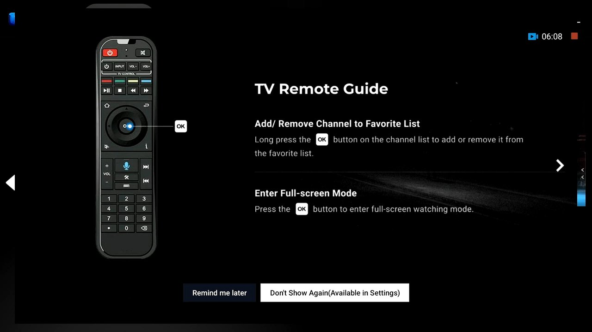

Blue TV is SuperBOX's live TV app. When I opened it, a **TV Remote Guide** appeared first: long-press OK on the channel list to add or remove a favorite, and press OK to enter full-screen mode. You can dismiss that guide or tell it not to show again. The 06:08 timer in the top-right corner is the built-in recorder overlay, which I will come back to.

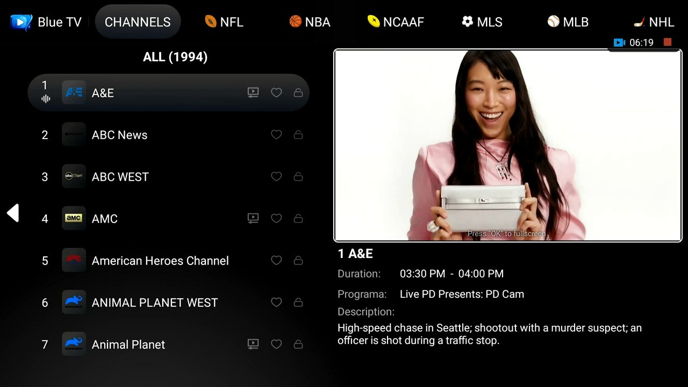

The channel list on my unit was labeled **ALL (1994)**, with category tabs across the top including NFL, NBA, NCAAF, MLS, MLB, and NHL. I am showing the guide and a static preview pane here, not a walk-through of what to watch. Whether you use Blue TV is your responsibility. See [A note on legal use](#legal-use).

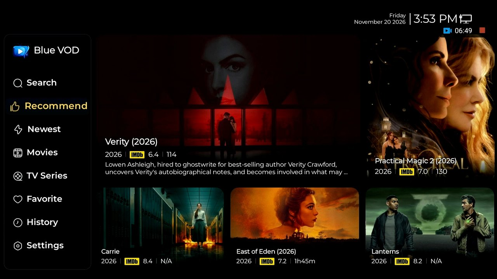

Blue VOD is the on-demand counterpart. The sidebar has Search, Recommend, Newest, Movies, TV Series, Favorite, History, and Settings. Again, this is a still of the library, not a playing title.

## VIDEO RECORDER {#video-recorder}

The built-in recorder is one of the S8-generation features SuperBOX advertises, so I installed it from their store and tried it.

On first launch it wanted a memory card. I had hoped it would use the 128 GB internal storage. It did not, at least not on that first path. I put in a **512 GB** microSD card. The recorder showed the card at about **500 GB** remaining. I started a recording, went back to the home screen and into the apps so it would capture whatever was on screen, and later played the file back from Apps > Video recorder.

Playback worked. The disappointment: the on-screen **recording timer was burned into the file**. You can see that overlay in the Blue TV and Blue VOD stills above (06:08, 06:19, and 06:49). I had guessed it might be preview-only. It was not, on this recording. If there is a setting to turn that counter off, I did not find it in the video. I would want that option before I used this as a serious recorder.

The official page says recordings can be saved locally and mentions plugging in USB. My first successful capture was on the SD card. ([Official recording claim](https://mysuperbox.shop/product/superbox-s8-ultra/))

## COLOR BUTTONS {#color-buttons}

I assumed the color keys could be assigned to apps or functions, because the remote has no Netflix or Amazon keys. A "functions" / quick-access screen let me add System Update, but pressing the color key did not open System Update.

What the keys actually did on my unit:

- **Red:** Blue TV
- **Green:** the file manager
- **Yellow:** nothing I could find
- **Blue:** nothing I could find

Some of those are preset. I did not find a clear remapping app during the recording, and I said I would research it and put the answer in this post. I still do not have a remapping still to show. If I find that screen later, I will add it here.

## WHAT I DID NOT DEMONSTRATE {#not-demonstrated}

A first look is not a complete feature audit. The official S8 Ultra page also lists items I did not open on camera. I am listing them as shop claims, not as results from my bench:

- **Multi View / picture-in-picture**, described as a full-channel feature on the Ultra
- **7-day time shift** and 7-day playback on live TV (the S7 Pro I reviewed earlier did have a time-shift app)
- **Parental controls**
- **Backup TV**
- **"7 free Prime apps (not official)"**

I may add stills of those later if I capture them. Until then, treat them as unverified.

The official page also lists Android 12, 4 GB DDR / 128 GB eMMC, dual-band Wi-Fi 6, 1000 Mbps Ethernet, Bluetooth 5.2, USB-C power, USB 3.0, and H.265 up to 6K at 60 fps. That lines up with the carton and with what I used (Ethernet, USB-C power, the 128 GB / 4 GB Device Info screen). I did not independently measure Wi-Fi 6 or Bluetooth 5.2. The shop page lists two different GPU names in two different spec blocks, so I am not repeating a GPU here. ([Official specs](https://mysuperbox.shop/product/superbox-s8-ultra/))

## TIPS AND TRICKS {#tips-and-tricks}

> **Tip:** Buy from the maker's shop or an approved link, not a random marketplace listing.
{: .tip}

> **Tip:** Bring two AAA batteries. They are not in the box.
{: .tip}

> **Tip:** Use Ethernet when you can, and put the box on a network path you are comfortable with. I do not drop these review units straight onto the rest of the house.
{: .tip}

> **Tip:** If you sign in to the Play Store or Chrome, use a secondary Google account, not your personal one.
{: .tip}

> **Tip:** Run TV ROM Updater first (OTA). System Update is for a local package already on the box.
{: .tip}

> **Tip:** Leave HDMI output and HDR on Auto unless you have a reason not to. I could not test the 6K claim.
{: .tip}

> **Tip:** Pair the remote over Bluetooth (OK + Return) once you are done with the infrared first boot, so you do not have to point at the box.
{: .tip}

> **Tip:** Turn HDMI-CEC on if your TV supports it. I also enable TV auto power, auto language, and auto input.
{: .tip}

> **Tip:** Read the "My Store" disclaimer before you install anything from SuperBOX's own store.
{: .tip}

> **Tip:** If you try the built-in recorder, have a microSD card ready, and check whether the timer is burned into the file before you record something you care about.
{: .tip}

## VERDICT {#verdict}

**Wins on this first look:**

- Aluminum case, same footprint as the S7 Pro, with a front display
- 128 GB of storage (120 GB usable), a real step up from the S7 Pro's 32 GB
- USB-C power, which I prefer to barrel jacks
- Backlit Bluetooth/IR remote with TV-programming instructions on the back
- Gigabit Ethernet and Wi-Fi 6 on the carton; 340 Mbps on my gigabit Ethernet Fast.com test
- USB 3.0, TF slot, IR extender, optical, and AV
- A fairly clean Android 12 start, with the Play Store available, plus accessibility settings that some earlier boxes removed
- Chrome, network file shares, and a built-in recorder that does at least capture the screen

**Misses and limits:**

- Still 4 GB of RAM. I want 8 GB
- Still Android 12, with a February 5, 2022 security patch that did not obviously move after the 260910 / 1.02 ROM update
- 6K is a claim I cannot test
- Color buttons are only partly assigned, and I did not find a remapping screen
- The recorder wanted a memory card and burned the timer into my test file
- Speed test at 340 Mbps on a 1 Gbps line is fine for 4K, not exciting for a gigabit port
- SuperBOX's own live TV and VOD apps are a legal gray area you have to settle for yourself

**Who should look at it:** someone who already liked the S7 Pro and wants the aluminum case, the backlit remote, and much more internal storage, or someone who wants a responsive Android 12 box they can also use with the Play Store.

**Who should pause:** anyone who needs a current Android security patch, 8 GB of RAM, or a proven 6K display path. Also pause if the only reason you are buying is a custom live TV or VOD app you have not thought through legally.

The official list price on SuperBOX's shop was **$449** on November 27, 2026. Code **retrocombs** is 10% off S6, S7, and S8 models. Check both the price and the code at checkout; prices change. ([Shop page](https://mysuperbox.shop/product/superbox-s8-ultra/))

## SOURCES {#sources}

- Companion video on @retroCombs-tech: <https://youtu.be/ffmh3uC2ZLM>
- Official SuperBOX S8 Ultra page (fetched November 27, 2026): <https://mysuperbox.shop/product/superbox-s8-ultra/>
- SuperBOX shop: <https://mysuperbox.shop/>
- SuperBOX S7 Pro video: <https://youtu.be/WVmw1CoG5fM>
- Android TV boxes I have tested: <https://retrocombs.com/android-tv-box-comparison>

## CONCLUSION {#conclusion}

The S8 Ultra is SuperBOX's flagship in the way that matters on a bench: a nicer case, a nicer remote, and four times the storage of the S7 Pro, on a familiar Android 12 box you can also use as a Play Store streamer. The limits are familiar too: 4 GB of RAM, an old security patch, a 6K claim I cannot test, and a custom app suite you have to judge for yourself.

Would you take the Ultra for the aluminum case, the backlit remote, and the 128 GB, or would you rather wait for 8 GB and a newer Android build? Tell me in the [comments below this post](#comments) — not on the YouTube page.

That's it for me. retroCombs, OUT!
