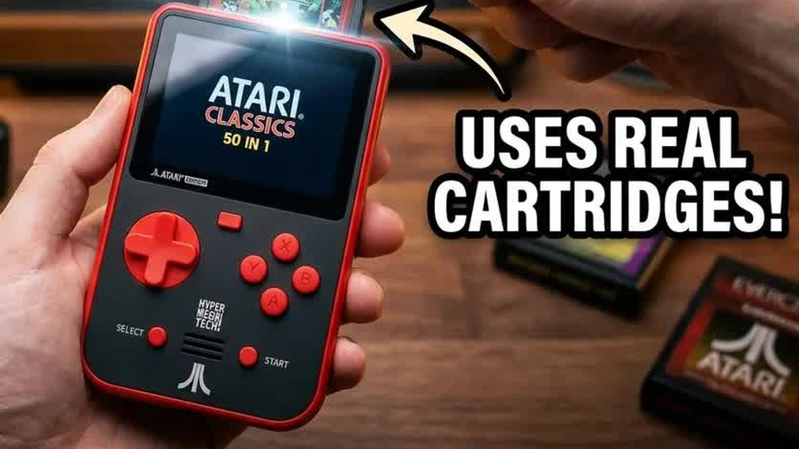

Remember that satisfying clunk of an Atari cartridge going into the slot? The Atari Edition Super Pocket from Hyper Mega Tech promises to bring that feeling back to the palm of your hand. It ships with 50 Atari games built in, from the arcade, the 2600, the 5200, the 7800 and the Lynx, and it has a slot for Evercade cartridges. I wanted to know one thing: can a handheld with Atari on the front play Commodore 64 and Intellivision games?



This post is the text companion to my video on retroCombs Tech (@retroCombs-tech). It covers what's in the box, the hardware, the menus, two built-in games, and two Evercade cartridges. This is a first look, not a full review. Let's dig in!

## TABLE OF CONTENTS {#table-of-contents}

- [TABLE OF CONTENTS](#table-of-contents)
- [LINKS](#links)
- [SUPPORT THE BLOG AND CHANNEL](#support-the-blog-and-channel)
- [COMPANION YOUTUBE VIDEO](#companion-youtube-video)
- [VIDEO ERRATA](#video-errata)
- [WHAT'S IN THE BOX](#whats-in-the-box)
- [HARDWARE TOUR](#hardware)
- [SETUP AND MENUS](#setup-and-menus)
- [SUPER POCKET VS. TRIMUI BRICK](#vs-trimui-brick)
- [YARS' REVENGE AND SAVE STATES](#yars-revenge)
- [A LYNX GAME: DIRTY LARRY](#dirty-larry)
- [THE EVERCADE ADVANTAGE: CARTRIDGES](#evercade-cartridges)
- [COMMODORE 64 GAMES ON THE EVERCADE](#c64-games)
- [INTELLIVISION GAMES ON THE EVERCADE](#intellivision-games)
- [WHO IS IT FOR?](#who-is-it-for)
- [CONCLUSION](#conclusion)

---

## LINKS {#links}

**Video Mention Links**

- 🕹️ Atari Edition Super Pocket (official page): <https://atari.com/products/super-pocket-atari-edition>
- 🧱 My TrimUI Brick first look: [TrimUI Brick: The Handheld That Surprised Me Most](/trimui-brick-first-look)
- 🎮 TrimUI Brick at MechDIY: <https://mechdiy.com/collections/trimui/products/trimui-brick-retro-handheld-game-console?ref=vpbwmzpy> (the code RETROCOMBS16 takes 15% off)
- ⚫ Atari 2600+ Console: <https://amzn.to/43KNriS>
- 🕹️ Atari CX40+ Joystick: <https://amzn.to/479CFmD>

*Disclosure Statement: When you click on links to various merchants on this site and make a purchase, this can result in this site earning a commission. Affiliate programs and affiliations include, but are not limited to Amazon and the eBay Partner Network.*

## SUPPORT THE BLOG AND CHANNEL {#support-the-blog-and-channel}

Check out the [supporters page](/supporters) to learn about my supporters and how you can join our community. If this post saved you some time, you can also [leave a tip](https://paypal.me/stevencombs). And if you like gadgets, subscribe to @retroCombs-tech. Hooked on tech since '73.

## COMPANION YOUTUBE VIDEO {#companion-youtube-video}

Title: _🤔 Is the Atari Evercade the BEST $60 Retro Handheld?_





## VIDEO ERRATA {#video-errata}

As of 2026-11-28:

- **Name.** The video title calls it the "Atari Evercade." The product is the Atari Edition Super Pocket by Hyper Mega Tech. It plays Evercade cartridges, but it isn't an Evercade-branded console.
- **Price.** The title says $60, but the video never states a price. As of November 2026, it's $69.99.
- **Lynx, not "Link."** When I load Dirty Larry I say it's from the "Link" system. It's the Atari Lynx.
- **Website (~0:50).** The address on the box is hypermegatech.com, for Hyper Mega Tech.
- **Cartridge prices (~11:55).** I say Evercade cartridges run about $20 to $30. That was in April 2025. Check current prices before you buy.

## WHAT'S IN THE BOX {#whats-in-the-box}

The front of the box features Centipede, and the back lists a selection of the 50 built-in games, sorted into Atari arcade, 2600, 5200, 7800 and Lynx titles. The box also calls out:

- A 2.8-inch IPS screen
- Evercade cartridge compatibility (the box says 600-plus Evercade games)
- An easy mode
- A rechargeable battery, with four-plus hours claimed
- USB-C charging
- Shoulder buttons

Inside you'll find a fold-out quick-start guide, a card that shows 40-plus Evercade cartridges you can buy separately, and a USB-A to USB-C cable.

## HARDWARE TOUR {#hardware}

The Super Pocket is heavier than I expected. It's an officially licensed Atari product.

- **Sides:** speakers on the sides (maybe stereo), and a rocker switch for volume
- **Back:** venting and two shoulder buttons
- **Bottom:** a headphone jack, the power button and the USB-C port
- **Top:** the Evercade cartridge slot

You hold it like a classic vertical handheld, with your fingers on the shoulder buttons behind it.

## SETUP AND MENUS {#setup-and-menus}

Power it on and you get a Blaze Entertainment startup screen. First-time setup is short: pick your language, accept the license, and choose your challenge. **Easy** lowers the difficulty of the built-in arcade games. **Normal** gives you the authentic arcade experience. I picked Normal.

The game menu is clean, the controls feel good, and the menu doesn't lag. In the lower-right corner of each game tile, the Super Pocket tells you which system it's emulating. For example, Berserk is the arcade version and Bounty Bob Strikes Back is the 5200 version.

The menu button brings up three tabs: **Atari** (the built-in games), **Evercade** (whatever cartridge is in the slot) and **Settings**. In Settings you'll find:

- Display: aspect ratio, shaders and the photosensitivity warning
- Sound: menu music volume
- Language and difficulty
- Legal and support, and the credits

> **Tip:** Turn the menu music down in Settings before a long session. It's the first thing I changed.
{: .tip}

## SUPER POCKET VS. TRIMUI BRICK {#vs-trimui-brick}

Next to the [TrimUI Brick](https://mechdiy.com/collections/trimui/products/trimui-brick-retro-handheld-game-console?ref=vpbwmzpy) (here's my [first look](/trimui-brick-first-look)), the Super Pocket is very close in size, the screens are almost identical, and the controls are in nearly the same places. The Super Pocket is easier to use: turn it on, pick a game, play. The Brick has more power and plays more systems. This isn't a comparison, but that's the trade-off.

## YARS' REVENGE AND SAVE STATES {#yars-revenge}

I started with one of my favorites, Yars' Revenge. It looks just like the Atari 2600 version, right down to the intro screen with those offset colors.

The in-game menu lets you:

- Save and load states
- Remap the controls
- Change the display: original, pixel perfect or original ratio, and scan lines for that original look
- Reset or quit back to the main menu

I finished level one, saved to slot one, and loaded it again. It worked. If you keep dying in the same spot, a save state lets you keep trying from there.

> **Tip:** Turn on scan lines in the in-game display menu for a closer match to a CRT.
{: .tip}

## A LYNX GAME: DIRTY LARRY {#dirty-larry}

For a game with a little more graphical punch, I tried Dirty Larry from the Atari Lynx. It opens with an intro screen that sets up the story, then drops you into the action. I had never played it and had no idea what I was doing, but the graphics look good and the screen's viewing angles held up even with my studio lights shining on it.

## THE EVERCADE ADVANTAGE: CARTRIDGES {#evercade-cartridges}

The cartridge slot is what sets the Super Pocket apart. I picked up two cartridges because they had games I wanted: **C64 Collection 3** and **Intellivision Collection 2**.

Opening them reminded me of the Game Boy days. Each one comes in a case with a printed, full-color manual on good, thick paper, and the Intellivision cartridge adds game cards with tips. The C64 Collection 3 manual even explains the controls for Summer Games, which I always struggled to figure out. Back in the day, a C64 game on disk or cartridge came with a booklet just like this.

I also like that these are legitimate, licensed copies of the games.

> **Tip:** Turn the Super Pocket off before you insert or remove a cartridge, just like a Game Boy.
{: .tip}

## COMMODORE 64 GAMES ON THE EVERCADE {#c64-games}

The cartridge goes in with a satisfying click. Power on, and you're back at the built-in Atari games. Open the menu and choose **Evercade** to run what's on the cartridge.

I tried Super Cycle. I hoped to see a Commodore BASIC prompt, but you don't get one. It goes straight into the game, so the Super Pocket acts like a C64 game machine, not a computer.

- **Select** brings up an on-screen Commodore keyboard for games that need special keys.
- **A and B buttons:** the C64 had a single joystick button. Here, some controls are remapped to make games more playable. In Super Cycle, A accelerates and B confirms.
- The control list for each game is in the menu, so you can check it any time.

The controls feel tight and solid, not mushy. They lapped me anyway.

We never had a Commodore handheld back in the day. Now I'm holding one.

## INTELLIVISION GAMES ON THE EVERCADE {#intellivision-games}

Power down, swap cartridges, power up, and choose Evercade again. I never had an Intellivision growing up, so this was exciting for me. The Intellivision controller had a disc and a lot of extra buttons, so a handheld with shoulder buttons suits it.

I loaded Star Strike (1981). I saw it on TV commercials as a kid and never knew anyone who owned an Intellivision. The parallax scrolling still looks good. The controls:

- **A:** drop bomb
- **X:** fire laser
- **Shoulder buttons:** open the Intellivision keypad on screen

## WHO IS IT FOR? {#who-is-it-for}

If you want a handheld that's simple to use, plays Atari classics out of the box, and lets you add legitimate games for other systems on cartridge, the Super Pocket is a good fit. If you want to play more advanced systems, look at something like the [TrimUI Brick](https://mechdiy.com/collections/trimui/products/trimui-brick-retro-handheld-game-console?ref=vpbwmzpy).

I had a trip coming up with several hours on a plane, and this was the handheld I planned to pack.

## CONCLUSION {#conclusion}

The Atari Edition Super Pocket does what it promises: 50 Atari games, simple menus, save states, and an Evercade slot that turned it into my first Commodore handheld and my first Intellivision.

Which Evercade collection would you put in the slot first? Let me know in the comments below. If this post helped, [leave a tip](https://paypal.me/stevencombs).

That's it for me, retroCombs, out.
