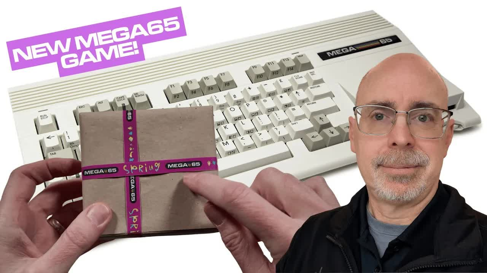
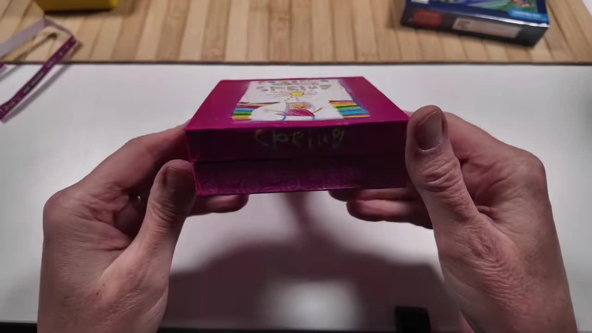
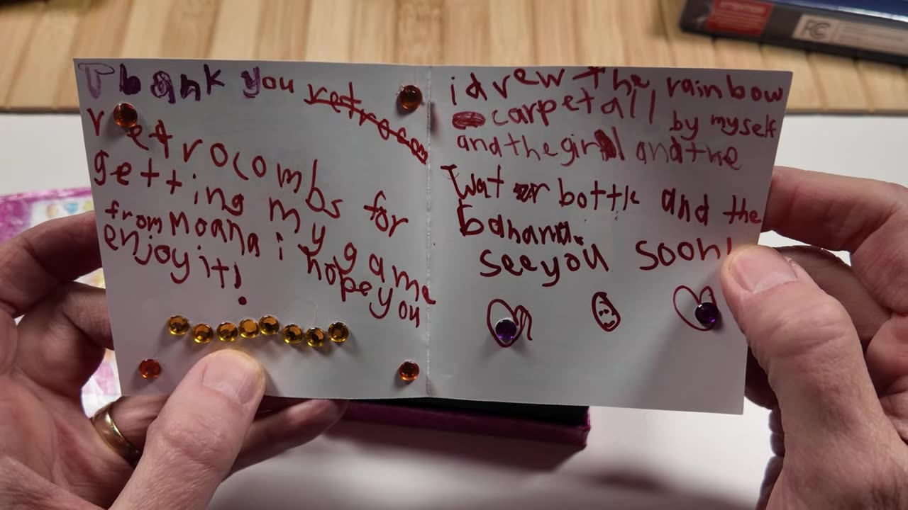
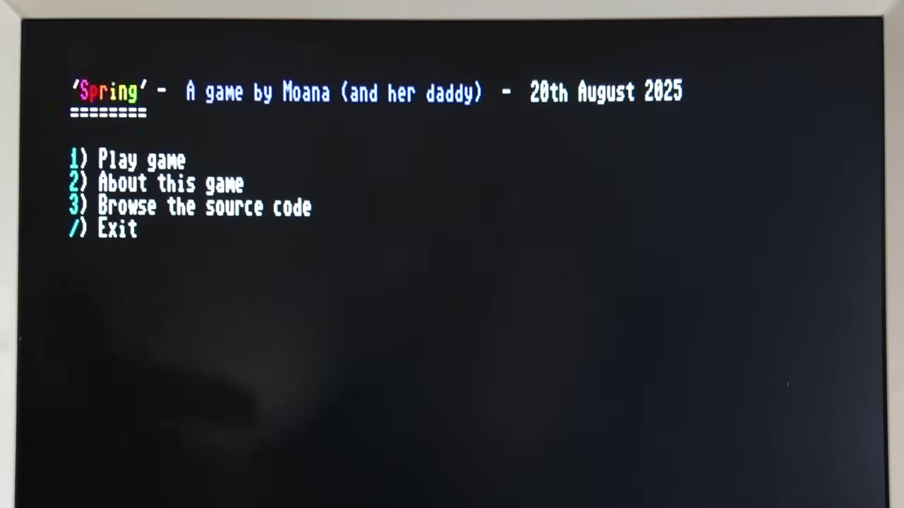
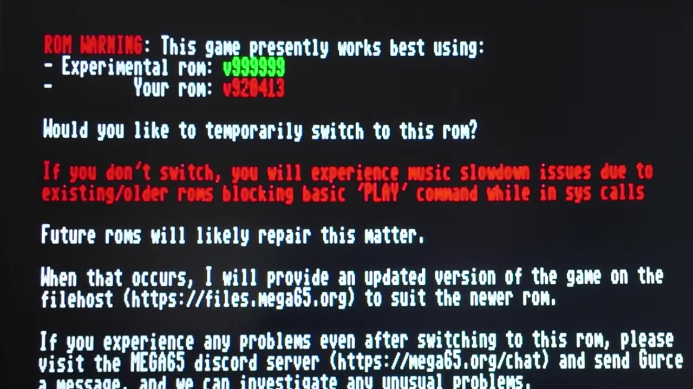

Gürçe reached out and asked if I'd like to take a look at a new MEGA65 title. Of course I would. Spring is a family affair: the game design and art are by his daughter Moana, the code is by Gürçe, and Gürçe's sister helped put the packaging and materials together. It arrived all the way from Australia. I promised I wouldn't show the gameplay, because that's something you should experience yourself. What I can show you is the box, how to load it, and the best part: the full BASIC source code, right there on the disk.

Gürçe sent this copy to me. Thank you! I'm under no obligation, and these thoughts are my own.

This post is the text companion to my video on retroCombs (@retroCombs).

## TABLE OF CONTENTS {#table-of-contents}

- [TABLE OF CONTENTS](#table-of-contents)
- [LINKS](#links)
- [SUPPORT THE BLOG AND CHANNEL](#support-the-blog-and-channel)
- [COMPANION YOUTUBE VIDEO](#companion-youtube-video)
- [VIDEO ERRATA](#video-errata)
- [WHAT'S IN THE BOX](#whats-in-the-box)
- [BOOTING SPRING](#booting-spring)
- [ABOUT THE GAME](#about-the-game)
- [BROWSING THE BASIC SOURCE CODE](#source-code)
- [THE MUSIC FILE](#music-file)
- [THE ROM WARNING AND THE SLOW-MUSIC FIX](#rom-warning)
- [TIPS](#tips)
- [CONCLUSION](#conclusion)

---

## LINKS {#links}

**Video Mention Links**

- 💾 Get Spring (Gürçe's site): <https://gurce.net/spring/>
- 📖 Spring game guide (by Gürçe): <https://gurce.net/spring/guide/>
- 🖥️ Eleven development environment (MEGA65 Filehost): <https://files.mega65.org?id=8b189d0b-ea1e-45a7-a4de-87bcb0b11696>
- 📺 More MEGA65 on the blog: [MEGA65 User's Guide series](/mega65-users-guide)

**MEGA65 Accessories**

- 💾 Floppy Disks: <https://amzn.to/3DrEOj1>
- 🧠 microSD Cards: <https://amzn.to/3IYL3Kn>
- 🕹️ Atari CX40+ Joystick: <https://amzn.to/479CFmD>

*Disclosure Statement: When you click on links to various merchants on this site and make a purchase, this can result in this site earning a commission. Affiliate programs and affiliations include, but are not limited to Amazon and the eBay Partner Network.*

## SUPPORT THE BLOG AND CHANNEL {#support-the-blog-and-channel}

Check out the [supporters page](/supporters) to learn about my supporters and how you can join our community. If this post saved you some time, you can also [leave a tip](https://paypal.me/stevencombs).

## COMPANION YOUTUBE VIDEO {#companion-youtube-video}

Title: _📺 NEW MEGA65 Game, Spring!: Unboxing, Demo, & BASIC Source Code Access_





## VIDEO ERRATA {#video-errata}

As of 2026-11-29:

- **Floppy size.** The auto-captions turn my "3½-inch floppy" into "3 and 12 inch." It's the MEGA65's 3½-inch drive.
- **"Demo" in the title.** The video shows the menus, the source code and the title screens, but on purpose it doesn't show gameplay.
- **Availability.** In the video (December 2025) I say limited physical copies are available. Visit [gurce.net/spring](https://gurce.net/spring/) for current price and availability.

## WHAT'S IN THE BOX {#whats-in-the-box}

The package arrived wrapped like a Christmas present, with custom Spring ribbon and tape holding it together. I hated to unwrap it, but I saved the ribbon. Under the paper, the box was still sealed in plastic.

The hand-drawn box art is all by Moana. The little character on the box is, I assume, the hero of the game. Lift the lid and you'll find:

- **A key**
- **Instructions**
- **A handwritten note from Moana.** Mine says, "Thank you, retroCombs, for getting my game from Moana. I hope you enjoy it. I drew the rainbow carpet all by myself." She also drew the girl, the water bottle and the banana.

    
- **A cardboard piece** that looks like a little game board
- **A Spring eraser** with the character on it
- **A Spring crayon.** My first official MEGA65 crayon!
- **A handmade banana**
- **A Spring water bottle**, with MEGA65 logos
- **The physical disk.** You load the game from it.
- **The game guide**, "by Moana and her daddy," with a link to the full guide online

I chose not to read anything about the game before the package arrived, so all of this was a surprise. Each goodie in the box turns out to be an item in the game.

## BOOTING SPRING {#booting-spring}

The brief instructions in the game guide:

1. Insert the floppy disk.
2. Type `MOUNT`.
3. Type `BOOT`.
4. Press option 1 to play the game.
5. Press **Y** at the ROM warning. Spring uses a custom ROM, and it's included on the floppy.
6. Choose a difficulty from 1 to 4.
7. Use a joystick in port 2.

The title screen reads "Spring, a game by Moana and her daddy," with four options: **Play game**, **About this game**, **Browse the source code** and **Exit**.

## ABOUT THE GAME {#about-the-game}

The About screen is pure Moana. It says, "My daddy kept bugging me to write a game on his silly MEGA65 thing. And I finally relented and shared my game design vision with him on the condition that he will do all the dumb code monkey work and leave all the important game design work to me." She also made sure she got top billing in the credits. I won't spoil the rest. Read it yourself when you get your copy.

## BROWSING THE BASIC SOURCE CODE {#source-code}

This is the part I love. **Browse the source code** lists the main source files, numbered one to four, plus miscellaneous files, including a melody file and the autoboot.

The note on file one says it started as an example of using the SEAM library and then grew into the actual Spring game, and that it's worth a browse for anyone curious about how that library can be used.

Press Return and the file opens in **Eleven**, the MEGA65 development environment, in 80-column mode. Eleven is an upgraded way to program the MEGA65 in BASIC. You can combine BASIC with structured, modern programming techniques, then compile it so it runs faster. You can download Eleven from the MEGA65 Filehost (link above).

A few things I noticed:

- **Strings are defined up front.** One text string reads "a game made by Moana," and the program can pull it up at any point.
- **The menus are along the bottom.** Press **F1** for a directory of every file on the disk, then load any of the other source files.

Thank you, Gürçe, for sharing the source. Studying a finished game is one of the best ways to learn how to make your own.

## THE MUSIC FILE {#music-file}

Gürçe is known for his music on the MEGA65, so I opened the melody file. It holds the key mappings for the game's music and the instrument definitions, including each instrument's name, attack, decay, sustain, release and waveform. If you want to see how a MEGA65 game's soundtrack is built, start here.

The title song is Gürçe's cover of the Dungeon of the Algebra Dragons theme.

## THE ROM WARNING AND THE SLOW-MUSIC FIX {#rom-warning}

Before the game starts, you'll see a core warning (the game was tested against a specific core) and then a ROM warning. My MEGA65 was on ROM version 920413. Spring offers to switch temporarily to an experimental ROM. If you don't switch, the music slows down, because older ROMs block the BASIC `PLAY` command while in `SYS` calls.

I was curious, so the first time I chose to keep my own ROM. Spring also switches from NTSC to PAL, and my monitor went to 576p at 50 Hz on its own. The music on the title screen did sound slow.

Then I restarted and let Spring switch to its experimental ROM (version 999999). I could hear the difference right away on the title screen, and in the game the music played at the right speed. It's impressive that the switch is built right into the BASIC program.

The title screen also has the difficulty choice (easy, medium, difficult and extreme; I'm definitely not choosing extreme) and quick instructions: guide your hero, Spring, around the baddy wolves, use the key to unlock the chest and collect gems, eat bananas to keep your health up, and drink water to prevent dehydration. There's also a note about supporting Moana and her daddy's games through PayPal and Patreon.

## TIPS {#tips}

> **Tip:** Say yes to the experimental ROM. It's temporary, and it fixes the slow music.
{: .tip}

> **Tip:** The game runs from the 3½-inch disk. You can also copy it to a D81 disk image on your SD card, and it will load a little faster.
{: .tip}

> **Tip:** If you're sharing Spring with a young programmer, let them play it first, then open the source together in Eleven.
{: .tip}

## CONCLUSION {#conclusion}

Spring is more than a box with a game in it. It's a family project, a handmade unboxing, and an open window into how a MEGA65 game is built, in BASIC you can read on the machine itself. Thank you, Gürçe, and especially Moana, for sending it. Grab your own copy from [Gürçe's site](https://gurce.net/spring/) and support independent MEGA65 developers.

Have you peeked at Spring's source code yet? Let me know in the comments below. If this post helped, [leave a tip](https://paypal.me/stevencombs).

That's it for me, folks. 🕹️ retroCombs, OUT!
