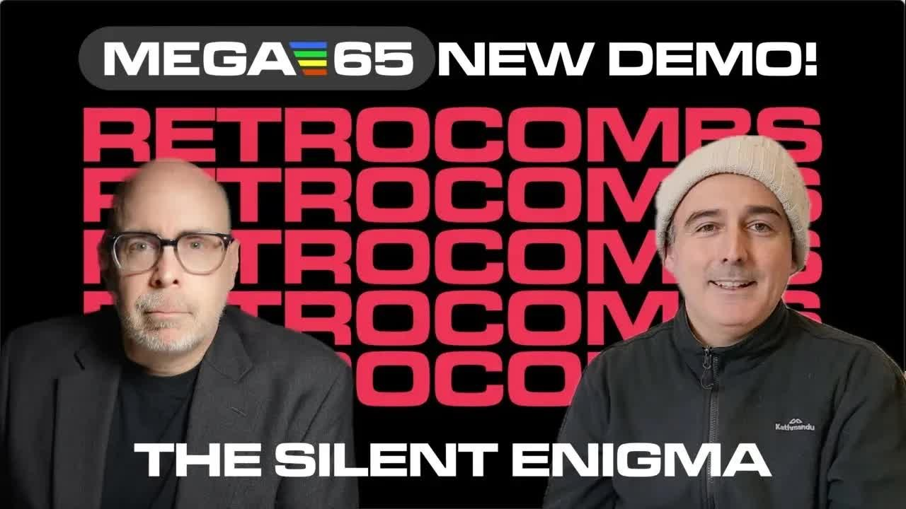
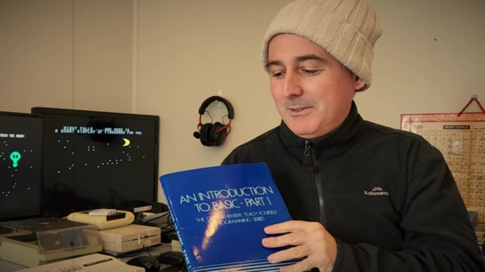
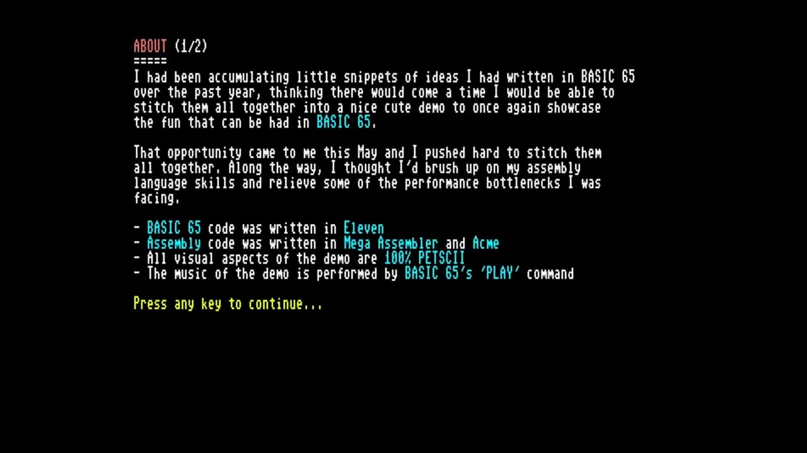
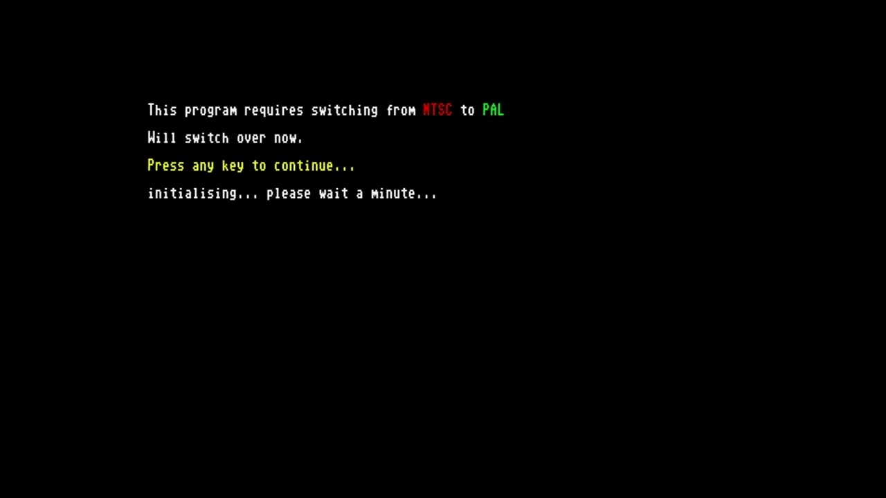
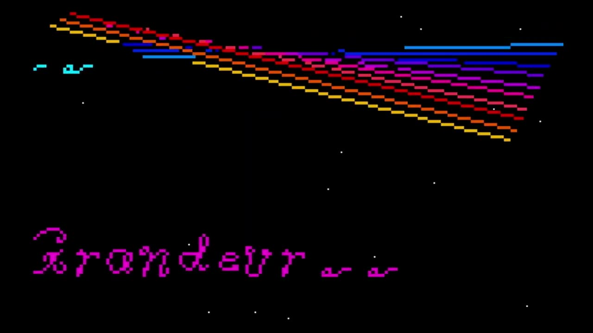

Those of my generation will remember the late Tom Snyder and his late-night interview program, The Tomorrow Show: he came on after Carson. So when Gürçe Işıkyıldız asked me to premiere his new MEGA65 demo, The Silent Enigma, I decided to do it Tomorrow-style, with a 1970s-style interview before the main event. This post is the text companion to that video on retroCombs (@retroCombs), with the highlights of our conversation and how to run the demo.

You may know Gürçe from the [BASIC 65 primer](/mega65-primer) we made together. MEGA65 developers tend to live in mystery on Discord, so this was a fun chance to put a face to the software.

## TABLE OF CONTENTS {#table-of-contents}

- [TABLE OF CONTENTS](#table-of-contents)
- [LINKS](#links)
- [SUPPORT THE BLOG AND CHANNEL](#support-the-blog-and-channel)
- [COMPANION YOUTUBE VIDEO](#companion-youtube-video)
- [VIDEO ERRATA](#video-errata)
- [GÜRÇE'S FIRST COMMODORE](#first-commodore)
- [FROM BASIC TO THE MEGA65 PROJECT](#mega65-project)
- [RUNNING THE SILENT ENIGMA](#running-the-demo)
- [WHAT INSPIRED THE DEMO](#inspiration)
- [GÜRÇE'S TOOLBOX](#toolbox)
- [WHAT'S NEXT FOR GÜRÇE](#whats-next)
- [CONCLUSION](#conclusion)

---

## LINKS {#links}

**Video Mention Links**

- 💾 The Silent Enigma on the MEGA65 Filehost: <https://files.mega65.org?id=4003af71-8f8d-48ff-a303-f0eac34dd465>
- 🧑‍💻 The Silent Enigma source code (GitHub): <https://github.com/gurcei/silent>
- 🛠️ Mega Assembler by grubi (MEGA65 Filehost): <https://files.mega65.org?id=3b101d41-5128-4a21-879c-0cf7988edfec>
- 📈 MEGAPLOT library by grim-fandango (GitHub): <https://github.com/grim-fandango/megaplot>
- 🎸 Anathema, "The Silent Enigma" (the song that inspired the demo): <https://youtu.be/CqsNCblUZPA>
- 📺 Tom Snyder's Tomorrow Show opening: <https://www.youtube.com/watch?v=WEuo8n2KvyY>
- 📖 Our BASIC 65 primer: [/mega65-primer](/mega65-primer)
- 📖 My MEGA65 User's Guide series: [/mega65-users-guide](/mega65-users-guide)

**MEGA65 Resources**

- 🌐 MEGA65: <https://mega65.org>
- 💾 MEGA65 Filehost: <https://files.mega65.org>
- 💬 MEGA65 Discord: <https://mega65.org/chat>
- 📖 MEGA65 User's Guide: <https://mega65.org/user-guide>

**MEGA65 Accessories**

- 🕹️ Hyperkin Trooper Controller: <https://amzn.to/3l1CHXj>
- 🧠 microSD Cards: <https://amzn.to/3IYL3Kn>

*Disclosure Statement: When you click on links to various merchants on this site and make a purchase, this can result in this site earning a commission. Affiliate programs and affiliations include, but are not limited to Amazon and the eBay Partner Network.*

## SUPPORT THE BLOG AND CHANNEL {#support-the-blog-and-channel}

Check out the [supporters page](/supporters) to learn about my supporters and how you can join our community. If this post saved you some time, you can also [leave a tip](https://paypal.me/stevencombs).

## COMPANION YOUTUBE VIDEO {#companion-youtube-video}

Title: _📺️ The Silent Enigma: New MEGA65 Demo by Gürçe (1970s-Style Interview)_





## VIDEO ERRATA {#video-errata}

As of 2026-11-30:

- **This is a re-upload.** The video description notes it was reposted to remove a copyright flag.
- **Dated news.** The opening updates are from June 2024: the next batch of MEGA65s arriving that summer, and Chapter 4 of my User's Guide series being delayed so I could premiere this demo. Both are long past. The whole [User's Guide series](/mega65-users-guide) is on the blog.
- **Names in the captions.** The auto-captions garble several names in the toolbox section. The native assembler is **Mega Assembler** by grubi, and the plotting library is **MEGAPLOT** by grim-fandango.
- **The BASIC book.** Gürçe holds up the Commodore introduction to BASIC book that came with the family C64. The captions name an author, but I can't confirm the book's exact title or author.

## GÜRÇE'S FIRST COMMODORE {#first-commodore}

Gürçe joined me from New South Wales, Australia. My first question is the one we always ask a fellow retro computing fan: what was your first Commodore?

His dad bought the family a Commodore 64 in 1986. He even traded in his pocket calculator for a $100 discount, after convincing the salesman the calculator was also a computer because it had a CPU inside. Gürçe and his sister fell in love with the machine from day one: the box, plugging it in, and seeing that READY prompt for the first time.

His other day-one memories:

- **The introduction to BASIC book** that came with the machine, and the test card demo that loaded from its cassette. The music, graphics and animation amazed them. He later learned the whole demo was written in BASIC, music included.

    
- **The first cartridges**, including Sea Wolf and a set of paddle games such as Pinball Spectacular.
- **Wizard of Wor.** His dad played it the whole night through, went to work the next morning without any sleep, and promised never to play computer games again.

## FROM BASIC TO THE MEGA65 PROJECT {#mega65-project}

Gürçe loved programming in BASIC. As a teenager he moved on to assembly language, which he found to be a steep learning curve. The best he managed back then was a joystick driver running inside an interrupt, not enough to make the full game he dreamed of.

Decades and a career in software development later, he heard about the MEGA65. It felt like reconnecting with that childhood memory, and because it's an open-source project, anyone can join in. He jumped in and helped with bug fixing, writing tools and documentation.

That probably mirrors the story of a lot of folks watching.

## RUNNING THE SILENT ENIGMA {#running-the-demo}

The demo has core and ROM requirements, but instructions are provided and the steps are easy. Here's what I did once my MEGA65 was on the right ROM and core:

1. Mount the disk image from the SD card with the `MOUNT` command.
2. Type `DIR` to verify The Silent Enigma disk image is loaded.
3. Run the program.
4. From the menu, choose **About this demo** for the about screens, **Browse** to open any of the source files by number, or **Play** to run the demo.

    
5. Let the demo switch from NTSC to PAL. It does that in software, so there's no trip to the Freezer.

    
6. Press any key, and give it a little while to initialize.

> **Tip:** Browse the source files. Gürçe includes all of them, so you can see how each effect was done.
{: .tip}

The demo itself is something to watch, not read about, so press play on the video above. What stands out is that it's a program written primarily in BASIC. And yes, those call-outs to my channel put a smile on my face, as I'm sure the call-outs to the other developers and community members will on theirs.

## WHAT INSPIRED THE DEMO {#inspiration}

The demo is inspired by the song "The Silent Enigma" by the metal band Anathema. I hadn't heard of them before, and Gürçe sent me a link (it's in the Links above).

Gürçe said the demo pulls together ideas he'd collected for a year, and he finally got the chance to stitch them together over the month before the premiere. Every project, you want to improve on the last one. This time that meant better frame rates, so he skilled up on assembly language again and rewrote the bottlenecks in assembly. It was time-expensive: about 10 lines of BASIC turned into 200 lines of assembly, half a day to write and half a day to debug.

## GÜRÇE'S TOOLBOX {#toolbox}

For anyone who wants to start their own MEGA65 project, here's what Gürçe used (most of it is on the MEGA65 Filehost):

- **Eleven**, the MEGA65 BASIC development environment, for the main program
- **[Mega Assembler](https://files.mega65.org?id=3b101d41-5128-4a21-879c-0cf7988edfec)** by grubi, an editor and assembler that runs natively on the MEGA65
- **The ACME cross-assembler** on a PC, then bringing the code over to the MEGA65
- **The [MEGAPLOT](https://github.com/grim-fandango/megaplot) library** by grim-fandango, for drawing 4x4-pixel PETSCII-based blocks. Gürçe extended it to draw whole lines of blocks in assembly from a start point and an end point. That's what powers the quick lines and triangles in the demo.

## WHAT'S NEXT FOR GÜRÇE {#whats-next}

- **Release the demo** on the MEGA65 Filehost. Gürçe noted that it needs a specific development core and a ROM he tweaked, and that he'd update the demo once those tweaks reach the mainstream core and ROM. It's now [on the Filehost](https://files.mega65.org?id=4003af71-8f8d-48ff-a303-f0eac34dd465), and the README in its download explains the core and ROM it needs.
- **Speed up Eleven.** This project pushed the limits of Eleven: when the source gets large, compiling takes a long time. His next project was to improve Eleven's compile speed so larger projects can iterate faster.
- **Then something fun** that makes use of it, maybe the paused project he mentioned, which had stalled for the same reason.

(Since then, Gürçe and his daughter Moana released the MEGA65 game [Spring](/spring-mega65-game), written with Eleven.)

## CONCLUSION {#conclusion}

Thank you, Gürçe, for letting me premiere The Silent Enigma and for sharing your story. It's a demo written mostly in BASIC by someone who first saw a READY prompt in 1986, and it shows how far a determined hobbyist can push the MEGA65.

Did you remember Tom Snyder, or was the Tomorrow homage new to you? Let me know in the comments below. If this post helped, [leave a tip](https://paypal.me/stevencombs).

That's it for me, folks. 🕹️ retroCombs, OUT!
