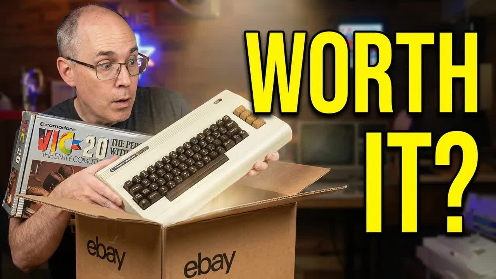

I was on eBay the other day. You know how dangerous that is. I found a boxed Commodore VIC-20, and I want you to tell me whether I got a good deal. The VIC-20 was my first computer, so this one is personal. This post is the text companion to my video on retroCombs (@retroCombs), an edit of a much longer livestream.

## TABLE OF CONTENTS {#table-of-contents}

- [TABLE OF CONTENTS](#table-of-contents)
- [LINKS](#links)
- [SUPPORT THE BLOG AND CHANNEL](#support-the-blog-and-channel)
- [COMPANION YOUTUBE VIDEO](#companion-youtube-video)
- [VIDEO ERRATA](#video-errata)
- [WHAT I PAID](#what-i-paid)
- [MY VIC-20 COLLECTION SO FAR](#collection)
- [THE ORIGINAL BOX](#original-box)
- [WHAT WAS INSIDE](#whats-inside)
- [THE COMPUTER ITSELF](#the-computer)
- [FIRST BOOT](#first-boot)
- [THE CARTRIDGE PROBLEM](#cartridge-problem)
- [TIPS FOR BUYING A VINTAGE COMPUTER ON EBAY](#buying-tips)
- [SO, DID I OVERPAY?](#verdict)
- [CONCLUSION](#conclusion)

---

## LINKS {#links}

**Video Mention Links**

- 📺 The full livestream this video was cut from: <https://youtube.com/live/9bX9j0Bm5U0>
- 🕹️ Atari CX40+ Joystick: <https://amzn.to/479CFmD>

**Commodore Parts and Alternatives**

- 🔌 8-Bit Classics (cables and parts store): <https://www.8bitclassics.com/?ref=2882>
- 💻 Retro Games Ltd TheVIC20 (UK link): <https://amzn.to/3CA7anp>

*Disclosure Statement: When you click on links to various merchants on this site and make a purchase, this can result in this site earning a commission. Affiliate programs and affiliations include, but are not limited to Amazon and the eBay Partner Network.*

## SUPPORT THE BLOG AND CHANNEL {#support-the-blog-and-channel}

Check out the [supporters page](/supporters) to learn about my supporters and how you can join our community. If this post saved you some time, you can also [leave a tip](https://paypal.me/stevencombs).

## COMPANION YOUTUBE VIDEO {#companion-youtube-video}

Title: _📦️ Did I Overpay for This Commodore VIC-20? | eBay Unboxing_





## VIDEO ERRATA {#video-errata}

As of 2026-12-01:

- **"Amiga" joystick (~15:55).** I start to call it the Amiga wireless joystick, then correct myself. It's an Atari wireless joystick.
- **"A VIC runs about 10% faster than a C64" (~16:45).** That's an off-the-cuff remark, and the answer depends on the model and the video standard.
- **The cartridge I want (~15:10).** I say "pen ultimate cartridge" in the video.
- **Livestream extras.** The end of the video covers channel memberships and Discord access as they stood in August 2025. Check the [supporters page](/supporters) for how that works today.

## WHAT I PAID {#what-i-paid}

The listing started at $75, plus about $20 shipping. Shipping wasn't bad because the seller was the next state over. I always suggest the Make an Offer button when it's an option, so I offered $60. That's dropping $15, which is a lot to ask, and I was surprised how quickly the seller said yes. The listing had been up for a while.

## MY VIC-20 COLLECTION SO FAR {#collection}

I already have four VIC-20s in various states of repair. Three of them are parts only, and the one I got working from the other three is just barely working. I bought all four, non-working, for $100, and what I was really after was the stack of cartridges and expansions that came with them:

- Avenger and Gorf
- Adventureland and Sea Wolf
- The Sky Is Falling, Mole Attack (I remember getting beat by that one many times) and Sargon II Chess
- Two 16K memory expansion cartridges and an 8K RAM cartridge

This new one was listed as working and looked lightly used. I wanted a VIC-20 that would actually play those cartridges.

## THE ORIGINAL BOX {#original-box}

After a lot of static-charged packing peanuts (I hate those things), there it was: the original VIC-20 box. It still has a price tag from the original store: $239.99, about full price back in the day. The serial number is 713658. Considering its age, the box is in really good shape.

Then I found tape. Somebody taped the original box. My guess is the seller didn't know what they had, which is probably why it sat in their inventory and why my offer was just enough for them to say yes.

This is probably the best VIC-20 box I have. I'm thinking about laminating it to protect it.

## WHAT WAS INSIDE {#whats-inside}

Some of the original inner packaging was missing, which I can understand. What was there surprised me:

- **The Commodore price list** for VIC-20 system peripherals: the VIC modem, joysticks, game paddles, memory expansion cartridges, interfaces and recreational games on cartridge. I have the paddles and a VIC modem. If you'd like a scan, let me know in the comments.
- **Product shipping specifications**
- **Printouts of type-in game listings** from the original owner's printer, including Space Intruders and Bowling Alley.
- **The VIC-20 user's manual**, in great condition. The best computer manual ever written for a personal computer was the VIC-20's. Mine has the cover ripped off, so this one is a real upgrade.
- **The RF adapter and a video cable.** The cable looks like it has never been used. The label says yellow to video, black to audio.
- **The Commodore AC adapter for the VIC-20.** It looks brand new.

Between the manual, the cables and the paperwork, I felt like I had my $60 back before I even got to the computer.

> **Tip:** Keep the paperwork. Price lists and printouts like these tell you how a machine was used, and they're hard to find.
{: .tip}

## THE COMPUTER ITSELF {#the-computer}

It's an early model, not the cost-reduced version, and it looks like it sat in the box most of its life. There's a little dirt and dust on the case and in the back, and something flaky I picked out, but the rubber feet are still on and still rubbery. It has the gold label. I'll open it up for a deep clean.

## FIRST BOOT {#first-boot}

I used the original power supply. The big, chunky power switch was so stiff I thought I'd broken it. It went "chunk" and nothing happened. Then it came on. The switch is now very sensitive: sometimes the lightest push turns it on, and sometimes I can't get it to flip. I'll have to look at that.

With the video cable run through my capture card and set to 4:3, the picture looked good, with a little bit of jailbar. I typed a quick Hello World program, ran it, stopped it with RUN/STOP-RESTORE and listed it. The keyboard feels tight, and every key on every row worked.

## THE CARTRIDGE PROBLEM {#cartridge-problem}

This is where things went sideways. I plugged in my Atari wireless joystick (the VIC-20 has a single joystick port) and tried Gorf. It didn't start. Some VIC-20 cartridges need a `SYS` command, and I used to know them all by heart, but this one wasn't booting. I tried another cartridge: nothing. I tried the RAM cartridge to see if the free memory on the startup screen would go up. It didn't.

So something is wrong with the cartridge port or the cartridges. In fairness, the seller never showed a cartridge running in the listing. The cartridges look clean, so my guess is the port. My plan:

1. Clean the cartridge port with alcohol and see which connection isn't making contact.
2. Pull the cover off and do a full deep clean.
3. Look at that power switch while I'm in there.

> **Tip:** Turn the VIC-20 off before you insert or remove a cartridge.
{: .tip}

## TIPS FOR BUYING A VINTAGE COMPUTER ON EBAY {#buying-tips}

What I learned from this one:

- **Use Make an Offer.** A listing that has been up for a while is a good candidate.
- **Look for a seller close to you** to keep shipping down.
- **Check what the listing actually shows working.** Mine showed the computer powering up, not a cartridge running.
- **Budget for a cleanup.** Switches and cartridge ports on 40-year-old machines often need attention.
- **Ask about the extras.** The manual, cables and paperwork can be worth a lot of the price.

## SO, DID I OVERPAY? {#verdict}

I don't think so. For $60, I got a boxed, early VIC-20 that powers on, a manual in great condition, an original power supply that looks new, cables and a stack of paperwork. The cartridge port needs work, but that's probably something I can fix. It's already better than the VIC-20s I had. Deals like this don't come along very often.

Holding that manual also got me thinking about a VIC-20 user's guide series after the MEGA65. Would you watch it?

## CONCLUSION {#conclusion}

A boxed VIC-20, a $60 offer, a stiff power switch and a cartridge port that needs cleaning. Commodore is still a thing, and I'm still buying old tech today.

Did I get a good deal for $60, or did I overpay? Let me know in the comments below. If this post helped, [leave a tip](https://paypal.me/stevencombs).

That's it for me, folks. 🕹️ retroCombs, OUT!
