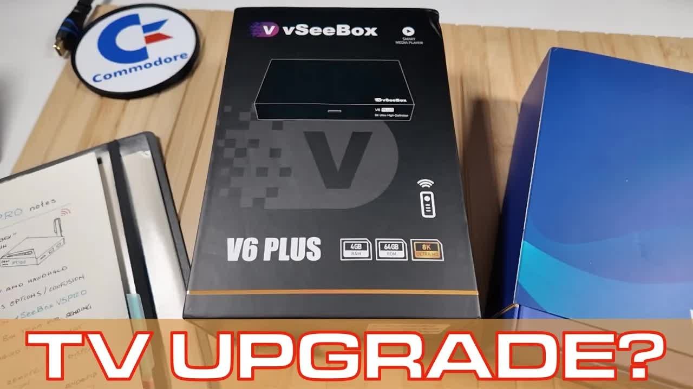

You all really seem to enjoy my Android TV box videos. Between November 2025 and October 2026, I unboxed and set up 11 of them on retroCombs Tech (@retroCombs-tech): five from vSeeBox, two from Colabox, and one each from Digibox, [EVPad](https://www.evpadpro.com/?DIST=T09OGg%3D%3D), SuperBOX and SeekBox. That's a lot of remotes, power bricks and HDMI cables. I could start an HDMI cable store.

This post puts all 11 in one place: what each box says on the packaging, what I saw on screen, and who each one is for. Each section links to the full video. The [vSeeBox α1](/vseebox-alpha1) is the one that isn't in that set. It runs a locked Linux launcher instead of Android TV OS, so it has its own review.

*Disclosure: the makers sent me most of these boxes for review. They didn't ask me to say anything in particular, and these thoughts are my own.*

## TABLE OF CONTENTS {#table-of-contents}

- [TABLE OF CONTENTS](#table-of-contents)
- [LINKS](#links)
- [SUPPORT THE BLOG AND CHANNEL](#support-the-blog-and-channel)
- [A NOTE ON LEGAL USE](#legal-use)
- [THE BOXES AT A GLANCE](#at-a-glance)
- [VSEEBOX V5 PRO](#vseebox-v5-pro)
- [VSEEBOX V6 PLUS](#vseebox-v6-plus)
- [VSEEBOX V6 MAX](#vseebox-v6-max)
- [VSEEBOX ELITE ULTRA](#vseebox-elite-ultra)
- [COLABOX L2 PLUS](#colabox-l2-plus)
- [VSEEBOX V6 PRO](#vseebox-v6-pro)
- [COLABOX COLASTICK V1 PLUS](#colastick-v1-plus)
- [DIGIBOX D6 MAX](#digibox-d6-max)
- [EVPAD 11P](#evpad-11p)
- [SUPERBOX S7 PRO](#superbox-s7-pro)
- [SEEKBOX S3 PRO](#seekbox-s3-pro)
- [SETUP TIPS FOR ANY OF THESE BOXES](#setup-tips)
- [WHICH ONE IS FOR YOU?](#which-one)
- [VIDEO ERRATA](#video-errata)
- [CONCLUSION](#conclusion)

---

## LINKS {#links}

**The Boxes**

- 📺 vSeeBox All Models (Elite Ultra, V6 Pro, V6 Max, V6 Plus): <https://vseeboxus.com/affiliate-program/sell-product?source_type=sales_plugin_af&slt=sales_plugin_af&productPage=1&referral_code=X973T43OZTN1>
- 📺 Colabox L2 Plus: <https://colaboxtech.com/products/colabox-l2-plus?sca_ref=11724747.nhAgh62WOx7v> (code STEVEN for 18% off)
- 🕹️ Colabox Colastick V1: <https://colaboxtech.com/products/colastick-v1-plus?sca_ref=11724747.nhAgh62WOx7v> (code STEVEN for 18% off)
- 📺 Digibox D6 Max: <https://tidd.ly/4vU8SKt> (code retroCombs for 5% off, plus 2 free gifts)
- 📺 EVPad 11P (EVPad Pro store): <https://www.evpadpro.com/?DIST=T09OGg%3D%3D>
- ✨ SuperBOX S7 Pro: <https://mysuperbox.shop/> (code retrocombs saves $50)
- 📺 SeekBox S3 Pro: <https://seekboxstore.com/?ref=RETROCOMBS> (code retroCombs saves $50)

Check each discount at checkout before you pay.

**Accessories I Used**

- 🦈 Surfshark VPN: <https://surfshark.club/friend/rfn4K5VF>
- ⌨️ K809 Mini Wireless Keyboard with Touchpad: <https://amzn.to/4ATykCI>
- 🛜 Ethernet Network Cable: <https://amzn.to/4cEJyyB>
- 🔋 Amazon Basics Batteries: <https://amzn.to/49LycZc>
- 🔌 AOHi 280W 6-Port Desktop Charging Station: <https://tidd.ly/4f3SfpM>
- 🏷️ NIIMBOT Label Maker: <https://amzn.to/497ehFd>
- 📀 ClonerAlliance UHD Pro (to record from these boxes): <https://amzn.to/3UzOnES>

**Related Posts**

- [vSeeBox α1 Review: A Linux Media Player That Walks Away From Android TV OS](/vseebox-alpha1)
- [ClonerAlliance UHD Pro Review: A Standalone HDMI Recorder for Android TV Boxes](/cloneralliance-uhd-pro)

*Disclosure Statement: When you click on links to various merchants on this site and make a purchase, this can result in this site earning a commission. Affiliate programs and affiliations include, but are not limited to Amazon and the eBay Partner Network.*

## SUPPORT THE BLOG AND CHANNEL {#support-the-blog-and-channel}

Check out the [supporters page](/supporters) to learn about my supporters and how you can join our community. If this post saved you some time, you can also [leave a tip](https://paypal.me/stevencombs). And if you like gadgets, subscribe to @retroCombs-tech. Hooked on tech since '73.

## A NOTE ON LEGAL USE {#legal-use}

I say it in every one of these videos: these boxes by themselves are not illegal. They're Android TV devices. You can sign in to the Google Play Store and install Netflix, YouTube, Prime Video and the rest, the legal way, with your own accounts. What you install and what you stream is what makes your use legal or not.

Most of these boxes also ship with their maker's own live TV and video-on-demand apps, and that's where the questions about legality and ethical use come in. The makers' own disclaimer screens put the responsibility on you. vSeeBox's, for example, says it's the user's responsibility to make sure that they, or the sites they stream from, have the correct copyright agreements in place. My advice from the V5 Pro video still stands: let your conscience be your guide, both when you decide to buy and when you use it.

I'm not a lawyer, and the rules differ by country.

## THE BOXES AT A GLANCE {#at-a-glance}

Specs are as printed on each box or shown on screen in my video. "ROM" on these boxes means internal storage. I haven't verified the 6K and 8K claims, because I don't have a 6K or 8K TV.

| Box (video date) | Android | RAM / storage | Wireless | Wired | Stand-out |
|---|---|---|---|---|---|
| vSeeBox V5 Pro (Jan 2026) | 12 | 4GB / 32GB | 2.4 and 5 GHz Wi-Fi | Ethernet | $799 MSRP printed on the box; front clock |
| vSeeBox V6 Plus (Nov 2025) | TV 14 | 4GB / 64GB | Wi-Fi 6, BT 5.0 | Ethernet, optical, USB 3.0 | HDMI 2.1; locked-down app selection |
| vSeeBox V6 Max (Jan 2026) | TV 14 | 4GB / 64GB | Wi-Fi 6, BT 5.0 | Ethernet, AV out, USB 3.0 | Front display; HDMI 2.1; Amlogic S905Y4 |
| vSeeBox Elite Ultra (Mar 2026) | 12 | 4GB / 128GB | Wi-Fi 6, BT 5 | Ethernet, optical, AV, USB 3.0 + 2.0 | Most storage; mini keyboard included |
| Colabox L2 Plus (Apr 2026) | 14 | 4GB / 64GB | Wi-Fi 5, BT 5 | Ethernet, optical, AV, 2x USB-A | Clean launcher; my favorite of the group |
| vSeeBox V6 Pro (Jun 2026) | 14 | 4GB / 32GB | 2.4 and 5 GHz Wi-Fi | Gigabit Ethernet, optical, USB 3.0 | LED display; external Wi-Fi antenna |
| Colastick V1 Plus (Jun 2026) | 14 | 4GB / 32GB | Dual-band Wi-Fi, BT 5.0 | None (USB-C) | Stick for travel and hotel TVs |
| Digibox D6 Max (Jul 2026) | 12 | 4GB / 64GB | Wi-Fi 6, BT 5.4 | Gigabit Ethernet, optical, USB | USB-C power; air mouse; phone app |
| EVPad 11P (Jul 2026) | 12 | 4GB / 64GB | Wi-Fi 6, BT 5.2 | Gigabit Ethernet, optical, AV, USB 3.0 + 2.0 | Air mouse; LED light strip |
| SuperBOX S7 Pro (Aug 2026) | 12 | 4GB / 32GB | Wi-Fi 6 | Gigabit Ethernet, optical, USB-C | USB-C power; time-shift app |
| SeekBox S3 Pro (Oct 2026) | 11 | 4GB / 64GB | Wi-Fi 6, BT 5.0 | Ethernet, USB 3.0 + 2.0 | Game controller support; claims only 4K |

Every one of them has 4GB of RAM. I'd love to see 8GB, though I understand RAM prices are high right now.

## VSEEBOX V5 PRO {#vseebox-v5-pro}

Title: _📺️ vSeeBox V5 Pro Features Tested | Worth Buying?_



The vSeeBox V5 Pro runs Android 12, with 4GB of RAM and 32GB of storage. The back of the box prints a manufacturer's suggested retail price of $799. Ouch. It's tiny, about the size of a Mi Box, and the Bluetooth remote is heavy and well built. Batteries are not included, so bring your own. A big external antenna pulls in Wi-Fi, and there's a little clock on the front.

Next to the Google Play Store, the V5 Pro has its own app market with a curated list of apps. The hardware is fast and responsive with great Wi-Fi. It costs two to three times as much as a Mi Box, and what you pay for is the hardware quality and the development of its four custom apps.

**Who it's for:** someone who wants a fast Android 12 box with a clock on the front and doesn't mind the older OS.

## VSEEBOX V6 PLUS {#vseebox-v6-plus}

Title: _🔍 vSeeBox V6 Plus Unboxing: Android TV 14 is Here, But at What Cost?_



vSeeBox sent the [V6 Plus](https://vseeboxus.com/affiliate-program/sell-product?source_type=sales_plugin_af&slt=sales_plugin_af&productPage=1&referral_code=X973T43OZTN1) and the [V6 Max](https://vseeboxus.com/affiliate-program/sell-product?source_type=sales_plugin_af&slt=sales_plugin_af&productPage=1&referral_code=X973T43OZTN1) in a single box. The V6 Plus moves to Android TV 14 (the earlier models were on Android 12), with 4GB of RAM, 64GB of storage, dual-band Wi-Fi 6, Bluetooth 5.0, HDMI 2.1, HEVC and an 8K claim. It has USB 3.0, optical audio, an SD card slot and Ethernet. The remote is new, with a Google Assistant button.

Compared to the V5 Pro, it drops the extra app market and the front clock (I miss that clock). In some ways it's a hardware downgrade. In others it's an upgrade: Android 14 brings better accessibility settings and a friendlier, more locked-down app selection for people new to these boxes.

**Who it's for:** first-time box owners who want Android 14 and a simpler setup.

## VSEEBOX V6 MAX {#vseebox-v6-max}

Title: _📺️ vSeeBox V6 Max: What's "MAX" versus the V6 Plus?_



The V6 Max has the same headline specs as the Plus: Android 14, 4GB of RAM, 64GB of storage, Wi-Fi 6, Bluetooth 5.0 and HDMI 2.1. Its About screen lists an Amlogic S905Y4 SoC with a quad-core ARM Cortex-A35 CPU, a Mali-G31 MP2 GPU, 4GB of DDR3 and 64GB of eMMC flash. The differences are on the outside. The Max swaps the Plus's optical out for a 3.5mm AV out, brings back a front screen, and has a smaller remote with a different layout. Over Ethernet, the Netflix speed test showed 83 megabits per second.

I prefer the V6 Max over the Plus. I like the onboard screen, and it seems a little more responsive. Either way, it's a step down in storage from the Elite Ultra's 128GB.

**Who it's for:** anyone choosing between the two V6 boxes who wants the front display.

## VSEEBOX ELITE ULTRA {#vseebox-elite-ultra}

Title: _📺️ Is vSeeBox Elite Ultra Worth It in 2026? Full Unboxing!_



The [Elite Ultra](https://vseeboxus.com/affiliate-program/sell-product?source_type=sales_plugin_af&slt=sales_plugin_af&productPage=1&referral_code=X973T43OZTN1) is vSeeBox's top box of the group: 4GB of DDR3 RAM, 128GB of eMMC storage, a quad-core ARM Cortex-A53 CPU, a Mali-G31 GPU, dual-band Wi-Fi 6 (2T2R), Bluetooth 5, HDMI 2.0 and 6K HDR decoding. It's still on Android 12. Ports include one USB 3.0, one USB 2.0, AV out, optical and a microSD slot, plus a clock on the front. vSeeBox also included a backlit mini keyboard, which makes passwords and URLs a lot easier.

My unit wouldn't activate at first. I contacted vSeeBox, and within 24 hours they replied that it should be activated, and it was. That's a good reason to buy from the maker and not a third-party seller.

**Who it's for:** the person who wants the most storage and everything included. If you want the top of the line, I still like the Elite Ultra.

## COLABOX L2 PLUS {#colabox-l2-plus}

Title: _🚀 Cut the Cord! Colabox L2 Plus Deep Dive (Best Android TV 14?)_



The [Colabox L2 Plus](https://colaboxtech.com/products/colabox-l2-plus?sca_ref=11724747.nhAgh62WOx7v) might be my favorite of these Android boxes. It runs Android 14 on a quad-core 64-bit ARM Cortex-A55 with a Mali-450 GPU, 4GB of RAM and 64GB of storage. Wi-Fi 5 is a couple of standards behind, but good enough, and Bluetooth is version 5.

Every port is on the back: optical, AV out, HDMI, a TF card slot, two USB-A ports (not 3.0), Ethernet and 12V power, plus two large Wi-Fi antennas. The matte black case has a gold Colabox logo. When I reviewed it, the L2 Plus was the only model Colabox sold, so there's no guessing which one to buy. It pulled an OTA firmware update on first boot.

The launcher is the cleanest of the group. I didn't find any stray foreign-language menus. You can pin favorites on the left, and a long press on an app gives you clear cache and clear data, which is a handy fix when a custom app won't load. There's no video player app for the TF card, so install VLC.

**Who it's for:** someone who wants Android 14 and a clean, simple launcher.

## VSEEBOX V6 PRO {#vseebox-v6-pro}

Title: _📺️ Before You Buy the vSeeBox V6 Pro, Watch This!_



The [V6 Pro](https://vseeboxus.com/affiliate-program/sell-product?source_type=sales_plugin_af&slt=sales_plugin_af&productPage=1&referral_code=X973T43OZTN1) completes the V6 line. It runs Android 14 with 4GB of RAM and 32GB of storage, gigabit Ethernet, 2.4 and 5 GHz Wi-Fi with an external antenna, USB 3.0, optical audio, a microSD slot and a little LED display. The storage screen confirms 32GB of internal storage. If you want to install a lot of apps or keep your own videos on the box, look at one of the 64GB models.

The security patch level was nearly two years old when I recorded, so run the updates first.

**Who it's for:** someone who wants Android 14 and gigabit Ethernet and keeps their media on USB or a network.

## COLABOX COLASTICK V1 PLUS {#colastick-v1-plus}

Title: _🚀 Colastick V1 Plus Deep Dive: Cut the Hotel TV Cord!_



The [Colastick V1](https://colaboxtech.com/products/colastick-v1-plus?sca_ref=11724747.nhAgh62WOx7v) is the only stick in the group, and I took it on the road. It runs Android 14 and supports 4K at 60 frames per second with HEVC, dual-band Wi-Fi and Bluetooth 5.0, with 4GB of RAM and 32GB of storage. It has a 12-month warranty.

For hotel rooms, I power it the way I power a Chromecast: from my power bank with a longer USB cable, so the stick hangs free behind the TV. A USB-A to USB-C adapter is in the box. There's no Ethernet port, but a USB-C Ethernet dongle or hub would work.

Two things to know. There are no accessibility settings, so I can't recommend it if you need them. And unlike the L2 Plus, there's no time-shift feature. Voice search works, but only for apps from the Google Play Store.

**Who it's for:** travelers who want their own box in a hotel room.

## DIGIBOX D6 MAX {#digibox-d6-max}

Title: _📟 Digibox D6 Max Has a Feature Nobody is Talking About | Full Unboxing_



I wanted to try the [Digibox D6 Max](https://tidd.ly/4vU8SKt) for its industrial design even before Digibox offered to send one. It runs Android 12 on a quad-core Cortex-A53, with 4GB of RAM and 64GB of eMMC storage (the storage screen shows 59GB), Wi-Fi 6, Bluetooth 5.4 and gigabit Ethernet. The front of the box says 8K, and the side says decoding up to 6K.

The feature nobody talks about: it's powered by USB-C, so it ran from my [AOHi 280W charging station](https://tidd.ly/4f3SfpM), where I could watch its power draw. The included remote is an air mouse, which I love, and the Digi Play phone app lets you control the box, and even play games, from your phone. Note that the app downloads from a website, not the Google Play Store.

The D6 Max comes pretty clean: a stock Android 12 without a lot of the maker's own apps, and a curated store of mainstream apps such as Pluto TV and Tubi that doesn't need a Google sign-in. The USB ports look like USB 2.0, with no USB-C data port.

**Who it's for:** tinkerers. When I make a video on putting retro games on an Android TV box, this is the box I'll probably use.

## EVPAD 11P {#evpad-11p}

Title: _📺️ EVPad 11P Unboxing and Setup: A Honest Look at the Competition_



Many of you asked how the EVPad 11P compares to vSeeBox. This unit was sent to me for review. It runs Android 12 on a Cortex-A53, with 4GB of DDR3, 64GB of storage, Wi-Fi 6, Bluetooth 5.2 and gigabit Ethernet. The sides have USB 2.0, USB 3.0 and an SD card slot, and the back adds optical and AV out. The remote is an air mouse, and an LED light strip on the front pulses like KITT from Knight Rider. There's even an app to change it.

Out of the box it's a standard Android 12 system with nothing extra installed. EVPad's own apps come by email after you buy: you get a URL and a password. Updating the launcher through that URL cleaned up the menus and fixed the logo.

**Who it's for:** someone comparing brands who wants an air mouse and gigabit Ethernet. Buy only from approved sellers. Some third-party marketplace units don't work, or arrive infected.

## SUPERBOX S7 PRO {#superbox-s7-pro}

Title: _📀️ Don't Buy a Streaming Box Until You Watch My SuperBOX S7 Pro Deep Dive_



The [SuperBOX S7 Pro](https://mysuperbox.shop/) was sent to me for review. It runs Android 12 with 4GB of RAM and only 32GB of storage, Wi-Fi 6, gigabit Ethernet and dual antennas, and it claims up to 6K. Like the Digibox, it's powered by USB-C, and there's a second USB-C port on the side for a keyboard or a USB drive, plus an SD card slot and optical out.

The remote starts in infrared mode, so you can take your time pairing it over Bluetooth for voice search. A TV ROM updater and a system updater are in the settings. Much of the accessibility in Android 12 has been removed, and there's no speed test app built in; it uses the browser. The custom apps include a time-shift feature that lets you go back to an earlier date on a channel.

**Who it's for:** someone who wants USB-C power and a time-shift app, and keeps media off the box. I'd love to see this one upgraded to Android 14.

## SEEKBOX S3 PRO {#seekbox-s3-pro}

Title: _📺️ SeekBox S3 Pro: The Android TV Box You've Been SEEKing?_



The [SeekBox S3 Pro](https://seekboxstore.com/?ref=RETROCOMBS) runs Android 11, an odd choice next to the Android 12 and 14 boxes, with 4GB of RAM, 64GB of eMMC storage, Wi-Fi 6 and Bluetooth 5.0. I like that the box claims 4K, not 6K or 8K, and that it lists game controller support. Ports include an SD card reader, USB 2.0 for a keyboard, USB 3.0 for external storage, and Ethernet. The remote has programmable color hot keys.

The first Bluetooth remote pairing failed ("Remote bond failed"), then worked. The on-screen keyboard is the Leanback keyboard. With Aptoide TV, the S3 Pro offers more than TV and films, including games and radio, which reminds me of the Digibox. SeekBox also provided a second unit for me to give away to my supporters. Thank you!

**Who it's for:** someone on a budget who wants more than streaming. Android 11 is old, so I have some security questions. If you know more, tell me in the comments.

## SETUP TIPS FOR ANY OF THESE BOXES {#setup-tips}

> **Tip:** Buy from the maker or an approved link. Units from third-party sellers sometimes don't work, or arrive with questionable software.
{: .tip}

> **Tip:** Run every update first: system, launcher and apps.
{: .tip}

> **Tip:** If you sign in to the Google Play Store, use a secondary Google account, not your primary one.
{: .tip}

> **Tip:** Install a VPN. I use [Surfshark](https://surfshark.club/friend/rfn4K5VF). On boxes without a Google sign-in, the Downloader app lets you install its APK.
{: .tip}

> **Tip:** Use Ethernet when you can, and add a small keyboard like the [K809](https://amzn.to/4ATykCI). Typing passwords on a remote is no fun.
{: .tip}

> **Tip:** Label every power supply the day you unbox. These barrel jacks all look alike. I use a [NIIMBOT label maker](https://amzn.to/497ehFd).
{: .tip}

> **Tip:** Check the installed apps list now and then for anything you didn't put there.
{: .tip}

> **Tip:** None of these boxes record. To record from one, see my [ClonerAlliance UHD Pro review](/cloneralliance-uhd-pro).
{: .tip}

## WHICH ONE IS FOR YOU? {#which-one}

- **Cleanest launcher on Android 14:** [Colabox L2 Plus](https://colaboxtech.com/products/colabox-l2-plus?sca_ref=11724747.nhAgh62WOx7v)
- **The most storage and extras:** [vSeeBox Elite Ultra](https://vseeboxus.com/affiliate-program/sell-product?source_type=sales_plugin_af&slt=sales_plugin_af&productPage=1&referral_code=X973T43OZTN1)
- **Android 14 with a front display:** [vSeeBox V6 Max](https://vseeboxus.com/affiliate-program/sell-product?source_type=sales_plugin_af&slt=sales_plugin_af&productPage=1&referral_code=X973T43OZTN1)
- **Travel and hotel TVs:** [Colastick V1](https://colaboxtech.com/products/colastick-v1-plus?sca_ref=11724747.nhAgh62WOx7v)
- **Tinkering, USB-C power and an air mouse:** [Digibox D6 Max](https://tidd.ly/4vU8SKt)
- **Budget, with games and radio apps:** [SeekBox S3 Pro](https://seekboxstore.com/?ref=RETROCOMBS)

I can't make the decision for you. Read, review, and see which box is right for your home.

## VIDEO ERRATA {#video-errata}

As of 2026-12-02:

- **Re-edits.** The V5 Pro, Elite Ultra, V6 Pro and EVPad videos are edits of earlier uploads, re-cut to meet YouTube Community Guidelines.
- **V6 Pro chapter markers.** The chapter list in the V6 Pro video description (retro games, original hardware and so on) doesn't match the video. Use the section headings above instead.
- **"V5 Ultra" (V6 Max video, ~27:10).** I say "V5 Ultra." I mean the Elite Ultra.
- **RAM vs. storage.** In the Digibox and SeekBox videos I say "64 GB of RAM" once. Both have 4GB of RAM and 64GB of storage.
- **V6 Max chipset.** I read the Amlogic chipset name on screen. The About screen lists the Amlogic S905Y4.
- **Colastick Android version.** I say "I believe this is Android 12" early on. It runs Android 14.
- **SeekBox Bluetooth.** The video description says 5.1. It's Bluetooth 5.0, as the box says.

## CONCLUSION {#conclusion}

Eleven boxes, a stack of remotes, and one lesson: the hardware is fast, often faster than the big-name streaming devices, and the differences come down to Android version, storage, ports and the maker's own apps. Pick the one that fits how you watch, buy it from a reputable source, and use it legally.

Which box should I test next? Let me know in the comments below. If this post helped, [leave a tip](https://paypal.me/stevencombs).

That's it for me, retroCombs, out.
