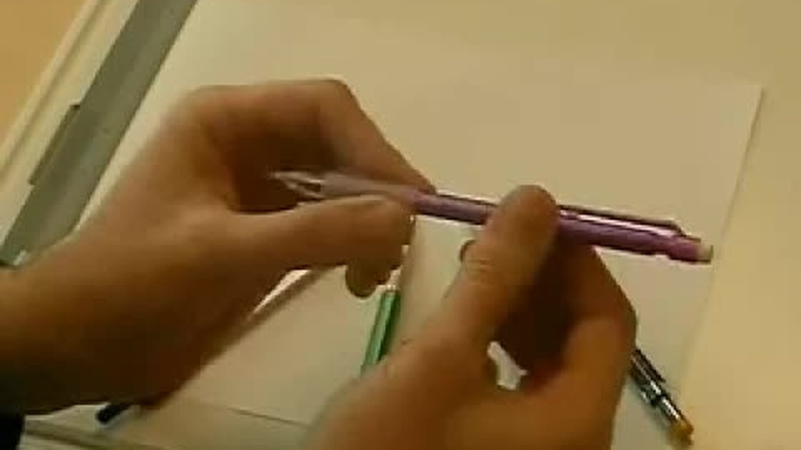
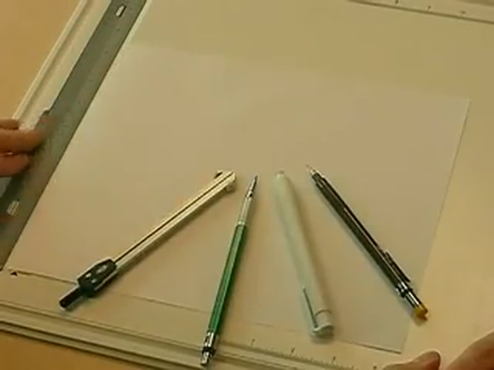
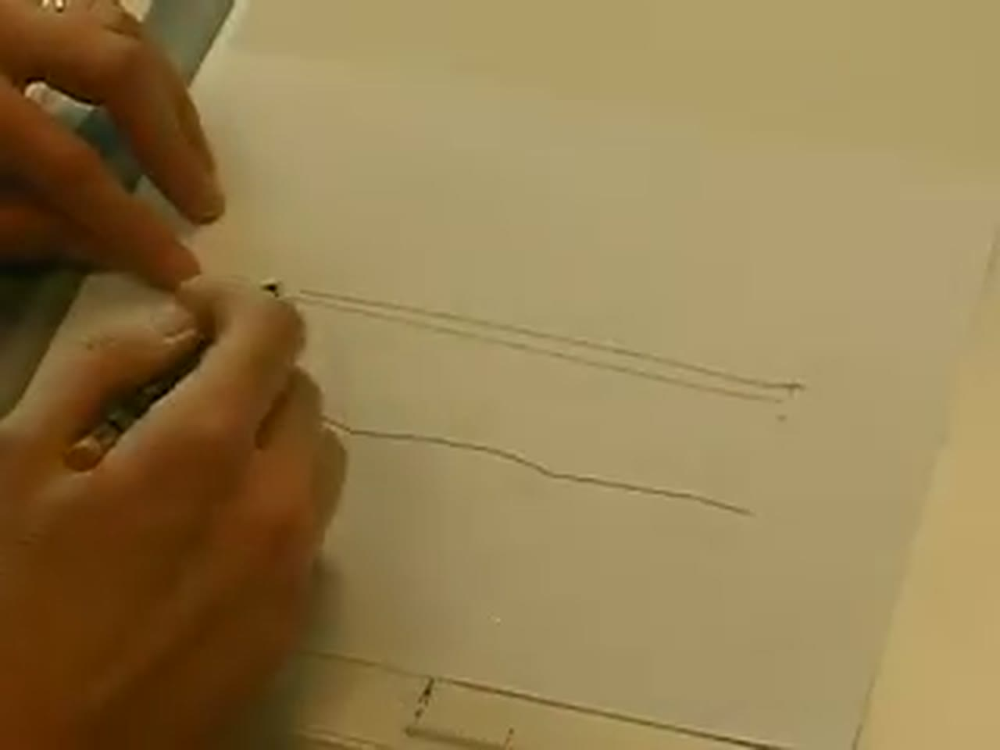
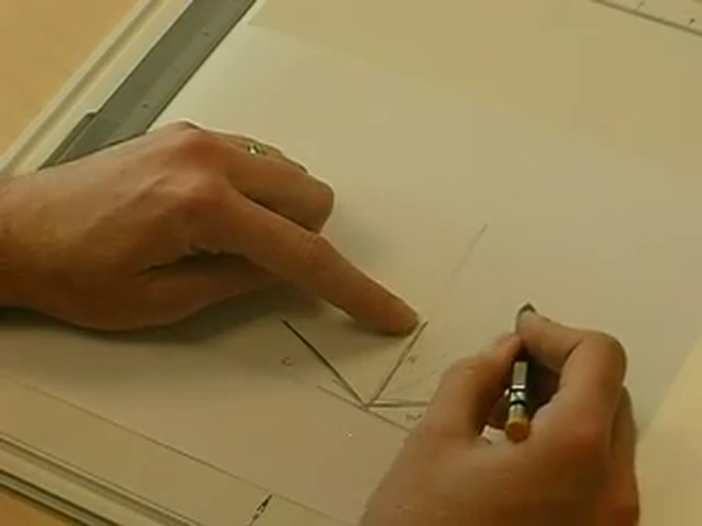
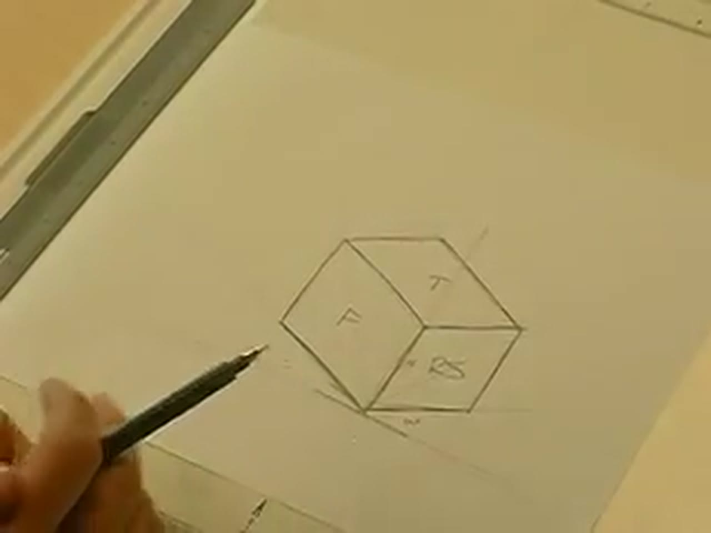

I recorded these four videos back in 2007. That's nearly 20 years ago, and it shows: standard definition, a camera over my drawing board, and lines darkened more than usual so you could see them on camera. The techniques are still as applicable today as they were then, just not in HD! :D

This post collects the whole Introduction to Technical Sketching series in one place, with the steps from each video written out and a few practice drills. Sketching is an important skill for engineers, technical illustrators and drafters: getting an idea down on paper, on the fly. All you need is a pencil and paper.

## TABLE OF CONTENTS {#table-of-contents}

- [TABLE OF CONTENTS](#table-of-contents)
- [LINKS](#links)
- [SUPPORT THE BLOG AND CHANNEL](#support-the-blog-and-channel)
- [COMPANION YOUTUBE VIDEOS](#companion-youtube-videos)
- [VIDEO ERRATA](#video-errata)
- [PART 1: TOOLS OF THE TRADE](#part-1)
- [PART 2: LINE QUALITY](#part-2)
- [PART 3: HOW TO DRAW A STRAIGHT LINE](#part-3)
- [PART 4: ANGLED LINES AND YOUR FIRST ISOMETRIC BOX](#part-4)
- [PRACTICE DRILLS](#practice-drills)
- [CONCLUSION](#conclusion)

---

## LINKS {#links}

**Going Digital**

- ✏️ Wacom Intuos Small Drawing Tablet (CTL4100): <https://link.amazon/B02inD7FJ>

*Disclosure Statement: When you click on links to various merchants on this site and make a purchase, this can result in this site earning a commission. Affiliate programs and affiliations include, but are not limited to Amazon and the eBay Partner Network.*

## SUPPORT THE BLOG AND CHANNEL {#support-the-blog-and-channel}

Check out the [supporters page](/supporters) to learn about my supporters and how you can join our community. If this post saved you some time, you can also [leave a tip](https://paypal.me/stevencombs).

## COMPANION YOUTUBE VIDEOS {#companion-youtube-videos}

Title: _Introduction to Technical Sketching | Part 1 - Tools of the Trade_



Title: _Introduction to Technical Sketching | Part 2 - How to Ensure Line Quality_



Title: _Introduction to Technical Sketching | Part 3 - How to Draw a Straight Line_



Title: _Introduction to Technical Sketching | Part 4 - How to Draw Angled Lines_





## VIDEO ERRATA {#video-errata}

As of 2026-12-03:

- **Construction lead range.** In Part 1 I say the lead holder takes 2H to 6H lead. In Part 2 I say "2H to 7H or 6H." Either way, construction lines use a hard lead, H or harder. The demonstration in Part 2 uses a 2H so the line shows up on camera.
- **Vertical or horizontal? (Part 3, ~4:05).** I say "vertical" when I mean "horizontal," then catch myself. Rotate the paper 90 degrees to turn whichever line you find harder into the one you find easier.
- **Darker than normal.** Throughout the series I darken lines more than I normally would so they show on a 2007 camera.

## PART 1: TOOLS OF THE TRADE {#part-1}

When the need to sketch hits you while you're out and about, grab whatever you have: a cheap pencil, a sheet of paper, sticky notes, even a napkin. That's fine for a quick sketch on the go.

For a real sketching session, where you're after a more professional sketch, I recommend:

- **A drawing board.** Mine is a Rotring board with a magnetic clip that holds the paper steady. It's an inexpensive way to keep things from sliding.
- **A good mechanical pencil.** In the videos I use a 0.9mm with a soft HB lead, because it shows up well on camera. For everyday work I like a 0.7mm. A 0.5mm, which is what you often get when you buy one, is okay, but the 0.7mm gives you better line quality.
- **A lead holder with hard construction lead,** anywhere from 2H to 6H. Hard lead makes very light construction lines.
- **A good eraser.** I like the kind with lots and lots of eraser inside, because I make lots and lots of mistakes.
- **Dividers,** for transferring and measuring quick distances.

> **Tip:** Keep the hard construction lead sharp. A sharp point makes a thinner, lighter line.
{: .tip}

If you'd rather sketch on screen today, the same habits carry over to a drawing tablet such as the [Wacom Intuos Small](https://link.amazon/B02inD7FJ): light construction strokes first, then confident object lines.

## PART 2: LINE QUALITY {#part-2}

Good sketches use two kinds of lines:

- **Object lines** are dark and consistent. They show the drawing.
- **Construction lines** are very light. They map out the drawing and are barely visible.

**For dark, consistent object lines,** keep your pencil as perpendicular to the paper as possible. That lets the full width of the lead (0.9mm in the video) transfer to the paper.

**An old drafting technique** is to spin the pencil as you pull it along a ruler. You get better lead transfer and a much darker line. That's more for drafting than sketching, because sketching is supposed to be quick, but it shows the difference.

**For construction lines,** switch to the hard lead and use a very light touch. If you're doing it correctly, the lines are hard to see.

The workflow: use construction lines to map out your drawing. When you're ready to lay lead on the paper, go back over the construction lines with your soft-lead pencil to give a nice dark drawing that people can see.

## PART 3: HOW TO DRAW A STRAIGHT LINE {#part-3}

The big rule: **don't look at your pencil tip.** If you watch the tip, you'll track the pencil, and the line will waver. Instead:

1. Put a light construction dot where you want the line to end.
2. Put your pencil where you want to start.
3. Look at the end point, not the pencil.
4. Draw your line right to that point.

If you miss, try again. You'll see it gets better.

Two beginner techniques help you work up to that:

- **Feathering:** short, overlapping strokes that slowly work toward the end point. It gets you there, but I don't like the little lines it leaves.
- **Line segments:** longer strokes from point to point, looking ahead to the next point each time. It looks cleaner than feathering, but you can still see the breaks.

Both are good ways to start. The goal is a single line from end point to end point. It takes time to get there.

> **Tip:** Better at horizontal lines than vertical ones, or the other way around? The paper isn't glued down. Rotate it 90 degrees, draw the line you're good at, and rotate it back.
{: .tip}

## PART 4: ANGLED LINES AND YOUR FIRST ISOMETRIC BOX {#part-4}

An angled line uses the same technique: start point, end point, look where you're going, draw. The trick is getting a **specific** angle. A line that "looks like 45 degrees" usually isn't. Use a little geometry and some construction lines.

**A 45-degree line:**

1. In construction lines, draw a horizontal line and a vertical line that meet at a right angle (90 degrees).
2. Eyeball the line that cuts that angle in half, so both halves look equal. That's your 45-degree line.
3. Darken it to the length you need.

**A 30-degree line** (common in isometric drawings): draw the same right angle, then split it into thirds instead of halves. That takes a little practice. Once you've drawn one 30-degree line, it's easier to mirror it on the other side.

You can also rotate your paper so the angled line becomes the horizontal or vertical line you're best at.

**An isometric box,** when you don't have an isometric grid:

1. In light construction lines, mark the front corner of the box with a horizontal line and a vertical line.
2. Draw the two 30-degree lines off the horizontal, one to each side of the corner.
3. Mark the rough length, width and height of the box on those lines and the vertical.
4. Sketch construction lines parallel to the ones you have to close in the top and sides. Adjust as you go. That's what construction lines are for.
5. When the corners are right, darken the object lines. Remember: look where you're going, not at the tip.

You end up with a box that shows the front, top and right side. The same 45-degree technique works for oblique drawings, such as a cabinet or cavalier oblique.

## PRACTICE DRILLS {#practice-drills}

A few drills built from the four videos:

1. **Two weights.** Fill half a page with light construction lines and half with dark object lines. Compare them.
2. **Dot to dot.** Scatter ten pairs of construction dots across a page and connect each pair with a single stroke, eyes on the end point.
3. **Feather, segment, single.** Draw the same line three ways and notice which breaks you can still see.
4. **Halves and thirds.** Draw a right angle, then a 45-degree line, then two 30-degree lines. Check your angles with a protractor afterward.
5. **Box a day.** Sketch one isometric box a day at different sizes.

## CONCLUSION {#conclusion}

A good pencil, a hard lead for construction, your eyes on the end point, and a little geometry for angles. That's the foundation of technical sketching, in 2007 or today.

What do you sketch with today, pencil and paper or a tablet? Let me know in the comments below. If this post helped, [leave a tip](https://paypal.me/stevencombs).

That's it for me, folks. 🕹️ retroCombs, OUT!
