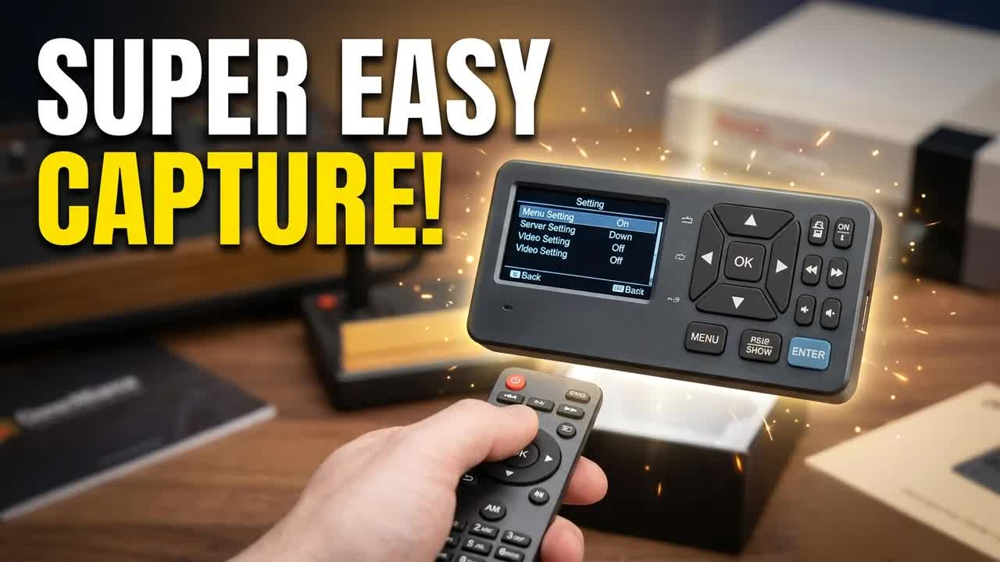
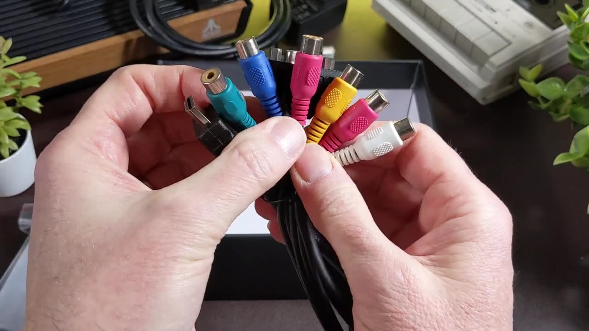
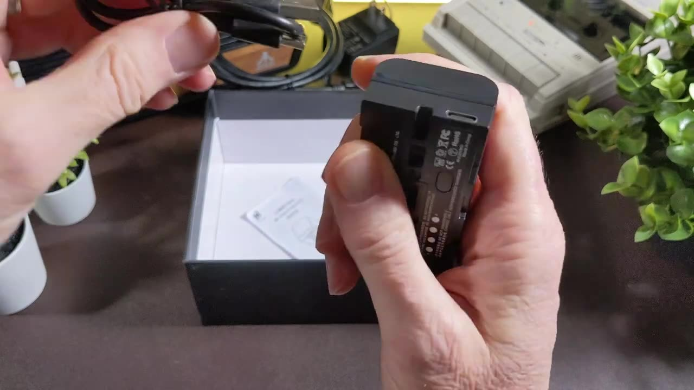
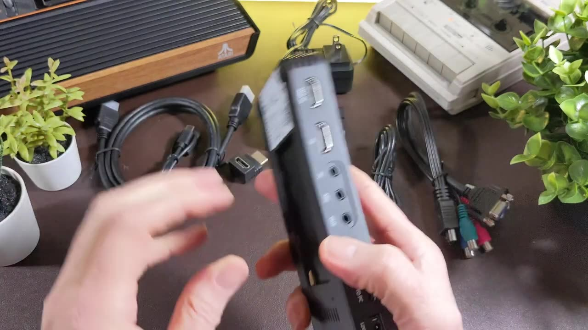
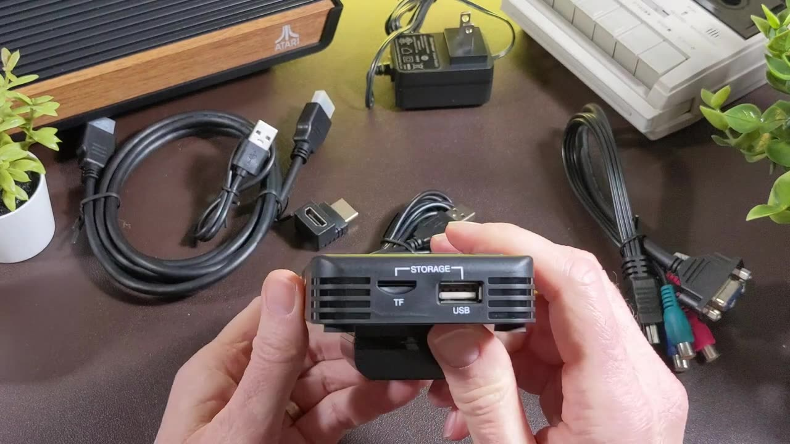

Got a shoebox of VHS tapes, or a Commodore that deserves better than a phone pointed at a CRT? I've tested three standalone capture boxes from ClonerAlliance on the channels: the [ViewLite AV](https://amzn.to/4gvGU14), the [Box Pro Pocket](https://amzn.to/4wQgjlB) and the [View Pro](https://amzn.to/45MhQ0R). All three record straight to an SD card or USB drive, no computer required. This post puts them side by side, with the setup and storage tips from each video. If you want the 4K pass-through model, I covered that one in the [ClonerAlliance UHD Pro](/cloneralliance-uhd-pro) post.

## TABLE OF CONTENTS {#table-of-contents}

- [TABLE OF CONTENTS](#table-of-contents)
- [LINKS](#links)
- [SUPPORT THE BLOG AND CHANNEL](#support-the-blog-and-channel)
- [COMPANION YOUTUBE VIDEOS](#companion-youtube-videos)
- [VIDEO ERRATA](#video-errata)
- [AT A GLANCE](#at-a-glance)
- [CLONERALLIANCE VIEWLITE AV](#viewlite-av)
- [CLONERALLIANCE BOX PRO POCKET](#box-pro-pocket)
- [CLONERALLIANCE VIEW PRO](#view-pro)
- [WHICH ONE FOR YOUR TAPES?](#which-one)
- [STORAGE AND ARCHIVING TIPS](#archiving-tips)
- [CONCLUSION](#conclusion)

---

## LINKS {#links}

**Capture Devices**

- 📼 ClonerAlliance ViewLite AV: <https://amzn.to/4gvGU14>
- 📼 ClonerAlliance Box Pro Pocket: <https://amzn.to/4wQgjlB>
- 📺 ClonerAlliance View Pro: <https://amzn.to/45MhQ0R>
- 📼 ClonerAlliance Box Pro: <https://amzn.to/4qAOn3A>
- 📺 ClonerAlliance UHD Pro: <https://amzn.to/3UzOnES>

**Used in the Videos**

- 🕹️ Kung Fu Flash: <https://link.amazon/B0bDHYEvP>
- 🕹️ Atari 2600+: <https://amzn.to/43KNriS>
- 🎬 Blackmagic ATEM Mini Extreme ISO: <https://amzn.to/4ypHQuP>
- 🔋 Amazon Basics Batteries: <https://amzn.to/49LycZc>
- 🧠 microSD Cards: <https://amzn.to/3IYL3Kn>
- 📺 USB HDMI capture device: <https://amzn.to/41iI9Kt>

*Disclosure Statement: When you click on links to various merchants on this site and make a purchase, this can result in this site earning a commission. Affiliate programs and affiliations include, but are not limited to Amazon and the eBay Partner Network. ClonerAlliance sent me all three devices; they had no input on the videos or this post.*

## SUPPORT THE BLOG AND CHANNEL {#support-the-blog-and-channel}

Check out the [supporters page](/supporters) to learn about my supporters and how you can join our community. If this post saved you some time, you can also [leave a tip](https://paypal.me/stevencombs). And if you like gadgets, subscribe to [@retroCombs-tech](https://www.youtube.com/@retroCombs-tech). Hooked on tech since '73.

## COMPANION YOUTUBE VIDEOS {#companion-youtube-videos}

Title: _This Tiny Device Makes VHS Tapes & Gameplay Digital in Minutes!_ (retroCombs channel)



Title: _This Pocket ClonerAlliance Makes Video Capture SUPER Easy_ (Tech channel)



Title: _This Gadget Records TV Like Magic!_ (Tech channel)





## VIDEO ERRATA {#video-errata}

As of 2026-12-04:

- **ViewLite AV price.** I quote $165 in the 2023 video. That price is three years old; check the link for today's price.
- **ViewLite AV software.** The box says the helper software is Windows only, but ClonerAlliance's website also had a Mac version when I recorded. The AI Video Enhancer was Windows only.
- **View Pro "4K recorder."** I call the View Pro a 4K recorder. It **accepts** 4K30 or 1080p sources, but the recording resolution menu I show tops out at 1920x1080.
- **Box Pro Pocket on a Mac.** Its USB capture showed a black screen on my Mac. See the workaround below.

## AT A GLANCE {#at-a-glance}

Everything here comes from the boxes, the manuals on screen and my testing in each video.

| | ViewLite AV | Box Pro Pocket | View Pro |
|---|---|---|---|
| Video | Sep 2023 | Feb 2025 | Oct 2025 |
| Screen | 3-inch, 640x480 | None | 7-inch LCD |
| Analog inputs | Composite RCA, S-Video | MMI cable: composite, component, VGA | MMI cable: composite, S-Video, VGA |
| HDMI | Out only (up to 1080p60) | In and out (pass-through) | In and out (pass-through), accepts 4K30 |
| Audio | Two 3.5mm TRS (in/out) | 3.5mm in, out and mic | Line in, mic in, line out, mixing |
| Recording | MP4 H.264, up to 1920x1080 (30 NTSC, 25 PAL), MP3 audio | Up to 1080p60 from HDMI | Up to 1920x1080, 4:3 options such as 1024x768 |
| Storage | SD or USB, up to 8TB | microSD (Class 10+) or USB | SD or USB |
| Power | 5V USB-C | 12V 1A barrel, optional NP-F550 battery (2.5 hours) | Barrel jack, optional battery (same as Pocket) |
| Scheduled recording | Not shown in the video | Yes | Yes, once or daily |
| Built-in speaker | Yes (tiny) | Not covered in the video | Yes |

## CLONERALLIANCE VIEWLITE AV {#viewlite-av}

The [ViewLite AV](https://amzn.to/4gvGU14) is the small one: 6.5 ounces and 6.2 x 2.8 x 1.1 inches. ClonerAlliance pitches it for VHS, camcorder, radio cassettes and albums. It'll even capture eight-track tapes if that's your jam.

**In the box:** the unit, a getting started guide, a remote, an RCA-to-RCA cable, a 90-degree HDMI adapter, a USB-C data and power cable, a 3.5mm TRS cable and a 5V power brick.

**Ports:** composite RCA, S-Video, two 3.5mm TRS jacks, USB-C for power and computer data, and HDMI out. Plugging in HDMI out turns off the built-in screen.

**Storage:** there's no internal storage. It records to a USB drive, hard drive or SD card up to 8TB, formatted FAT32, NTFS or exFAT, MBR or GPT. Use one at a time. Files are MP4 (H.264) with MP3 audio, and the camera button on the remote saves JPEG screenshots.

**Getting files off:** pull the card or drive, or use TF transfer mode over USB. TF transfer works with SD cards only. The ViewLite also plays your recordings back on its screen.

**Firmware:** updates come only through ClonerAlliance tech support.

In the video I captured a Commodore 128 in C64 mode through a 5-pin DIN to RCA cable, running Zaxxon from a [Kung Fu Flash](https://link.amazon/B0bDHYEvP) cartridge. I also ran that clip and a VIC-20 commercial with William Shatner through the AI Video Enhancer. You be the judge of the results.

> **Tip:** When you stop a recording, wait for the LED to stop flashing before you pull the card. That's the box finishing the file.
{: .tip}

## CLONERALLIANCE BOX PRO POCKET {#box-pro-pocket}

The [Box Pro Pocket](https://amzn.to/4wQgjlB) has no screen. It's a capture box you can run from a battery, which makes it easy to carry to wherever the VCR or console lives.

**In the box:** a remote (bring your own batteries, such as [Amazon Basics](https://amzn.to/49LycZc)), a 12V 1A power supply, a 6-foot HDMI cable, a 90-degree HDMI adapter, a micro USB cable for computer capture, the MMI breakout cable (composite, component and VGA), and an NP-F550 rechargeable battery rated for 2.5 hours of recording, with a short USB cable to charge it.

**Ports:** MMI in, HDMI in, 3.5mm audio in, audio out for headphones, a mic jack, HDMI out (pass-through), micro USB and 12V power. The right side holds a [microSD](https://amzn.to/3IYL3Kn) slot (Class 10 or faster) and a USB port.

**Storage formats:** NTFS, exFAT or FAT32. FAT32 splits recordings into 4GB chunks, so use exFAT or NTFS for long tapes.

**The light:** solid means ready, blinking means saving, and off means no media.

I captured an [Atari 2600+](https://amzn.to/43KNriS) over HDMI at 1080p60 and a Commodore 64 through the MMI cable. HDMI pass-through let me send the signal on to my [ATEM Mini Extreme ISO](https://amzn.to/4ypHQuP) at the same time. The menu also has scheduled recording, resolution and snapshot settings.

> **Tip:** USB capture on my Mac showed only a black screen. The workaround: send HDMI out into an inexpensive [USB HDMI capture dongle](https://amzn.to/41iI9Kt) and record that in OBS. On Windows, the helper software captures over USB.
{: .tip}

## CLONERALLIANCE VIEW PRO {#view-pro}

The [View Pro](https://amzn.to/45MhQ0R) is the big one: a standalone recorder with a 7-inch LCD and a built-in speaker. It accepts 4K30 or 1080p sources over HDMI, and the MMI cable covers composite (a VCR), S-Video (an old DVD player) and VGA.

**In the box:** a carrying case with SD card slots, a tool and screwdriver for the remote's CR2025 battery, a micro USB cable, a barrel-jack power supply, an HDMI cable for pass-through to your TV, the MMI cable, a plastic stand with a 1/4-inch mount (it wobbles a bit) and the remote.

**No power button:** plug it in and wait for the ribbon across the bottom of the screen.

**Recording settings:** 1920x1080, 1280x720, 1280x1024 and 1024x768, so you can record 16:9 HD or a 4:3 ratio. You also get bit rate, a 4G or 16G file size limit, loop recording, an on-screen time display and an optional time watermark. The watermark is burned into the video, so you may not want it.

**Audio:** separate HDMI, mic, line in, speaker, line out and mixed-out volumes. Plug in an external mic and narrate what's on screen.

**Scheduled recording:** once or every day. Set the source to the right channel yourself first. You can also turn the screen off while it records.

**Firmware:** like the ViewLite, updates come from ClonerAlliance support, and only for known common problems.

I tested it recording a vSeeBox Elite Ultra. A short test clip came to 14MB, so it compresses well.

> **Tip:** There's no way to sync the View Pro's clock to a time server. If you plan to line up its recordings with another camera, set the system time carefully by hand.
{: .tip}

## WHICH ONE FOR YOUR TAPES? {#which-one}

- **Simplest tape-to-file box with a screen:** [ViewLite AV](https://amzn.to/4gvGU14). Composite and S-Video in, one button to record. No HDMI input.
- **Portable, battery option, analog and HDMI:** [Box Pro Pocket](https://amzn.to/4wQgjlB). Add a screen through HDMI pass-through.
- **Big screen, scheduled recording, 4K sources:** [View Pro](https://amzn.to/45MhQ0R).
- **4K pass-through on your desk:** see my [UHD Pro](/cloneralliance-uhd-pro) post.

## STORAGE AND ARCHIVING TIPS {#archiving-tips}

From the three videos:

- **Format for long recordings.** Use exFAT or NTFS. FAT32 splits files at 4GB.
- **Wait for the save.** Don't pull media while the light is blinking.
- **Use a fast card.** Class 10 or faster for the Pocket.
- **Match the shape.** Record old 4:3 sources at a 4:3 resolution (such as 1024x768 on the View Pro) instead of stretching them.
- **Skip the watermark** unless you need it. It's permanent.
- **Narrate as you go.** The mic inputs on the Pocket and View Pro let you add notes about a tape while it plays.

From the archivists:

- **Digitize sooner, not later.** The National Archives recommends reformatting video tape older than five years ([NARA, Machine-Readable Media](https://www.archives.gov/preservation/holdings-maintenance/machine-readable)). Most of our VHS tapes passed that mark decades ago.
- **Keep the highest-quality file.** Save the best version of each video, with descriptive file names and a short written description of how your folders are organized ([Library of Congress, Personal Archiving: Video](https://www.digitalpreservation.gov/personalarchiving/video.html)).
- **Make more than one copy.** The Library of Congress says at least two copies, on separate media, stored as far apart as practical. The National Archives recommends three copies on different media types, and not relying on the cloud as your only copy ([NARA, Video Guidance: Ensuring Future Usability](https://www.archives.gov/preservation/formats/video-future-usability.html)).
- **Check and refresh.** Open your saved files at least once a year, and copy them to new media every five years or so ([Library of Congress](https://www.digitalpreservation.gov/personalarchiving/video.html)).
- **Keep the tapes after you capture them.** Store them upright, off the floor, away from attics and garages, ideally at 55 to 70°F and 30 to 55% relative humidity ([NARA, Video Guidance: Storage of Materials](https://www.archives.gov/preservation/formats/video-storage.html)).

## CONCLUSION {#conclusion}

All three boxes turn analog video into files without a computer in the middle. The ViewLite AV is the simplest, the Box Pro Pocket is the most portable, and the View Pro has the screen and scheduling.

What are you digitizing first, family tapes or retro gameplay? Let me know in the comments below. If this post helped, [leave a tip](https://paypal.me/stevencombs).

That's it for me, retroCombs, out.
