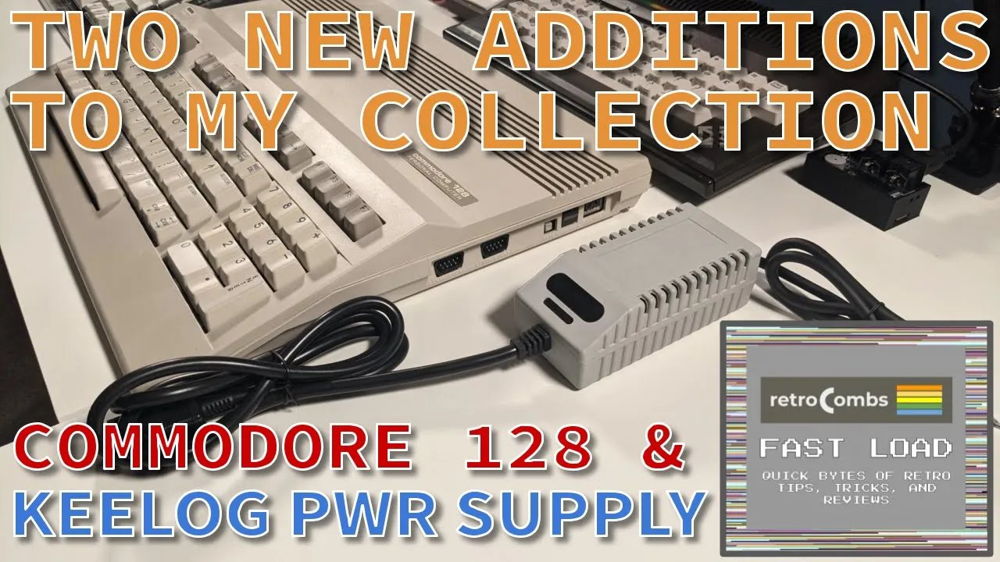

The Commodore 128 was my second computer, and it was my daily driver for most of college. In the late 1980s I sold it, along with its Commodore 1902 monitor, to buy an Amiga 500. Like most of us, I wish I'd kept it. In June 2021, after months of eBay searches, a C128 finally came home. This post is the companion to that FAST LOAD video: the purchase, the power supply I chose, and the first tests.



## TABLE OF CONTENTS {#table-of-contents}

- [TABLE OF CONTENTS](#table-of-contents)
- [LINKS](#links)
- [SUPPORT THE BLOG AND CHANNEL](#support-the-blog-and-channel)
- [COMPANION YOUTUBE VIDEO](#companion-youtube-video)
- [VIDEO ERRATA](#video-errata)
- [MY COMMODORE 128 HISTORY](#history)
- [THE EBAY PURCHASE](#ebay)
- [WHY A KEELOG POWER SUPPLY?](#power-supply)
- [UNBOXING](#unboxing)
- [POWERING UP](#powering-up)
- [TESTING C128 AND C64 MODES](#testing)
- [A LOOK INSIDE](#inside)
- [THE ONLY PIECE LEFT FROM MY ORIGINAL C128](#remnants)
- [CONCLUSION](#conclusion)

---

## LINKS {#links}

**Used in the Video**

- 🎮 Hyperkin Ranger: <https://link.amazon/B0fysS6Ec>
- ⚡ Kung Fu Flash: <https://link.amazon/B0bDHYEvP>
- 📀 ClonerAlliance Box Pro: <https://amzn.to/4qAOn3A>

**More from retroCombs**

- 📝 My first Amiga since 1987: [Unboxing an Amiga 600](/amiga-600-first-amiga-since-1987)
- 📝 The capture box I used: [ClonerAlliance Box Pro first use](/cloner-alliance-box-pro-first-use)
- 💾 More Commodore posts: [Commodore](/commodore)

*Disclosure Statement: When you click on links to various merchants on this site and make a purchase, this can result in this site earning a commission. Affiliate programs and affiliations include, but are not limited to Amazon and the eBay Partner Network.*

## SUPPORT THE BLOG AND CHANNEL {#support-the-blog-and-channel}

Check out the [supporters page](/supporters) to learn about my supporters and how you can join our community. If this post saved you some time, you can also [leave a tip](https://paypal.me/stevencombs).

## COMPANION YOUTUBE VIDEO {#companion-youtube-video}

Title: _FAST LOAD: Commodore 128 and Keelog Power Supply \| New additions to my retro-computing collection_





## VIDEO ERRATA {#video-errata}

As of 2026-12-05:

- **Datasette port.** When I describe the connectors, I call the Datasette connector the user port.
- **The printer.** In the video I say my college printer was a Star Micronics "NX10, I think." My original 2021 post says NX-1000.
- **The companion post link.** The video description points to stevencombs.com/c128-1. This post is that companion post, now at retrocombs.com/commodore-128-keelog-power-supply.

## MY COMMODORE 128 HISTORY {#history}

With GEOS, a 1351 mouse and a Star Micronics printer, my C128 turned out lab reports and papers that held their own against the work of my Mac-owning friends.

One college writing assignment stuck with me. Most students turned in typed pages with pictures pasted on, with actual glue. I drew every image in geoDraw and placed it in line with the text. My instructor looked at it and said, "You must have a Mac." When I told him it was a Commodore 128 and GEOS, he said, "Well, it's all about the final product!" That stayed with me.

When I sold the C128 and its 1902 monitor, the money was just enough for the Amiga 500 by itself. (Decades later I did add an Amiga to the collection: here's my [Amiga 600 unboxing](/amiga-600-first-amiga-since-1987).)

## THE EBAY PURCHASE {#ebay}

Working through my Commodore Plus/4 user's manual and BASIC 3.5 made me nostalgic for the C128. I'd searched eBay since January 2021, lost bids, and passed on machines I wasn't sure worked.

In June 2021 I lost a bid on a C128D, but I was also watching a beautiful C128. The listing had excellent photos, notes on the seller's restoration and a 30-day money-back guarantee, but the Buy It Now price was just over my limit. About a day later, everyone watching the listing got a 15% price-drop offer. I contacted the seller, and it turned out he watches the channel. Thanks for watching! We settled on a price, and four days later a box landed on my doorstep.

## WHY A KEELOG POWER SUPPLY? {#power-supply}

The C128 came without a power supply. The seller offered an original for $50. I passed. Original Commodore power supplies have a history of failing in ways that can damage the computer, and I like mixing modern with retro. I chose the Keelog C128 power supply with an OLED screen. That's Keelog, not the cereal company.

The features Keelog listed when I bought it in 2021:

- Stabilized 5V/3.0A DC output with an anti-ripple filter
- 9V/1.1A AC output from a transformer
- Over-voltage and over-current protection
- Fused on the AC and DC sides, and fully isolated
- An OLED display with voltage and time readouts, and a touch sensor to switch screens
- 0.6 kg (1.3 lb), 125 x 59 x 42 mm (5.0 x 2.3 x 1.6 inches)
- A square DIN5 plug with 5V DC and 9V AC, and a US 120V AC plug

Online reviews were fair to very good. The ad card in the box showed Keelog also sells C64 and 1541 supplies, including a combined C64 and 1541 supply, but there was no combined option for the C128. Its color isn't an exact match for the C128 case, but it's close to the function keys and looks right on the desk.

## UNBOXING {#unboxing}

On top of the box sat the C128's RF and heat shields, with a little thermal paste on them. They weren't installed, and you'll see why below. My first knife was too dull, so out came the Swiss Army knife.

The seller packed the C128 carefully: bubble wrap, air pillows and foam. Out came a clean, dust-free machine with yellow protective tape still on the ports. Just as the seller advertised, it was in almost mint condition.

> **Tip:** If a Commodore space bar feels loose after shipping, it has probably just popped off its connectors. Line it up over them and press until it clicks.
{: .tip}

## POWERING UP {#powering-up}

I connected the Keelog supply to the C128 and the wall. No smoke. For video, I ran a 5-pin DIN to RCA cable into my [ClonerAlliance Box Pro](https://amzn.to/4qAOn3A), which fed a portable HDMI display.

I flipped the switch and got... nothing. While tapping keys earlier, I'd pressed the 40/80 DISPLAY key down, so the C128 started in 80-column mode. I turned it off, released the key, turned it back on, and there was the familiar BASIC 7.0 startup screen.

> **Tip:** The 40/80 DISPLAY key locks down. If your C128 shows a blank screen on a 40-column display, check that key first.
{: .tip}

## TESTING C128 AND C64 MODES {#testing}

First, the retroCombs "Hello World":

```basic
10 ? "RETROCOMBS ";
20 GOTO 10
RUN
```

RETROCOMBS scrolled across the screen. Next I typed `GO 64`, pressed RETURN, and ran the same scrolling program again in C64 mode. Both modes work.

Then the cartridge port and joystick. I plugged in The Future Was 8-Bit's Crazy Blaster cartridge and a [Hyperkin Ranger](https://link.amazon/B0fysS6Ec) controller, which has a paddle built in, and the game ran. Last, the [Kung Fu Flash](https://link.amazon/B0bDHYEvP). It booted straight into C64 mode, and its menu came right up.

My original 2021 post flagged two things to research: the game sound was indistinct through my capture setup, and sometimes a joystick in port 1 made the keyboard stop responding.

## A LOOK INSIDE {#inside}

Inside was as clean as the eBay photos. The seller had added heat sinks to the processors and major chips, which is why the RF and heat shields came off: the heat sinks are too tall for them. I put the small shield back on the RF modulator, because a little shielding there seemed like a good idea.

A wire runs across the board, and I don't know why it's there. If you know, tell me in the comments below.

## THE ONLY PIECE LEFT FROM MY ORIGINAL C128 {#remnants}

One thing survived from my first C128: my copy of *Commodore 128 Troubleshooting and Repair* by John Heilborn. I bought it in 1989 in case my C128 ever needed repairs, and it never did. When I flipped through it, out fell a surprise: a geoDraw drawing I made comparing the size of the original starship Enterprise, the 1701, with The Next Generation's 1701-D. I don't have the file anymore, but I have the printout.

## CONCLUSION {#conclusion}

Thirty-plus years later, there's a Commodore 128 in my collection again, clean, working, and running on a modern power supply. Back in 2021, my to-do list for it included a Wi-Fi modem, a Pi1541 and more software.

What should I try first on the C128, and do you know what that mystery wire is for? Let me know in the comments below. If this post helped, [leave a tip](https://paypal.me/stevencombs).

That's it for me, folks. 🕹️ retroCombs, OUT!
