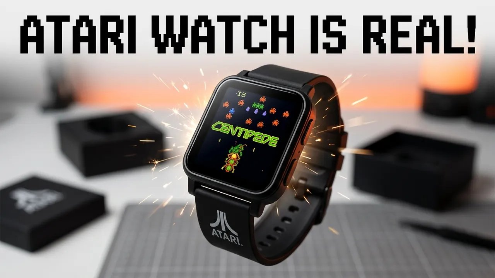

My Pixel Watch felt out of place at Vintage Computer Festival Midwest. Too modern for a room full of retro computers. So, at VCFMW 2025, the day before I wore it on the show floor, I unboxed something that would fit right in: the Atari 2600 My Play Watch. It tells time, counts steps, and plays Atari games on your wrist.



This post is the text companion to my video on retroCombs Tech (@retroCombs-tech). It covers what's in the box, setup, every menu I found, the four games, watch faces and charging. It's a first look, not a long-term review.

## TABLE OF CONTENTS {#table-of-contents}

- [TABLE OF CONTENTS](#table-of-contents)
- [LINKS](#links)
- [SUPPORT THE BLOG AND CHANNEL](#support-the-blog-and-channel)
- [COMPANION YOUTUBE VIDEO](#companion-youtube-video)
- [VIDEO ERRATA](#video-errata)
- [WHAT'S IN THE BOX](#whats-in-the-box)
- [FIRST-TIME SETUP](#setup)
- [THE MENUS AND SETTINGS](#settings)
- [THE FOUR GAMES](#games)
- [WATCH FACES AND THE SIDE BUTTON](#watch-faces)
- [CHARGING](#charging)
- [WHO IS IT FOR?](#who-is-it-for)
- [CONCLUSION](#conclusion)

---

## LINKS {#links}

- ⌚ Atari 2600 My Play Watch: see the [video description](https://www.youtube.com/watch?v=ufOwjiEqFTM) for current buying links
- 🕹️ My Atari Edition Super Pocket first look: [Atari Edition Super Pocket](/atari-super-pocket-evercade)
- ⚫ Atari 2600+ Console: <https://amzn.to/43KNriS>
- 🚗 My earlier VCFMW trip: [VCFMW 2022](/vcfmw-2022)

*Disclosure Statement: When you click on links to various merchants on this site and make a purchase, this can result in this site earning a commission. Affiliate programs and affiliations include, but are not limited to Amazon and the eBay Partner Network.*

## SUPPORT THE BLOG AND CHANNEL {#support-the-blog-and-channel}

Check out the [supporters page](/supporters) to learn about my supporters and how you can join our community. If this post saved you some time, you can also [leave a tip](https://paypal.me/stevencombs). And if you like gadgets, subscribe to [@retroCombs-tech](https://www.youtube.com/@retroCombs-tech). Hooked on tech since '73.

## COMPANION YOUTUBE VIDEO {#companion-youtube-video}

Title: _⌚️ The Atari MyPlay Watch Puts Retro Gaming on your Wrist!_





## VIDEO ERRATA {#video-errata}

As of 2026-12-06:

- **The name.** In the video I call it the "Atari Retro Play Watch." The name on the video title and description is the Atari 2600 My Play Watch.
- **Three games or four?** In the settings menu I say "those are the three games." There are four: Missile Command, Pong, Centipede and Super Breakout.
- **Price.** I don't give a price in the video. Check the link for today's price.

## WHAT'S IN THE BOX {#whats-in-the-box}

The back of the box lists retro time, workout time, play time, a custom crown and button, classic sound, and extra watch bands. Inside:

- The watch, wearing a wood-grain band styled like an Atari 2600, with "Atari 2600" on it
- Two extra quick-release straps
- A magnetic charging cable
- A card that says "scan for user's guide." There's no printed manual

Flip the wood-grain strap over and the back is printed with Centipede. That's the band I wanted. The watch itself is big and a little bulky, with a crown that both presses and turns.

> **Tip:** The screen ships with a black protective film on it. Peel it off before you power the watch on, or you'll wonder why the display looks so dark.
{: .tip}

## FIRST-TIME SETUP {#setup}

Power on and the watch boots straight to an Atari screen. Setup is old school, like setting a watch: you enter the date, then the time, by hand. Then it asks for a daily step goal. I chose 10,000, which I figured I'd beat walking the VCFMW floor.

## THE MENUS AND SETTINGS {#settings}

Press the button to open the actions menu:

- Clock, alarm, timer, stopwatch, calendar and calculator
- Settings

In Settings I found:

- **Game options:** pick a game, and adjust control sensitivity
- **Battery:** mine showed 62% out of the box
- **Date and time**
- **Power:** restart or power down
- **Fitness:** the step goal from setup
- **Brightness:** turn it down to save battery
- **Volume:** the crown wheel adjusts it
- **Vibration alerts**
- **Wake:** raise to wake, so the screen turns on when you lift your wrist
- **User's manual**
- **About:** my watch ran version 1.03. I don't know yet whether the firmware can be updated.

You can't swipe back. Use the back button to go up a level.

From the main screen, scroll through heart rate, steps, calories, and each game's high score.

## THE FOUR GAMES {#games}

Each game uses a different control scheme:

- **Missile Command:** tap the screen to fire. This one works well on a watch.
- **Pong:** turn the crown to move your paddle. It's hard at first.
- **Centipede:** your shooter fires on its own, and you use the controls to move it up, down and around.
- **Super Breakout:** the crown again, and again it takes practice.

The crown-controlled games need work, or at least practice. The control sensitivity setting in Game options is the first thing I'd adjust.

## WATCH FACES AND THE SIDE BUTTON {#watch-faces}

Swipe down (or up) on the clock to change watch faces: a joystick, Centipede, Missile Command and Super Breakout. One of them has a cool retro vibe, and that's the face I planned to wear at VCFMW.

The side button is a shortcut. One press shows the time. A second press jumps to the games.

## CHARGING {#charging}

The charger is a magnetic pogo-pin cable. The magnets only let it attach one way, so you can't connect it backward. Plug it in and charge it overnight before a show day.

## WHO IS IT FOR? {#who-is-it-for}

It isn't as full-featured as a modern smartwatch, and it isn't trying to be. If you're heading to a retro show, a meetup or anywhere Atari fans gather, it's a conversation starter, and it tells time, counts steps and plays four Atari classics.

## CONCLUSION {#conclusion}

The Atari 2600 My Play Watch looks the part, from the wood-grain band to the Centipede strap. Setup is simple, Missile Command plays well with taps, and the crown games need some practice.

Which Atari game would you want on your wrist? Let me know in the comments below. If this post helped, [leave a tip](https://paypal.me/stevencombs).

That's it for me, retroCombs, out.
