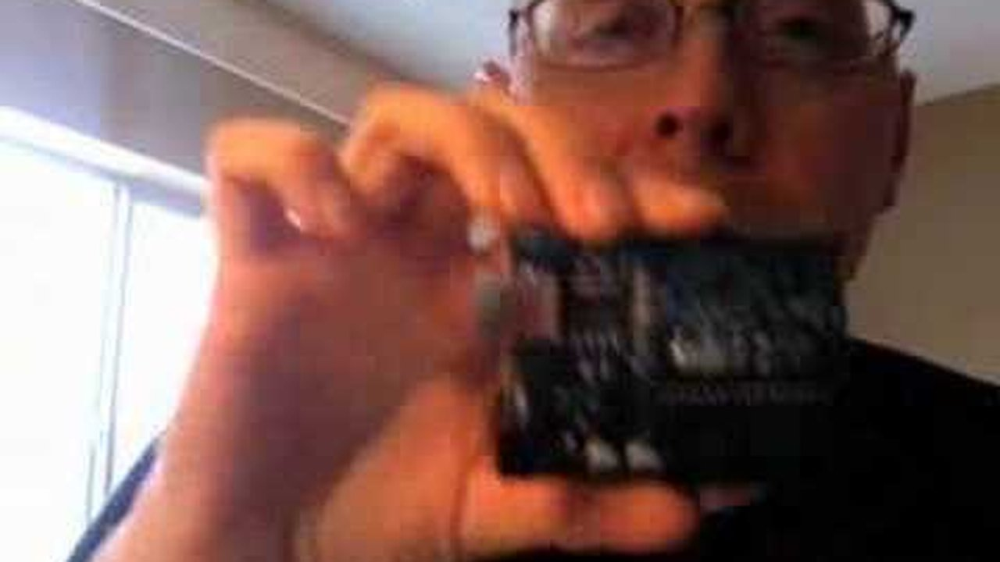
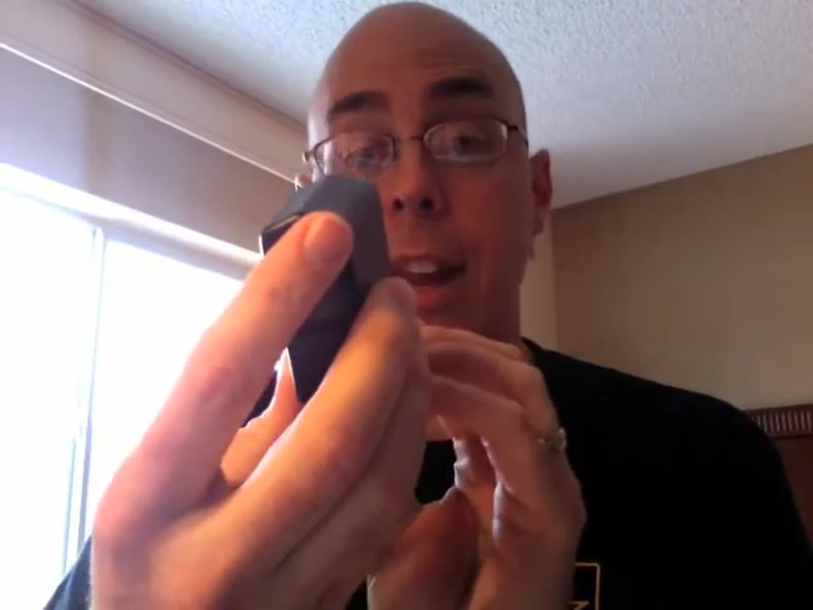
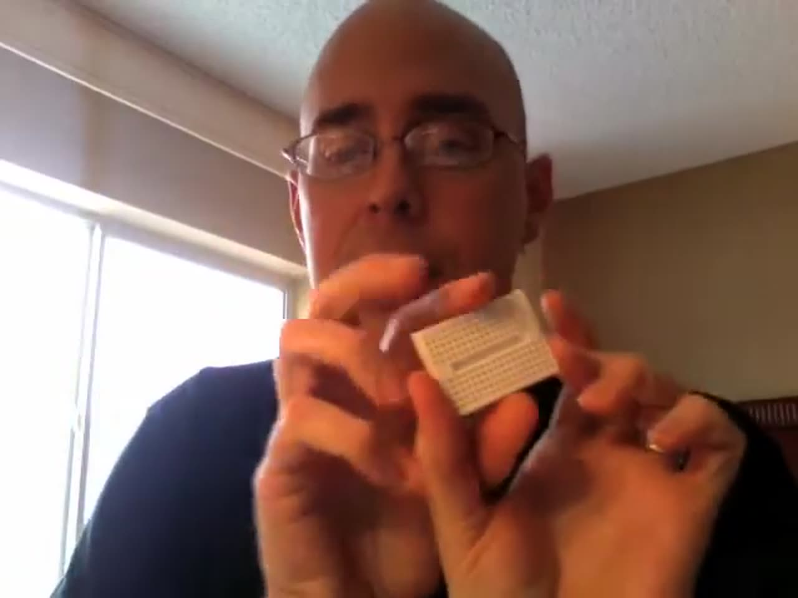

Before the Blink sketch, there was a little white box. In March 2008 I opened the Arduino Starter Pack from Adafruit Industries on camera. That video led straight to my [Hello Arduino](/hello-arduino-blink) how-to about a week later. Eighteen years on, it's a fun look at where a lot of us started with microcontrollers.



This post is the text companion to that unboxing. It covers what Arduino is, everything in the box, and what the same Adafruit kit includes today.

## TABLE OF CONTENTS {#table-of-contents}

- [TABLE OF CONTENTS](#table-of-contents)
- [LINKS](#links)
- [SUPPORT THE BLOG AND CHANNEL](#support-the-blog-and-channel)
- [COMPANION YOUTUBE VIDEO](#companion-youtube-video)
- [VIDEO ERRATA](#video-errata)
- [WHAT IS AN ARDUINO?](#what-is-arduino)
- [WHY ADAFRUIT'S STARTER PACK?](#why-adafruit)
- [WHAT'S IN THE BOX](#whats-in-the-box)
- [THE STARTER PACK PARTS LIST](#parts-list)
- [THE SAME KIT TODAY](#today)
- [WHAT'S NEXT](#whats-next)
- [CONCLUSION](#conclusion)

---

## LINKS {#links}

- 💾 Arduino: <https://www.arduino.cc>
- 🛒 Adafruit Metro 328 Starter Pack (Adafruit product #68): <https://www.adafruit.com/product/68>
- 📚 Adafruit Learning System: <https://learn.adafruit.com>
- 📝 The follow-up how-to: [Hello Arduino! Your First Blink Sketch, Then and Now](/hello-arduino-blink)
- 📝 My later Arduino Hello World post (Elegoo kit): [BUILD & CODE: Arduino Hello World!](/arduino-hello-world)

*Disclosure Statement: When you click on links to various merchants on this site and make a purchase, this can result in this site earning a commission. Affiliate programs and affiliations include, but are not limited to Amazon and the eBay Partner Network.*

## SUPPORT THE BLOG AND CHANNEL {#support-the-blog-and-channel}

Check out the [supporters page](/supporters) to learn about my supporters and how you can join our community. If this post saved you some time, you can also [leave a tip](https://paypal.me/stevencombs). And if you like gadgets, subscribe to [@retroCombs-tech](https://www.youtube.com/@retroCombs-tech). Hooked on tech since '73.

## COMPANION YOUTUBE VIDEO {#companion-youtube-video}

Title: _OPEN THE BOX: Arduino Starter Pack_





## VIDEO ERRATA {#video-errata}

As of 2026-12-07:

- **The board's name.** I wasn't sure how to say it in the video. The board is the Arduino Diecimila.
- **Old links.** The video description and the tutorial address on screen (ladyada.net) are from 2008. Adafruit's tutorials now live in the [Adafruit Learning System](https://learn.adafruit.com).
- **Price.** The $65 price is from 2008. See [THE SAME KIT TODAY](#today) below.
- **Not a first unboxing.** As I admit in the video, I'd already had the board out of its bag once before I hit record.

## WHAT IS AN ARDUINO? {#what-is-arduino}

In 2008, the Arduino website described it as "an open-source electronics prototyping platform based on flexible, easy-to-use hardware and software," intended for artists, designers, hobbyists and anyone interested in creating interactive objects or environments.

In plain terms: a small board with a set of inputs, a set of outputs, and a microcontroller in the middle to control them. You write a program on your computer in a language based on C, send it to the board, and then unplug it. The Arduino keeps running your program on its own power, wherever you put it. That's the part that got me excited.

## WHY ADAFRUIT'S STARTER PACK? {#why-adafruit}

I bought mine from Adafruit Industries because their Arduino Starter Pack included more than the board. For $65 plus shipping in 2008, it had everything you needed to start learning electronics and microcontrollers.

## WHAT'S IN THE BOX {#whats-in-the-box}

- **The Arduino Diecimila**, in a green anti-static bag. It has a USB port for programming and power, and a barrel jack for external power.
- **A 9-volt wall adapter**, for running the board away from your computer

    

- **A tiny breadboard**, about quarter size, designed to sit on top of the board

    
- **A USB cable**, about 3 feet. I used a MacBook Pro, and the Arduino software also runs on Linux and Windows.
- **A 9-volt battery adapter**, so the board can run where there's no outlet. Picture an Arduino riding on a LEGO robot around the house.
- **A bag of electronic components**, listed below
- **A Proto Shield**, which ships unassembled

> **Tip:** You can program the board over USB, then unplug it and power it from the wall adapter or a 9V battery. It doesn't need to stay tethered to your computer.
{: .tip}

## THE STARTER PACK PARTS LIST {#parts-list}

From the Adafruit product page, as I read it in the video:

- 10K potentiometer
- 1K potentiometer
- Two small push buttons
- Five red diffused bright LEDs
- One RGB (red, green, blue) ultra-bright LED
- Five 100-ohm resistors
- Five 1K resistors
- Five 10K resistors
- A CdS photocell

Plus the Proto Shield, an Adafruit design for prototyping on top of an Arduino. The micro switches are my favorite: press one and you can hear the tiny click.

## THE SAME KIT TODAY {#today}

When I checked Adafruit's site in November 2026, product #68, the same listing as my 2008 starter pack, is now the [Adafruit Metro 328 Starter Pack](https://www.adafruit.com/product/68), listed at $44.95 and out of stock. The tutorial parts are the same list as 2008. The big changes:

- **The board.** The Adafruit Metro 328, an Arduino Uno R3-compatible board, replaces the Diecimila.
- **The cable.** Micro USB instead of the larger USB cable.
- **Power.** A regulated 9V wall adapter that works on US 110V and European 220V, and a 9V battery case with an on/off switch and a 2.1mm plug.
- **Wires.** 65 flexible breadboard wires in eight colors.

## WHAT'S NEXT {#whats-next}

At the end of the video I promised to hook the Arduino up to the computer and run the electronics version of "Hello World." That's the next video, and its companion post is [Hello Arduino! Your First Blink Sketch, Then and Now](/hello-arduino-blink).

## CONCLUSION {#conclusion}

In 2008 the Adafruit Arduino Starter Pack gave me a board, power options, a breadboard and a bag of parts, and it started a hobby that led to the posts and projects that followed.

What was your first microcontroller board, and do you still have it? Let me know in the comments below. If this post helped, [leave a tip](https://paypal.me/stevencombs).

That's it for me, retroCombs, out.
