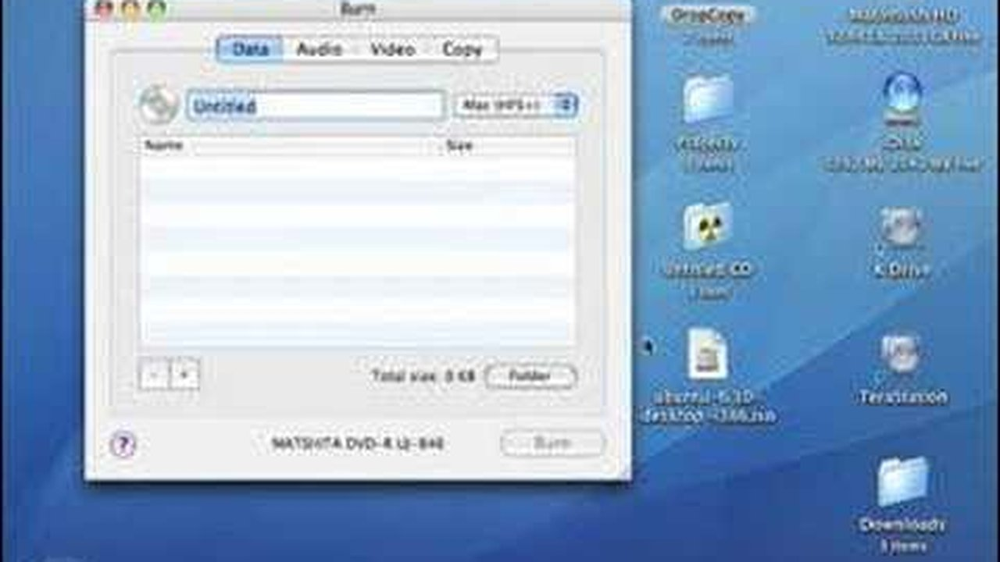
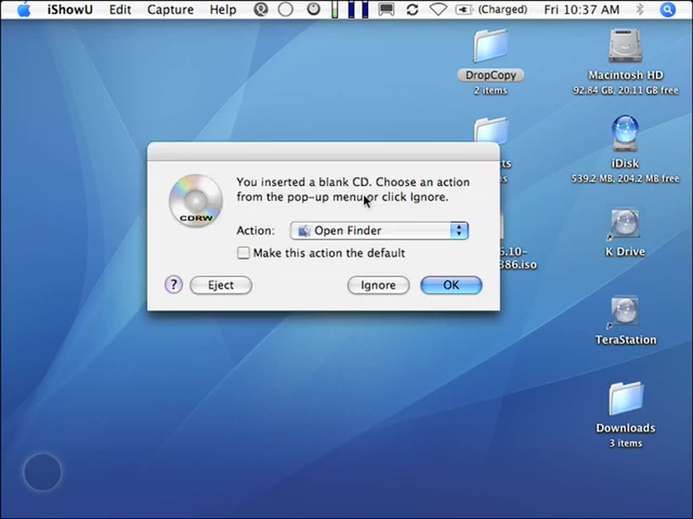
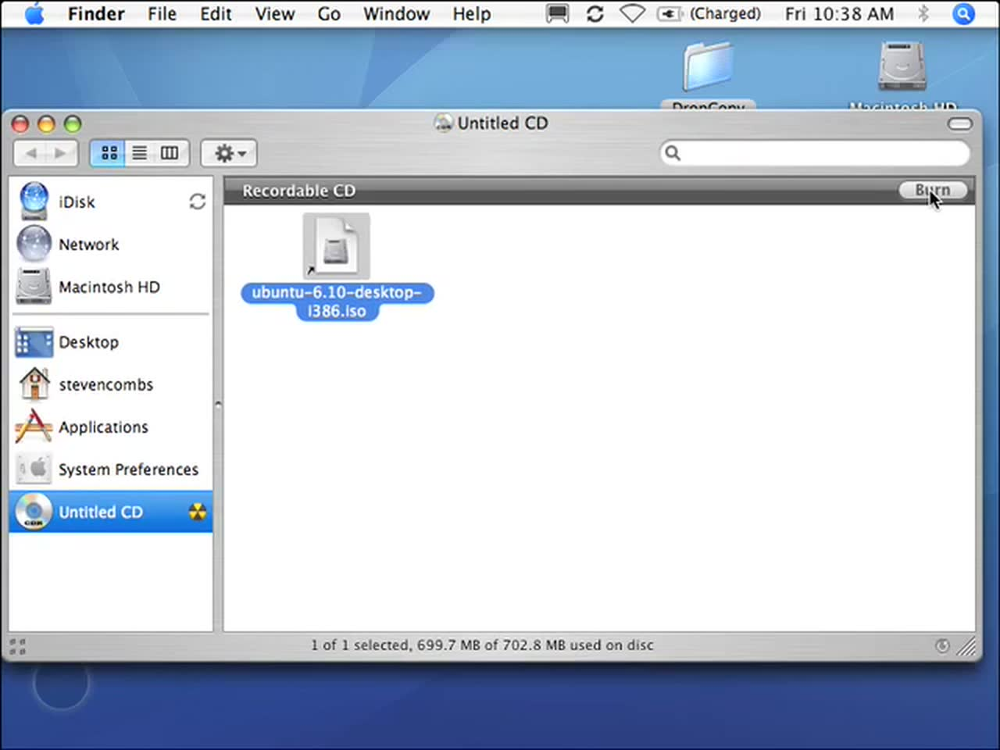
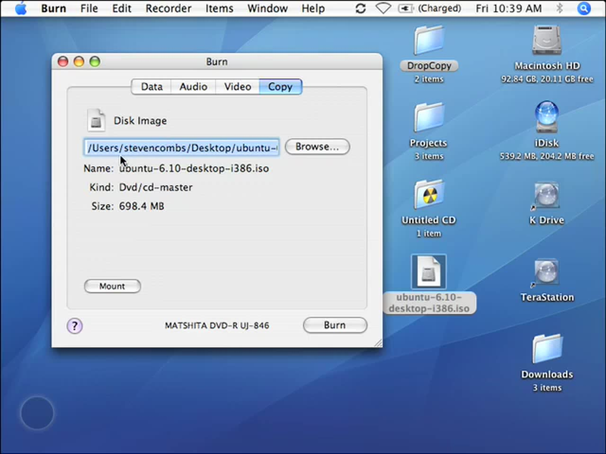
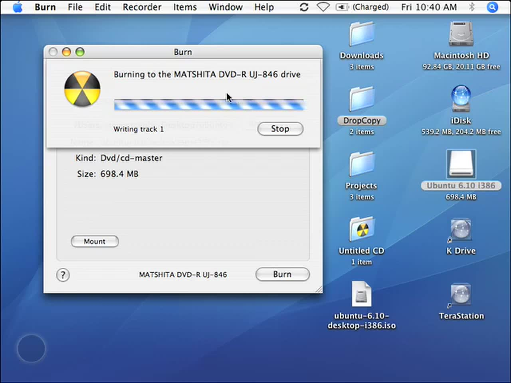

People asked me this all the time in 2007: "I burned my .iso file to a CD, and it won't boot. What happened?" Almost every time, they'd made the same mistake. They dragged the .iso file onto a blank disc and clicked Burn. This screencast shows the right way, using the free Burn app on a Mac. It's still one of my most-watched videos, so this post adds the modern macOS way too.



## TABLE OF CONTENTS {#table-of-contents}

- [TABLE OF CONTENTS](#table-of-contents)
- [LINKS](#links)
- [SUPPORT THE BLOG AND CHANNEL](#support-the-blog-and-channel)
- [COMPANION YOUTUBE VIDEO](#companion-youtube-video)
- [VIDEO ERRATA](#video-errata)
- [THE WRONG WAY](#wrong-way)
- [THE RIGHT WAY WITH BURN](#burn-app)
- [ON MODERN MACOS: FINDER](#finder)
- [ON MODERN MACOS: TERMINAL](#terminal)
- [CONCLUSION](#conclusion)

---

## LINKS {#links}

- 🔥 Burn (free, open source) on SourceForge: <https://sourceforge.net/projects/burn-osx/>
- 🍎 Apple Support, Store information on CD and DVD discs on Mac: <https://support.apple.com/guide/mac-help/burn-cds-and-dvds-mchl8addfd95/mac>
- 🐧 Ubuntu tutorial, How to burn a DVD on macOS: <https://ubuntu.com/tutorials/burn-a-dvd-on-macos>
- 📰 OS X Daily, How to Burn Disc Images in Mac OS Without Disk Utility: <https://osxdaily.com/2015/11/22/burn-disc-images-os-x-finder/>

*Disclosure Statement: When you click on links to various merchants on this site and make a purchase, this can result in this site earning a commission. Affiliate programs and affiliations include, but are not limited to Amazon and the eBay Partner Network.*

## SUPPORT THE BLOG AND CHANNEL {#support-the-blog-and-channel}

Check out the [supporters page](/supporters) to learn about my supporters and how you can join our community. If this post saved you some time, you can also [leave a tip](https://paypal.me/stevencombs).

## COMPANION YOUTUBE VIDEO {#companion-youtube-video}

Title: _How To: Burn an .iso Image on a Mac Using Burn App_





## VIDEO ERRATA {#video-errata}

As of 2026-12-08:

- **"Compressed."** I say an .iso is an exact duplicate of a CD "compressed and put into a single file." It is an exact copy of the disc in a single file, but it isn't compressed. The point stands: Burn has to write it back out as a disc, not as a file on a disc.
- **Finding Burn.** I say to search Google for "Burn" and "OS X." Burn is on SourceForge (link above). When I checked in November 2026, the project page showed a last update of October 26, 2026.
- **Quicksilver.** I launch Burn with Quicksilver, a launcher. On a current Mac, Spotlight (Command-Space) does the same job.
- **The old blog link.** The video description points to my old stevencombs.com site. This post replaces it.
- **Modern Macs.** Current Macs don't have built-in optical drives. Apple's instructions assume an external writable optical drive.

## THE WRONG WAY {#wrong-way}

Here's what I saw people do:

1. Insert a blank CD-R. Finder asks what to do with it. Click OK.

    

2. Open the blank disc in Finder and drag the .iso file onto it.
3. Click Burn.

    

That gives you a disc with one file on it, the .iso. It won't boot, and it isn't the disc the .iso describes. The .iso is an exact image of a whole disc, so it needs software that writes the image back out as a disc, with every file in its proper place.

## THE RIGHT WAY WITH BURN {#burn-app}

1. Open Burn.
2. Don't drag the .iso into the **Data** area. That's the same mistake again.
3. Click the **Copy** tab. It asks for a disk image.
4. Browse to your .iso (mine was on the desktop) and click **Open**. Burn shows the image type and size.

    

5. Optional: click **Mount** to see what's inside. You'll see the files laid out the way they'll appear on the finished disc.
6. Click **Burn**, insert the blank disc when asked, and click **Burn** again.

    
7. When it finishes, eject the disc.

In the video, that disc was an Ubuntu installer for a Windows machine.

> **Tip:** Not sure what's inside an .iso? Mount it first. If you see the files you expect, you're burning the right image.
{: .tip}

## ON MODERN MACOS: FINDER {#finder}

Disk Utility lost its burn feature years ago. OS X Daily notes it's gone in OS X El Capitan and later. Finder still burns disc images:

1. Connect an external writable optical drive.
2. In Finder, select the .iso file.
3. Choose **File > Burn Disk Image "name" to Disc…** You can also Control-click (right-click) the file.
4. Insert a blank CD or DVD and click **Burn**.

The [Ubuntu tutorial](https://ubuntu.com/tutorials/burn-a-dvd-on-macos) uses the same right-click "Burn Disk Image" option to make an Ubuntu install DVD.

## ON MODERN MACOS: TERMINAL {#terminal}

If Finder's option doesn't work for an image, the command line still does. In Terminal:

```bash
hdiutil burn ~/Desktop/your-image.iso
```

Insert a blank disc when it asks. Replace the path with your file's location. Users in [Apple's support community](https://discussions.apple.com/thread/250786206) report `hdiutil burn` making bootable discs when Finder's burn option failed on macOS Catalina.

## CONCLUSION {#conclusion}

The rule from 2007 still holds: don't copy the .iso onto the disc, burn the image. Burn's Copy tab does it, Finder's Burn Disk Image does it, and so does `hdiutil burn`.

Do you still burn CDs or DVDs, and what for? Let me know in the comments below. If this post helped, [leave a tip](https://paypal.me/stevencombs).

That's it for me, folks. 🕹️ retroCombs, OUT!
