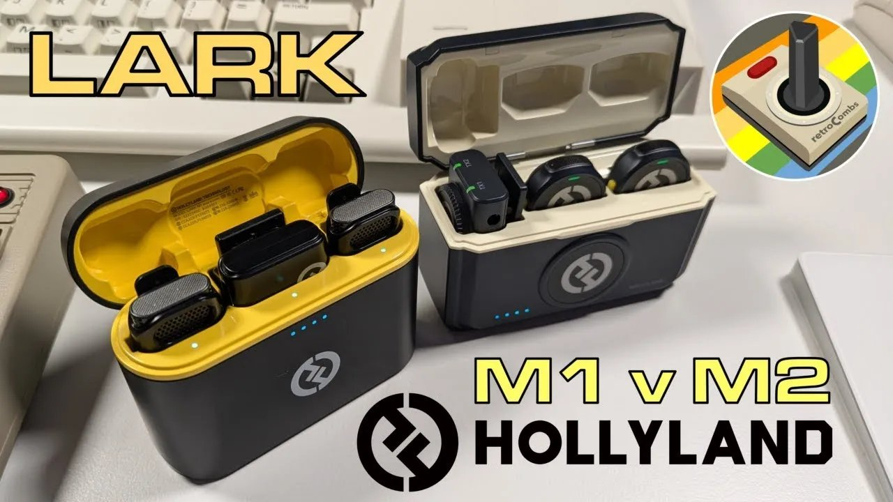
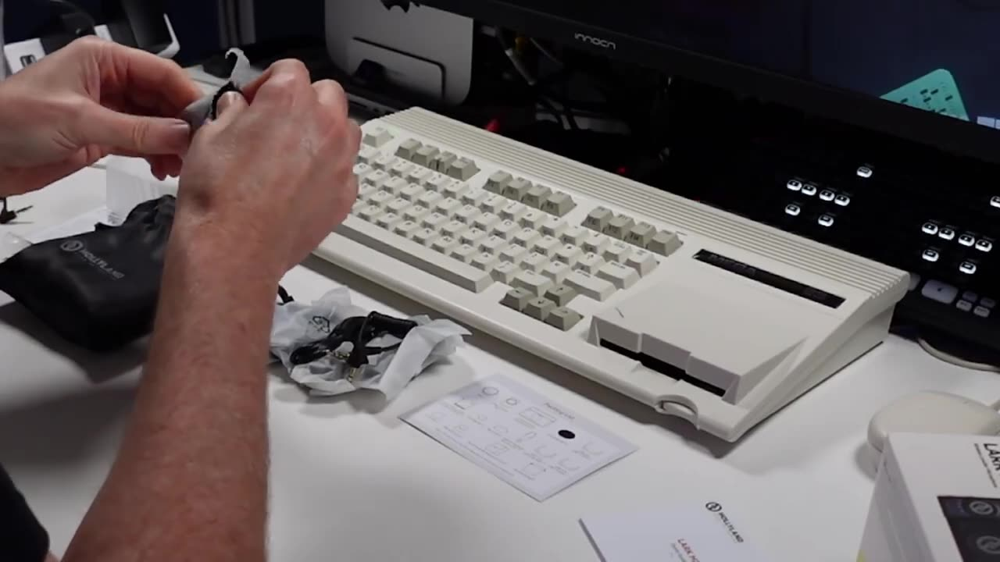
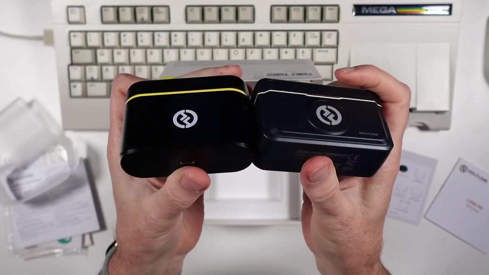
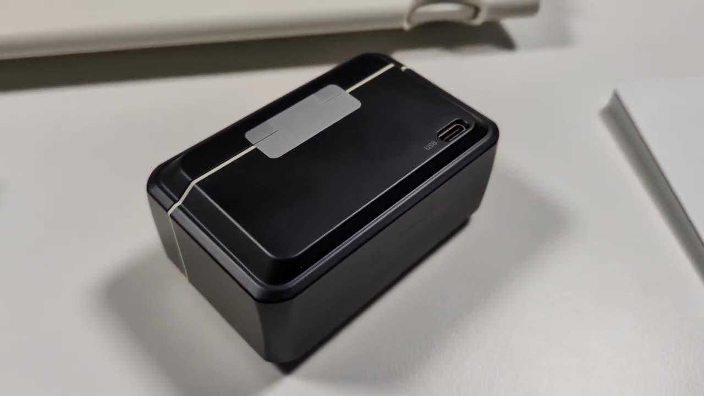
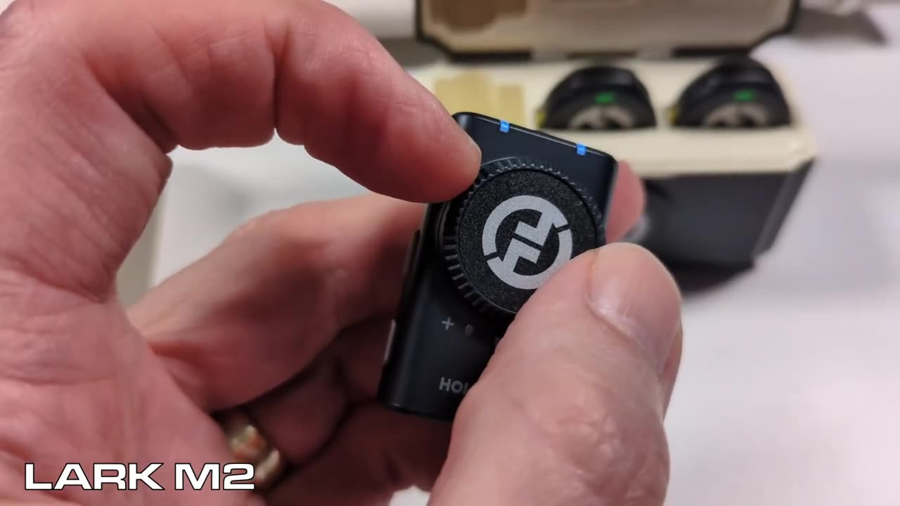

I've only used my Hollyland Lark M1 wireless mics now and then. They're handy, but the sound never matched what I expected, so my on-camera RØDE VideoMic GO II stayed my main mic. Then Hollyland released the Lark M2. Did I make another mistake counting on Hollyland for wireless lavalier mics? I unboxed the M2 and ran all three mics through the same setup to find out.



This post is the text companion to my video on retroCombs Tech (@retroCombs-tech): what's in the M2 box, what changed from the M1, and how the three mics compared in my basement studio.

## TABLE OF CONTENTS {#table-of-contents}

- [TABLE OF CONTENTS](#table-of-contents)
- [LINKS](#links)
- [SUPPORT THE BLOG AND CHANNEL](#support-the-blog-and-channel)
- [COMPANION YOUTUBE VIDEO](#companion-youtube-video)
- [VIDEO ERRATA](#video-errata)
- [WHY I WANTED WIRELESS MICS](#why)
- [WHAT'S IN THE LARK M2 BOX](#whats-in-the-box)
- [M2 VS. M1: WHAT CHANGED](#what-changed)
- [SETUP](#setup)
- [THE SOUND TEST](#sound-test)
- [NOISE REDUCTION AND DISTANCE](#noise-reduction)
- [BATTERY AND PRICE](#battery-and-price)
- [CONCLUSION](#conclusion)

---

## LINKS {#links}

- 🎙️ Hollyland Lark M2 and Lark M1: see the [video description](https://www.youtube.com/watch?v=xzQ7SMkVBhQ) for current buying links
- 🎤 RØDE VideoMic GO II: see the [video description](https://www.youtube.com/watch?v=xzQ7SMkVBhQ) for current buying links
- 🔴 Blackmagic Design ATEM Mini Extreme ISO: <https://amzn.to/4ypHQuP>

*Disclosure Statement: When you click on links to various merchants on this site and make a purchase, this can result in this site earning a commission. Affiliate programs and affiliations include, but are not limited to Amazon and the eBay Partner Network.*

## SUPPORT THE BLOG AND CHANNEL {#support-the-blog-and-channel}

Check out the [supporters page](/supporters) to learn about my supporters and how you can join our community. If this post saved you some time, you can also [leave a tip](https://paypal.me/stevencombs). And if you like gadgets, subscribe to [@retroCombs-tech](https://www.youtube.com/@retroCombs-tech). Hooked on tech since '73.

## COMPANION YOUTUBE VIDEO {#companion-youtube-video}

Title: _👩🏻‍🎤I Tested the NEW Lark M2 Against My M1 – Here's What Changed_





## VIDEO ERRATA {#video-errata}

As of 2026-12-09:

- **Mic names.** A few times I say "Hollyland Mark M1" or "Mark M2." They're the Lark M1 and Lark M2. I also stumble over the RØDE's name. It's the RØDE VideoMic GO II.
- **Transmitter vs. receiver.** I call the unit that plugs into the ATEM the "transmitter." That's the receiver. The two clip-on mics are the transmitters.
- **"A10 Mini."** That's the Blackmagic Design ATEM Mini Extreme ISO.
- **Prime Day.** I mention Amazon Prime Day "on the 16th and 17th of July." That was Prime Day 2024, when I recorded this.
- **Battery life.** I say "I believe" the M2 gets up to 8 hours on a charge. I didn't test battery life in the video, so check Hollyland's current specs.

## WHY I WANTED WIRELESS MICS {#why}

My RØDE VideoMic GO II sits in one spot. When I step back from the desk into the studio, my audio gets quieter and muffled. During livestreams I sometimes move around and talk to people, and I'm pretty sure viewers can't hear me. A clip-on mic goes where I go.

The Lark M1 also helps when I have a guest in the studio: its receiver plugs into my [ATEM Mini Extreme ISO](https://amzn.to/4ypHQuP) and gives me two mics on one input. And I'd grab the M1 when I recorded away from the studio, instead of dismounting the RØDE.

## WHAT'S IN THE LARK M2 BOX {#whats-in-the-box}

- A "We are here for you" support card
- Stickers for the mics. They look removable and reusable, and there are plain white and black ones if you'd rather cover the Hollyland logo.
- A quick start guide, a compliance card and a packing list
- The charging case, with the receiver and two mics inside
- A carrying pouch for the case
- Two windscreens. Most people call them dead cats. I call them tribbles.

    
- A connector cable that looks identical to the M1's
- A USB to USB-C cable for charging
- Magnetic clips, for clipping a mic to a shirt or pocket
- A USB-C to USB-C cable
- A USB to Lightning cable, for using the mics with an iPhone
- Two magnetic lanyards, one per mic

The lanyards are a welcome addition. With the M1, I'd been wearing a mic on a lanyard of my own.

## M2 VS. M1: WHAT CHANGED {#what-changed}

- **The case.** I love the case design on both. The M2's is a little thicker.

    
- **The charging port.** The M2 case has its USB-C port on the back, so it charges sitting upright. The M1's port is on the bottom, so you charge it lying on its side.

    
- **Out of the box.** The M2 case arrived fully charged. The mics and receiver were not.
- **Magnets.** The M2 mics attach to a shirt magnetically, and they drop into the case magnetically, so you can't seat them wrong.
- **Gain control.** The M2 receiver has a dial. The M1 uses click buttons. I like the dial.

    
- **Size.** The M2 mics are tiny. Clipped on with the light pointing up, it's inconspicuous, and with a black sticker you'd hardly notice it.

## SETUP {#setup}

Peel the protective film off the receiver and mics, and off their charging contacts. Pulling a unit out of the case turns it on. While they charge, the lights glow orange.

> **Tip:** The M2 mics and receiver arrived without a charge, even though the case was full. Drop them in the case and let them charge before your first recording.
{: .tip}

## THE SOUND TEST {#sound-test}

I recorded all three mics through the ATEM Mini Extreme ISO with no EQ, everything flat. I could raise the bass or tweak them, but I wanted a raw comparison. Listen in the video and judge for yourself:

- **Lark M1**, clipped where I usually wear it
- **RØDE VideoMic GO II**, in its usual on-camera spot
- **Lark M2**, clipped in the same spot as the M1

The M2's levels came in hot at first. I turned the dial down until it stopped peaking.

## NOISE REDUCTION AND DISTANCE {#noise-reduction}

The M2 has noise reduction you toggle on the unit. In my test the light turned green with it on and blue with it off. You can hear M2 with and without noise reduction in the video, and the M1 with it on and off.

Then the distance test. I walked away from the desk while talking, all the way to the back corner of my basement. On the RØDE, my voice drops off as soon as I step back. On the M2, I sounded the same as I did at the desk.

## BATTERY AND PRICE {#battery-and-price}

I didn't run a battery test. See the errata above. Prices on these mics drop regularly, so I suggest adding them to your cart and using a price-tracking tool, or waiting for a sale like Prime Day or Black Friday.

## CONCLUSION {#conclusion}

The Lark M2 fixed the things that bugged me about the M1: a gain dial, a case that charges upright, magnetic mounting, and lanyards in the box. It also held up when I walked across the basement. For the way I move around on livestreams, I planned to use the M2 on my next stream.

Which do you prefer, the M1, the RØDE or the M2? Let me know in the comments below. If this post helped, [leave a tip](https://paypal.me/stevencombs).

That's it for me, retroCombs, out.
