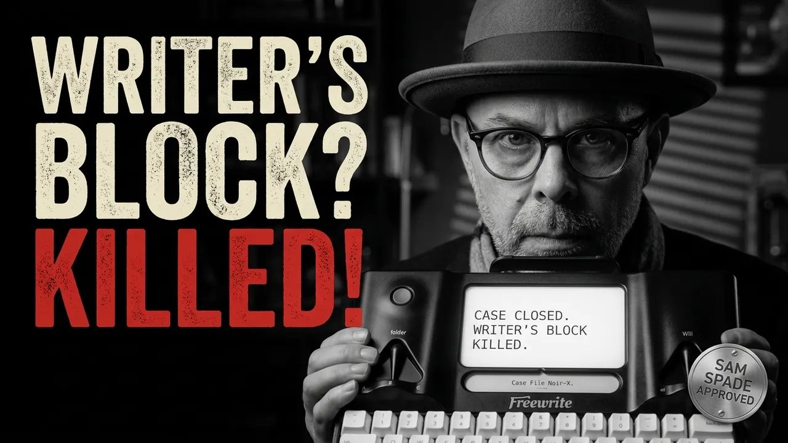
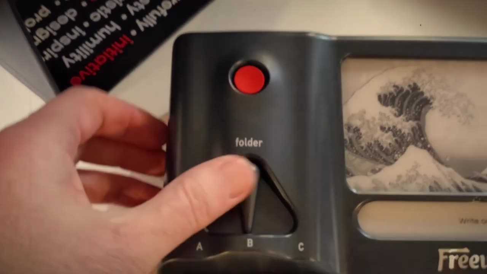
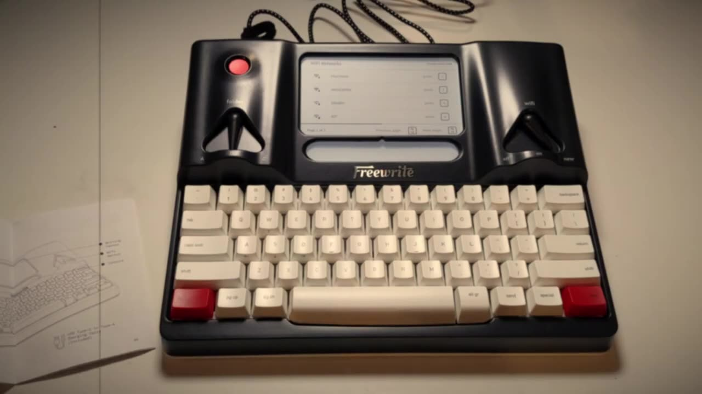
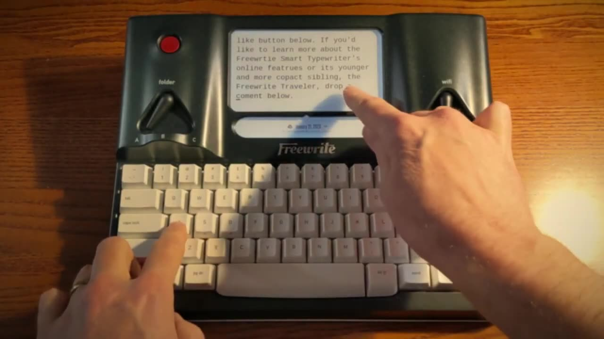
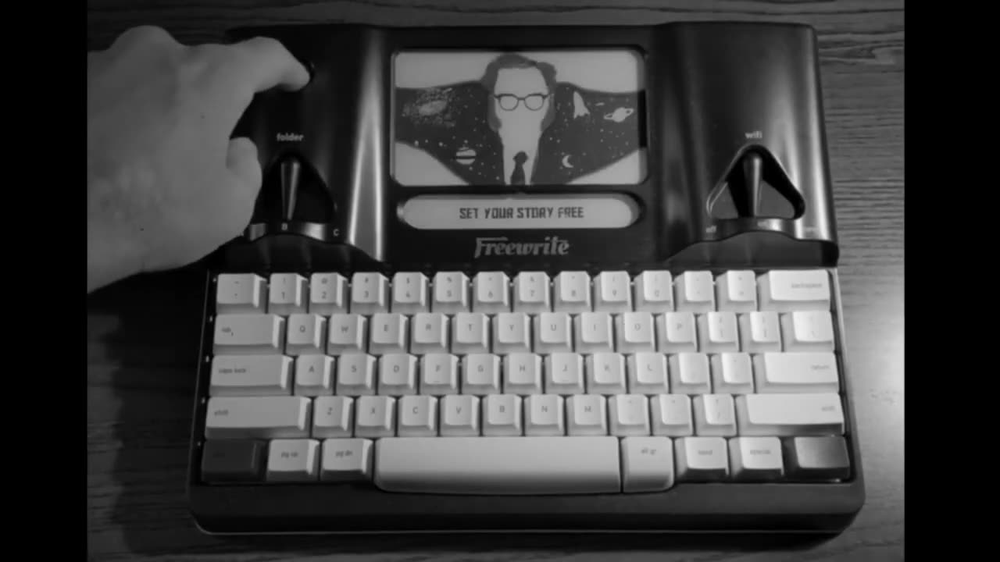

It was an early evening in December when a package arrived on my doorstep. Inside was a single-purpose machine with a promise printed right on the box: Freewrite. Could a device that only lets you write help me finish a novel I've been drafting since 2017? I put on the fedora, cued the saxophone, and shot the unboxing as a film noir. This post is the case file.



This post is the text companion to my film noir Freewrite video on retroCombs Tech (@retroCombs-tech). My shorter Freewrite overview is further down, as a second opinion.

## TABLE OF CONTENTS {#table-of-contents}

- [TABLE OF CONTENTS](#table-of-contents)
- [LINKS](#links)
- [SUPPORT THE BLOG AND CHANNEL](#support-the-blog-and-channel)
- [COMPANION YOUTUBE VIDEO](#companion-youtube-video)
- [VIDEO ERRATA](#video-errata)
- [THE BOX ARRIVES](#the-box)
- [WHAT'S IN THE BOX](#whats-in-the-box)
- [THE HARDWARE](#hardware)
- [TYPING ON E INK](#typing)
- [FOLDERS AND WI-FI](#folders-and-wifi)
- [MOVING THE CURSOR: NEW PLUS WASD](#cursor-keys)
- [THE SPECIAL KEY AND THE SECOND DISPLAY](#special-key)
- [STANDBY AND THE OPTIONS MENU](#options-menu)
- [THE SHORT VERSION](#short-version)
- [CONCLUSION](#conclusion)

---

## LINKS {#links}

- ⌨️ Freewrite Smart Typewriter and Freewrite Traveler: see the [video description](https://www.youtube.com/watch?v=qL1oePwlfC0) for current buying links
- 🏭 About the Freewrite, from Astrohaus: <https://astrohaus.com/freewrite>

*Disclosure Statement: When you click on links to various merchants on this site and make a purchase, this can result in this site earning a commission. Affiliate programs and affiliations include, but are not limited to Amazon and the eBay Partner Network.*

## SUPPORT THE BLOG AND CHANNEL {#support-the-blog-and-channel}

Check out the [supporters page](/supporters) to learn about my supporters and how you can join our community. If this post saved you some time, you can also [leave a tip](https://paypal.me/stevencombs). And if you like gadgets, subscribe to [@retroCombs-tech](https://www.youtube.com/@retroCombs-tech). Hooked on tech since '73.

## COMPANION YOUTUBE VIDEO {#companion-youtube-video}

Title: _⌨️️ This Freewrite Typewriter Killed My Writer's Block!_





## VIDEO ERRATA {#video-errata}

As of 2026-12-10:

- **Supporting the channel.** At the end of the noir video I point to an old support page. To support the channel today, see the [supporters page](/supporters) or [leave a tip](https://paypal.me/stevencombs).
- **The film noir link in the short video.** The description of my shorter 2024 Freewrite video links to an earlier upload of the noir video that's now private. The noir video above is the current version.
- **NaNoWriMo 2024.** The short video pitches the Freewrite for NaNoWriMo 2024. That challenge has come and gone, but the pitch works for any writing goal.

## THE BOX ARRIVES {#the-box}

Even the strapping tape had words on it. Inside the shipping box sat another box with "Freewrite" front and center. Flip it over and the back reveals the secret: a smart typewriter with an E Ink screen and a mechanical keyboard that backs up your writing to the cloud. The sides show off its profile.

Then a second name: Astrohaus. I remembered it from a Kickstarter campaign in 2014. By the time I recorded, Astrohaus was selling the Freewrite in more than 50 countries and had released more than 115 million words into the cloud.

## WHAT'S IN THE BOX {#whats-in-the-box}

- **The Freewrite**, wrapped in a cloth cover and held in place by two black side supports
- **A black-and-white USB-C cable** with a strap, with "Freewrite" on each connector. There's no power brick, so bring your own.
- **A sticker** of the Freewrite
- **A small user's manual.** It's short, simple and covers everything you need.

## THE HARDWARE {#hardware}

- **Folder switch (upper left):** three positions, A, B and C. It makes a satisfying thunk.
- **Wi-Fi switch (upper right):** off, on and new.
- **E Ink display** between the switches, with good contrast and sharp text. It's easy on the eyes.
- **Mechanical keyboard** with brown switches, good travel and a great sound.
- **A carry handle** that pulls out of a recess in the back. It's firm and substantial.
- **A red power toggle.** It travels deep into the case with no click, an old-school feel that feels right.
- **An all-aluminum shell**: curved, hefty and mid-century in style.

It's a premium device for writers whose first draft stands between them and their publisher.

## TYPING ON E INK {#typing}

Typing felt like the electric typewriter of my youth, except the words land on E Ink instead of paper. The faster I typed, the more the display lagged behind my keystrokes, but the keys never jammed together like a typewriter's. The only thing missing was the bell at the end of each line.

The default font size discourages rereading earlier sentences, which keeps you drafting. The Freewrite supports Markdown, so you can format as you go without complicated key combinations.

When I plugged in the USB-C cable, the screen showed a charging indicator, but not how much charge.

> **Tip:** Hold the space bar to see the battery level and confirm your words have synced to the cloud.
{: .tip}

## FOLDERS AND WI-FI {#folders-and-wifi}

The manual explained the folder switch: the Freewrite holds three writing projects at once, and the switch moves between them. No file management required.

To join Wi-Fi, move the Wi-Fi switch to **new**, pick your network on the E Ink screen and enter the password. Then move it back to **on**. If you ever need to join a different network, switch to **new** again.

## MOVING THE CURSOR: NEW PLUS WASD {#cursor-keys}

The Freewrite is built for drafting, not editing. Backspace works fine on the current line, but there are no arrow keys. The manual reveals the trick, and the arrow markings on the front of the W, A, S and D keys give it away. They reminded me of a Commodore keyboard.

- **New + A or D:** move one word left or right
- **New + W or S:** move up or down one paragraph
- **New + Shift + A or D:** move one character left or right
- **New + Shift + W or S:** move up or down one line

It wasn't intuitive at first, but after a few uses it felt natural.

## THE SPECIAL KEY AND THE SECOND DISPLAY {#special-key}

The screen has a soft light, enough to write in the evening, though you still need a little room light to see the keys. In the dark I noticed a key labeled **Special**. Each tap cycles the small display under the main screen:

- Date and cloud sync status
- Reading time, word count and character count
- A retro clock with hands
- A date view
- A chronograph that times your writing session
- Blank

## STANDBY AND THE OPTIONS MENU {#options-menu}

A short press of the power button puts the Freewrite in standby and shows a portrait of a famous writer. I got Edgar Allan Poe, then Isaac Asimov.

Hold the power button for about two seconds for the options menu:

- Log out of your account
- Font size
- Screen brightness
- Firmware updates
- Shut down

Astrohaus also has web-based settings, such as connecting the Freewrite to Dropbox or Google Drive. That's a story for another day.

## THE SHORT VERSION {#short-version}

Before the noir video, I posted a shorter Freewrite overview in 2024. It's the five-minute version:

Title: _⌨️️ The Freewrite Typewriter: Why Writers Are Ditching Their Laptops_



What it adds, as stated in that video:

- Kailh Brown switches, an aluminum frame, and a weight just under 4 pounds
- Five lines of text on the screen at a time, depending on magnification
- Cloud backup to services like Google Drive, Dropbox and Evernote, and sending documents by email. Your writing stays on the device until you're back online.
- Battery life of up to four weeks, depending on use
- Postbox, Astrohaus's online tools, where you can add more keyboard languages

## CONCLUSION {#conclusion}

The Freewrite Smart Typewriter does one thing: it gets words out of your head with nothing in the way. The switches, the E Ink screen and the New-plus-WASD cursor keys take a little learning. It's pricey and it's a niche product, but if digital distractions keep beating your first draft, it's worth a look. The case is closed, for now.

Would you write your next draft on a Freewrite, or would you miss the typewriter bell too? Let me know in the comments below. If this post helped, [leave a tip](https://paypal.me/stevencombs).

That's it for me, retroCombs, out.
