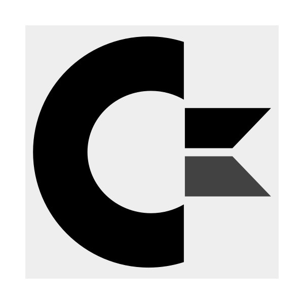

The Commodore VIC 20 was my first computer. I've always had a special place in my heart for this machine and upgraded across the Commodore line as the 80s and 90s progressed. Commodore computers are popular in the 21st century thanks to the retro computing community and this page collects my Commodore computer related posts.

## Commodore Accessories


## Commodore PET



## Commodore VIC-20



## Commodore 64


 DRAFT heading and line, needs Editor review (Wave 2). 
## Modern Commodore 64-Style Gear

New hardware built to look and feel like the Commodore 64.






## Commodore Plus/4



## Commodore 128


