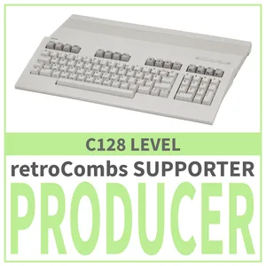
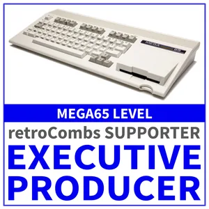
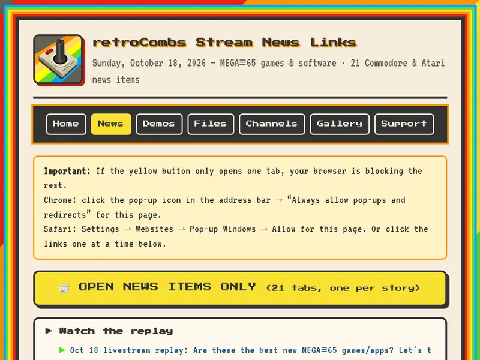
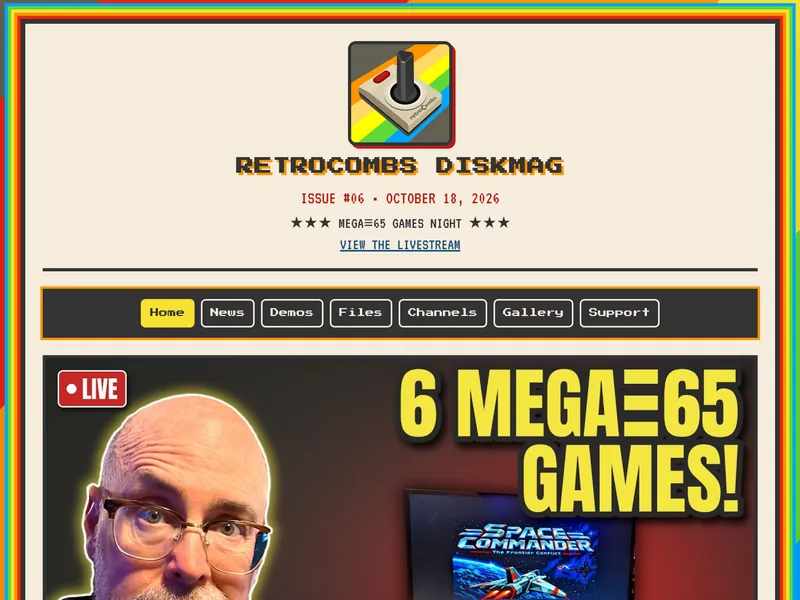
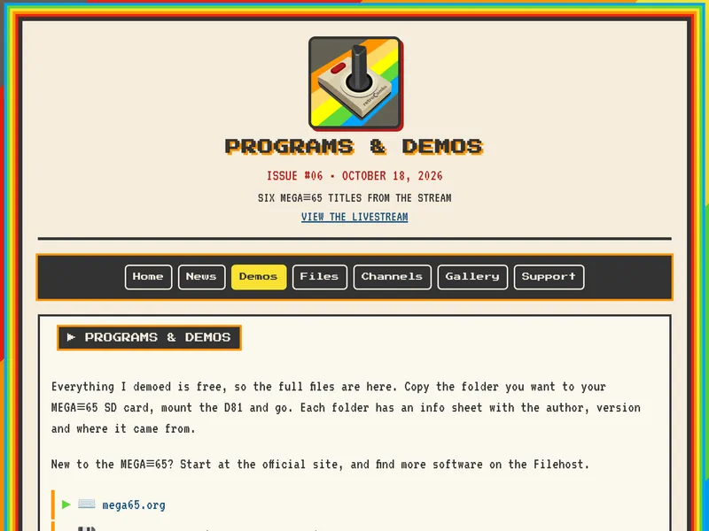
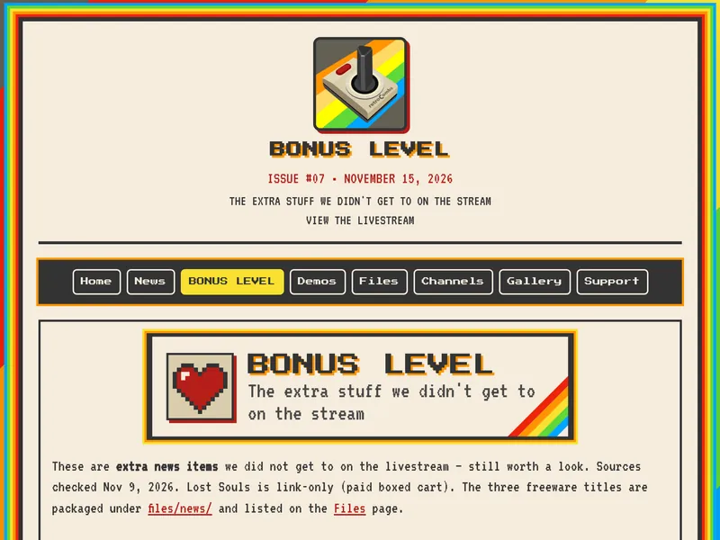

The **retroCombs Disk Mag** is a digital magazine I put out after each [@retroCombs](https://www.youtube.com/@retroCombs) livestream. It's the "take the stream home with you" package: the news, the demos, the files and a few extras, all in one download.

<a class="rc-join" href="https://www.youtube.com/@retrocombs/join">Join on YouTube to get the Disk Mag</a> <a class="diskmag-back" href="/supporters#membership-benefits">See every membership level</a>

## How often it comes out {#how-often}

The Disk Mag follows the livestream schedule, not a fixed calendar. I aim to have each issue out **48 to 72 hours after the stream**.

## What's inside {#whats-inside}

- News from the stream, with titles, short summaries and links
- Stream demos and load notes (MEGA≡65 and FPGA cores, programs, demos of commercial games and related files)
- A **Files** page that lists everything packaged in the issue
- Channel updates for [@retroCombs](https://www.youtube.com/@retroCombs) and [@retroCombs-tech](https://www.youtube.com/@retroCombs-tech)
- A photo gallery from the desk and the stream
- A **Support** page
- Starting with issue #07, a **BONUS LEVEL** section with extras that didn't make it onto the livestream
- A new-member shout-out for folks who joined around stream day

## The format and what you need {#format}

Each issue is an **HTML mini-site in a folder**. It arrives as one or more **zip files**. Large issues are split into parts so they fit Discord's upload limit. Unzip the folder, open **`_double click me_.html`** in any modern web browser, and you're in. No special app required.

- **To read the magazine:** a computer, a web browser and something that can unzip the download.
- **To run the programs, disks and cores inside:** an emulator (VICE, for example), real Commodore or related hardware, a **MEGA≡65**, or an FPGA board that can load the included cores. Each title's info sheet in the issue has the load notes.

## How to get the Disk Mag {#how-to-get-it}

The Disk Mag comes with **C128 (Bil Herd Approved!)** Producer memberships and up. Each issue is posted in the members-only **#💾️-disk-mag** channel on the retroCombs Discord as a forum thread with the zip parts attached.

  

    
    

      
<strong>C128 (Bil Herd Approved!)</strong> Producer

      
$14.99/month

      <ul>
        <li>retroCombs Disk Mag</li>
        <li>Producer Credit!</li>
        <li>Producer's Chat</li>
      </ul>
    

  

  

    
    

      
<strong>MEGA≡65 (FPGA)</strong> Executive Producer

      
$24.99/month

      
Everything in C128, plus:

      <ul>
        <li>Executive Producer Credit</li>
        <li>Holiday Greeting from Santa Combs!</li>
        <li>You Get a Wrench 🔧!</li>
      </ul>
    

  

<strong>Both levels also include the perks of every level before them:</strong>

<ul>
  <li><strong>Commodore PET (Mono)</strong>, $1.99/month: loyalty badges next to your name in comments and live chat, custom emoji to use in comments and live chat, and Live in the Shadows?</li>
  <li><strong>VIC-20 (Colors)</strong>, $2.99/month: Discord/retroCombian Membership!</li>
  <li><strong>Commodore 64 (Sprites)</strong>, $4.99/month: member shout-outs and Supporters Page Recognition!</li>
  <li><strong>Plus/4 (Business)</strong>, $7.99/month: priority reply to comments</li>
</ul>

Prices are set by YouTube and may vary by region.

<a class="rc-join" href="https://www.youtube.com/@retrocombs/join">Become a member on YouTube</a> <a class="diskmag-back" href="/supporters">Back to the supporters page</a>

## A smaller taste: the news-links file {#news-links}

  
  

    
Not ready for the full Disk Mag? Every stream also gets a one-page <strong>news-links</strong> file (<code>_open-news-links.html</code>). It lists every news item from the show, each with a title, a short two-line summary and a link to the source. It also has a "watch the replay" pointer, a note about what's new on @retroCombs when there is something, and the same new-member shout-out that appears in the Disk Mag.

    
The news-links file is <strong>included with VIC-20 (Colors) memberships and up</strong>. I post it in the <strong>#📹-livestreams</strong> channel on the retroCombs Discord, and Discord access starts at VIC-20.

  

## Sample pages {#samples}

Here are a few pages from recent issues. Click or tap any page to see it full size. The member names in these samples are made up to protect the privacy of the retroCombs crew.

  <figure class="diskmag-gallery-item"><figcaption>Issue #06 home page</figcaption></figure>
  <figure class="diskmag-gallery-item"><figcaption>Issue #06 programs and demos</figcaption></figure>
  <figure class="diskmag-gallery-item"><figcaption>Preview: the new BONUS LEVEL from the upcoming issue #07 (pre-release)</figcaption></figure>

Want the next issue? [Join on YouTube](https://www.youtube.com/@retrocombs/join) at the C128 (Bil Herd Approved!) level or higher, or see all the levels on the [supporters page](/supporters).
