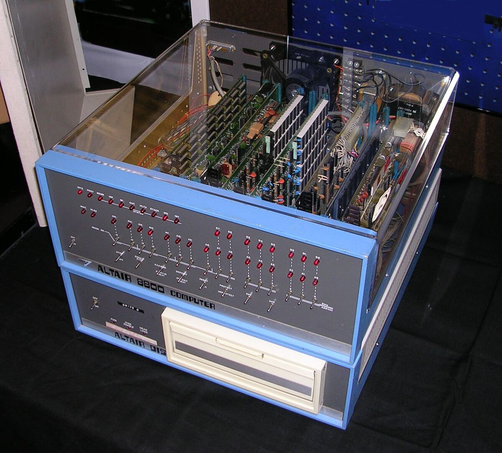
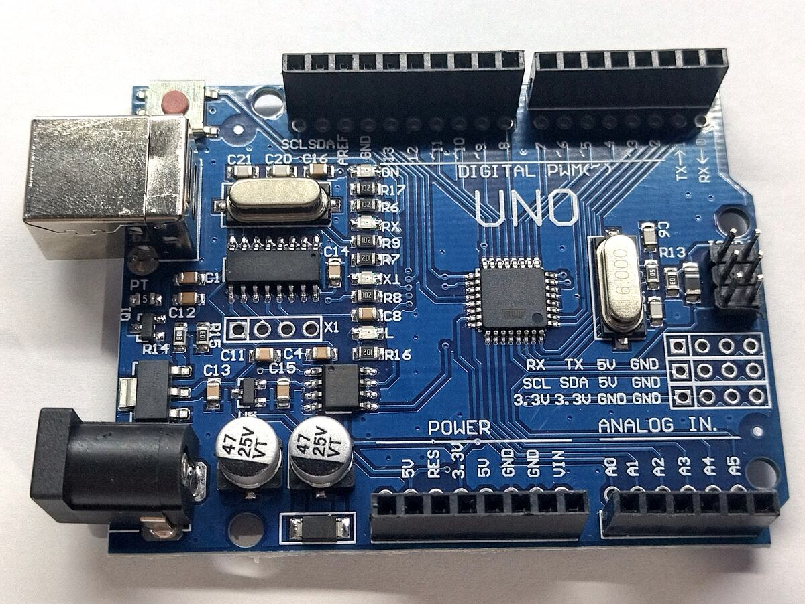
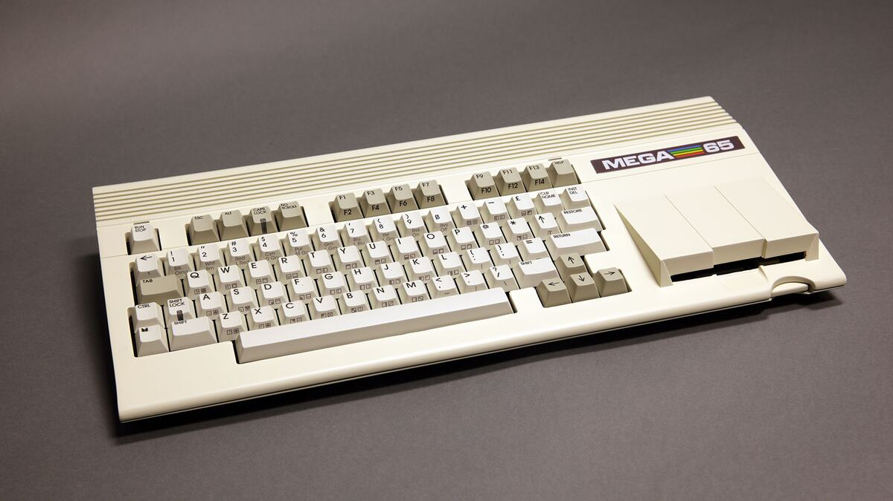
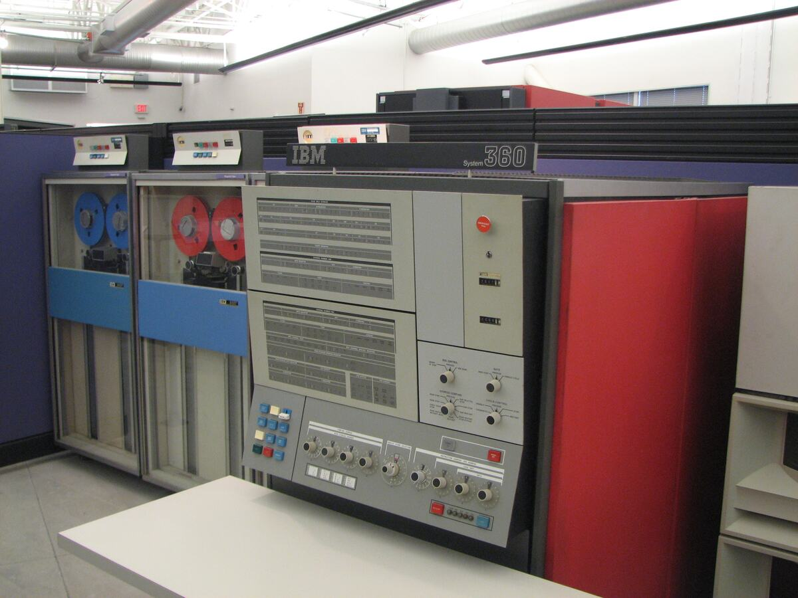
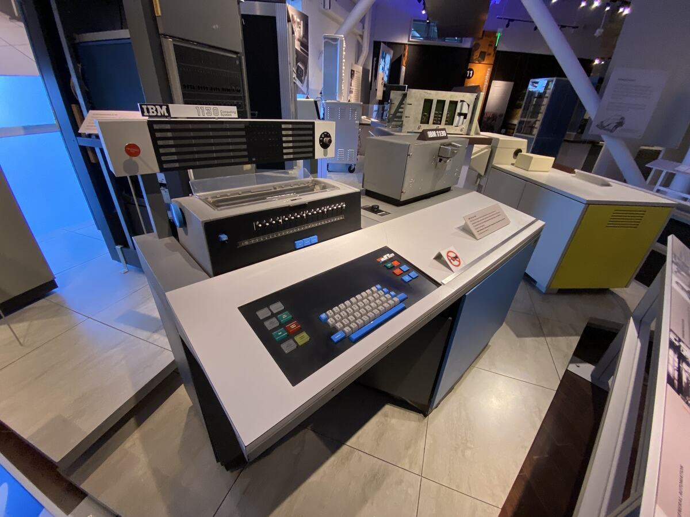
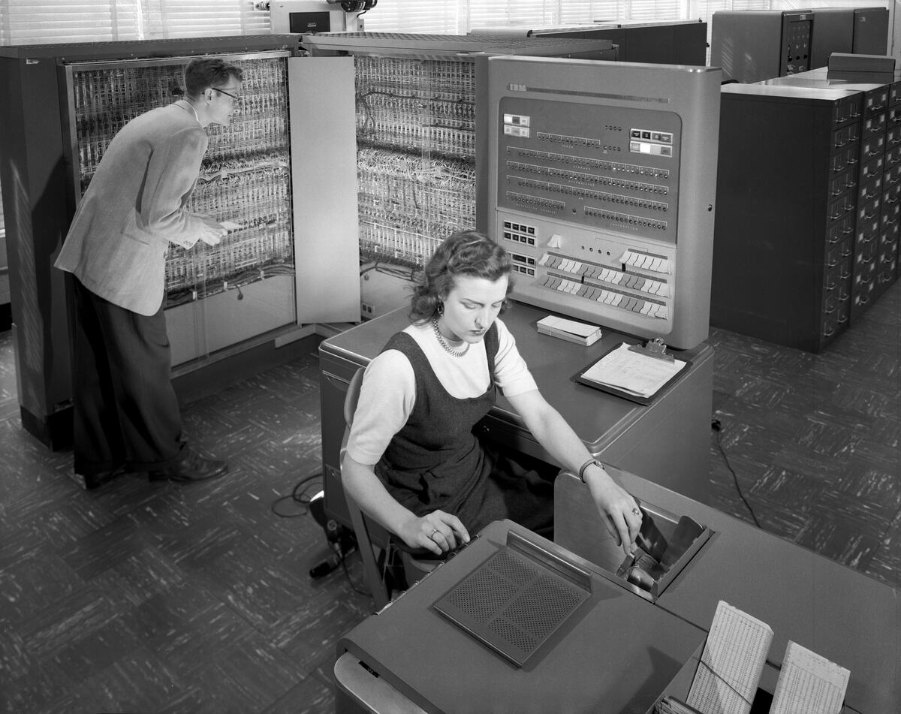
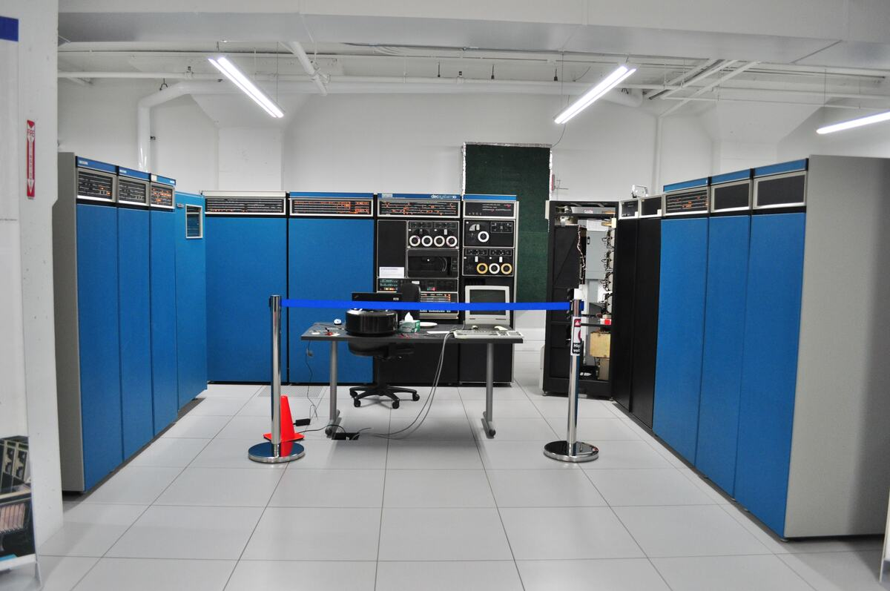
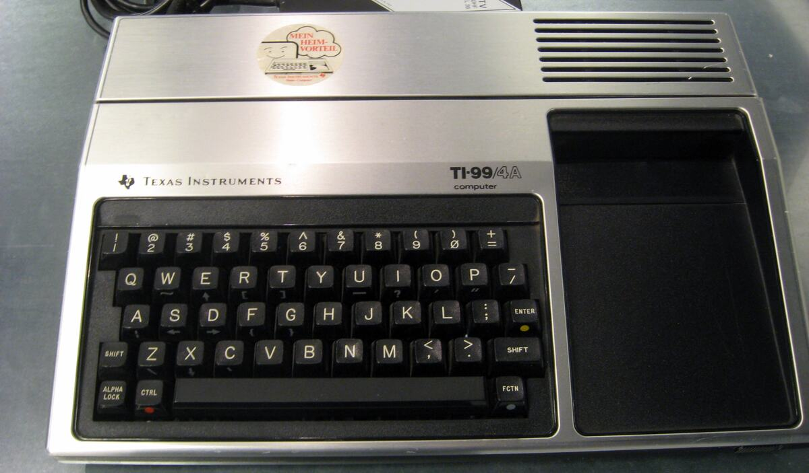

As an amateur coder, I often dabble in multiple languages such as Ruby, C, Arduino, Java, etc. Each language has a unique structure and specific syntax requirements (add a semi-colon at the end anyone?).

To help jog my memory, I put the same small program, Hello World, on this page in each language. This is a primer for each language, and a comparison. It includes modern languages and classic retro languages, and I am likely to add more in the future.

Where it helps, I include a photo of a machine. Sometimes that is the computer the language was written for. Sometimes it is the machine I picture when I use the language. Four entries are the hardware itself: the Altair 8800, the PDP-8, the PDP-10, and the PDP-11. Each of those shows a short program you enter on that machine.

# Languages

There are numerous programming languages here, along with those four machines. The purpose of this page is to show a minimal Hello World in each one. You will not want to learn each language, but this quick guide might assist you in determining which language you want to learn.

Use the list below to jump to an example:

* [6502 assembly](#6502-assembly)
* [Ada](#ada)
* [ALGOL 68](#algol-68)
* [Altair 8800](#altair-8800)
* [Applescript](#applescript)
* [Applesoft BASIC](#applesoft-basic)
* [Arduino](#arduino)
* [BASIC 65](#basic-65)
* [BBC BASIC](#bbc-basic)
* [C](#c)
* [COBOL](#cobol)
* [Commodore BASIC V2](#commodore-basic-v2)
* [Forth](#forth)
* [Fortran](#fortran)
* [Java](#java)
* [Javascript](#javascript)
* [Lisp](#lisp)
* [Logo](#logo)
* [Pascal](#pascal)
* [PDP-8](#pdp-8)
* [PDP-10](#pdp-10)
* [PDP-11](#pdp-11)
* [Processing](#processing)
* [Python](#python)
* [Ruby](#ruby)
* [Swift](#swift)
* [TI BASIC](#ti-basic)
* [ZX Spectrum BASIC](#zx-spectrum-basic)

## 6502 assembly

<figure class="hw-machine">

<figcaption>Photo: Bill Bertram, <a href="https://creativecommons.org/licenses/by-sa/2.5">CC BY-SA 2.5</a>, via <a href="https://commons.wikimedia.org/wiki/File:Commodore64.jpg">Wikimedia Commons</a>. Resized.</figcaption>
</figure>

```6502
; Commodore 64 Hello World for the ACME assembler.
; $FFD2 is the KERNAL CHROUT routine.

!to "hello.prg", cbm

* = $0801
!word $080c
!word 10
!byte $9e
!text " 2064"
!byte 0, 0, 0

* = $0810
    ldx #0
loop
    lda msg,x
    beq done
    jsr $ffd2
    inx
    bne loop
done
    rts
msg
    !text "HELLO, WORLD!"
    !byte 13, 0
```

**About the language:** MOS Technology introduced the 6502 in 1975. Chuck Peddle led the design. It was inexpensive, and it went into the Apple II, Commodore's home computers, the Atari 8-bit line, and the NES.

**About the machine:** Commodore released the Commodore 64 in 1982. Its processor is the 6510, a close relative of the 6502. The machine is known for the SID sound chip and the VIC-II video chip.

**Comments:** This is a Commodore 64 program. The bytes at `$0801` are a one-line BASIC program, `10 SYS 2064`, so `RUN` starts the routine. Save it as `hello.asm` and assemble with `acme hello.asm`, which writes `hello.prg`. Then `LOAD "HELLO.PRG",8` and `RUN`. The text is uppercase because those PETSCII codes match ASCII.

## Ada

```ada
with Ada.Text_IO;

procedure Hello is
begin
   Ada.Text_IO.Put_Line ("Hello, World!");
end Hello;
```

**About the language:** Ada was designed for the U.S. Department of Defense. Jean Ichbiah led the team at CII Honeywell Bull, and the first standard was published in 1983. The language is named for Ada Lovelace.

**Comments:** Save this as `hello.adb`. The file name has to match the procedure name. `gnatmake hello.adb` compiles it, and `./hello` runs it. `Put_Line` writes the text and a newline.

## ALGOL 68

```algol68
BEGIN
    print("Hello, World!")
END
```

**About the language:** ALGOL 68 came from IFIP Working Group 2.1. Adriaan van Wijngaarden edited the report, which is from 1968. It was meant to follow ALGOL 60, and it was known for a definition that was exact and very hard to read.

**Comments:** ALGOL 60 never defined a standard way to print text, so this is ALGOL 68. `print` writes the string. Algol 68 Genie runs the file with `a68g hello.a68`.

## Altair 8800

<figure class="hw-machine">

<figcaption>Photo: Michael Holley, public domain, via <a href="https://commons.wikimedia.org/wiki/File:Altair_8800_Computer.jpg">Wikimedia Commons</a>. Resized.</figcaption>
</figure>

This one is toggled in on the front panel. The bytes below are a short Intel 8080 program that prints `HELLO WORLD` on the serial port. It assumes an 88-2SIO, the Motorola 6850 board used by most Altair emulators and replicas, at ports 020 and 021 octal (10h and 11h).

| Address | Data | Instruction |
| --- | --- | --- |
| 000000 | 076 | MVI A,003Q |
| 000001 | 003 |  |
| 000002 | 323 | OUT 020Q |
| 000003 | 020 |  |
| 000004 | 076 | MVI A,025Q |
| 000005 | 025 |  |
| 000006 | 323 | OUT 020Q |
| 000007 | 020 |  |
| 000010 | 041 | LXI H,MSG |
| 000011 | 045 |  |
| 000012 | 000 |  |
| 000013 | 176 | LOOP: MOV A,M |
| 000014 | 376 | CPI 0 |
| 000015 | 000 |  |
| 000016 | 312 | JZ DONE |
| 000017 | 030 |  |
| 000020 | 000 |  |
| 000021 | 315 | CALL OUTCH |
| 000022 | 031 |  |
| 000023 | 000 |  |
| 000024 | 043 | INX H |
| 000025 | 303 | JMP LOOP |
| 000026 | 013 |  |
| 000027 | 000 |  |
| 000030 | 166 | DONE: HLT |
| 000031 | 365 | OUTCH: PUSH PSW |
| 000032 | 333 | WAIT: IN 020Q |
| 000033 | 020 |  |
| 000034 | 346 | ANI 002Q |
| 000035 | 002 |  |
| 000036 | 312 | JZ WAIT |
| 000037 | 032 |  |
| 000040 | 000 |  |
| 000041 | 361 | POP PSW |
| 000042 | 323 | OUT 021Q |
| 000043 | 021 |  |
| 000044 | 311 | RET |
| 000045 | 110 | MSG: 'H' |
| 000046 | 105 | 'E' |
| 000047 | 114 | 'L' |
| 000050 | 114 | 'L' |
| 000051 | 117 | 'O' |
| 000052 | 040 | ' ' |
| 000053 | 127 | 'W' |
| 000054 | 117 | 'O' |
| 000055 | 122 | 'R' |
| 000056 | 114 | 'L' |
| 000057 | 104 | 'D' |
| 000060 | 015 | CR |
| 000061 | 012 | LF |
| 000062 | 000 | end |

A switch up is a 1 and a switch down is a 0. Read each octal digit as a group of switches, left to right. On a data byte the left group is only two switches.

1. If the machine is running, raise STOP.
2. Set every address switch down, so the lights read 000000 octal, and raise EXAMINE.
3. Set the data switches to 076 octal, the first row, and raise DEPOSIT. That stores the byte at address 0.
4. For each following row, set the data switches to that byte and raise DEPOSIT NEXT. The address lights should match the address in the row.
5. Raise RESET, then raise RUN.

**About the language:** The bytes above are Intel 8080 machine code. Intel introduced the 8080 in 1974. On a basic Altair you enter each byte with the front-panel switches.

**About the machine:** MITS sold the Altair 8800 in 1975. Ed Roberts led the design. It was on the cover of Popular Electronics in January 1975, and a lot of hobbyists met microcomputers through that issue.

**Comments:** The first two `OUT` instructions reset the 6850 and then select 8 data bits, no parity, 1 stop bit, and a clock divided by 16, which is the usual 88-2SIO strap. Before each character the program reads the status port and waits until bit 1 is set. That bit is TDRE, transmit data register empty. The message ends with a carriage return (015), a line feed (012), and a 000 that stops the loop.


## Applescript

<figure class="hw-machine">

<figcaption>Photo: Sailko, <a href="https://creativecommons.org/licenses/by/3.0">CC BY 3.0</a>, via <a href="https://commons.wikimedia.org/wiki/File:Computer_macintosh_128k,_1984_(all_about_Apple_onlus).jpg">Wikimedia Commons</a>. Resized.</figcaption>
</figure>

```applescript
display dialog "Hello, World!"
```

**About the language:** Apple released AppleScript in 1993, with System 7 Pro. William Cook led the language design. The English-like wording follows HyperTalk, the language in HyperCard.

**About the machine:** Apple introduced the Macintosh 128K in January 1984. It was the first Macintosh, with a built-in black-and-white screen, a mouse, and 128 KB of memory. The processor is a Motorola 68000.

**Comments:** AppleScript ships with macOS. Paste this into Script Editor and press Run, or save it and run `osascript hello.scpt`. `display dialog` opens a small window with the message and an OK button.

## Applesoft BASIC

<figure class="hw-machine">

<figcaption>Photo: Marcin Wichary, <a href="https://creativecommons.org/licenses/by/2.0">CC BY 2.0</a>, via <a href="https://commons.wikimedia.org/wiki/File:Apple_II_Plus,_Museum_of_the_Moving_Image.jpg">Wikimedia Commons</a>. Resized.</figcaption>
</figure>

```basic
10 PRINT "HELLO, WORLD!"
```

**About the language:** Microsoft wrote Applesoft BASIC. Apple put it in ROM on the Apple II Plus in 1979. It is the floating-point BASIC that followed Steve Wozniak's Integer BASIC.

**About the machine:** Apple released the Apple II Plus in 1979. It is an Apple II with Applesoft BASIC in ROM. The original Apple II, from 1977, started up in Wozniak's Integer BASIC.

**Comments:** Type this at the `]` prompt on an Apple II and enter `RUN`. Applesoft programs use line numbers, and the original Apple II character set is uppercase.

## Arduino

<figure class="hw-machine">

<figcaption>Photo: JrawX, <a href="https://creativecommons.org/publicdomain/zero/1.0/">CC0</a>, via <a href="https://commons.wikimedia.org/wiki/File:Arduino_Uno_board.jpg">Wikimedia Commons</a>. Resized.</figcaption>
</figure>

```cpp
void setup() {
  Serial.begin(9600);
  Serial.println("Hello, World!");
}

void loop() {
}
```

**About the language:** Arduino started in 2005 at the Interaction Design Institute Ivrea, in Italy. Massimo Banzi and David Cuartielles were among the people who started it. A sketch is C++, with a small set of functions meant for people new to microcontrollers.

**About the machine:** Arduino released the Uno in 2010. The name means "one" in Italian, and this became the board people mean when they say Arduino. It uses an ATmega328, and you program it over a USB cable.

**Comments:** This is an Arduino sketch, written in C++. Upload it from the Arduino IDE and open the Serial Monitor at 9600 baud. Many boards reset when the monitor opens, so `setup` runs again and the line shows up. `loop` is empty because the greeting only needs to print once.

## BASIC 65

<figure class="hw-machine">

<figcaption>Photo: AnshulBirajdarPune, <a href="https://creativecommons.org/licenses/by-sa/4.0">CC BY-SA 4.0</a>, via <a href="https://commons.wikimedia.org/wiki/File:Mega65_photo.jpg">Wikimedia Commons</a>. Resized.</figcaption>
</figure>

```basic
10 PRINT "HELLO, WORLD!"
```

**About the language:** BASIC 65 is the BASIC built into the MEGA65. It continues Commodore's BASIC 10, written for the Commodore 65. Commodore shelved that computer before release, and the MEGA65 team carried the BASIC forward.

**About the machine:** The MEGA65 is a new computer based on the unreleased Commodore 65. Paul Gardner-Stephen started the project. It has a Commodore-style keyboard, a built-in 3.5-inch floppy drive, and an HDMI video output.

**Comments:** Type this at the `READY` prompt on a MEGA65 and enter `RUN`. BASIC 65 is the MEGA65's Commodore-style BASIC. A saved program uses line numbers, and this uppercase line matches the startup screen.

## BBC BASIC

<figure class="hw-machine">

<figcaption>Photo: Stuart Brady, restored by Ubcule, public domain, via <a href="https://commons.wikimedia.org/wiki/File:BBC_Micro_Front_Restored.jpg">Wikimedia Commons</a>. Resized.</figcaption>
</figure>

```bbcbasic
10 PRINT "Hello, World!"
```

**About the language:** Sophie Wilson wrote BBC BASIC at Acorn for the BBC Micro. It shipped with that machine in 1981. It has named procedures and a built-in 6502 assembler.

**About the machine:** Acorn released the BBC Micro in December 1981 for the BBC Computer Literacy Project. The processor is a 6502 running at 2 MHz. The Model B includes 32 KB of RAM.

**Comments:** Type this on a BBC Micro and enter `RUN`. The line number stores it as a program. `PRINT` writes the text and moves to the next line.

## C

<figure class="hw-machine">

<figcaption>Photo: Don DeBold, <a href="https://creativecommons.org/licenses/by/2.0">CC BY 2.0</a>, via <a href="https://commons.wikimedia.org/wiki/File:DEC_PDP-11_20_computer_at_the_Computer_History_Museum.jpg">Wikimedia Commons</a>. Resized.</figcaption>
</figure>

```c
#include <stdio.h>

int main(void) {
    printf("Hello, World!\n");
    return 0;
}
```

**About the language:** Dennis Ritchie developed C at Bell Labs around 1972. It grew out of Ken Thompson's B language. Unix was rewritten in C, which let the system move to other computers.

**About the machine:** DEC introduced the PDP-11/20 in 1970. It was the first PDP-11, a 16-bit minicomputer. C was written on this line of machines.

**Comments:** Save this as `hello.c`. `cc hello.c -o hello` compiles it, and `./hello` runs it. `\n` is the newline. `main` is where the program starts, and `return 0` tells the system it finished cleanly.

## COBOL

<figure class="hw-machine">

<figcaption>Photo: Erik Pitti, <a href="https://creativecommons.org/licenses/by/2.0">CC BY 2.0</a>, via <a href="https://commons.wikimedia.org/wiki/File:IBM_System360_Mainframe.jpg">Wikimedia Commons</a>. Resized.</figcaption>
</figure>

```cobol
       IDENTIFICATION DIVISION.
       PROGRAM-ID. HELLO.
       PROCEDURE DIVISION.
           DISPLAY "Hello, World!".
           STOP RUN.
```

**About the language:** The CODASYL committee defined COBOL in 1959, and the first specification followed in 1960. It drew on Grace Hopper's FLOW-MATIC. The language uses English-like sentences and was meant for business data on many different computers.

**About the machine:** IBM announced the System/360 in 1964. Fred Brooks and Gene Amdahl were lead architects. It was a family of computers that could run the same programs, from small machines to large ones.

**Comments:** This is fixed-format COBOL. Division headers start in column 8, and the statements start in column 12. Save it as `hello.cob`. GnuCOBOL builds it with `cobc -x hello.cob`, which writes a program you can run.

## Commodore BASIC V2

<figure class="hw-machine">

<figcaption>Photo: Bill Bertram, <a href="https://creativecommons.org/licenses/by-sa/2.5">CC BY-SA 2.5</a>, via <a href="https://commons.wikimedia.org/wiki/File:Commodore64.jpg">Wikimedia Commons</a>. Resized.</figcaption>
</figure>

```basic
10 PRINT "HELLO, WORLD!"
```

**About the language:** Commodore BASIC V2 is a Microsoft BASIC. It shipped in the VIC-20 and the Commodore 64. Programs reach the sound and graphics chips with POKE.

**About the machine:** Commodore released the Commodore 64 in 1982. It starts up in this BASIC. The SID chip handles sound, and the VIC-II handles video.

**Comments:** Type this at the `READY` prompt on a Commodore 64 and enter `RUN`. V2 is the BASIC built into the C64. The line number is required, and uppercase matches the computer's default character set.

## Forth

<figure class="hw-machine">

<figcaption>Photo: ArnoldReinhold, <a href="https://creativecommons.org/licenses/by-sa/4.0">CC BY-SA 4.0</a>, via <a href="https://commons.wikimedia.org/wiki/File:IBM_1130_at_CHM_2022.agr.jpg">Wikimedia Commons</a>. Resized.</figcaption>
</figure>

```forth
: HELLO ( -- ) ." Hello, World!" CR ;
HELLO
bye
```

**About the language:** Charles Moore created Forth. He first ran it on an IBM 1130 around 1970. It is a stack language, and the name is "fourth" shortened to five letters because that 1130 only allowed five-character names.

**About the machine:** IBM announced the 1130 in 1965. It is a small 16-bit computer aimed at engineers and colleges. Moore's first Forth system ran on one.

**Comments:** The space after `."` is required, and so is the space before `;`. Save this as `hello.fs` and run `gforth hello.fs`. The colon definition prints the text, `CR` starts a new line, and `bye` leaves the interpreter.

## Fortran

<figure class="hw-machine">

<figcaption>Photo: NASA, public domain, via <a href="https://commons.wikimedia.org/wiki/File:IBM_Electronic_Data_Processing_Machine_-_GPN-2000-001881.jpg">Wikimedia Commons</a>. Resized.</figcaption>
</figure>

```fortran
program hello
  print *, "Hello, World!"
end program hello
```

**About the language:** John Backus led the IBM team that created Fortran. The first compiler shipped in 1957 for the IBM 704. It let scientists write formulas in the program.

**About the machine:** IBM introduced the 704 in 1954. It is a vacuum-tube computer for scientific work, with hardware floating-point arithmetic. The first Fortran compiler targeted this machine.

**Comments:** This is free-form Fortran, the form used since Fortran 90. Save it as `hello.f90`. The `.f90` ending tells the compiler not to use fixed columns. `gfortran hello.f90 -o hello` compiles it, and `./hello` runs it. List-directed `print` writes a space before the text.

## Java

<figure class="hw-machine">

<figcaption>Photo: NapoliRoma, <a href="https://creativecommons.org/licenses/by-sa/3.0">CC BY-SA 3.0</a>, via <a href="https://commons.wikimedia.org/wiki/File:Sun_SPARCstation_5.JPG">Wikimedia Commons</a>. Resized.</figcaption>
</figure>

```java
public class HelloWorld {
    public static void main(String[] args) {
        System.out.println("Hello, World!");
    }
}
```

**About the language:** James Gosling created Java at Sun Microsystems. Sun released it in 1995. A program compiles to bytecode and runs on a Java virtual machine, so the same file can run on different computers.

**About the machine:** Sun sold the SPARCstation 5 in 1994. It is a desktop SPARC workstation running Sun's Unix. The Java team at Sun did their work on SPARC workstations.

**Comments:** Save this as `HelloWorld.java`. The public class name has to match the file name. `javac HelloWorld.java` compiles it, and `java HelloWorld` runs it.

## Javascript

```javascript
console.log("Hello, World!");
```

**About the language:** Brendan Eich wrote JavaScript at Netscape in 1995. The early names were Mocha and LiveScript. It was made so a page in Netscape could respond to the reader, and it is separate from Java.

**Comments:** Run this in a browser's console, or save it as `hello.js` and run `node hello.js`. `console.log` prints the line.

## Lisp

<figure class="hw-machine">

<figcaption>Photo: Joe Mabel, <a href="https://creativecommons.org/licenses/by-sa/3.0">CC BY-SA 3.0</a>, via <a href="https://commons.wikimedia.org/wiki/File:LCM_-_DEC_PDP-10_-_01.jpg">Wikimedia Commons</a>. Resized.</figcaption>
</figure>

```lisp
(write-line "Hello, World!")
```

**About the language:** John McCarthy designed Lisp at MIT in 1958. It was built for symbolic computation and early artificial intelligence work. The first implementation ran on an IBM 704.

**About the machine:** DEC announced the PDP-10 in 1966. It is a 36-bit timesharing computer. A lot of Lisp work in the 1970s ran on PDP-10s.

**Comments:** This is Common Lisp. `write-line` prints the text and a newline, without the quotes that `print` would add. Save it as `hello.lisp` and run `sbcl --script hello.lisp`.

## Logo

<figure class="hw-machine">

<figcaption>Photo: Valiant Technology Ltd., <a href="https://creativecommons.org/licenses/by-sa/3.0">CC BY-SA 3.0</a>, via <a href="https://commons.wikimedia.org/wiki/File:Turtle_draw.jpg">Wikimedia Commons</a>. Resized.</figcaption>
</figure>

```logo
PRINT [Hello, World!]
```

**About the language:** Seymour Papert, Wally Feurzeig, and Cynthia Solomon developed Logo in 1967. It was made for learners, especially children. It is known for turtle graphics, and the language is a dialect of Lisp.

**About the machine:** Dave Catlin designed the Valiant Turtle in 1983, and Valiant Technology in the UK built it. The computer sends Logo commands over an infrared link. A pen in the base can draw on paper as it moves.

**Comments:** In UCBLogo and most other Logos, `PRINT` takes a list and prints the words with a space between them. Paste this into the listener and press Enter.

## Pascal

<figure class="hw-machine">

<figcaption>Photo: Jitze Couperus, <a href="https://creativecommons.org/licenses/by/2.0">CC BY 2.0</a>, via <a href="https://commons.wikimedia.org/wiki/File:CDC_6600.jc.jpg">Wikimedia Commons</a>. Resized.</figcaption>
</figure>

```pascal
program HelloWorld;
begin
  writeln('Hello, World!');
end.
```

**About the language:** Niklaus Wirth designed Pascal in 1970 at ETH Zurich. He made it as a teaching language, drawing on ALGOL. The name honors Blaise Pascal.

**About the machine:** Seymour Cray designed the CDC 6600 for Control Data Corporation. Deliveries began in 1964, and it was the fastest computer then available. Wirth developed Pascal on the CDC 6000 series, the family this machine belongs to.

**Comments:** Save this as `hello.pas`. The period after `end` is required. Free Pascal compiles it with `fpc hello.pas`, and `./hello` runs it.

## PDP-8

<figure class="hw-machine">

<figcaption>Photo: Kirk1013, <a href="https://creativecommons.org/licenses/by-sa/3.0">CC BY-SA 3.0</a>, via <a href="https://commons.wikimedia.org/wiki/File:DEC_PDP-8.jpg">Wikimedia Commons</a>. Resized.</figcaption>
</figure>

```pal
/ HELLO WORLD
/ PDP-8, PAL-III, console Teletype
        *200
LOOP,   CLA
        TAD I PTR
        SNA
        HLT
        TLS
WAIT,   TSF
        JMP WAIT
        ISZ PTR
        JMP LOOP
PTR,    MSG
MSG,    0110
        0105
        0114
        0114
        0117
        0040
        0127
        0117
        0122
        0114
        0104
        0015
        0012
        0000
$
```

**About the language:** This listing is written in PAL, the assembler DEC supplied for the PDP-8. Instructions are 12-bit words, shown here in octal. PAL-III was used on machines that had no disk operating system.

**About the machine:** DEC introduced the PDP-8 in 1965. It is a 12-bit minicomputer, small enough for a single lab to own. The lamps and switches on the front panel are how you examine memory and start the program.

**Comments:** PAL-III, with no disk operating system. The console is the Teletype on the standard TTY device codes. `TLS` (6046) prints the character in the accumulator and clears the flag. `TSF` (6041) skips when the printer is ready for another character. The octal words are 7-bit ASCII for `HELLO WORLD`, then a carriage return, a line feed, and a zero that stops the loop. Assemble it, load it at 0200, and start at 0200.

## PDP-10

<figure class="hw-machine">

<figcaption>Photo: Joe Mabel, <a href="https://creativecommons.org/licenses/by-sa/3.0">CC BY-SA 3.0</a>, via <a href="https://commons.wikimedia.org/wiki/File:LCM_-_DEC_PDP-10_-_01.jpg">Wikimedia Commons</a>. Resized.</figcaption>
</figure>

```macro10
        TITLE   HELLO
        SEARCH  UUOSYM

MSG:    ASCIZ   /Hello, World!
/
START:  RESET
        OUTSTR  MSG
        MONRT.
        JRST    START
        END     START
```

**About the language:** MACRO-10 is DEC's assembler for the PDP-10. Programs written in it ran under TOPS-10, which this listing does. The computer stores data in 36-bit words.

**About the machine:** DEC announced the PDP-10 in 1966. The first processor in the line was the KA10. Several people could use one machine from their own terminals.

**Comments:** MACRO-10 under TOPS-10. `SEARCH UUOSYM` makes the monitor-call names available. `OUTSTR` types the ASCIZ string, which includes a carriage return and line feed before the null, and `MONRT.` returns to the monitor. Save it as `HELLO.MAC`, then `.COMPILE HELLO.MAC`, `.LOAD HELLO`, and `.RUN`.

## PDP-11

<figure class="hw-machine">

<figcaption>Photo: Todd Dailey, <a href="https://creativecommons.org/licenses/by-sa/2.0">CC BY-SA 2.0</a>, via <a href="https://commons.wikimedia.org/wiki/File:PDP-11_at_the_Computer_History_Museum.jpg">Wikimedia Commons</a>. Resized.</figcaption>
</figure>

```macro11
        .TITLE  HELLO
        .MCALL  .PRINT,.EXIT
START:  .PRINT  #MSG
        .EXIT
MSG:    .ASCII  /Hello, World!/
        .BYTE   15,12,0
        .EVEN
        .END    START
```

**About the language:** MACRO-11 is DEC's assembler for the PDP-11. This listing is written for the RT-11 operating system. `.PRINT` and `.EXIT` are requests to that monitor.

**About the machine:** DEC introduced the PDP-11 in 1970. Early units have a front panel of switches and lights, as in the photo. It is a 16-bit minicomputer, and DEC sold the line into the 1990s.

**Comments:** MACRO-11 under RT-11. `.PRINT` writes the string to the console, and `.EXIT` returns to the monitor. The bytes after the text are a carriage return, a line feed, and the null that ends the string.


## Processing

```processing
void setup() {
  println("Hello, World!");
}
```

**About the language:** Ben Fry and Casey Reas started Processing in 2001 at the MIT Media Lab. They made it so artists and designers could write programs that draw. This Java mode is Java underneath, with a simpler setup.

**Comments:** Paste this into the Processing editor and press Run. `println` writes the line to the console under the sketch window. This is Processing's Java mode.

## Python

```python
# Hello World
# Python 3
# Dr. Steven B. Combs

print("Hello, World!")
```

**About the language:** Guido van Rossum released Python in 1991. He named it after Monty Python. Indentation is part of the syntax, so the layout of the code changes what the program means.

**Comments:** Save this as `hello.py` and run `python3 hello.py`. macOS no longer ships Python. `python3` comes with the Xcode Command Line Tools, or from python.org or Homebrew.

## Ruby

```ruby
puts "Hello, World!"
```

**About the language:** Yukihiro Matsumoto released Ruby in 1995. He was working in Japan, and he drew on Perl, Smalltalk, and Lisp. He wanted the language to be comfortable to read and write.

**Comments:** Save this as `hello.rb` and run `ruby hello.rb`. `puts` prints the text and a newline.

## Swift

<figure class="hw-machine">

<figcaption>Photo: Laptopsarena, <a href="https://creativecommons.org/licenses/by-sa/4.0">CC BY-SA 4.0</a>, via <a href="https://commons.wikimedia.org/wiki/File:MacBook_Pro_2019_13_inch.jpg">Wikimedia Commons</a>. Resized.</figcaption>
</figure>

```swift
print("Hello, World!")
```

**About the language:** Chris Lattner started Swift at Apple. Apple introduced it at WWDC in 2014. It is used for Mac and iOS apps.

**About the machine:** This photo is Apple's 13-inch MacBook Pro from 2019. It is an Intel laptop running macOS. The Touch Bar is the strip above the keyboard.

**Comments:** Save this as `hello.swift` and run `swift hello.swift`. `print` writes the line.

## TI BASIC

<figure class="hw-machine">

<figcaption>Photo: Tomasz Sienicki, <a href="https://creativecommons.org/licenses/by/3.0">CC BY 3.0</a>, via <a href="https://commons.wikimedia.org/wiki/File:Texas_Instruments_TI-99_4A_(ubt).JPG">Wikimedia Commons</a>. Resized.</figcaption>
</figure>

```basic
10 PRINT "HELLO, WORLD!"
```

**About the language:** TI BASIC is the BASIC in ROM on the TI-99/4 and the TI-99/4A. Texas Instruments included it from the TI-99/4 in 1979. Many of its graphics and sound commands are CALL subprograms.

**About the machine:** Texas Instruments released the TI-99/4A in 1981. The processor is the 16-bit TMS9900. The 4A replaced the TI-99/4 and brought a full-travel keyboard.

**Comments:** On a TI-99/4A, choose TI BASIC from the menu, type this at the `>` prompt, and enter `RUN`.

## ZX Spectrum BASIC

<figure class="hw-machine">

<figcaption>Photo: Bill Bertram, <a href="https://creativecommons.org/licenses/by-sa/2.5">CC BY-SA 2.5</a>, via <a href="https://commons.wikimedia.org/wiki/File:ZXSpectrum48k.jpg">Wikimedia Commons</a>. Resized.</figcaption>
</figure>

```basic
10 PRINT "Hello, World!"
```

**About the language:** ZX Spectrum BASIC is the BASIC built into the Sinclair ZX Spectrum of 1982. Steven Vickers wrote it, building on his ZX81 BASIC. Each keyword is one keypress on the Spectrum keyboard.

**About the machine:** Sinclair Research released the ZX Spectrum in 1982. Clive Sinclair's company sold it as a small color computer. The 48K model has 48 KB of RAM, a Z80 processor, and the rubber-key keyboard.

**Comments:** Type this at the Spectrum's cursor and enter `RUN`. `PRINT` is a single keyword on the Spectrum keyboard. The string itself can be mixed case.
