<!-- Insert Blinking Cursor Image -->
<!-- Convert below to Blog Post when complete -->
*DRAFT PAGE UPDATED: November, 11th, 2014*

As an amateur coder, I often dabble in multiple languages such as Ruby, C, Arduino, Java, etc. Each language has a unique structure and specific syntax requirements (add a semi-colon at the end anyone?). 

To help jog my memory, I thought it would be beneficial for me to create a page that demonstrates the same program in multiple languages. This will serve as a primer to each language as well as a comparison. It includes modern languages and classic retro languages, and I am likely to add more in the future. The list below contains the first languages I will work through.

If you are looking for an app to try out various languages, might I suggest [CodeRunner](https://apps.apple.com/us/search?term=CodeRunner). It’s available in the Mac app store and is my go to app when I want to try out a snippet of code.
<!-- End Blog Post -->

<!-- Add introduction to page here from excerpts above -->

# Preparation
Many programmers create an outline of a program before they type a single line of code. This sometimes takes the form of either [pseudo code](https://en.wikipedia.org/wiki/Special:Search?search=pseudo+code) or a [flow chart](https://en.wikipedia.org/wiki/Special:Search?search=flow+chart). I will present both, but before doing so, I will also provide a description of the program in paragraph form.

Want to skip the background and go right to the languages? Click [here](#languages).

## Notes and assumptions
As I began to write the program in various languages, there are assumptions made:

* functions are a necessary programming skill
* functions allow reuse of code chunks
* there are many ways, in a single language, to solve this code project
* my code will follow, as closely as a language allows, my pseudo code
* my code will focus on the Mac OS where necessary

## Description
This program will prompt the user for a number of breaks, the amount of time between each break (in seconds) and a URL. If the number of breaks is equal to zero, the program will display a scathing message ("If you don't need a break, why'd you ask?") and exit. If the number of breaks is one or more, the program will execute. If the number of breaks is greater than 12, the program will display a scathing message ("You work too hard. Get a social life now!") and exit.

At each break interval, the requested URL will open in the default browser as a reminder to take a break.

> The inspiration for this program is from the first assignment found in the Udacity course, [Introduction to the basics of programming using Python](https://www.udacity.com/course/ud036). It is a good example of how to use Python to create useful programs and implement into your daily workflow.

## Pseudo Code
Pseudo code is a program outline that does not include any programming language specific code but is a plain english line-by-line description. Below is the pseudo code for the description above.

> **TIP:** It is useful to copy the actual outline and paste it into the an [integrated development environment](https://en.wikipedia.org/wiki/Special:Search?search=integrated+development+environment) (IDE) or program editor. After the outline is pasted, I convert each line to a comment. A good IDE, such as [Atom](https://www.google.com/search?q=Atom) or [Sublime Text 3](https://www.google.com/search?btnI=1&q=Sublime+Text+3), will provide a tool to do this automatically. This process creates an outline for my work.

add comments:

* program name
* program language
* program author
	
load functions (if needed and based on language):

function to prompt user:

* prompt for number of breaks
* prompt for interval between breaks
* prompt for URL
* if number of breaks is 0
	* print message "If you don't need a break, why'd you ask?"
	* quit program
* if number of breaks is greater than 12
	* print message "You work too hard. Get a social life now!"
	* quit program

function for loop:

* do while breaks is less than or equal to requested breaks
	* wait for requested period
	* run function to load web page
	* breaks is equal to breaks plus one

function to load web page:

* open default system web browser
* load requested URL

run prompt user function
run loop program function
run load URL function

## Flow Chart
A [flow chart](https://en.wikipedia.org/wiki/Special:Search?search=flow+chart) is a graphical representation of programming code and is often used during the planning process. Below is the flow chart for the program described above.

*Coming soon…*

# Languages

There are numerous programming languages available. To reiterate, the purpose of this page is to show a minimal Hello World in each language. You will not want to learn each language, but this quick guide might assist you in determining which language you want to learn.

Use the table below to quickly jump to a language example:

* [6502 assembly](#6502-assembly)
* [Ada](#ada)
* [ALGOL 68](#algol-68)
* [Altair 8800](#altair-8800)
* [Applescript](#applescript)
* [Applesoft BASIC](#applesoft-basic)
* [Arduino](#arduino)
* [BASIC 65](#basic-65)
* [BBC BASIC](#bbc-basic)
* [C](#c)
* [COBOL](#cobol)
* [Commodore BASIC V2](#commodore-basic-v2)
* [Forth](#forth)
* [Fortran](#fortran)
* [Java](#java)
* [Javascript](#javascript)
* [Lisp](#lisp)
* [Logo](#logo)
* [Pascal](#pascal)
* [PDP-8](#pdp-8)
* [PDP-10](#pdp-10)
* [PDP-11](#pdp-11)
* [Processing](#processing)
* [Python](#python)
* [Ruby](#ruby)
* [Swift](#swift)
* [TI BASIC](#ti-basic)
* [ZX Spectrum BASIC](#zx-spectrum-basic)

## 6502 assembly

<figure class="hw-machine">
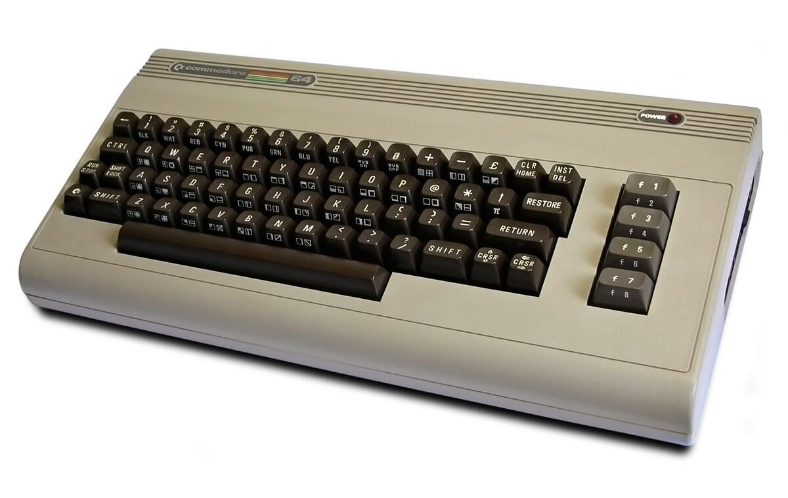
<figcaption>Photo: Bill Bertram, <a href="https://creativecommons.org/licenses/by-sa/2.5">CC BY-SA 2.5</a>, via <a href="https://commons.wikimedia.org/wiki/File:Commodore64.jpg">Wikimedia Commons</a>. Resized.</figcaption>
</figure>

```6502
; Commodore 64 Hello World for the ACME assembler.
; $FFD2 is the KERNAL CHROUT routine.

!to "hello.prg", cbm

* = $0801
!word $080c
!word 10
!byte $9e
!text " 2064"
!byte 0, 0, 0

* = $0810
    ldx #0
loop
    lda msg,x
    beq done
    jsr $ffd2
    inx
    bne loop
done
    rts
msg
    !text "HELLO, WORLD!"
    !byte 13, 0
```

**Comments:** This is a Commodore 64 program. The bytes at `$0801` are a one-line BASIC program, `10 SYS 2064`, so `RUN` starts the routine. Save it as `hello.asm` and assemble with `acme hello.asm`, which writes `hello.prg`. Then `LOAD "HELLO.PRG",8` and `RUN`. The text is uppercase because those PETSCII codes match ASCII.

## Ada

```ada
with Ada.Text_IO;

procedure Hello is
begin
   Ada.Text_IO.Put_Line ("Hello, World!");
end Hello;
```

**Comments:** Save this as `hello.adb`. The file name has to match the procedure name. `gnatmake hello.adb` compiles it, and `./hello` runs it. `Put_Line` writes the text and a newline.

## ALGOL 68

```algol68
BEGIN
    print("Hello, World!")
END
```

**Comments:** ALGOL 60 never defined a standard way to print text, so this is ALGOL 68. `print` writes the string. Algol 68 Genie runs the file with `a68g hello.a68`.

## Altair 8800

<figure class="hw-machine">

<figcaption>Photo: Michael Holley, public domain, via <a href="https://commons.wikimedia.org/wiki/File:Altair_8800_Computer.jpg">Wikimedia Commons</a>. Resized.</figcaption>
</figure>

This one is toggled in on the front panel. The bytes below are a short Intel 8080 program that prints `HELLO WORLD` on the serial port. It assumes an 88-2SIO, the Motorola 6850 board used by most Altair emulators and replicas, at ports 020 and 021 octal (10h and 11h).

| Address | Data | Instruction |
| --- | --- | --- |
| 000000 | 076 | MVI A,003Q |
| 000001 | 003 |  |
| 000002 | 323 | OUT 020Q |
| 000003 | 020 |  |
| 000004 | 076 | MVI A,025Q |
| 000005 | 025 |  |
| 000006 | 323 | OUT 020Q |
| 000007 | 020 |  |
| 000010 | 041 | LXI H,MSG |
| 000011 | 045 |  |
| 000012 | 000 |  |
| 000013 | 176 | LOOP: MOV A,M |
| 000014 | 376 | CPI 0 |
| 000015 | 000 |  |
| 000016 | 312 | JZ DONE |
| 000017 | 030 |  |
| 000020 | 000 |  |
| 000021 | 315 | CALL OUTCH |
| 000022 | 031 |  |
| 000023 | 000 |  |
| 000024 | 043 | INX H |
| 000025 | 303 | JMP LOOP |
| 000026 | 013 |  |
| 000027 | 000 |  |
| 000030 | 166 | DONE: HLT |
| 000031 | 365 | OUTCH: PUSH PSW |
| 000032 | 333 | WAIT: IN 020Q |
| 000033 | 020 |  |
| 000034 | 346 | ANI 002Q |
| 000035 | 002 |  |
| 000036 | 312 | JZ WAIT |
| 000037 | 032 |  |
| 000040 | 000 |  |
| 000041 | 361 | POP PSW |
| 000042 | 323 | OUT 021Q |
| 000043 | 021 |  |
| 000044 | 311 | RET |
| 000045 | 110 | MSG: 'H' |
| 000046 | 105 | 'E' |
| 000047 | 114 | 'L' |
| 000050 | 114 | 'L' |
| 000051 | 117 | 'O' |
| 000052 | 040 | ' ' |
| 000053 | 127 | 'W' |
| 000054 | 117 | 'O' |
| 000055 | 122 | 'R' |
| 000056 | 114 | 'L' |
| 000057 | 104 | 'D' |
| 000060 | 015 | CR |
| 000061 | 012 | LF |
| 000062 | 000 | end |

A switch up is a 1 and a switch down is a 0. Read each octal digit as a group of switches, left to right. On a data byte the left group is only two switches.

1. If the machine is running, raise STOP.
2. Set every address switch down, so the lights read 000000 octal, and raise EXAMINE.
3. Set the data switches to 076 octal, the first row, and raise DEPOSIT. That stores the byte at address 0.
4. For each following row, set the data switches to that byte and raise DEPOSIT NEXT. The address lights should match the address in the row.
5. Raise RESET, then raise RUN.

**Comments:** The first two `OUT` instructions reset the 6850 and then select 8 data bits, no parity, 1 stop bit, and a clock divided by 16, which is the usual 88-2SIO strap. Before each character the program reads the status port and waits until bit 1 is set. That bit is TDRE, transmit data register empty. The message ends with a carriage return (015), a line feed (012), and a 000 that stops the loop.


## Applescript

<figure class="hw-machine">
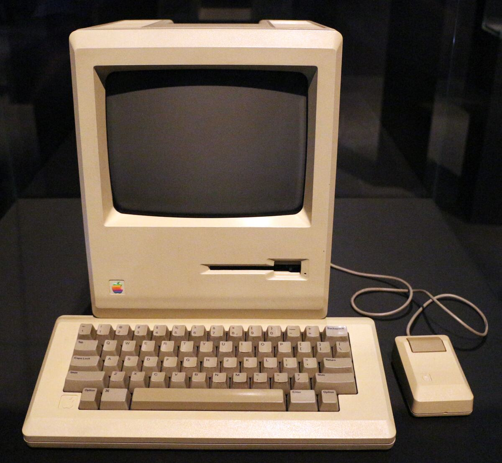
<figcaption>Photo: Sailko, <a href="https://creativecommons.org/licenses/by/3.0">CC BY 3.0</a>, via <a href="https://commons.wikimedia.org/wiki/File:Computer_macintosh_128k,_1984_(all_about_Apple_onlus).jpg">Wikimedia Commons</a>. Resized.</figcaption>
</figure>

```applescript
display dialog "Hello, World!"
```

**Comments:** AppleScript ships with macOS. Paste this into Script Editor and press Run, or save it and run `osascript hello.scpt`. `display dialog` opens a small window with the message and an OK button.

## Applesoft BASIC

<figure class="hw-machine">
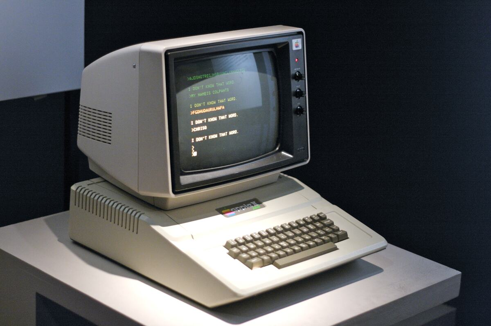
<figcaption>Photo: Marcin Wichary, <a href="https://creativecommons.org/licenses/by/2.0">CC BY 2.0</a>, via <a href="https://commons.wikimedia.org/wiki/File:Apple_II_Plus,_Museum_of_the_Moving_Image.jpg">Wikimedia Commons</a>. Resized.</figcaption>
</figure>

```basic
10 PRINT "HELLO, WORLD!"
```

**Comments:** Type this at the `]` prompt on an Apple II and enter `RUN`. Applesoft programs use line numbers, and the original Apple II character set is uppercase.

## Arduino

<figure class="hw-machine">

<figcaption>Photo: JrawX, <a href="https://creativecommons.org/publicdomain/zero/1.0/">CC0</a>, via <a href="https://commons.wikimedia.org/wiki/File:Arduino_Uno_board.jpg">Wikimedia Commons</a>. Resized.</figcaption>
</figure>

```cpp
void setup() {
  Serial.begin(9600);
  Serial.println("Hello, World!");
}

void loop() {
}
```

**Comments:** This is an Arduino sketch, written in C++. Upload it from the Arduino IDE and open the Serial Monitor at 9600 baud. Many boards reset when the monitor opens, so `setup` runs again and the line shows up. `loop` is empty because the greeting only needs to print once.

## BASIC 65

<figure class="hw-machine">

<figcaption>Photo: AnshulBirajdarPune, <a href="https://creativecommons.org/licenses/by-sa/4.0">CC BY-SA 4.0</a>, via <a href="https://commons.wikimedia.org/wiki/File:Mega65_photo.jpg">Wikimedia Commons</a>. Resized.</figcaption>
</figure>

```basic
10 PRINT "HELLO, WORLD!"
```

**Comments:** Type this at the `READY` prompt on a MEGA65 and enter `RUN`. BASIC 65 is the MEGA65's Commodore-style BASIC. A saved program uses line numbers, and this uppercase line matches the startup screen.

## BBC BASIC

<figure class="hw-machine">
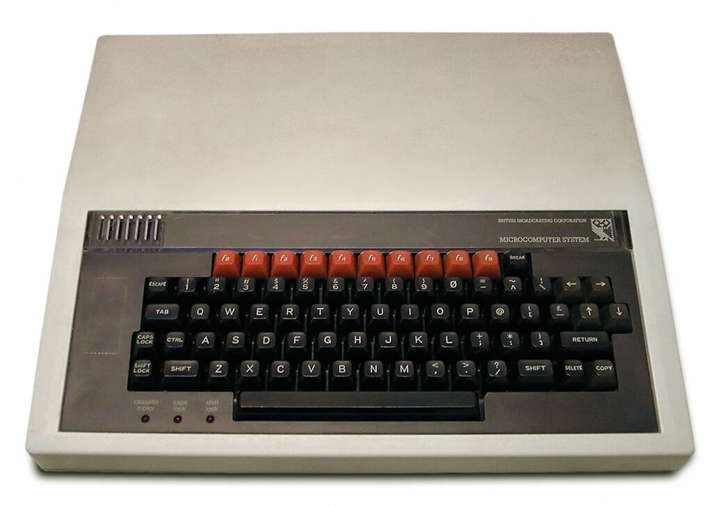
<figcaption>Photo: Stuart Brady, restored by Ubcule, public domain, via <a href="https://commons.wikimedia.org/wiki/File:BBC_Micro_Front_Restored.jpg">Wikimedia Commons</a>. Resized.</figcaption>
</figure>

```bbcbasic
10 PRINT "Hello, World!"
```

**Comments:** Type this on a BBC Micro and enter `RUN`. The line number stores it as a program. `PRINT` writes the text and moves to the next line.

## C

<figure class="hw-machine">
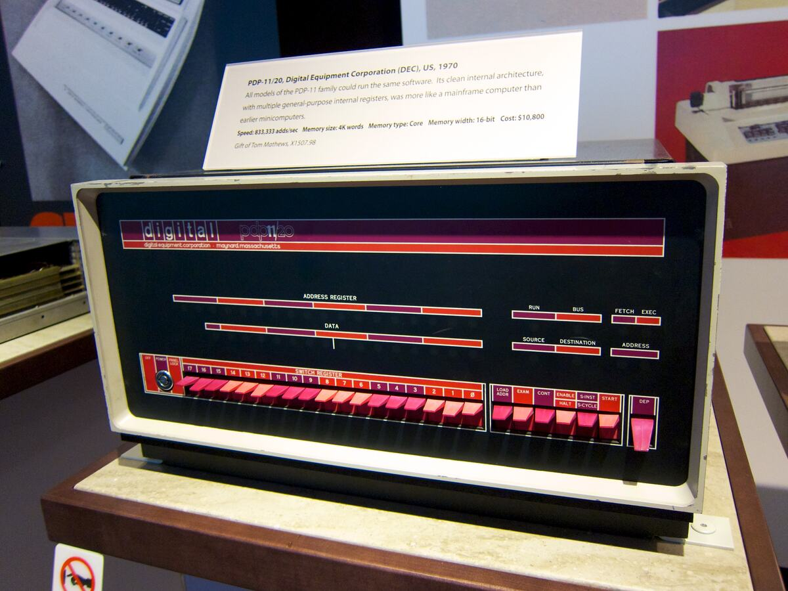
<figcaption>Photo: Don DeBold, <a href="https://creativecommons.org/licenses/by/2.0">CC BY 2.0</a>, via <a href="https://commons.wikimedia.org/wiki/File:DEC_PDP-11_20_computer_at_the_Computer_History_Museum.jpg">Wikimedia Commons</a>. Resized.</figcaption>
</figure>

```c
#include <stdio.h>

int main(void) {
    printf("Hello, World!\n");
    return 0;
}
```

**Comments:** Save this as `hello.c`. `cc hello.c -o hello` compiles it, and `./hello` runs it. `\n` is the newline. `main` is where the program starts, and `return 0` tells the system it finished cleanly.

## COBOL

<figure class="hw-machine">

<figcaption>Photo: Erik Pitti, <a href="https://creativecommons.org/licenses/by/2.0">CC BY 2.0</a>, via <a href="https://commons.wikimedia.org/wiki/File:IBM_System360_Mainframe.jpg">Wikimedia Commons</a>. Resized.</figcaption>
</figure>

```cobol
       IDENTIFICATION DIVISION.
       PROGRAM-ID. HELLO.
       PROCEDURE DIVISION.
           DISPLAY "Hello, World!".
           STOP RUN.
```

**Comments:** This is fixed-format COBOL. Division headers start in column 8, and the statements start in column 12. Save it as `hello.cob`. GnuCOBOL builds it with `cobc -x hello.cob`, which writes a program you can run.

## Commodore BASIC V2

<figure class="hw-machine">

<figcaption>Photo: Bill Bertram, <a href="https://creativecommons.org/licenses/by-sa/2.5">CC BY-SA 2.5</a>, via <a href="https://commons.wikimedia.org/wiki/File:Commodore64.jpg">Wikimedia Commons</a>. Resized.</figcaption>
</figure>

```basic
10 PRINT "HELLO, WORLD!"
```

**Comments:** Type this at the `READY` prompt on a Commodore 64 and enter `RUN`. V2 is the BASIC built into the C64. The line number is required, and uppercase matches the computer's default character set.

## Forth

<figure class="hw-machine">

<figcaption>Photo: ArnoldReinhold, <a href="https://creativecommons.org/licenses/by-sa/4.0">CC BY-SA 4.0</a>, via <a href="https://commons.wikimedia.org/wiki/File:IBM_1130_at_CHM_2022.agr.jpg">Wikimedia Commons</a>. Resized.</figcaption>
</figure>

```forth
: HELLO ( -- ) ." Hello, World!" CR ;
HELLO
bye
```

**Comments:** The space after `."` is required, and so is the space before `;`. Save this as `hello.fs` and run `gforth hello.fs`. The colon definition prints the text, `CR` starts a new line, and `bye` leaves the interpreter.

## Fortran

<figure class="hw-machine">

<figcaption>Photo: NASA, public domain, via <a href="https://commons.wikimedia.org/wiki/File:IBM_Electronic_Data_Processing_Machine_-_GPN-2000-001881.jpg">Wikimedia Commons</a>. Resized.</figcaption>
</figure>

```fortran
program hello
  print *, "Hello, World!"
end program hello
```

**Comments:** This is free-form Fortran, the form used since Fortran 90. Save it as `hello.f90`. The `.f90` ending tells the compiler not to use fixed columns. `gfortran hello.f90 -o hello` compiles it, and `./hello` runs it. List-directed `print` writes a space before the text.

## Java

<figure class="hw-machine">
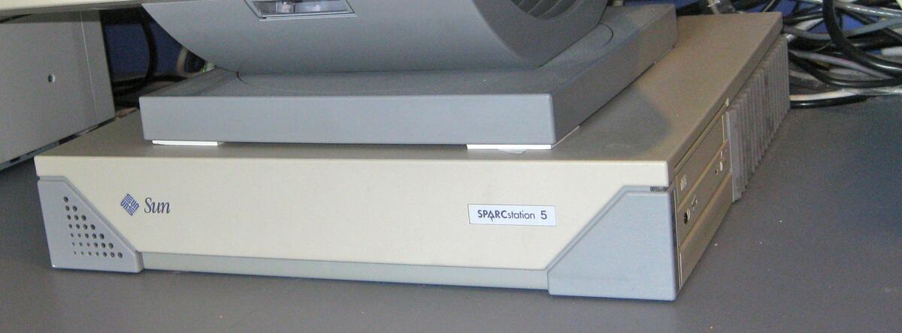
<figcaption>Photo: NapoliRoma, <a href="https://creativecommons.org/licenses/by-sa/3.0">CC BY-SA 3.0</a>, via <a href="https://commons.wikimedia.org/wiki/File:Sun_SPARCstation_5.JPG">Wikimedia Commons</a>. Resized.</figcaption>
</figure>

```java
public class HelloWorld {
    public static void main(String[] args) {
        System.out.println("Hello, World!");
    }
}
```

**Comments:** Save this as `HelloWorld.java`. The public class name has to match the file name. `javac HelloWorld.java` compiles it, and `java HelloWorld` runs it.

## Javascript

```javascript
console.log("Hello, World!");
```

**Comments:** Run this in a browser's console, or save it as `hello.js` and run `node hello.js`. `console.log` prints the line.

## Lisp

<figure class="hw-machine">

<figcaption>Photo: Joe Mabel, <a href="https://creativecommons.org/licenses/by-sa/3.0">CC BY-SA 3.0</a>, via <a href="https://commons.wikimedia.org/wiki/File:LCM_-_DEC_PDP-10_-_01.jpg">Wikimedia Commons</a>. Resized.</figcaption>
</figure>

```lisp
(write-line "Hello, World!")
```

**Comments:** This is Common Lisp. `write-line` prints the text and a newline, without the quotes that `print` would add. Save it as `hello.lisp` and run `sbcl --script hello.lisp`.

## Logo

<figure class="hw-machine">
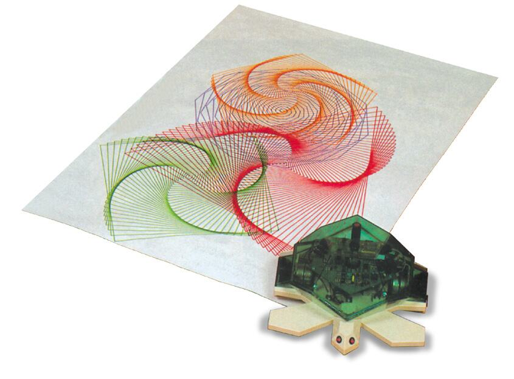
<figcaption>Photo: Valiant Technology Ltd., <a href="https://creativecommons.org/licenses/by-sa/3.0">CC BY-SA 3.0</a>, via <a href="https://commons.wikimedia.org/wiki/File:Turtle_draw.jpg">Wikimedia Commons</a>. Resized.</figcaption>
</figure>

```logo
PRINT [Hello, World!]
```

**Comments:** In UCBLogo and most other Logos, `PRINT` takes a list and prints the words with a space between them. Paste this into the listener and press Enter.

## Pascal

<figure class="hw-machine">
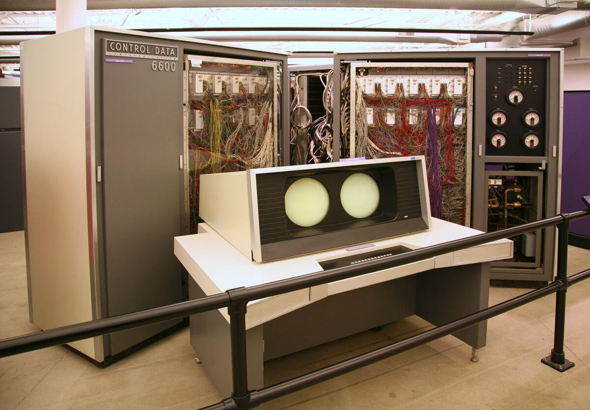
<figcaption>Photo: Jitze Couperus, <a href="https://creativecommons.org/licenses/by/2.0">CC BY 2.0</a>, via <a href="https://commons.wikimedia.org/wiki/File:CDC_6600.jc.jpg">Wikimedia Commons</a>. Resized.</figcaption>
</figure>

```pascal
program HelloWorld;
begin
  writeln('Hello, World!');
end.
```

**Comments:** Save this as `hello.pas`. The period after `end` is required. Free Pascal compiles it with `fpc hello.pas`, and `./hello` runs it.

## PDP-8

<figure class="hw-machine">
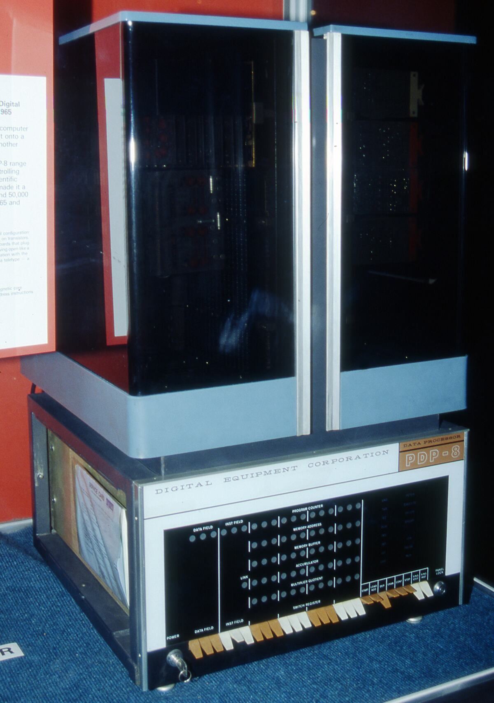
<figcaption>Photo: Kirk1013, <a href="https://creativecommons.org/licenses/by-sa/3.0">CC BY-SA 3.0</a>, via <a href="https://commons.wikimedia.org/wiki/File:DEC_PDP-8.jpg">Wikimedia Commons</a>. Resized.</figcaption>
</figure>

```pal
/ HELLO WORLD
/ PDP-8, PAL-III, console Teletype
        *200
LOOP,   CLA
        TAD I PTR
        SNA
        HLT
        TLS
WAIT,   TSF
        JMP WAIT
        ISZ PTR
        JMP LOOP
PTR,    MSG
MSG,    0110
        0105
        0114
        0114
        0117
        0040
        0127
        0117
        0122
        0114
        0104
        0015
        0012
        0000
$
```

**Comments:** PAL-III, with no disk operating system. The console is the Teletype on the standard TTY device codes. `TLS` (6046) prints the character in the accumulator and clears the flag. `TSF` (6041) skips when the printer is ready for another character. The octal words are 7-bit ASCII for `HELLO WORLD`, then a carriage return, a line feed, and a zero that stops the loop. Assemble it, load it at 0200, and start at 0200.

## PDP-10

<figure class="hw-machine">

<figcaption>Photo: Joe Mabel, <a href="https://creativecommons.org/licenses/by-sa/3.0">CC BY-SA 3.0</a>, via <a href="https://commons.wikimedia.org/wiki/File:LCM_-_DEC_PDP-10_-_01.jpg">Wikimedia Commons</a>. Resized.</figcaption>
</figure>

```macro10
        TITLE   HELLO
        SEARCH  UUOSYM

MSG:    ASCIZ   /Hello, World!
/
START:  RESET
        OUTSTR  MSG
        MONRT.
        JRST    START
        END     START
```

**Comments:** MACRO-10 under TOPS-10. `SEARCH UUOSYM` makes the monitor-call names available. `OUTSTR` types the ASCIZ string, which includes a carriage return and line feed before the null, and `MONRT.` returns to the monitor. Save it as `HELLO.MAC`, then `.COMPILE HELLO.MAC`, `.LOAD HELLO`, and `.RUN`.

## PDP-11

<figure class="hw-machine">
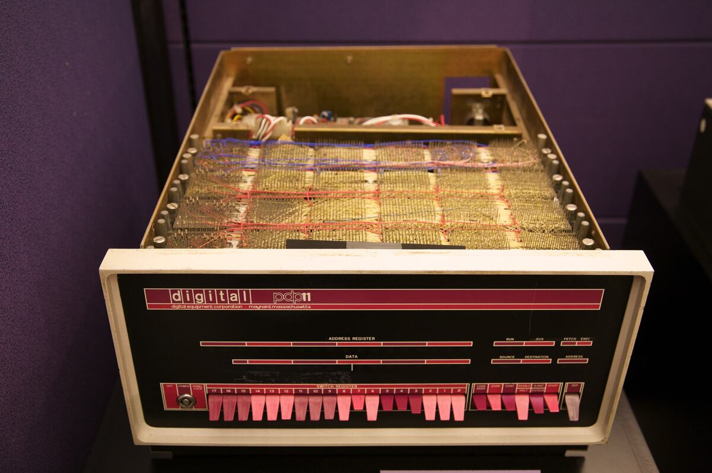
<figcaption>Photo: Todd Dailey, <a href="https://creativecommons.org/licenses/by-sa/2.0">CC BY-SA 2.0</a>, via <a href="https://commons.wikimedia.org/wiki/File:PDP-11_at_the_Computer_History_Museum.jpg">Wikimedia Commons</a>. Resized.</figcaption>
</figure>

```macro11
        .TITLE  HELLO
        .MCALL  .PRINT,.EXIT
START:  .PRINT  #MSG
        .EXIT
MSG:    .ASCII  /Hello, World!/
        .BYTE   15,12,0
        .EVEN
        .END    START
```

**Comments:** MACRO-11 under RT-11. `.PRINT` writes the string to the console, and `.EXIT` returns to the monitor. The bytes after the text are a carriage return, a line feed, and the null that ends the string.


## Processing

```processing
void setup() {
  println("Hello, World!");
}
```

**Comments:** Paste this into the Processing editor and press Run. `println` writes the line to the console under the sketch window. This is Processing's Java mode.

## Python

```python
# Break Time
# Python
# Dr. Steven B. Combs

import webbrowser
import time

def prompt_user():
	# allow variables outside of function
	global breaks, interval, web_address
	# request input 
	breaks = input('Enter number of breaks: ')
	interval = input('Enter the interval in seconds: ')
	web_address = input('Enter a URL (exlude http://): ')
	
def run_timer():
	# insert timer code here
	load_web()
	return
	
def load_web():
	webbrowser.open('http://'+web_address)
	return

prompt_user()
run_timer()
```

**Comments:** Python is a great first language; however, it does have some quirks. Indenting is important and can easily cause errors. There are times when the syntax does not make sense and concepts are not readily apparent. There is a huge user community and outstanding web resources to answer questions. It comes standard as part of a Mac OS X install. It is a useful language for both web and computer applications.

## Ruby

```ruby
puts "Hello, World!"
```

**Comments:** Save this as `hello.rb` and run `ruby hello.rb`. `puts` prints the text and a newline.

## Swift

<figure class="hw-machine">

<figcaption>Photo: Laptopsarena, <a href="https://creativecommons.org/licenses/by-sa/4.0">CC BY-SA 4.0</a>, via <a href="https://commons.wikimedia.org/wiki/File:MacBook_Pro_2019_13_inch.jpg">Wikimedia Commons</a>. Resized.</figcaption>
</figure>

```swift
print("Hello, World!")
```

**Comments:** Save this as `hello.swift` and run `swift hello.swift`. `print` writes the line.

## TI BASIC

<figure class="hw-machine">

<figcaption>Photo: Tomasz Sienicki, <a href="https://creativecommons.org/licenses/by/3.0">CC BY 3.0</a>, via <a href="https://commons.wikimedia.org/wiki/File:Texas_Instruments_TI-99_4A_(ubt).JPG">Wikimedia Commons</a>. Resized.</figcaption>
</figure>

```basic
10 PRINT "HELLO, WORLD!"
```

**Comments:** On a TI-99/4A, choose TI BASIC from the menu, type this at the `>` prompt, and enter `RUN`.

## ZX Spectrum BASIC

<figure class="hw-machine">
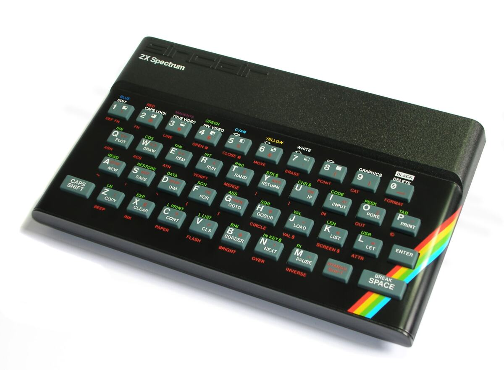
<figcaption>Photo: Bill Bertram, <a href="https://creativecommons.org/licenses/by-sa/2.5">CC BY-SA 2.5</a>, via <a href="https://commons.wikimedia.org/wiki/File:ZXSpectrum48k.jpg">Wikimedia Commons</a>. Resized.</figcaption>
</figure>

```basic
10 PRINT "Hello, World!"
```

**Comments:** Type this at the Spectrum's cursor and enter `RUN`. `PRINT` is a single keyword on the Spectrum keyboard. The string itself can be mixed case.
