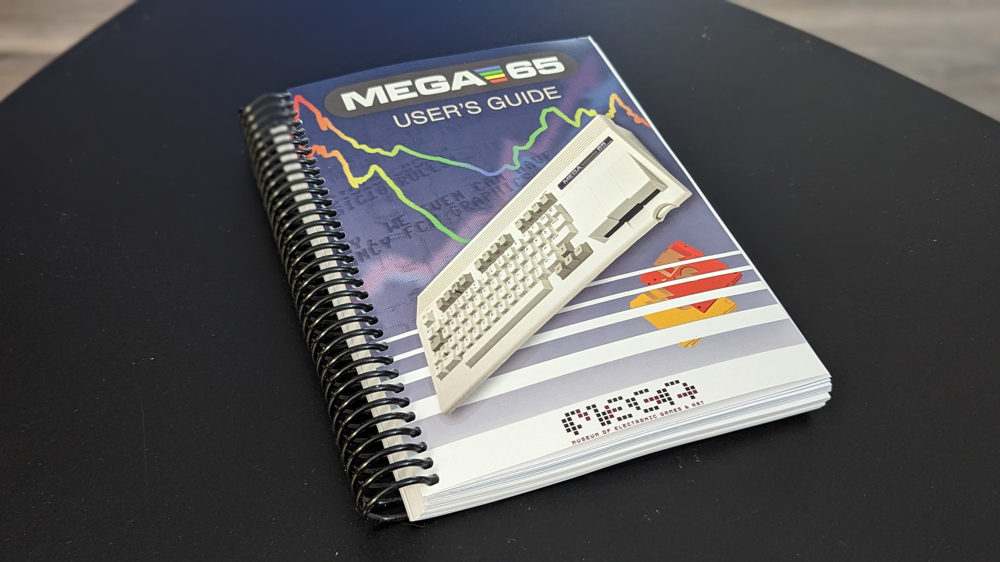




<a class="btn primary" href="{{ site.data.guide.playlist }}">Watch the MEGA65 User's Guide playlist</a>

If you find this useful, the best help is a channel membership. A tip helps too. The [supporters page](/supporters) is where I say thanks.



[Leave a tip](https://paypal.me/stevencombs)

## Chapters



## Appendices


