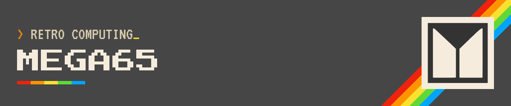

This is my start page for the MEGA≡65. I keep the User's Guide series, the downloads I actually use, and the community links in one place. Bookmark it. If something here is wrong or missing, [send me an email](mailto:retrocombs@icloud.com).

## PAGE UPDATES {#page-updates}

The latest update (2026-11-08) includes:

- A full-width layout for this page, with a jump list and grouped sections
- Current hardware, ROM, core, Xemu, and M65Connect notes, checked against the official pages
- A link pass, including Bluesky. The Amazon and PayPal links are unchanged
- Commodore computer cores, in place of Other cores and disks. Statuses checked on 8 November 2026 against cores.mega65.org and each core's GitHub repository
- The BASIC programs card is now My MEGA65 Coding
- A note that the Xemu package holds many emulators, and that xmega65 is the MEGA65 one, plus two install videos
- The museum sentence under Community is gone

The earlier update (2026-11-07) includes:

- The User's Guide chapter list, so the series starts from this page
- Link repairs where a target had moved or gone (Discord, the style guide, file host files, the keychain, mouSTer, and the Trenz shop)
- Typo and wording fixes

<strong>Jump to</strong>

<ul>
<li><a href="#get-a-mega65">Get a MEGA65</a></li>
<li><a href="#learn">Learn</a></li>
<li><a href="#my-mega65-coding">My MEGA65 Coding</a></li>
<li><a href="#software">Software and downloads</a></li>
<li><a href="#commodore-cores">Commodore computer cores</a></li>
<li><a href="#emulation">Emulation</a></li>
<li><a href="#community">Community</a></li>
<li><a href="#support">Support the channel</a></li>
</ul>

<video id="video-bg" autoplay muted loop playsinline poster="/images/mega65/mega65-rotating-poster.jpg" width="1920" height="1080"><source src="/images/mega65/mega65-rotating.mp4" type="video/mp4">
</video>

Video courtesy of [MEGA≡65](https://mega65.org)

## GET A MEGA65 {#get-a-mega65}

Trenz Electronic builds the MEGA≡65 in Germany. I checked the English shop on 8 November 2026.

The complete computer is article TE0765-07-AK. The shop listed it at US$838.95, VAT included, plus shipping. It showed 33 in stock and said it was ready to ship in about 1 to 3 workdays. That part number is the current board. The MEGA≡65 team calls this PCB revision R6A, and it uses the R6 core. An older R3 or R6 board still runs current MEGA≡65 software. You do not need a new board to keep up. Hold Restore for a second, let go, then press Help. MegaInfo shows the model.

The mainboard without the case is article TE0765-07-B. The same shop listed it at US$528.36, VAT included, plus shipping. That page showed zero in stock. You can still preorder it, and the shop said delivery time is on request. Prices and stock move, so look at the shop again before you buy.

<article class="topic-card">
Buy the computer
The complete machine, the parts shop, and the bare mainboard.
<ul>
<li><a href="https://www.trenz-electronic.de/en/MEGA65-highly-advanced-C64-and-C65-compatible-8-bit-computer/TE0765-07-AK">Complete MEGA65 at Trenz (TE0765-07-AK)</a></li>
<li><a href="https://www.trenz-electronic.de/en/Products/MEGA65/">MEGA65 shop: cases, drives, keyboards, and more</a></li>
<li><a href="https://www.trenz-electronic.de/en/MEGA65-Mainboard-without-housing/TE0765-07-B">Mainboard without the case (TE0765-07-B)</a></li>
</ul>
</article>
<article class="topic-card">
Desk gear
Shirts, a keychain, and the sticks and mice I use with the machine.
<ul>
<li><a href="https://commandshop.eu/">COMMAND webshop</a></li>
<li><a href="https://commandshop.eu/mega65-keychain">MINI MEGA65 keychain</a></li>
<li><a href="https://amzn.to/3l1CHXj">Hyperkin Trooper controller</a></li>
<li><a href="https://sordan.ie/search/?q=tank+mouse">Tank Mouse</a></li>
<li><a href="https://retrohax.net/shop/modulesandparts/mouster/">mouSTer USB mouse adapter</a></li>
<li><a href="https://amzn.to/3PiJ1JM">TheMouse</a></li>
</ul>
</article>

The Hyperkin Trooper is a remake of the classic Atari joystick with a 9-pin plug. The Tank Mouse is a remake of the 1351, and it works on USB and on the 9-pin port. An original 1351 is hard to find. The mouSTer lets a USB mouse stand in for one, which is what I want for GEOS. [Here is my mouSTer write-up](/mouster). TheMouse is the inexpensive USB mouse I pair with a mouSTer.

## LEARN {#learn}

### MY MEGA≡65 USER'S GUIDE {#users-guide}

Work through the MEGA≡65 User's Guide, chapter by chapter. Each chapter has a video, a written companion page, the commands from the episode, and links to the official manual. The appendices live on the [User's Guide series page](/mega65-users-guide).

<a class="btn primary" href="{{ "/mega65-ug-1" | relative_url }}">Start with Chapter 1</a><a class="btn ghost" href="{{ site.data.guide.playlist }}">Watch the playlist</a>



### BLOG, VIDEOS, AND PROGRAMS {#more-learning}

<article class="topic-card">
Read and watch
My posts, the full MEGA≡65 playlist, and the Intro Disk V4 write-up.
<ul>
<li><a href="/mega65-blog">MEGA65 blog posts</a></li>
<li><a href="https://www.youtube.com/playlist?list=PLRVBh2hjFTomsrJnQdqFmoZUdT6qHocpo">MEGA65 YouTube playlist</a></li>
<li><a href="/mega65-intro-disk-v4">Intro Disk V4: what it is and how to run it</a></li>
</ul>
</article>
<article class="topic-card" id="my-mega65-coding">
My MEGA65 Coding
Two small programs of mine on the file host.
<ul>
<li><a href="https://files.mega65.org?id=1813f548-7280-4b73-9112-abc24b90892b">MEGA65 Colors BASIC Demo. A short program, with sound effects, that shows the standard and extended colors.</a></li>
<li><a href="https://files.mega65.org?id=b3301095-87cf-4c9e-b954-b2922b7ee270">Submarine Tracking System Demo. My recreation of the submarine tracking program from the Commodore 128 Programmer's Reference Guide.</a></li>
<li><a href="/basic65-sub-track-update">Submarine tracking write-up</a></li>
</ul>
</article>

## SOFTWARE AND DOWNLOADS {#software}

The [MEGA≡65 File Host](https://files.mega65.org/) is where the current files live. Owners redeem a code there for the closed ROM. If you do not own a MEGA≡65 yet, you build the ROM from a diff file and a Commodore 65 ROM. I cover both below.

<article class="topic-card">
Cores
The newest numbered release is 0.97.2, published 28 September 2025. It is a compatibility patch for the R6A board. An earlier R6 board can stay on 0.97. Release 0.98 was not out when I checked. These downloads do not include the ROM. The R6 package also holds the freezer and the other SD card files.
<ul>
<li><a href="https://files.mega65.org?id=764642f7-83bc-4162-9911-99a0a6283d08">R6 core, release 0.97.2. Use this on an R6 or R6A board.</a></li>
<li><a href="https://files.mega65.org?id=8d295d12-4422-4dc4-9553-64bf424e860e">R3 core, release 0.97. DevKit and MEGA65 R3a. Published 1 May 2025.</a></li>
<li><a href="https://files.mega65.org?id=948f9d5a-cd8e-4d6a-b5ed-0285377e4c53">R2 core, release 0.97. Published 1 May 2025.</a></li>
<li><a href="https://files.mega65.org?id=a2b3c6a2-be4c-4b98-9df4-2bc14df0f222">Nexys4DDR widget core, release 0.97</a></li>
<li><a href="https://github.com/MEGA65/mega65-core/releases/tag/release-0.97.2">Release notes for 0.97.2</a></li>
</ul>
</article>
<article class="topic-card">
ROM
Stable ROM 920413 shipped with release 0.97. The ROM changelog calls it stable as of 27 April 2025. It needs the 0.97 core, or Xemu from 23 April 2025 or later. Beta ROM 920423 is the testing build. The file host copy is dated 29 October 2026. I stay on the stable ROM unless I am testing.
<ul>
<li><a href="https://files.mega65.org?ar=e9fdd71c-bf9f-4156-a728-8443c07bcceb">How to download closed ROM files</a></li>
<li><a href="https://files.mega65.org?id=fd2c40b9-f337-41f7-8a81-0254b1e09fb5">Stable ROM diff, 920413</a></li>
<li><a href="https://files.mega65.org?id=22f1eb6c-3df5-43c4-a584-e8212fc80b9d">Beta ROM diff, 920423</a></li>
<li><a href="https://github.com/MEGA65/mega65-rom-public/blob/main/CHANGELOG.md">ROM changelog</a></li>
<li><a href="https://files.mega65.org?id=0fb941fe-5c5f-4608-b0f1-32849d4a8dff">SD Card Essentials, no ROM. Version 1.2, from 18 June 2022. I do not use this for a current machine. Use the core release package instead.</a></li>
</ul>
</article>
<article class="topic-card">
Manuals and tools
The official PDFs were version 1.2 on 20 October 2026. The stable tools package is version 1.00 from 10 August 2024. Newer development builds, dated 5 October 2026, are on the file host if you need a newer m65 or mega65_ftp.
<ul>
<li><a href="https://mega65.org/user-guide">User's Guide</a></li>
<li><a href="https://mega65.org/developer-guide">Developer's Guide</a></li>
<li><a href="https://mega65.org/basic65-ref">BASIC 65 Reference</a></li>
<li><a href="https://mega65.org/chipset-ref">Chipset Reference</a></li>
<li><a href="https://mega65.org/mega65-book">Complete compendium</a></li>
<li><a href="https://mega65.org/wiki">MEGA65 Wiki</a></li>
<li><a href="https://github.com/MEGA65/mega65-user-guide/blob/master/styleguide.tex">Style guide for writers</a></li>
<li><a href="https://github.com/MEGA65">MEGA65 on GitHub</a></li>
<li><a href="https://files.mega65.org?id=57f855b9-a758-49df-ba7c-d120c4d1241d">Tools release, Mac</a></li>
<li><a href="https://files.mega65.org?id=06c55815-7826-4ad6-be0e-b8dc5e721b6d">Tools release, Windows</a></li>
<li><a href="https://files.mega65.org?id=e3ec875c-ca31-44fc-a268-ab6f9990e004">Tools release, Linux</a></li>
<li><a href="https://files.mega65.org?id=7d96641c-b306-49cf-80ff-ea1e5d00c9d1">Tools development build, Mac</a></li>
<li><a href="https://files.mega65.org?id=658322fd-e586-4b4f-a991-89470b269b4a">Tools development build, Windows</a></li>
<li><a href="https://files.mega65.org?id=2b7bd912-1181-447c-a489-223f16b764c1">Tools development build, Linux</a></li>
</ul>
</article>

### COMMODORE COMPUTER CORES {#commodore-cores}

<a class="btn primary" href="https://cores.mega65.org">cores.mega65.org</a>

These community cores are among the most requested, and they are a big part of the MEGA65's value. This is every Commodore 8-bit computer core on that list: C64, C128, VIC-20, PET, and the C16 and Plus/4. Statuses below are as of 8 November 2026. The cores site says its own list was current through 19 October 2026. I checked each GitHub repository the same day.

- [C64](https://github.com/MJoergen/C64MEGA65). Released version 5.2, published 28 April 2025. The cores site lists it with the stable computer cores. The guide for this core is [c64.mega65.org](https://c64.mega65.org/).
- [C64 version 6](https://kugelblitz360.github.io/C64MEGA65DOCS/alphasix.html). Beta, and still in progress. The cores site lists "C64 (V6 Beta)" with the work-in-progress cores and says it wants more testing. Those notes, updated 10 October 2026, say work has started on version 6.0, a release is planned for late 2026 or early 2027, and they describe Alpha 20. The same repository, [MJoergen/C64MEGA65](https://github.com/MJoergen/C64MEGA65), has tag WIP-V6-A24, tagged 7 November 2026.
- [C128](https://github.com/eilers/c128Mega65). Beta, and still in progress. The cores site says it is very complete and wants some more testing. The repository has no GitHub Release. The newest tag is V2.0 Beta 1. The commit on 8 November 2026 says "This is V2.0 Beta 1."
- [VIC-20](https://github.com/MJoergen/VIC20MEGA65). Work in progress. The cores site says it is fully functional, development is quiet, and only minor issues remain. The repository has no GitHub Releases.
- [PET](https://github.com/Rhialto/MegaPET). Released version 1.3, published 24 May 2026. The cores site lists the Commodore PET series with the stable computer cores.
- [C16 and Plus/4](https://github.com/piso77/C16-MEGA65). Released version 1.0, dated 17 April 2026 in the repository's VERSIONS file, which calls it a maintenance release. The cores site lists C16 and Plus/4 with the stable computer cores. The file host copy is [here](https://files.mega65.org?id=7a29a797-ae82-4455-8a27-f48cb856e524).
- [C16 and Plus/4 extended](https://files.mega65.org?id=04585f68-14c0-43ae-8dd5-6448445ac926). Work in progress. The cores site says this build is only on the file host, and it has no proper documentation. That row does not link a GitHub repository.

Release 0.97.2 includes Freezer 0.40. That is the freezer I use. A separate [Freezer rework on GitHub](https://github.com/M3wP/MEGA65-Freezer) is still public. The last update there was 21 June 2022, so I treat it as a side project, not the current freezer.

## EMULATION {#emulation}

No MEGA≡65 yet? Xemu is how I tell people to start. It is free, and it runs on Mac, Linux, and Windows. You still need a ROM.

<article class="topic-card">
Xemu
The Xemu package contains many emulators. xmega65 is the one used for MEGA65 emulation. The stable downloads on the Xemu page were stamped 29 January 2026 for Linux, Mac, and Windows. Use the stable (master) branch unless you are testing. The next branch is newer and less settled.
<ul>
<li><a href="https://github.lgb.hu/xemu/">Xemu download page</a></li>
<li><a href="https://github.com/lgblgblgb/xemu/">Xemu source on GitHub</a></li>
<li><a href="https://www.youtube.com/watch?v=8PbSxkYVD8I">Install and run the MEGA65 emulator, Xemu, on Mac OS X</a></li>
<li><a href="https://www.youtube.com/watch?v=z65O6bxIkaY">Install the MEGA65 Emulator on a Chromebook!</a></li>
</ul>
</article>
<article class="topic-card">
M65Connect 2.5
This is the GUI I use to move files and talk to a real MEGA≡65 over the network or a JTAG adapter. Version 2.5 is the current download on the file host, published 9 November 2025.
<ul>
<li><a href="https://files.mega65.org?id=5919a8b8-c23c-4616-9a52-37e077076638">Mac (Universal)</a></li>
<li><a href="https://files.mega65.org?id=d612d745-360e-4e86-8e15-14af525b6220">Windows (Intel)</a></li>
<li><a href="https://files.mega65.org?id=1b849d0a-2ceb-44aa-beb4-a2cdfa51eb19">Windows (ARM)</a></li>
<li><a href="https://files.mega65.org?id=c1dbc7fe-89ad-4f1d-9e72-ad3f55cf02a1">Linux (Intel)</a></li>
<li><a href="https://mega65.atlassian.net/wiki/spaces/MEGA65/pages/48365569/M65Connect">M65Connect manual</a></li>
<li><a href="https://github.com/MEGA65/m65connect">M65Connect source</a></li>
</ul>
</article>

## COMMUNITY {#community}

<article class="topic-card">
Talk to people
The Discord is the friendliest place I know for MEGA≡65 questions. It feels like an 8-bit BBS, without the wait.
<ul>
<li><a href="https://discord.gg/tVpG4yx9Yu">MEGA65 Discord</a></li>
<li><a href="https://www.forum64.de/index.php?board/457-mega65/&amp;l=2">MEGA65 on Forum64</a></li>
<li><a href="https://m65digest.substack.com/p/keeping-up-with-the-mega65?showWelcome=true">Dan's MEGA65 newsletter</a></li>
<li><a href="https://www.reddit.com/r/mega65/">MEGA65 on Reddit</a></li>
</ul>
</article>
<article class="topic-card">
Official pages
The project site, the handbook PDF, and the places the team posts.
<ul>
<li><a href="https://mega65.org">MEGA65 homepage</a></li>
<li><a href="https://mega65.org/assets/pdf/What_is_the_MEGA65.pdf">What is the MEGA65 (PDF)</a></li>
<li><a href="https://www.youtube.com/channel/UCEz3CQ343r4ssvIdmhDauMQ">MEGA65 YouTube channel</a></li>
<li><a href="https://bsky.app/profile/mega65.bsky.social">MEGA65 on Bluesky</a></li>
<li><a href="https://x.com/MEGA65Retro">MEGA65 on X</a></li>
<li><a href="https://www.facebook.com/MEGA65RetroComputer">MEGA65 on Facebook</a></li>
<li><a href="https://c65gs.blogspot.com/">Paul Gardner-Stephen's MEGA65 blog</a></li>
<li><a href="https://www.m-e-g-a.org/">Museum of Electronic Games &amp; Art</a></li>
</ul>
</article>

## SUPPORT THE CHANNEL {#support}

If the MEGA≡65 posts and videos are useful, the best help is a channel membership. A tip helps too. The [supporters page](/supporters) is where I say thanks.



[Leave a tip](https://paypal.me/stevencombs)
