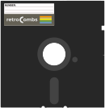




This is my start page for the Commodore Plus/4. I keep the User's Guide series, the disk image, the manual scans, and the links I actually use in one place. Bookmark it. If something here is wrong or missing, [send me an email](mailto:retrocombs@icloud.com).

## PAGE UPDATES {#page-updates}

The latest update (2026-11-08) includes:

- The User's Guide chapter list, in chapter order. A row says Page + video only when that post has a YouTube video
- A full-width layout for this page, with a jump list and grouped sections
- The Plus/4 User's Guide playlist, with the channel support links above the posts
- A pass on the resource list. Commodore4Ever is gone. Every link that remains was checked on 8 November 2026
- Wording fixes in the disk image section, including the broken file-name example
- The Key to Keys list, with a key cap for each Plus/4 key
- The small Plus/4 banner across the top of the page

<strong>Jump to</strong>

<ul>
<li><a href="#key-to-keys">Key to Keys</a></li>
<li><a href="#users-guide">User's Guide</a></li>
<li><a href="#companion-disk">Companion disk</a></li>
<li><a href="#users-manual">User's manual</a></li>
<li><a href="#plus4-resources">Plus/4 resources</a></li>
<li><a href="#support">Support the channel</a></li>
</ul>

## KEY TO KEYS {#key-to-keys}



## USER'S GUIDE {#users-guide}

### MY COMMODORE PLUS/4 USER'S GUIDE




Work through the Commodore Plus/4 User's Guide, chapter by chapter. The series follows the Plus/4 user's manual. Each chapter has a written page, and a video when the episode is on YouTube.

<a class="btn primary" href="{{ plus4_first.url | relative_url }}">Start with Chapter 1</a><a class="btn ghost" href="https://www.youtube.com/playlist?list=PLRVBh2hjFTokz1IAmxM4ERr5ZJ-zTjFgn">Watch the playlist</a>



## SUPPORT THE CHANNEL {#support}

If the Plus/4 posts and videos are useful, the best help is a channel membership. A tip helps too. The [supporters page](/supporters) is where I say thanks.



[Leave a tip](https://paypal.me/stevencombs)

The cards are the later Plus/4 posts.



## COMPANION DISK {#companion-disk}

As I work through the user's manual, I type in the sample programs and run them. The file below is a `.d81` disk image of those programs. It is marked updated as of 2021-02-13. Later chapters may not be on this copy yet.

[retroCombs User's Manual disk image](/commodore-disk-images/plus4-users-manual.d81)

I use this file name so a program is easy to find:

Sample program name: `02 RCOMBS SCROLL.PRG`

* `02` is the chapter number.
* `RCOMBS SCROLL` is the self-assigned name of the BASIC program. It is easy to spot if you are following along.

## USER'S MANUAL {#users-manual}

In the Plus/4 series I work through each chapter of the Plus/4 user's manual. The scans are below. The encyclopedia is the written companion that closes the series.

1. [Front Matter](/plus4/users-manual/p4um-title-introduction.pdf)
2. [Chapter 1 - Unpacking and Setting Up](/plus4/users-manual/p4um-chapter-1.pdf)
3. [Chapter 2 - Using the Keyboard and the Screen](/plus4/users-manual/p4um-chapter-2.pdf)
4. [Chapter 3 - Using Software](/plus4/users-manual/p4um-chapter-3.pdf)
5. [Chapter 4 - Getting Started](/plus4/users-manual/p4um-chapter-4.pdf)
6. [Chapter 5 - Numbers and Calculations](/plus4/users-manual/p4um-chapter-5.pdf)
7. [Chapter 6 - Beginning BASIC Programming](/plus4/users-manual/p4um-chapter-6.pdf)
8. [Chapter 7 - Using Graphics and Color](/plus4/users-manual/p4um-chapter-7.pdf)
9. [Chapter 8 - Making Sound and Music on the Plus/4](/plus4/users-manual/p4um-chapter-8.pdf)
10. [Commodore Plus/4 User's Manual Series, Encyclopedia](/plus4-encyclopedia)

## PLUS/4 RESOURCES {#plus4-resources}

These are the Plus/4 pages I send people to. I checked each one on 8 November 2026.

<article class="topic-card">
Plus/4 World
The archive and the forum. If you have a Plus/4, C16, or 264, start here.
<ul>
<li><a href="https://plus4world.powweb.com/">Plus/4 World. Games, tools, and documents for the Plus/4, C16, and 264.</a></li>
<li><a href="https://plus4world.powweb.com/forum">Plus/4 World forum. The community board.</a></li>
</ul>
</article>
<article class="topic-card">
Files and reference
ROMs, software, the manual, and the written specs.
<ul>
<li><a href="https://www.zimmers.net/anonftp/pub/cbm/plus4/index.html">Zimmers.net Plus/4 files. Software for the Plus/4, C16, and C116.</a></li>
<li><a href="https://www.zimmers.net/anonftp/pub/cbm/firmware/computers/plus4/">Zimmers.net 264 firmware. Kernal, BASIC 3.5, and 3+1 ROMs.</a></li>
<li><a href="https://www.zimmers.net/cbmpics/cplus4.html">Meet TED. Photo and specification page for the Plus/4.</a></li>
<li><a href="https://archive.org/details/commodore-plus-4-users-manual">Plus/4 user's manual on the Internet Archive. A complete scan.</a></li>
<li><a href="https://en.wikipedia.org/wiki/Commodore_Plus/4">Commodore Plus/4 on Wikipedia.</a></li>
<li><a href="https://www.c64-wiki.com/wiki/Plus/4">Commodore Plus/4 on the C64-Wiki.</a></li>
<li><a href="https://problemkaputt.de/pagezero.htm#c16plus4specs">Pagezero C16 and Plus/4 specifications.</a></li>
<li><a href="https://github.com/mist64/cbmsrc">Original Commodore source on GitHub, including the TED BASIC and Kernal.</a></li>
</ul>
</article>
<article class="topic-card">
Emulators
Ways to run Plus/4 software without the machine on the desk.
<ul>
<li><a href="http://yape.homeserver.hu/">YAPE. Plus/4 and C16 emulator. The site posted version 1.4.1 on 31 October 2026.</a></li>
<li><a href="https://vice-emu.sourceforge.io/">VICE. Emulates the Plus/4 along with the other Commodore 8-bit computers.</a></li>
<li><a href="https://plus4emu.sourceforge.net/">plus4emu. A portable Plus/4 and C16 emulator.</a></li>
</ul>
</article>
<article class="topic-card">
Parts
Shops I used while building the Tapuino and the Pi1541.
<ul>
<li><a href="https://www.tfw8b.com/">The Future Was 8-bit. Parts, including Tapuino boards. The shop is in the U.K., so delivery to the U.S. takes some time.</a></li>
<li><a href="https://store.go4retro.com/">RETRO Innovations. Parts I used for the Tapuino and the Pi1541.</a></li>
</ul>
</article>

